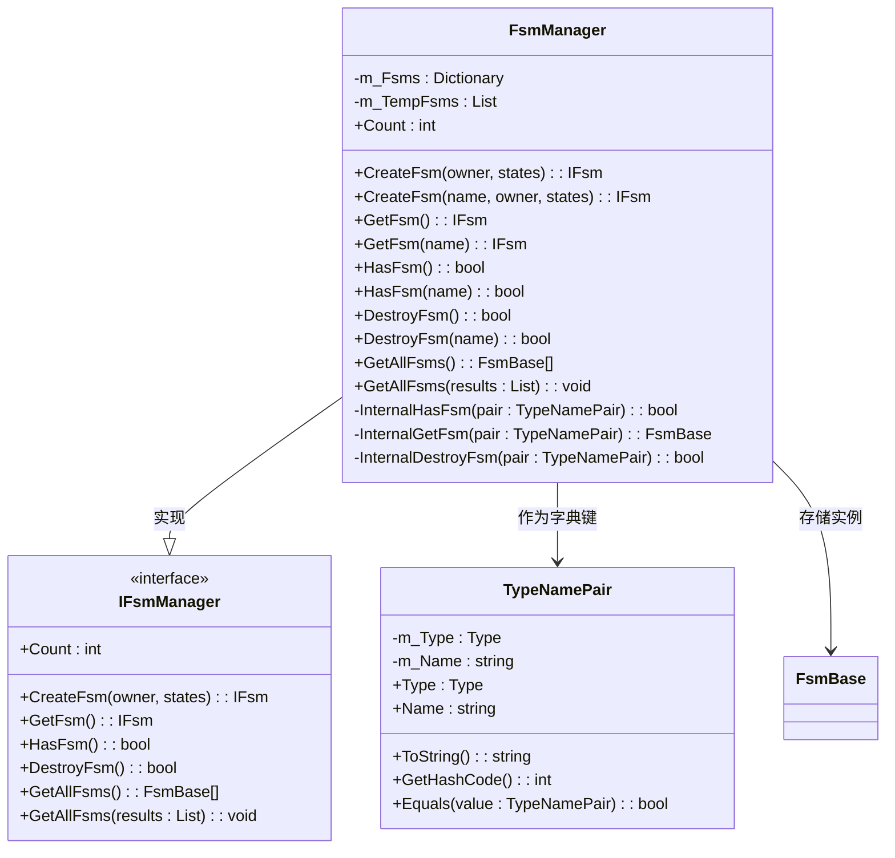

# 状态机管理器

<cite>
**Referenced Files in This Document**   
- [FsmManager.cs](file://GameFramework/Fsm/FsmManager.cs)
- [IFsmManager.cs](file://GameFramework/Fsm/IFsmManager.cs)
- [Fsm.cs](file://GameFramework/Fsm/Fsm.cs)
- [TypeNamePair.cs](file://GameFramework/Base/DataStruct/TypeNamePair.cs)
</cite>

## 目录
1. [简介](#简介)
2. [核心职责与架构](#核心职责与架构)
3. [状态机生命周期管理](#状态机生命周期管理)
4. [状态机查询与访问](#状态机查询与访问)
5. [内部机制与性能优化](#内部机制与性能优化)
6. [工程实践建议](#工程实践建议)

## 简介

`FsmManager` 是 Game Framework 框架中的核心模块之一，作为全局状态机容器，负责统一管理游戏中所有有限状态机（Finite State Machine, FSM）的创建、获取、更新与销毁。它为复杂的游戏逻辑提供了结构化的状态管理方案，确保状态机实例的高效复用与内存安全。本文档详细阐述了 `FsmManager` 的 API 设计、内部工作机制以及在复杂系统中的最佳实践。

## 核心职责与架构

`FsmManager` 实现了 `IFsmManager` 接口，作为游戏框架的模块（`GameFrameworkModule`）运行，其主要职责是作为所有状态机实例的中央注册表和调度器。



**Diagram sources**
- [FsmManager.cs](file://GameFramework/Fsm/FsmManager.cs#L15-L409)
- [IFsmManager.cs](file://GameFramework/Fsm/IFsmManager.cs#L15-L179)
- [TypeNamePair.cs](file://GameFramework/Base/DataStruct/TypeNamePair.cs#L15-L135)

**Section sources**
- [FsmManager.cs](file://GameFramework/Fsm/FsmManager.cs#L15-L409)
- [IFsmManager.cs](file://GameFramework/Fsm/IFsmManager.cs#L15-L179)

### 核心数据结构
`FsmManager` 的核心是一个 `Dictionary<TypeNamePair, FsmBase>` 类型的哈希表 `m_Fsms`，用于存储所有已创建的状态机实例。其键 `TypeNamePair` 是一个结构体，由持有者类型（`Type`）和状态机名称（`string`）组合而成，确保了状态机实例的唯一性。

### 模块优先级
`FsmManager` 的 `Priority` 属性返回值为 `1`，这意味着它在游戏框架的模块轮询序列中具有较高的优先级，会优先于大多数其他模块进行更新，确保状态机逻辑能够及时响应。

## 状态机生命周期管理

`FsmManager` 提供了完整的状态机生命周期控制 API，包括创建、获取和销毁。

### 创建状态机 (CreateFsm)

`CreateFsm` 方法用于创建并注册一个新的状态机实例。

```mermaid
sequenceDiagram
participant User as "用户代码"
participant FsmMgr as "FsmManager"
participant TypeName as "TypeNamePair"
participant Fsm as "Fsm<T>"
participant RefPool as "ReferencePool"
User->>FsmMgr : CreateFsm(name, owner, states)
FsmMgr->>TypeName : new TypeNamePair(typeof(T), name)
FsmMgr->>FsmMgr : HasFsm(name) 检查
alt 状态机已存在
FsmMgr-->>User : 抛出 GameFrameworkException
return
end
FsmMgr->>Fsm : Fsm<T>.Create(name, owner, states)
Fsm->>RefPool : ReferencePool.Acquire<Fsm<T>>()
Fsm->>Fsm : 初始化 m_Owner, m_States
Fsm->>Fsm : 调用每个 state.OnInit(fsm)
Fsm-->>FsmMgr : 返回新创建的 Fsm 实例
FsmMgr->>FsmMgr : m_Fsms.Add(typeNamePair, fsm)
FsmMgr-->>User : 返回 IFsm<T>
```

**Diagram sources**
- [FsmManager.cs](file://GameFramework/Fsm/FsmManager.cs#L253-L264)
- [Fsm.cs](file://GameFramework/Fsm/Fsm.cs#L133-L174)

**Section sources**
- [FsmManager.cs](file://GameFramework/Fsm/FsmManager.cs#L240-L297)
- [Fsm.cs](file://GameFramework/Fsm/Fsm.cs#L133-L174)

#### 方法签名
- `IFsm<T> CreateFsm<T>(T owner, params FsmState<T>[] states)`：创建一个无名状态机。
- `IFsm<T> CreateFsm<T>(string name, T owner, params FsmState<T>[] states)`：创建一个有名状态机。
- `IFsm<T> CreateFsm<T>(T owner, List<FsmState<T>> states)`：使用列表创建无名状态机。
- `IFsm<T> CreateFsm<T>(string name, T owner, List<FsmState<T>> states)`：使用列表创建有名状态机。

#### 参数说明
- `T`：状态机持有者的类型，必须是引用类型（`where T : class`）。
- `name`：状态机的名称，用于区分同一持有者类型下的多个状态机实例。如果为空字符串，则创建无名状态机。
- `owner`：状态机的持有者对象，通常是某个游戏实体或管理器。
- `states`：状态机包含的状态集合，可以是数组或列表。

#### 返回值与异常
- **返回值**：成功创建后，返回一个 `IFsm<T>` 类型的接口，用于后续操作。
- **异常**：如果指定名称的状态机已存在，将抛出 `GameFrameworkException`。

#### 使用场景
当需要为一个游戏对象（如玩家角色、敌人AI）初始化一套状态逻辑时，使用此方法。例如，为一个 `Player` 对象创建一个名为 `"Combat"` 的战斗状态机。

### 销毁状态机 (DestroyFsm)

`DestroyFsm` 方法用于销毁并从管理器中移除一个状态机实例。

```mermaid
sequenceDiagram
participant User as "用户代码"
participant FsmMgr as "FsmManager"
participant TypeName as "TypeNamePair"
participant Fsm as "FsmBase"
User->>FsmMgr : DestroyFsm<T>(name)
FsmMgr->>TypeName : new TypeNamePair(typeof(T), name)
FsmMgr->>FsmMgr : m_Fsms.TryGetValue(pair, out fsm)
alt 状态机不存在
FsmMgr-->>User : 返回 false
return
end
FsmMgr->>Fsm : fsm.Shutdown()
FsmMgr->>FsmMgr : m_Fsms.Remove(pair)
FsmMgr-->>User : 返回 true
```

**Diagram sources**
- [FsmManager.cs](file://GameFramework/Fsm/FsmManager.cs#L330-L333)
- [FsmManager.cs](file://GameFramework/Fsm/FsmManager.cs#L372-L380)

**Section sources**
- [FsmManager.cs](file://GameFramework/Fsm/FsmManager.cs#L304-L380)

#### 方法签名
- `bool DestroyFsm<T>()`：销毁指定持有者类型的无名状态机。
- `bool DestroyFsm<T>(string name)`：销毁指定持有者类型和名称的状态机。
- `bool DestroyFsm(Type ownerType, string name)`：通过 `Type` 和 `string` 销毁状态机。
- `bool DestroyFsm<T>(IFsm<T> fsm)`：通过状态机实例本身进行销毁。
- `bool DestroyFsm(FsmBase fsm)`：通过基类实例进行销毁。

#### 参数说明
- `T` / `ownerType`：要销毁的状态机的持有者类型。
- `name`：要销毁的状态机的名称。
- `fsm`：要销毁的状态机实例。

#### 返回值
- **返回值**：`bool` 类型，表示销毁操作是否成功。如果指定的状态机不存在，返回 `false`。

#### 内部流程
1.  根据输入参数构造 `TypeNamePair` 键。
2.  在 `m_Fsms` 字典中查找对应的状态机实例。
3.  如果找到，调用该实例的 `Shutdown` 方法进行清理。
4.  从字典中移除该实例。
5.  返回 `true`；如果未找到，返回 `false`。

## 状态机查询与访问

`FsmManager` 提供了多种方式来检查状态机的存在性和获取其引用。

### 检查状态机 (HasFsm)

`HasFsm` 方法用于判断一个特定的状态机是否已经存在。

#### 方法签名
- `bool HasFsm<T>()`
- `bool HasFsm<T>(string name)`
- `bool HasFsm(Type ownerType)`
- `bool HasFsm(Type ownerType, string name)`

#### 使用场景
在创建新的状态机之前，使用 `HasFsm` 进行检查，可以避免重复创建和异常抛出，实现更安全的初始化逻辑。

### 获取状态机 (GetFsm)

`GetFsm` 方法用于获取一个已存在的状态机实例的引用。

#### 方法签名
- `IFsm<T> GetFsm<T>()`
- `IFsm<T> GetFsm<T>(string name)`
- `FsmBase GetFsm(Type ownerType)`
- `FsmBase GetFsm(Type ownerType, string name)`

#### 返回值
- **返回值**：成功获取后返回状态机实例；如果不存在，则返回 `null`。

#### 使用场景
当需要在不同模块或系统中访问同一个状态机时，使用 `GetFsm` 可以避免传递状态机引用，实现松耦合。

### 获取所有状态机 (GetAllFsms)

`GetAllFsms` 方法提供了两种重载，用于获取管理器中所有的状态机实例。

#### 方法签名
- `FsmBase[] GetAllFsms()`：返回一个包含所有状态机的新数组。
- `void GetAllFsms(List<FsmBase> results)`：将所有状态机填充到传入的 `List<FsmBase>` 中。

#### 使用场景
用于全局状态监控、批量更新或调试目的。

## 内部机制与性能优化

### 对象池与引用管理
`FsmManager` 本身不直接管理状态机对象的池化，但其创建的状态机 `Fsm<T>` 实例是通过 `ReferencePool`（引用池）来获取和释放的。当调用 `CreateFsm` 时，`Fsm<T>.Create` 方法会从 `ReferencePool.Acquire<Fsm<T>>()` 获取一个实例；当调用 `DestroyFsm` 时，`Fsm` 的 `Shutdown` 方法会调用 `ReferencePool.Release(this)` 将实例归还到池中。这种设计极大地减少了频繁的 `new` 和 `GC` 操作，有效控制了内存开销。

### 高效的更新机制
`FsmManager` 的 `Update` 方法实现了高效的批量更新。它使用一个临时列表 `m_TempFsms` 来缓存所有状态机实例的引用，然后遍历这个列表进行更新。这种设计避免了在遍历字典 `m_Fsms` 的过程中，因其他线程或代码修改字典（如创建或销毁状态机）而导致的 `InvalidOperationException`（集合被修改）。同时，它也过滤掉了已被标记为销毁的实例，确保了更新的安全性。

### 唯一性保证
通过 `TypeNamePair` 结构体作为字典的键，`FsmManager` 确保了在同一个持有者类型下，不能存在两个同名的状态机。这为状态机的管理和查找提供了坚实的基础。

## 工程实践建议

1.  **命名规范**：为状态机赋予有意义的名称，例如 `"Player_Movement"`、`"Enemy_AI"`，这有助于在调试和日志中快速定位问题。
2.  **生命周期管理**：确保在持有者对象被销毁时，也调用 `DestroyFsm` 来清理对应的状态机，防止内存泄漏。
3.  **避免频繁创建/销毁**：对于需要频繁切换的逻辑，考虑使用状态机内部的状态切换，而不是反复创建和销毁整个状态机实例。
4.  **利用对象池优势**：理解 `ReferencePool` 的工作原理，可以放心地按需创建状态机，框架会自动处理底层的内存复用。
5.  **多状态机并行**：`FsmManager` 的设计天然支持多状态机并行。例如，一个角色可以同时拥有一个 `MovementFsm` 和一个 `AnimationFsm`，它们由 `FsmManager` 统一调度，互不干扰。