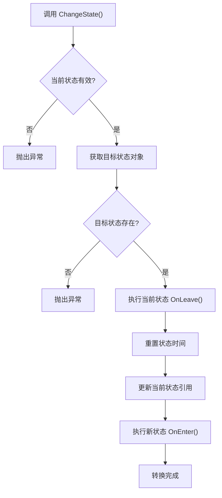
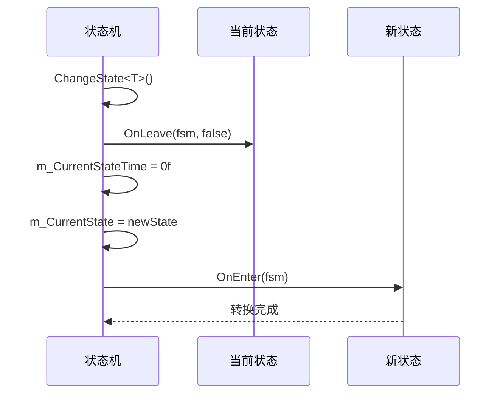

# 状态转换机制

<cite>
**Referenced Files in This Document**  
- [Fsm.cs](file://GameFramework/Fsm/Fsm.cs)
- [FsmState.cs](file://GameFramework/Fsm/FsmState.cs)
</cite>

## 目录
1. [状态转换机制](#状态转换机制)
2. [核心状态转换方法](#核心状态转换方法)
3. [状态生命周期回调](#状态生命周期回调)
4. [状态跳转流程与顺序](#状态跳转流程与顺序)
5. [错误检测与调试支持](#错误检测与调试支持)
6. [外部事件驱动的状态迁移](#外部事件驱动的状态迁移)
7. [立即与延迟转换处理](#立即与延迟转换处理)

## 核心状态转换方法

状态转换机制的核心由 `Fsm` 类中的 `ChangeState` 和 `Start` 方法实现。`ChangeState` 方法负责在有限状态机运行过程中切换状态，而 `Start` 方法用于启动状态机并进入初始状态。

`ChangeState` 方法存在两个重载版本：泛型版本和类型参数版本。泛型版本通过类型参数直接指定目标状态类型，而类型参数版本则接收 `Type` 对象作为目标状态的标识。两个版本最终都调用相同的内部逻辑来完成状态切换。

`Start` 方法同样提供泛型和类型参数两种调用方式，用于初始化状态机并进入第一个状态。该方法会检查状态机是否已在运行，防止重复启动。

**Section sources**
- [Fsm.cs](file://GameFramework/Fsm/Fsm.cs#L559-L585)
- [Fsm.cs](file://GameFramework/Fsm/Fsm.cs#L255-L303)

## 状态生命周期回调

状态机通过 `FsmState` 基类定义了完整的状态生命周期回调方法，包括 `OnInit`、`OnEnter`、`OnUpdate`、`OnLeave` 和 `OnDestroy`。这些方法在状态机的相应阶段被调用，为状态提供执行自定义逻辑的机会。

`OnEnter` 方法在状态被激活时调用，通常用于初始化该状态特有的资源或逻辑。`OnLeave` 方法在状态被退出时调用，用于清理资源或保存状态数据。`OnUpdate` 方法在每个逻辑帧被调用，用于处理状态的持续逻辑。

**Section sources**
- [FsmState.cs](file://GameFramework/Fsm/FsmState.cs#L36-L38)
- [FsmState.cs](file://GameFramework/Fsm/FsmState.cs#L55-L57)

## 状态跳转流程与顺序

状态跳转遵循严格的执行顺序，确保状态转换的可靠性和可预测性。当调用 `ChangeState` 方法时，系统首先验证当前状态的有效性，然后获取目标状态对象。

转换过程的核心顺序为：先调用当前状态的 `OnLeave` 方法，然后重置状态持续时间计数器，更新当前状态引用，最后调用新状态的 `OnEnter` 方法。这种"先离开，后进入"的模式保证了状态间的数据隔离和资源管理。

**Diagram sources**
- [Fsm.cs](file://GameFramework/Fsm/Fsm.cs#L568-L585)

**Section sources**
- [Fsm.cs](file://GameFramework/Fsm/Fsm.cs#L568-L585)

## 错误检测与调试支持

系统内置了完善的错误检测机制，能够在状态转换过程中及时发现并报告问题。当尝试转换到不存在的状态时，系统会通过 `GetState` 方法的返回值进行检查，并抛出带有详细信息的 `GameFrameworkException` 异常。

此外，系统还会验证状态类型的有效性，确保目标状态类型继承自 `FsmState<T>`。对于非法操作，如在状态机未运行时尝试转换状态，系统也会抛出相应的异常，帮助开发者快速定位问题。

**Section sources**
- [Fsm.cs](file://GameFramework/Fsm/Fsm.cs#L568-L585)

## 外部事件驱动的状态迁移

状态迁移可以通过外部事件或内部逻辑触发。`FsmState` 基类提供了 `ChangeState` 保护方法，允许状态内部根据特定条件触发状态转换。例如，基于输入事件、计时器超时或游戏特定事件，状态可以调用 `ChangeState` 方法来请求转换到新状态。

这种设计模式使得状态能够响应外部刺激，实现复杂的行为逻辑。例如，一个"巡逻"状态可以在检测到玩家时转换到"追击"状态，而"追击"状态在失去目标一段时间后可以转换回"巡逻"状态。

**Section sources**
- [FsmState.cs](file://GameFramework/Fsm/FsmState.cs#L75-L97)

## 立即与延迟转换处理

当前实现采用立即转换模式，状态转换在 `ChangeState` 方法调用后立即执行。系统不支持延迟转换，所有状态变更都是同步完成的。这种设计确保了状态机行为的确定性和可预测性。

在 `Update` 方法中，系统会检查当前状态是否存在，如果存在则调用其 `OnUpdate` 方法并增加状态持续时间。这种轮询机制与立即转换相结合，形成了一个稳定的状态管理循环。

**Diagram sources**
- [Fsm.cs](file://GameFramework/Fsm/Fsm.cs#L568-L585)
- [FsmState.cs](file://GameFramework/Fsm/FsmState.cs#L36-L38)
- [FsmState.cs](file://GameFramework/Fsm/FsmState.cs#L55-L57)