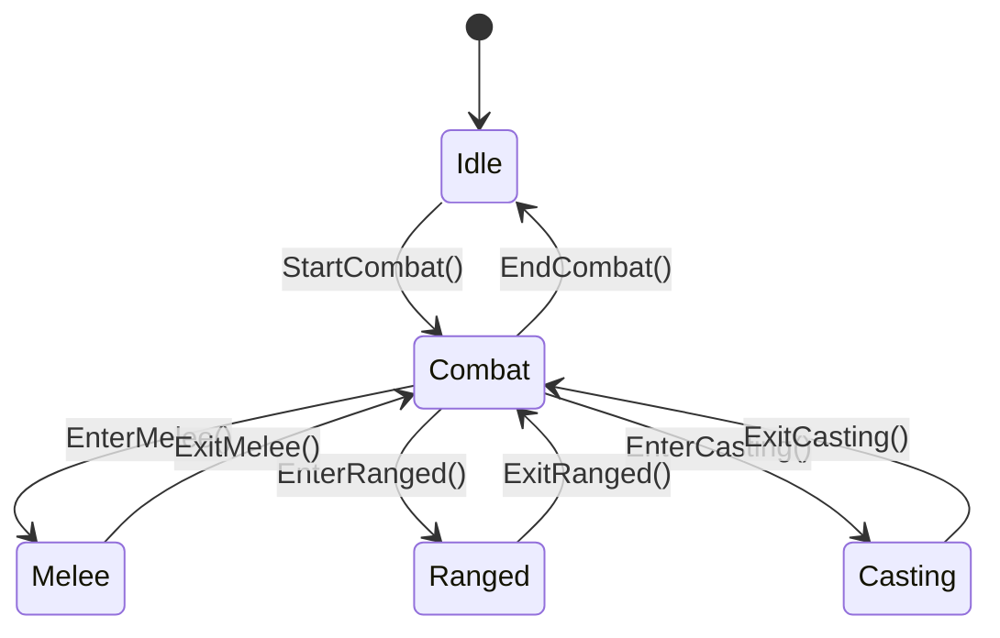
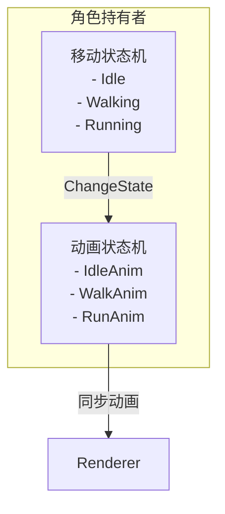
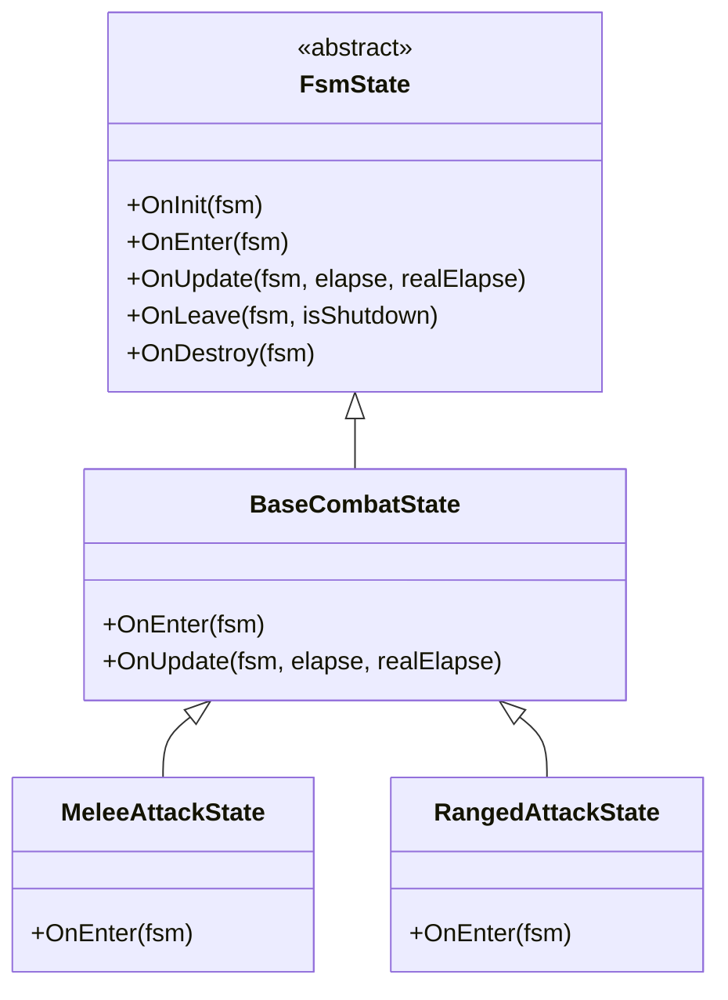
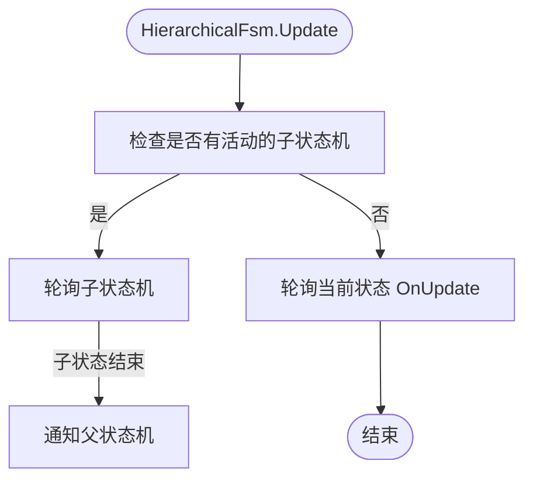
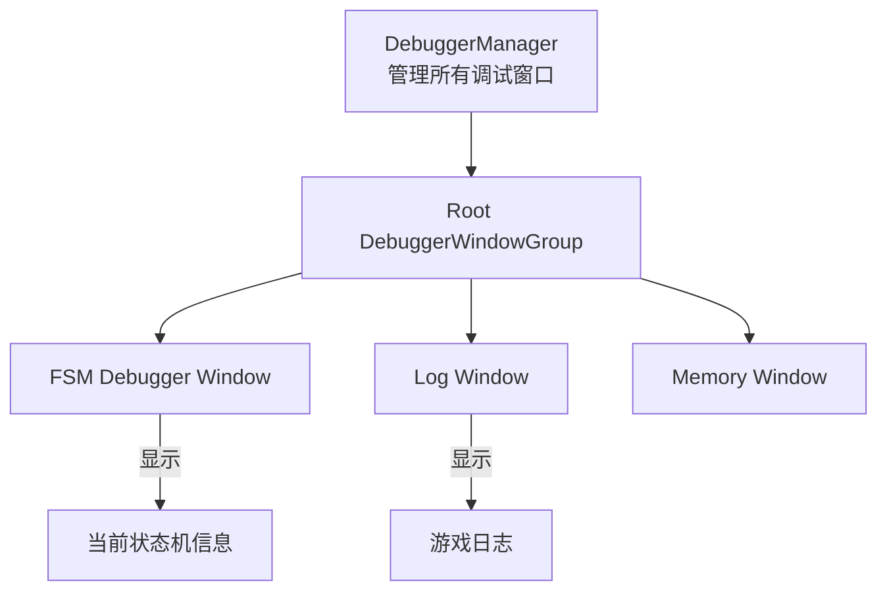
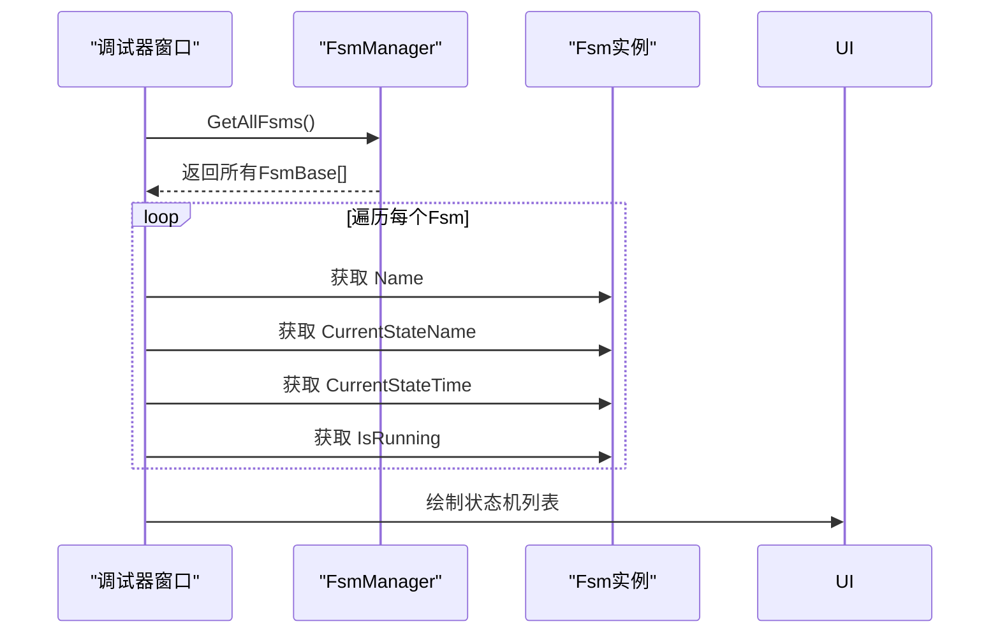
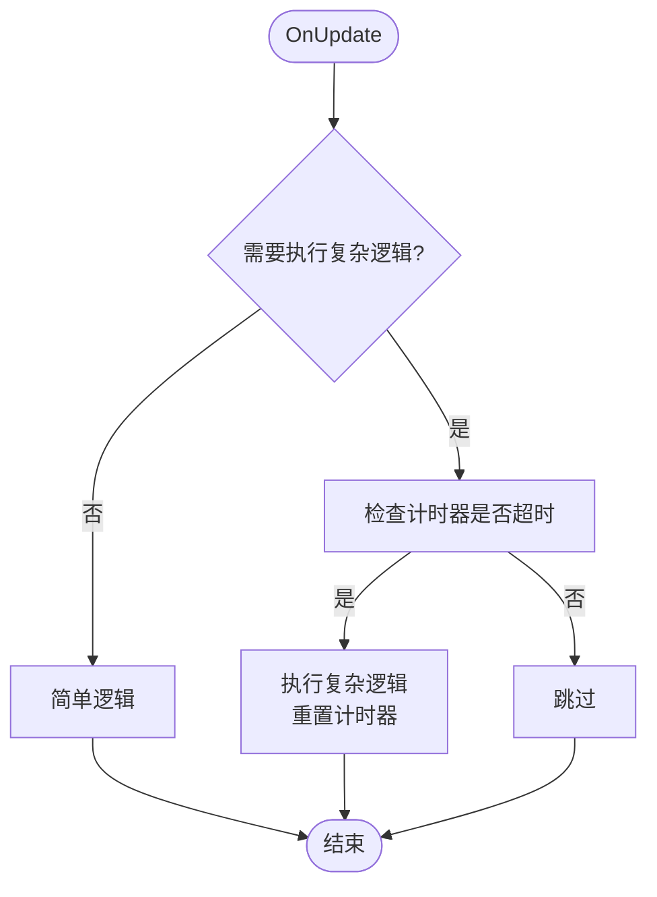

# 高级应用与调试

<cite>
**本文档中引用的文件**  
- [FsmBase.cs](file://GameFramework/Fsm/FsmBase.cs)
- [Fsm.cs](file://GameFramework/Fsm/Fsm.cs)
- [FsmState.cs](file://GameFramework/Fsm/FsmState.cs)
- [IFsm.cs](file://GameFramework/Fsm/IFsm.cs)
- [FsmManager.cs](file://GameFramework/Fsm/FsmManager.cs)
- [DebuggerManager.cs](file://GameFramework/Debugger/DebuggerManager.cs)
- [IDebuggerManager.cs](file://GameFramework/Debugger/IDebuggerManager.cs)
- [IDebuggerWindow.cs](file://GameFramework/Debugger/IDebuggerWindow.cs)
- [DebuggerManager.DebuggerWindowGroup.cs](file://GameFramework/Debugger/DebuggerManager.DebuggerWindowGroup.cs)
</cite>

## 目录
1. [引言](#引言)
2. [复杂状态机模式实现](#复杂状态机模式实现)
3. [扩展FsmBase支持复杂控制流](#扩展fsmbase支持复杂控制流)
4. [调试器模块集成与运行时监控](#调试器模块集成与运行时监控)
5. [性能剖析与优化技巧](#性能剖析与优化技巧)
6. [常见陷阱与解决方案](#常见陷阱与解决方案)
7. [结论](#结论)

## 引言
本文档旨在深入探讨基于GameFramework的状态机系统在高级场景下的应用方法。重点涵盖嵌套状态机、并行状态机、子状态继承等复杂模式的实现机制，以及如何通过扩展`FsmBase`类来支持更复杂的控制流逻辑。同时，结合内置的调试器模块，详细说明如何实时监控状态机的运行状态、记录状态切换日志，并可视化当前状态路径。此外，文档还提供了性能剖析技巧，帮助开发者避免频繁状态切换和减少`OnUpdate`开销，并列举了诸如循环跳转、空状态引用等常见陷阱及其解决方案。

**Section sources**
- [FsmBase.cs](file://GameFramework/Fsm/FsmBase.cs)
- [Fsm.cs](file://GameFramework/Fsm/Fsm.cs)
- [FsmManager.cs](file://GameFramework/Fsm/FsmManager.cs)

## 复杂状态机模式实现

### 嵌套状态机
嵌套状态机（Hierarchical State Machine, HSM）允许一个状态内部包含另一个完整的状态机，从而实现更精细的状态划分和逻辑复用。在GameFramework中，可以通过在`FsmState`的子类中创建并管理另一个`Fsm<T>`实例来实现。

例如，一个角色的“战斗”状态可以作为一个主状态机，其内部可以嵌套“近战”、“远程”、“施法”等子状态机。当角色进入“战斗”状态时，启动嵌套的战斗状态机；当离开“战斗”状态时，关闭该嵌套状态机。



**Diagram sources**
- [FsmState.cs](file://GameFramework/Fsm/FsmState.cs#L36-L57)
- [Fsm.cs](file://GameFramework/Fsm/Fsm.cs#L130-L145)

### 并行状态机
并行状态机允许两个或多个状态机同时运行，适用于需要并行处理多个独立逻辑的场景（如角色的移动状态和动画状态）。GameFramework本身不直接提供并行状态机的抽象，但可以通过为同一持有者（Owner）创建多个独立的`Fsm<T>`实例来实现。

例如，可以为一个角色创建一个`MovementFsm`和一个`AnimationFsm`，它们共享同一个角色对象作为持有者，但各自管理独立的状态逻辑。`FsmManager`会自动轮询所有已创建的状态机，确保它们并行执行。



**Diagram sources**
- [FsmManager.cs](file://GameFramework/Fsm/FsmManager.cs#L100-L115)
- [Fsm.cs](file://GameFramework/Fsm/Fsm.cs#L16-L586)

### 子状态继承
子状态继承利用了面向对象的继承特性。通过定义一个基类状态（Base State），然后让具体的状态类继承该基类，可以实现代码复用和行为扩展。

例如，定义一个`BaseCombatState`，其中包含所有战斗状态共有的逻辑（如播放攻击音效、消耗体力）。然后，`MeleeAttackState`和`RangedAttackState`继承`BaseCombatState`，并重写`OnEnter`或`OnUpdate`方法以实现各自的特有逻辑。



**Diagram sources**
- [FsmState.cs](file://GameFramework/Fsm/FsmState.cs#L15-L108)
- [Fsm.cs](file://GameFramework/Fsm/Fsm.cs#L16-L586)

**Section sources**
- [FsmState.cs](file://GameFramework/Fsm/FsmState.cs#L15-L108)
- [Fsm.cs](file://GameFramework/Fsm/Fsm.cs#L16-L586)

## 扩展FsmBase支持复杂控制流

`FsmBase`是所有状态机的抽象基类，定义了状态机的核心接口和属性。虽然`Fsm<T>`是其主要实现，但开发者可以通过继承`FsmBase`来创建自定义的、支持更复杂控制流的状态机。

例如，可以创建一个`HierarchicalFsm<T>`类，继承`FsmBase`，并添加对父状态机和子状态机的引用。在`Update`方法中，不仅轮询当前状态，还可以根据需要轮询其子状态机或通知父状态机。



通过这种方式，可以实现状态机的层级化管理，构建出树状或网状的复杂状态结构，从而支持更高级的游戏逻辑。

**Section sources**
- [FsmBase.cs](file://GameFramework/Fsm/FsmBase.cs#L14-L111)
- [Fsm.cs](file://GameFramework/Fsm/Fsm.cs#L16-L586)

## 调试器模块集成与运行时监控

### 调试器架构
GameFramework的调试器模块提供了一个可扩展的UI框架，用于在运行时监控和调试游戏。其核心是`DebuggerManager`，它管理着一个由`IDebuggerWindow`构成的树状结构（`IDebuggerWindowGroup`）。



**Diagram sources**
- [DebuggerManager.cs](file://GameFramework/Debugger/DebuggerManager.cs#L12-L141)
- [IDebuggerManager.cs](file://GameFramework/Debugger/IDebuggerManager.cs#L12-L59)
- [DebuggerManager.DebuggerWindowGroup.cs](file://GameFramework/Debugger/DebuggerManager.DebuggerWindowGroup.cs#L11-L305)

### 监控状态机运行时状态
要监控状态机，首先需要创建一个实现`IDebuggerWindow`接口的调试窗口类。该类的`OnDraw`方法负责绘制UI，可以调用`FsmManager.GetAllFsms()`获取所有状态机实例，并遍历它们以显示其名称、当前状态、状态持续时间等信息。



**Diagram sources**
- [FsmManager.cs](file://GameFramework/Fsm/FsmManager.cs#L100-L115)
- [FsmBase.cs](file://GameFramework/Fsm/FsmBase.cs#L87-L98)
- [IDebuggerWindow.cs](file://GameFramework/Debugger/IDebuggerWindow.cs#L45-L45)

### 记录状态切换日志
可以在`FsmState`的`OnEnter`和`OnLeave`方法中添加日志记录。通过`GameFrameworkLog`，可以将状态切换事件输出到控制台或日志文件。

```csharp
protected internal override void OnEnter(IFsm<Character> fsm)
{
    GameFrameworkLog.Info($"进入状态: {this.GetType().Name}");
    // ... 其他逻辑
}
```

### 可视化当前状态路径
调试窗口可以提供一个“状态路径”视图，显示从初始状态到当前状态的完整切换历史。这需要在状态机或状态类中维护一个状态切换的栈或列表，并在`ChangeState`时进行记录。

**Section sources**
- [Fsm.cs](file://GameFramework/Fsm/Fsm.cs#L550-L580)
- [FsmState.cs](file://GameFramework/Fsm/FsmState.cs#L36-L57)
- [DebuggerManager.cs](file://GameFramework/Debugger/DebuggerManager.cs#L125-L128)
- [IDebuggerWindow.cs](file://GameFramework/Debugger/IDebuggerWindow.cs#L40-L45)

## 性能剖析与优化技巧

### 避免频繁状态切换
频繁的状态切换会导致`OnLeave`和`OnEnter`方法被反复调用，产生不必要的开销。应通过添加状态切换的条件判断来避免。

**优化前:**
```csharp
// 每帧都检查，可能导致频繁切换
void Update() {
    if (health < 50) ChangeState<LowHealthState>();
    else ChangeState<NormalHealthState>();
}
```

**优化后:**
```csharp
private bool isInLowHealth = false;
void Update() {
    if (health < 50 && !isInLowHealth) {
        ChangeState<LowHealthState>();
        isInLowHealth = true;
    } else if (health >= 50 && isInLowHealth) {
        ChangeState<NormalHealthState>();
        isInLowHealth = false;
    }
}
```

### 减少OnUpdate开销
`OnUpdate`方法每帧调用，应避免在此方法中执行耗时操作（如字符串拼接、内存分配、复杂计算）。

**优化建议:**
- 使用对象池（`ReferencePool`）避免在`OnUpdate`中创建临时对象。
- 将复杂的计算逻辑移到事件驱动或定时触发的回调中。
- 使用布尔标志位来控制某些逻辑的执行频率（例如，每0.5秒检查一次）。



**Section sources**
- [Fsm.cs](file://GameFramework/Fsm/Fsm.cs#L530-L545)
- [FsmState.cs](file://GameFramework/Fsm/FsmState.cs#L46-L48)

## 常见陷阱与解决方案

### 循环跳转
状态A切换到状态B，状态B又立即切换回状态A，形成无限循环，导致程序卡死。

**解决方案:**
- 在状态切换前增加延迟或条件判断。
- 使用状态机的`CurrentStateTime`属性，确保状态至少持续一定时间。
- 在调试器中设置断点，检查`ChangeState`的调用栈。

### 空状态引用
尝试获取一个不存在的状态（`GetState<T>()`返回null）或切换到一个未注册的状态，会导致`NullReferenceException`。

**解决方案:**
- 在调用`GetState`或`ChangeState`前，使用`HasState<T>()`进行检查。
- 在`Fsm.Create`时确保所有需要的状态都已正确添加。
- 使用异常处理机制进行兜底。

```csharp
if (fsm.HasState<CombatState>()) {
    fsm.ChangeState<CombatState>();
} else {
    GameFrameworkLog.Warning("CombatState 未注册!");
}
```

**Section sources**
- [Fsm.cs](file://GameFramework/Fsm/Fsm.cs#L250-L260)
- [Fsm.cs](file://GameFramework/Fsm/Fsm.cs#L560-L570)

## 结论
通过深入理解GameFramework状态机系统的内部机制，开发者可以灵活地实现嵌套、并行等复杂状态模式，并通过扩展`FsmBase`来满足特定的业务需求。集成调试器模块是开发和维护复杂状态逻辑的关键，它提供了强大的运行时监控能力。最后，遵循性能优化的最佳实践并警惕常见陷阱，能够确保状态机系统高效、稳定地运行。