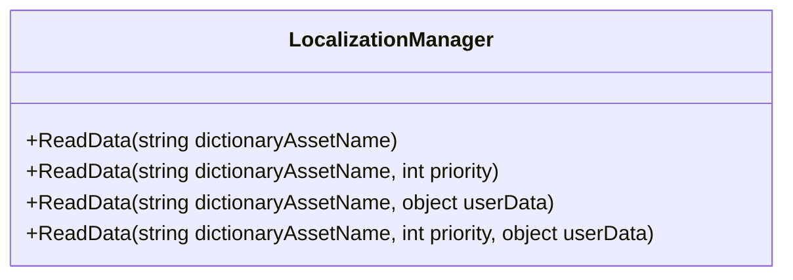
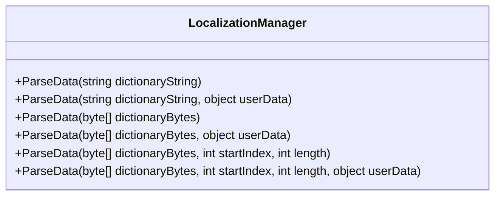
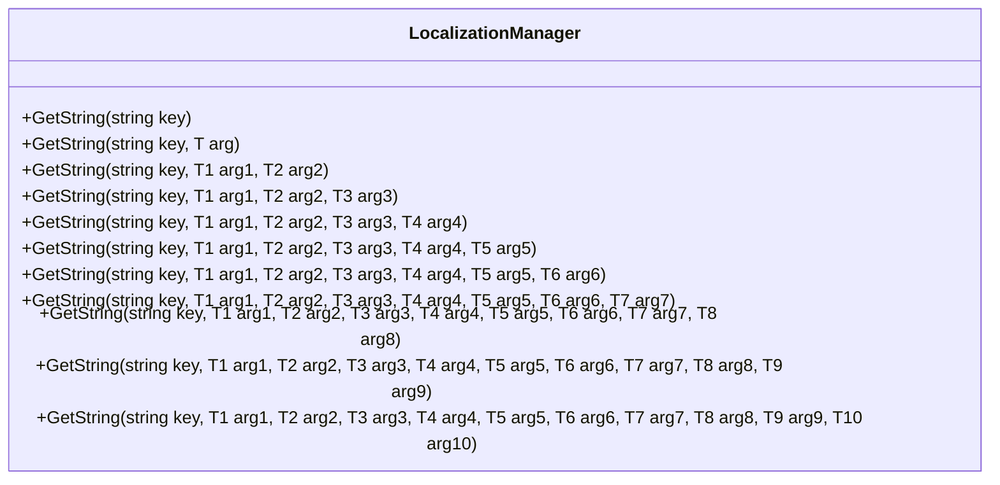
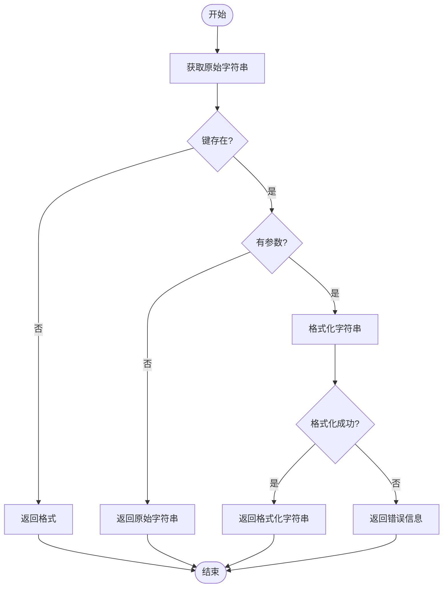
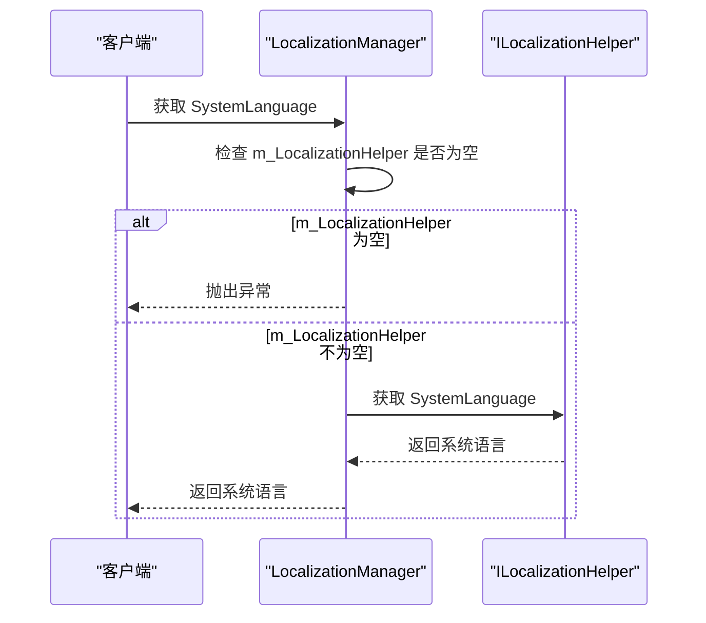
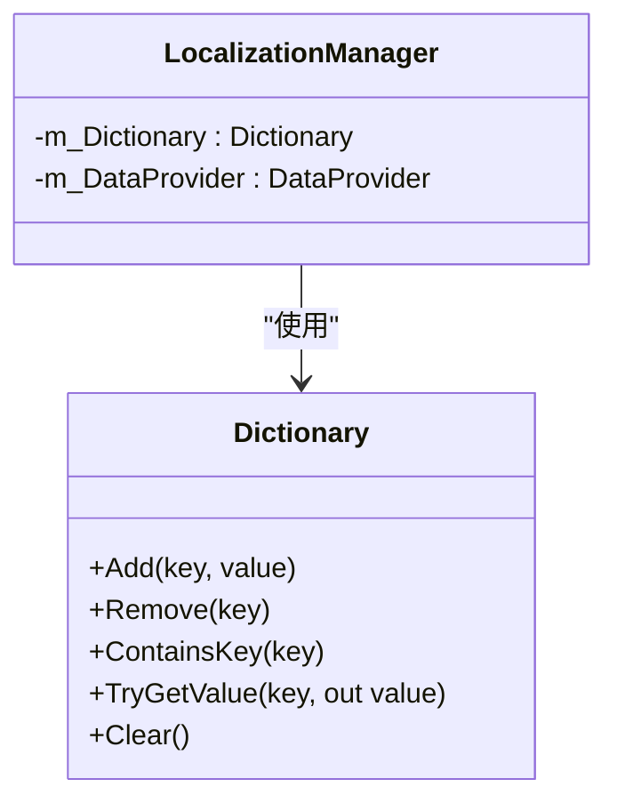

# 本地化

<cite>
**Referenced Files in This Document**   
- [ILocalizationManager.cs](file://GameFramework/Localization/ILocalizationManager.cs)
- [LocalizationManager.cs](file://GameFramework/Localization/LocalizationManager.cs)
- [Language.cs](file://GameFramework/Localization/Language.cs)
</cite>

## 目录
1. [简介](#简介)
2. [核心接口与枚举](#核心接口与枚举)
3. [本地化文本加载与解析](#本地化文本加载与解析)
4. [文本获取与格式化](#文本获取与格式化)
5. [动态语言切换](#动态语言切换)
6. [缓存机制](#缓存机制)
7. [最佳实践](#最佳实践)

## 简介

本地化系统是游戏框架中用于支持多语言功能的核心模块。该系统通过 `ILocalizationManager` 接口和 `LocalizationManager` 实现类，提供了完整的多语言支持能力，包括文本翻译、语言切换、资源本地化等功能。系统设计遵循模块化原则，通过数据提供者模式实现本地化数据的加载与管理，支持从资源文件中读取字典数据，并提供高效的文本获取与格式化功能。

本地化系统的主要特性包括：
- 支持多种语言，通过 `Language` 枚举定义所有可用语言
- 提供灵活的文本获取接口，支持参数化字符串格式化
- 实现高效的字典缓存机制，确保文本访问性能
- 支持动态语言切换，允许在运行时更改当前语言
- 提供完整的事件系统，便于监控本地化操作状态

## 核心接口与枚举

### ILocalizationManager 接口

`ILocalizationManager` 是本地化管理器的核心接口，定义了所有本地化功能的基本操作。该接口继承自 `IDataProvider<ILocalizationManager>`，表明本地化管理器本质上是一个数据提供者，负责管理本地化数据的加载和访问。

**主要属性：**
- `Language Language`：获取或设置当前本地化语言
- `Language SystemLanguage`：获取系统语言
- `int DictionaryCount`：获取字典数量
- `int CachedBytesSize`：获取缓冲二进制流的大小

**主要方法：**
- `SetResourceManager`：设置资源管理器
- `SetDataProviderHelper`：设置本地化数据提供者辅助器
- `SetLocalizationHelper`：设置本地化辅助器
- `EnsureCachedBytesSize`：确保二进制流缓存分配足够内存
- `FreeCachedBytes`：释放缓存的二进制流
- `GetString`：根据字典主键获取字典内容字符串（支持多个重载版本）
- `HasRawString`：检查是否存在指定字典
- `GetRawString`：根据字典主键获取字典值
- `AddRawString`：增加字典
- `RemoveRawString`：移除字典
- `RemoveAllRawStrings`：清空所有字典

**Section sources**
- [ILocalizationManager.cs](file://GameFramework/Localization/ILocalizationManager.cs#L14-L502)

### Language 枚举

`Language` 枚举定义了系统支持的所有语言类型，为多语言功能提供了基础支持。该枚举采用字节类型作为底层数据类型，优化内存使用。

**支持的语言包括：**
- 南非荷兰语 (Afrikaans)
- 阿尔巴尼亚语 (Albanian)
- 阿拉伯语 (Arabic)
- 巴斯克语 (Basque)
- 白俄罗斯语 (Belarusian)
- 保加利亚语 (Bulgarian)
- 加泰罗尼亚语 (Catalan)
- 简体中文 (ChineseSimplified)
- 繁体中文 (ChineseTraditional)
- 克罗地亚语 (Croatian)
- 捷克语 (Czech)
- 丹麦语 (Danish)
- 荷兰语 (Dutch)
- 英语 (English)
- 爱沙尼亚语 (Estonian)
- 法罗语 (Faroese)
- 芬兰语 (Finnish)
- 法语 (French)
- 格鲁吉亚语 (Georgian)
- 德语 (German)
- 希腊语 (Greek)
- 希伯来语 (Hebrew)
- 匈牙利语 (Hungarian)
- 冰岛语 (Icelandic)
- 印尼语 (Indonesian)
- 意大利语 (Italian)
- 日语 (Japanese)
- 韩语 (Korean)
- 拉脱维亚语 (Latvian)
- 立陶宛语 (Lithuanian)
- 马其顿语 (Macedonian)
- 马拉雅拉姆语 (Malayalam)
- 挪威语 (Norwegian)
- 波斯语 (Persian)
- 波兰语 (Polish)
- 巴西葡萄牙语 (PortugueseBrazil)
- 葡萄牙语 (PortuguesePortugal)
- 罗马尼亚语 (Romanian)
- 俄语 (Russian)
- 塞尔维亚克罗地亚语 (SerboCroatian)
- 塞尔维亚西里尔语 (SerbianCyrillic)
- 塞尔维亚拉丁语 (SerbianLatin)
- 斯洛伐克语 (Slovak)
- 斯洛文尼亚语 (Slovenian)
- 西班牙语 (Spanish)
- 瑞典语 (Swedish)
- 泰语 (Thai)
- 土耳其语 (Turkish)
- 乌克兰语 (Ukrainian)
- 越南语 (Vietnamese)

**Section sources**
- [Language.cs](file://GameFramework/Localization/Language.cs#L12-L268)

## 本地化文本加载与解析

### 文本加载机制

本地化系统通过 `ReadData` 方法实现字典数据的加载。该方法有多个重载版本，支持不同的参数组合：



**Diagram sources**
- [LocalizationManager.cs](file://GameFramework/Localization/LocalizationManager.cs#L221-L255)

所有 `ReadData` 方法最终都委托给内部的 `m_DataProvider` 对象执行实际的数据读取操作。这种设计实现了关注点分离，将数据加载逻辑与本地化管理器的核心功能解耦。

### 文本解析流程

系统提供了多种 `ParseData` 方法用于解析本地化数据，支持不同的数据源格式：



**Diagram sources**
- [LocalizationManager.cs](file://GameFramework/Localization/LocalizationManager.cs#L262-L322)

解析流程的核心是将外部数据源（字符串或字节数组）转换为内部字典结构。系统通过 `m_DataProvider` 的 `ParseData` 方法完成实际的解析工作，然后将解析结果存储在内部的 `m_Dictionary` 中。

**Section sources**
- [LocalizationManager.cs](file://GameFramework/Localization/LocalizationManager.cs#L221-L322)

## 文本获取与格式化

### 文本获取机制

本地化系统提供了丰富的 `GetString` 方法重载，支持从简单到复杂的各种文本获取场景：



**Diagram sources**
- [LocalizationManager.cs](file://GameFramework/Localization/LocalizationManager.cs#L329-L635)

### 文本格式化流程

文本获取流程遵循以下步骤：
1. 调用 `GetRawString` 方法从内部字典中获取原始字符串
2. 如果键不存在，返回格式化的错误信息 `<NoKey>{key}`
3. 如果存在参数，使用 `Utility.Text.Format` 方法进行字符串格式化
4. 处理格式化异常，返回包含错误信息的字符串



**Diagram sources**
- [LocalizationManager.cs](file://GameFramework/Localization/LocalizationManager.cs#L329-L635)

**Section sources**
- [LocalizationManager.cs](file://GameFramework/Localization/LocalizationManager.cs#L329-L635)

## 动态语言切换

### 语言切换实现

动态语言切换通过 `Language` 属性实现。该属性的实现包含以下关键逻辑：

```mermaid
classDiagram
class LocalizationManager {
+Language {get; set;}
}
class Language {
Unspecified
ChineseSimplified
ChineseTraditional
English
// 其他语言...
}
LocalizationManager --> Language : "使用"
```

**Diagram sources**
- [LocalizationManager.cs](file://GameFramework/Localization/LocalizationManager.cs#L40-L55)
- [Language.cs](file://GameFramework/Localization/Language.cs#L12-L268)

当设置 `Language` 属性时，系统会验证新语言的有效性，禁止设置为 `Unspecified` 值。这种设计确保了语言状态的完整性。

### 系统语言获取

系统语言通过 `SystemLanguage` 属性获取，其实现依赖于 `ILocalizationHelper`：



**Diagram sources**
- [LocalizationManager.cs](file://GameFramework/Localization/LocalizationManager.cs#L57-L68)
- [ILocalizationHelper.cs](file://GameFramework/Localization/ILocalizationHelper.cs#L17-L20)

**Section sources**
- [LocalizationManager.cs](file://GameFramework/Localization/LocalizationManager.cs#L40-L68)

## 缓存机制

### 字典缓存

本地化系统使用 `Dictionary<string, string>` 作为内部字典缓存，存储所有已加载的本地化文本：



**Diagram sources**
- [LocalizationManager.cs](file://GameFramework/Localization/LocalizationManager.cs#L18-L19)

缓存机制的关键特性：
- 使用 `StringComparer.Ordinal` 进行字符串比较，提高性能
- 所有字典操作都是线程安全的
- 提供 `AddRawString`、`RemoveRawString` 和 `RemoveAllRawStrings` 方法管理缓存

### 二进制流缓存

系统还提供了二进制流缓存管理功能：

```mermaid
classDiagram
class LocalizationManager {
+EnsureCachedBytesSize(int ensureSize)
+FreeCachedBytes()
+CachedBytesSize {get;}
}
class DataProvider {
+EnsureCachedBytesSize(int ensureSize)
+FreeCachedBytes()
+CachedBytesSize {get;}
}
LocalizationManager --> DataProvider : "委托"
```

**Diagram sources**
- [LocalizationManager.cs](file://GameFramework/Localization/LocalizationManager.cs#L115-L125)
- [ILocalizationManager.cs](file://GameFramework/Localization/ILocalizationManager.cs#L70-L85)

这些方法直接委托给 `DataProvider` 类的静态方法，实现了跨实例的缓存共享。

**Section sources**
- [LocalizationManager.cs](file://GameFramework/Localization/LocalizationManager.cs#L18-L19)
- [LocalizationManager.cs](file://GameFramework/Localization/LocalizationManager.cs#L115-L125)

## 最佳实践

### 本地化资源管理

1. **资源组织**：将不同语言的本地化资源分别存储在独立的文件中，便于管理和维护
2. **键命名规范**：使用清晰、一致的键命名规则，建议采用模块/功能/描述的层次结构
3. **资源预加载**：在游戏启动时预加载常用语言的本地化资源，避免运行时加载延迟
4. **增量更新**：支持增量更新本地化资源，允许在不重启游戏的情况下更新部分文本

### 文本格式化

1. **参数化设计**：尽可能使用参数化字符串，避免拼接文本
2. **文化特定处理**：注意不同语言的文本顺序和格式差异，避免硬编码文本顺序
3. **错误处理**：始终处理文本获取失败的情况，提供友好的默认值或错误提示
4. **性能优化**：对于频繁访问的文本，考虑缓存获取结果

### 动态语言切换

1. **用户偏好**：保存用户的语言选择，在游戏重启后恢复
2. **界面更新**：语言切换后及时更新所有UI元素的文本
3. **资源释放**：切换语言时释放不再需要的语言资源，避免内存浪费
4. **异步加载**：对于大型本地化资源，采用异步加载方式，避免界面卡顿

### 调试与测试

1. **调试工具**：提供调试界面，便于查看和修改当前本地化状态
2. **测试覆盖**：确保所有语言版本都经过充分测试
3. **边界测试**：测试极端情况下的文本显示，如超长文本、特殊字符等
4. **性能监控**：监控本地化系统的性能，确保文本获取操作不会成为性能瓶颈

**Section sources**
- [ILocalizationManager.cs](file://GameFramework/Localization/ILocalizationManager.cs#L14-L502)
- [LocalizationManager.cs](file://GameFramework/Localization/LocalizationManager.cs#L16-L1063)
- [Language.cs](file://GameFramework/Localization/Language.cs#L12-L268)