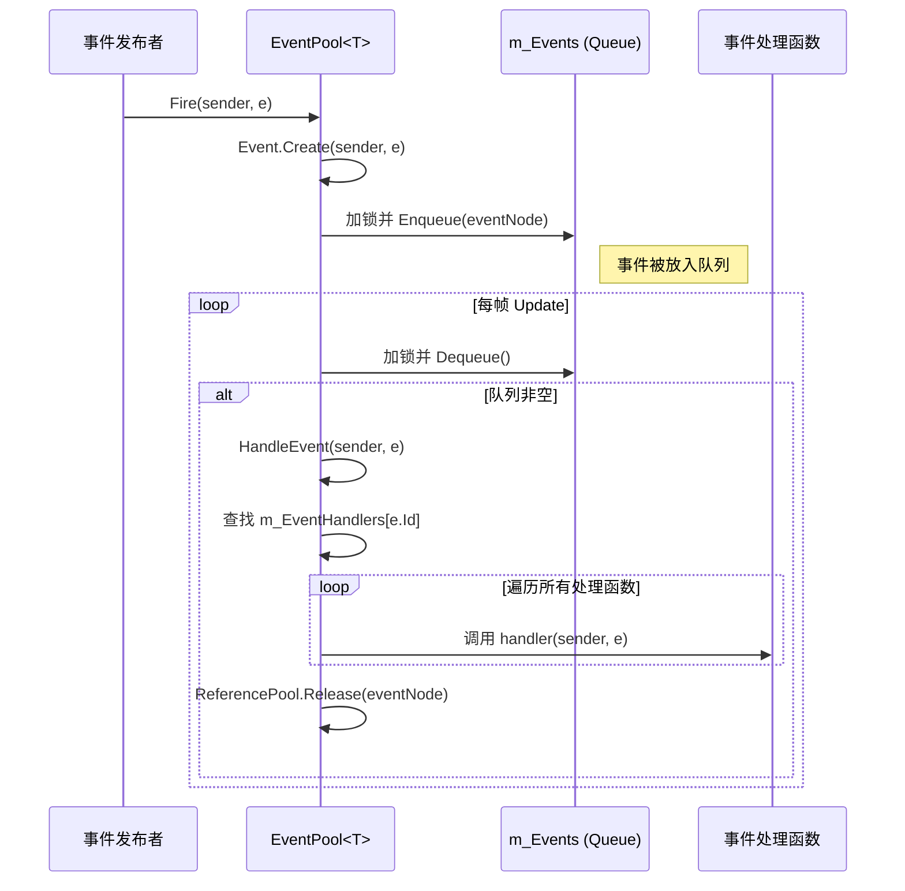

# 事件池 (EventPool)

<cite>
**Referenced Files in This Document**   
- [EventPool.cs](file://GameFramework/Base/EventPool/EventPool.cs)
- [BaseEventArgs.cs](file://GameFramework/Base/EventPool/BaseEventArgs.cs)
- [EventPoolMode.cs](file://GameFramework/Base/EventPool/EventPoolMode.cs)
- [EventPool.Event.cs](file://GameFramework/Base/EventPool/EventPool.Event.cs)
- [EventManager.cs](file://GameFramework/Event/EventManager.cs)
- [GameEventArgs.cs](file://GameFramework/Event/GameEventArgs.cs)
</cite>

## 目录
1. [简介](#简介)
2. [核心组件](#核心组件)
3. [事件池模式 (EventPoolMode)](#事件池模式-eventpoolmode)
4. [内部数据结构与线程安全](#内部数据结构与线程安全)
5. [事件处理流程](#事件处理流程)
6. [自定义事件的定义与使用](#自定义事件的定义与使用)
7. [内存泄漏与侦听器卸载](#内存泄漏与侦听器卸载)
8. [架构概览](#架构概览)

## 简介

事件池（EventPool）是游戏框架中实现事件驱动架构的核心组件。它提供了一个线程安全的机制，用于管理事件的订阅（Subscribe）、分发（Fire）和取消订阅（Unsubscribe）。通过事件池，系统中的不同模块可以实现松耦合的通信，一个模块在发生特定状态变化时发布事件，而其他感兴趣的模块则通过订阅该事件来接收通知并做出响应。本文档将深入剖析事件池的实现细节，包括其工作模式、内部数据结构、核心流程以及最佳实践。

## 核心组件

事件池系统由几个关键的类和枚举构成，它们共同协作以实现完整的事件管理功能。

- **`EventPool<T>`**: 事件池的核心实现类，是一个泛型类，其中 `T` 必须继承自 `BaseEventArgs`。它负责管理特定类型事件的所有侦听器，并处理事件的分发。该类提供了 `Subscribe`、`Unsubscribe` 和 `Fire` 等核心方法。
- **`BaseEventArgs`**: 所有事件参数类的抽象基类。它定义了 `Id` 属性，用于唯一标识一个事件类型，是事件系统进行路由和分发的关键。
- **`EventPoolMode`**: 一个标志枚举（Flags enum），用于配置事件池的行为模式，例如是否允许没有处理函数、是否允许多个处理函数等。
- **`Event`**: 事件池内部使用的私有类，用于封装一次事件触发时的事件源（sender）和事件参数（e）。它实现了 `IReference` 接口，可以被对象池（ReferencePool）管理，以减少垃圾回收（GC）的压力。

**Section sources**
- [EventPool.cs](file://GameFramework/Base/EventPool/EventPool.cs#L29-L37)
- [BaseEventArgs.cs](file://GameFramework/Base/EventPool/BaseEventArgs.cs#L12-L21)
- [EventPoolMode.cs](file://GameFramework/Base/EventPool/EventPoolMode.cs#L14-L36)
- [EventPool.Event.cs](file://GameFramework/Base/EventPool/EventPool.Event.cs#L9-L55)

## 事件池模式 (EventPoolMode)

`EventPoolMode` 枚举定义了事件池在处理事件时的严格程度，通过位标志（bit flags）的方式，可以组合多种模式。这为不同的使用场景提供了灵活性。

| 模式 (Mode) | 描述 |
| :--- | :--- |
| `Default` | 默认模式。要求对于每一个发布的事件，必须存在且仅存在一个事件处理函数。如果找不到处理函数或找到多个，都会抛出异常。 |
| `AllowNoHandler` | 允许不存在事件处理函数。当事件发布时，如果没有订阅者，事件池将静默处理，不会抛出异常。 |
| `AllowMultiHandler` | 允许存在多个事件处理函数。一个事件可以被多个不同的侦听器订阅。 |
| `AllowDuplicateHandler` | 允许存在重复的事件处理函数。同一个侦听器可以多次订阅同一个事件。 |

例如，框架中的 `EventManager` 在初始化时使用了 `EventPoolMode.AllowNoHandler | EventPoolMode.AllowMultiHandler` 模式，这意味着它可以处理没有订阅者的事件，并且允许多个模块同时监听同一个事件。

**Section sources**
- [EventPoolMode.cs](file://GameFramework/Base/EventPool/EventPoolMode.cs#L14-L36)
- [EventManager.cs](file://GameFramework/Event/EventManager.cs#L15-L16)

## 内部数据结构与线程安全

事件池的设计巧妙地结合了多种数据结构来平衡性能和功能需求，并通过锁机制保证了线程安全。

### 核心数据结构

```mermaid
classDiagram
class EventPool<T> {
-m_EventHandlers : GameFrameworkMultiDictionary<int, EventHandler<T>>
-m_Events : Queue<Event>
-m_CachedNodes : Dictionary<object, LinkedListNode<EventHandler<T>>>
-m_TempNodes : Dictionary<object, LinkedListNode<EventHandler<T>>>
-m_EventPoolMode : EventPoolMode
+Subscribe(id, handler)
+Unsubscribe(id, handler)
+Fire(sender, e)
+Update(elapseSeconds, realElapseSeconds)
}
class Event {
-m_Sender : object
-m_EventArgs : T
+Sender : object
+EventArgs : T
+Create(sender, e) : Event
+Clear()
}
class BaseEventArgs {
<<abstract>>
+Id : int
}
EventPool<T> --> Event : "创建并存储"
EventPool<T> --> BaseEventArgs : "泛型约束 T : BaseEventArgs"
Event --> BaseEventArgs : "包含"
```

**Diagram sources**
- [EventPool.cs](file://GameFramework/Base/EventPool/EventPool.cs#L0-L285)
- [EventPool.Event.cs](file://GameFramework/Base/EventPool/EventPool.Event.cs#L9-L55)
- [BaseEventArgs.cs](file://GameFramework/Base/EventPool/BaseEventArgs.cs#L12-L21)

- **`m_EventHandlers`**: 一个 `GameFrameworkMultiDictionary<int, EventHandler<T>>` 类型的字典。这是事件侦听器的主存储。字典的键是事件的 `Id`（一个整数），值是一个链表（LinkedList），存储了所有订阅了该事件的处理函数（`EventHandler<T>`）。使用多值字典（MultiDictionary）是因为一个事件ID可以对应多个处理函数。
- **`m_Events`**: 一个 `Queue<Event>` 类型的队列。这个队列是实现线程安全的关键。当调用 `Fire` 方法时，事件不会立即被处理，而是被封装成一个 `Event` 对象并放入此队列。实际的事件分发在主线程的 `Update` 方法中进行。
- **`m_CachedNodes` 和 `m_TempNodes`**: 这两个字典用于在遍历链表（`m_EventHandlers`）的过程中安全地移除节点。在遍历过程中直接修改链表会导致 `InvalidOperationException`。`m_CachedNodes` 用于缓存下一个节点的引用，而 `m_TempNodes` 用于在取消订阅时暂存需要更新的缓存，以避免在遍历过程中直接修改 `m_CachedNodes`。

### 线程安全机制

事件池的线程安全主要通过以下方式实现：
1.  **生产者-消费者模式**：`Fire` 方法（可能在任意线程）将事件对象放入 `m_Events` 队列，而 `Update` 方法（在主线程）从队列中取出事件并处理。对队列的访问使用 `lock` 关键字进行同步，确保了多线程写入和主线程读取的安全性。
2.  **主线程分发**：所有事件的最终处理都在主线程的 `Update` 循环中完成，这保证了事件处理逻辑的执行环境是确定的，避免了多线程并发修改UI或游戏状态带来的问题。

**Section sources**
- [EventPool.cs](file://GameFramework/Base/EventPool/EventPool.cs#L29-L37)
- [EventPool.cs](file://GameFramework/Base/EventPool/EventPool.cs#L61-L69)
- [EventPool.cs](file://GameFramework/Base/EventPool/EventPool.cs#L230-L234)

## 事件处理流程

事件的完整生命周期包括订阅、发布和分发三个主要阶段。

### 订阅 (Subscribe)

当一个对象想要接收某个事件的通知时，它会调用 `EventPool<T>.Subscribe` 方法，传入事件的 `Id` 和一个事件处理函数（`EventHandler<T>`）。事件池会检查当前的 `EventPoolMode`，根据模式决定是否允许此次订阅（例如，是否允许重复订阅）。如果检查通过，处理函数将被添加到 `m_EventHandlers` 字典中对应 `Id` 的链表末尾。

### 发布 (Fire)

当事件发生时，调用 `EventPool<T>.Fire` 方法。该方法首先创建一个 `Event` 对象（从对象池中获取以减少GC），然后将其 `sender` 和 `e` 参数填充进去。最后，这个 `Event` 对象被加锁后放入 `m_Events` 队列。此操作是线程安全的。

### 分发 (Dispatch)

在游戏主循环的每一帧，`EventPool<T>.Update` 方法会被调用。该方法会加锁并检查 `m_Events` 队列。如果队列不为空，它会持续出队一个 `Event` 对象，并调用私有的 `HandleEvent` 方法来处理它。处理完成后，`Event` 对象会被释放回对象池。`HandleEvent` 方法会根据事件参数 `e` 的 `Id` 从 `m_EventHandlers` 中查找所有订阅了该事件的处理函数，并依次调用它们。如果找不到处理函数且模式不允许，则会抛出异常。



**Diagram sources**
- [EventPool.cs](file://GameFramework/Base/EventPool/EventPool.cs#L205-L284)
- [EventPool.cs](file://GameFramework/Base/EventPool/EventPool.cs#L170-L186)
- [EventPool.Event.cs](file://GameFramework/Base/EventPool/EventPool.Event.cs#L38-L48)

## 自定义事件的定义与使用

要使用事件池，首先需要定义自己的事件参数类。

### 定义自定义事件

1.  创建一个新的类，继承自 `GameEventArgs`（或直接继承 `BaseEventArgs`）。
2.  重写 `Id` 属性，返回一个唯一的整数来标识该事件类型。
3.  添加该事件特有的数据字段和属性。

例如，可以定义一个 `PlayerHealthChangedEventArgs` 事件：
```csharp
public class PlayerHealthChangedEventArgs : GameEventArgs
{
    public override int Id => typeof(PlayerHealthChangedEventArgs).GetHashCode();

    public int CurrentHealth { get; private set; }
    public int MaxHealth { get; private set; }

    public static PlayerHealthChangedEventArgs Create(int current, int max)
    {
        var e = ReferencePool.Acquire<PlayerHealthChangedEventArgs>();
        e.CurrentHealth = current;
        e.MaxHealth = max;
        return e;
    }

    public override void Clear()
    {
        CurrentHealth = 0;
        MaxHealth = 0;
    }
}
```

### 使用自定义事件

1.  **订阅**: 在需要监听事件的类中，调用 `EventPool<PlayerHealthChangedEventArgs>` 的 `Subscribe` 方法。
    ```csharp
    EventPool<PlayerHealthChangedEventArgs>.Subscribe(PlayerHealthChangedEventArgs.Id, OnPlayerHealthChanged);
    ```
2.  **处理**: 实现事件处理函数 `OnPlayerHealthChanged`。
    ```csharp
    private void OnPlayerHealthChanged(object sender, PlayerHealthChangedEventArgs e)
    {
        // 更新UI，播放音效等
        UpdateHealthBar(e.CurrentHealth, e.MaxHealth);
    }
    ```
3.  **发布**: 当玩家血量变化时，调用 `Fire` 方法。
    ```csharp
    var e = PlayerHealthChangedEventArgs.Create(currentHp, maxHp);
    EventPool<PlayerHealthChangedEventArgs>.Fire(this, e);
    ```

**Section sources**
- [GameEventArgs.cs](file://GameFramework/Event/GameEventArgs.cs#L12-L16)
- [BaseEventArgs.cs](file://GameFramework/Base/EventPool/BaseEventArgs.cs#L12-L21)

## 内存泄漏与侦听器卸载

**及时卸载事件侦听器是避免内存泄漏的关键。**

如果一个对象（例如一个UI界面）订阅了事件，但在其生命周期结束（如被销毁）后没有取消订阅，那么事件池会持有该对象的引用（通过 `EventHandler` 委托）。这会阻止垃圾回收器回收该对象，导致内存泄漏。

**最佳实践**：
- **成对出现**：`Subscribe` 和 `Unsubscribe` 应该成对出现。通常在 `OnEnable` 或初始化时订阅，在 `OnDisable` 或销毁时取消订阅。
- **使用 `FireNow` 谨慎**：`FireNow` 方法会立即同步调用所有处理函数。如果在处理函数中又进行了订阅或取消订阅操作，可能会干扰当前的遍历过程，导致逻辑错误或异常。应优先使用 `Fire` 方法。

**Section sources**
- [EventPool.cs](file://GameFramework/Base/EventPool/EventPool.cs#L138-L163)

## 架构概览

事件池是整个框架事件系统的基础。`EventManager` 作为更高层的封装，使用 `EventPool<GameEventArgs>` 来管理所有游戏逻辑事件。其他模块（如下载、实体、网络等）都通过 `EventManager` 来发布和订阅事件，实现了模块间的解耦。

```mermaid
graph TD
A[其他模块<br>(下载, 实体, UI等)] --> |发布/订阅| B(EventManager)
B --> C[EventPool<GameEventArgs>]
C --> D[m_EventHandlers]
C --> E[m_Events]
C --> F[Event]
G[自定义事件] --> |继承| H[GameEventArgs]
H --> |继承| I[BaseEventArgs]
C --> |处理| J[事件处理函数]
```

**Diagram sources**
- [EventManager.cs](file://GameFramework/Event/EventManager.cs#L11-L16)
- [EventPool.cs](file://GameFramework/Base/EventPool/EventPool.cs#L29-L37)
- [GameEventArgs.cs](file://GameFramework/Event/GameEventArgs.cs#L12-L16)