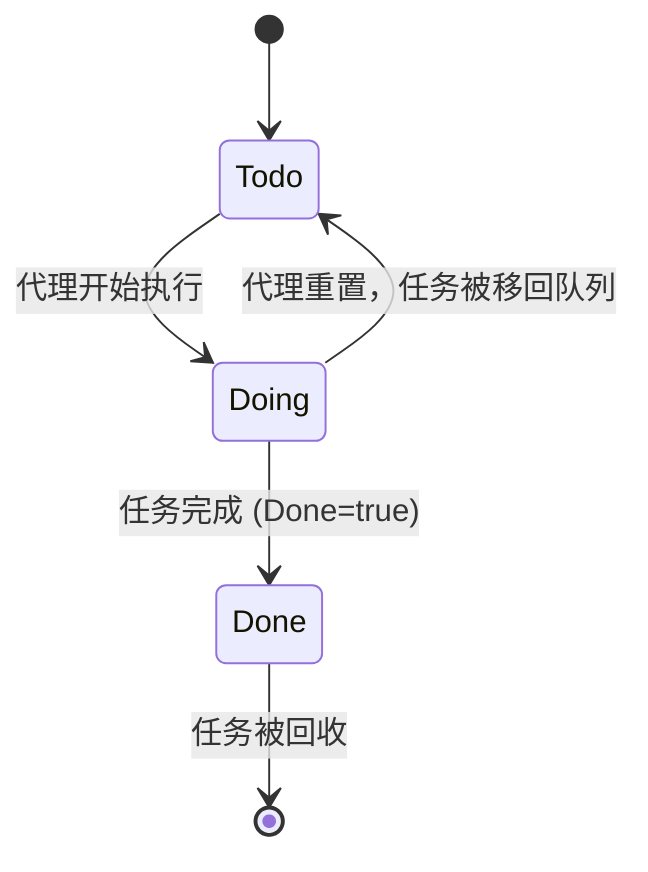
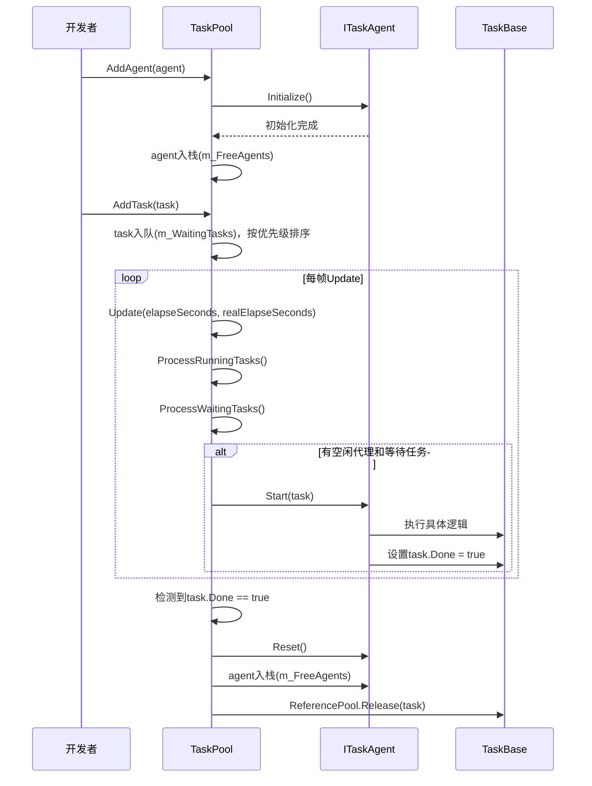

# 任务池 (TaskPool)

<cite>
**Referenced Files in This Document**   
- [TaskBase.cs](file://GameFramework/Base/TaskPool/TaskBase.cs)
- [ITaskAgent.cs](file://GameFramework/Base/TaskPool/ITaskAgent.cs)
- [TaskPool.cs](file://GameFramework/Base/TaskPool/TaskPool.cs)
- [TaskStatus.cs](file://GameFramework/Base/TaskPool/TaskStatus.cs)
- [StartTaskStatus.cs](file://GameFramework/Base/TaskPool/StartTaskStatus.cs)
- [TaskInfo.cs](file://GameFramework/Base/TaskPool/TaskInfo.cs)
</cite>

## 目录
1. [简介](#简介)
2. [核心组件](#核心组件)
3. [任务生命周期与状态转换](#任务生命周期与状态转换)
4. [任务调度与执行流程](#任务调度与执行流程)
5. [任务优先级与排序机制](#任务优先级与排序机制)
6. [错误处理与超时机制](#错误处理与超时机制)
7. [创建自定义任务类型](#创建自定义任务类型)

## 简介

任务池（TaskPool）系统是 GameFramework 框架中的一个核心组件，旨在高效地管理和调度异步任务。该系统通过复用任务代理（Task Agent）来避免频繁创建和销毁线程或协程所带来的性能开销。任务池将任务的提交、调度、执行和回收进行解耦，提供了一个稳定、可扩展的异步任务处理框架。本文档将深入解析其内部工作原理，涵盖核心组件、任务生命周期、调度机制以及错误处理策略。

## 核心组件

任务池系统由三个核心组件构成：`TaskBase`（任务基类）、`ITaskAgent`（任务代理接口）和 `TaskPool`（任务池管理器）。它们共同协作，实现了任务的高效处理。

### TaskBase (任务基类)

`TaskBase` 是所有具体任务类型的抽象基类，它定义了任务的通用属性和行为。该类实现了 `IReference` 接口，表明其生命周期由引用池（ReferencePool）管理，以实现对象的复用，减少垃圾回收压力。

**关键属性与方法：**
- **序列编号 (SerialId)**: 每个任务在被加入任务池时，都会被分配一个唯一的序列号，用于标识和追踪任务。
- **标签 (Tag)**: 一个字符串标签，可用于对任务进行分类或分组，方便后续的批量查询和管理。
- **优先级 (Priority)**: 一个整数，用于决定任务在等待队列中的执行顺序。数值越大，优先级越高。
- **用户数据 (UserData)**: 一个 `object` 类型的字段，允许开发者传递与任务相关的自定义数据。
- **完成状态 (Done)**: 一个布尔值，表示任务是否已完成。任务代理在执行任务逻辑时，需要将此属性设置为 `true` 来通知任务池任务已完成。
- **Description**: 一个虚属性，子类可以重写此属性以提供任务的详细描述信息。

**Section sources**
- [TaskBase.cs](file://GameFramework/Base/TaskPool/TaskBase.cs#L12-L135)

### ITaskAgent (任务代理)

`ITaskAgent<T>` 是一个泛型接口，定义了任务代理的行为规范。任务代理是实际执行任务逻辑的“工人”。通过将执行逻辑封装在代理中，任务池可以灵活地管理这些代理，实现复用。

**关键方法：**
- **Initialize()**: 在代理被添加到任务池时调用，用于执行代理的初始化操作。
- **Update(float elapseSeconds, float realElapseSeconds)**: 任务池在每帧调用此方法，驱动代理执行任务。`elapseSeconds` 表示逻辑时间，`realElapseSeconds` 表示真实时间。
- **Shutdown()**: 在任务池关闭时调用，用于清理代理占用的资源。
- **Start(T task)**: 这是最重要的方法。当任务池将一个任务分配给代理时，会调用此方法。代理在此方法中接收任务，并开始执行。该方法返回一个 `StartTaskStatus` 枚举值，指示任务的启动状态。
- **Reset()**: 当任务执行完毕或被中断时，任务池会调用此方法来重置代理，使其恢复到可处理新任务的初始状态。

**Section sources**
- [ITaskAgent.cs](file://GameFramework/Base/TaskPool/ITaskAgent.cs#L13-L51)

### TaskPool (任务池)

`TaskPool<T>` 是任务池系统的中枢，负责管理所有的任务和任务代理。它是一个泛型类，`T` 必须继承自 `TaskBase`。

**内部数据结构：**
- **m_FreeAgents**: 一个 `Stack<ITaskAgent<T>>`，存储所有空闲的、可以立即处理新任务的代理。
- **m_WorkingAgents**: 一个 `GameFrameworkLinkedList<ITaskAgent<T>>`，存储所有正在执行任务的代理。
- **m_WaitingTasks**: 一个 `GameFrameworkLinkedList<T>`，存储所有已提交但尚未被处理的任务，即等待队列。

**核心功能：**
- **AddAgent(ITaskAgent<T> agent)**: 将一个任务代理添加到池中，并立即将其放入 `m_FreeAgents` 栈中。
- **AddTask(T task)**: 将一个任务添加到等待队列 `m_WaitingTasks` 中。添加时会根据任务的优先级进行排序。
- **Update(float elapseSeconds, float realElapseSeconds)**: 这是任务池的主循环方法。它会依次处理正在运行的任务和等待中的任务。

**Section sources**
- [TaskPool.cs](file://GameFramework/Base/TaskPool/TaskPool.cs#L15-L442)

## 任务生命周期与状态转换

任务在其生命周期中会经历不同的状态，这些状态由 `TaskStatus` 枚举定义。

### 任务状态 (TaskStatus)



**Diagram sources**
- [TaskStatus.cs](file://GameFramework/Base/TaskPool/TaskStatus.cs#L12-L28)

- **Todo (未开始)**: 任务已提交到任务池，但尚未被任何代理执行。它存在于 `m_WaitingTasks` 队列中。
- **Doing (执行中)**: 任务已被分配给一个代理，代理正在执行其逻辑。任务存在于 `m_WorkingAgents` 链表中。
- **Done (完成)**: 任务的逻辑已成功执行完毕。当代理检测到任务的 `Done` 属性被设置为 `true` 后，会将其从 `m_WorkingAgents` 中移除，并回收任务对象。

### 状态转换机制

状态转换由任务池的 `Update` 方法驱动，具体流程如下：

1.  **处理运行中的任务 (`ProcessRunningTasks`)**:
    - 遍历 `m_WorkingAgents` 中的所有代理。
    - 调用每个代理的 `Update` 方法。
    - 检查任务的 `Done` 属性。如果为 `true`，则认为任务已完成。
    - 将完成的任务从 `m_WorkingAgents` 中移除，调用代理的 `Reset()` 方法，并将代理放回 `m_FreeAgents` 栈中，最后通过 `ReferencePool.Release(task)` 回收任务对象。

2.  **处理等待中的任务 (`ProcessWaitingTasks`)**:
    - 遍历 `m_WaitingTasks` 队列。
    - 如果有空闲代理 (`FreeAgentCount > 0`)，则从 `m_FreeAgents` 弹出一个代理。
    - 调用代理的 `Start(task)` 方法，将任务交给代理。
    - 根据 `Start` 方法返回的 `StartTaskStatus`，决定后续操作。

**Section sources**
- [TaskPool.cs](file://GameFramework/Base/TaskPool/TaskPool.cs#L380-L442)

## 任务调度与执行流程

任务的调度与执行是一个自动化的过程，开发者只需将任务和代理提交给任务池即可。



**Diagram sources**
- [TaskPool.cs](file://GameFramework/Base/TaskPool/TaskPool.cs#L325-L378)
- [ITaskAgent.cs](file://GameFramework/Base/TaskPool/ITaskAgent.cs#L45-L45)

## 任务优先级与排序机制

任务池支持基于优先级的任务调度。当向 `m_WaitingTasks` 队列添加新任务时，会根据其优先级进行插入排序。

- **排序规则**: 优先级数值越高的任务，越先被执行。在 `AddTask` 方法中，代码会从队列末尾向前遍历，找到第一个优先级小于或等于新任务的节点，然后将新任务插入到该节点之后。如果所有现有任务的优先级都低于新任务，则新任务将被添加到队列最前端。
- **默认优先级**: `TaskBase.DefaultPriority` 的值为 `0`。开发者可以通过构造函数或初始化方法为任务设置不同的优先级。

**Section sources**
- [TaskBase.cs](file://GameFramework/Base/TaskPool/TaskBase.cs#L15-L15)
- [TaskPool.cs](file://GameFramework/Base/TaskPool/TaskPool.cs#L285-L299)

## 错误处理与超时机制

任务池系统通过 `StartTaskStatus` 枚举来处理任务启动时的各种情况，这为错误处理和依赖管理提供了基础。

### StartTaskStatus (启动状态)

```mermaid
flowchart TD
Start[Start(task) 被调用] --> Check{检查任务依赖和状态}
Check --> |任务可立即完成| Done["返回 StartTaskStatus.Done"]
Check --> |任务可继续执行| CanResume["返回 StartTaskStatus.CanResume"]
Check --> |任务依赖未满足| HasToWait["返回 StartTaskStatus.HasToWait"]
Check --> |发生未知错误| UnknownError["返回 StartTaskStatus.UnknownError"]
Done --> |任务池| 移除任务并回收
CanResume --> |任务池| 任务进入执行状态
HasToWait --> |任务池| 任务保留在等待队列
UnknownError --> |任务池| 移除任务并回收
```

**Diagram sources**
- [StartTaskStatus.cs](file://GameFramework/Base/TaskPool/StartTaskStatus.cs#L12-L33)
- [TaskPool.cs](file://GameFramework/Base/TaskPool/TaskPool.cs#L355-L376)

- **Done**: 代理发现任务可以立即完成（例如，所需资源已缓存），则返回此状态。任务池会直接将任务标记为完成并回收。
- **CanResume**: 代理成功接收任务，并开始异步执行。这是最常见的情况。
- **HasToWait**: 代理发现任务的执行条件不满足（例如，依赖的资源尚未加载），则返回此状态。此时，任务不会被从等待队列中移除，它会继续等待，直到下一次调度。
- **UnknownError**: 代理在启动任务时遇到无法处理的错误。任务池会将此任务视为失败并进行回收。

### 超时机制

值得注意的是，`TaskBase` 和 `TaskPool` 的核心代码中**并未直接包含超时机制**。超时逻辑需要在具体的 `ITaskAgent` 实现中自行处理。例如，在 `DownloadManager.DownloadAgent` 或 `WebRequestManager.WebRequestAgent` 的 `Update` 方法中，会维护一个计时器，如果任务执行时间超过预设阈值，则会主动将任务标记为失败并回调错误事件。

## 创建自定义任务类型

要创建一个自定义任务，需要继承 `TaskBase` 类，并根据需要重写相关属性和方法。

```csharp
// 示例：一个自定义的资源加载任务
public class CustomLoadTask : TaskBase
{
    private string m_AssetPath;
    private Action<object> m_OnSuccess;
    private Action<string> m_OnFailure;

    public CustomLoadTask(string assetPath, Action<object> onSuccess, Action<string> onFailure)
    {
        m_AssetPath = assetPath;
        m_OnSuccess = onSuccess;
        m_OnFailure = onFailure;
    }

    public override string Description => $"加载资源: {m_AssetPath}";

    // 提供一个方法供任务代理调用，以开始加载
    public void StartLoading()
    {
        // 模拟异步加载
        StartCoroutine(LoadCoroutine());
    }

    private IEnumerator LoadCoroutine()
    {
        // 这里可以使用Unity的AssetBundle或其他加载方式
        yield return new WaitForSeconds(2f); // 模拟加载耗时

        if (/* 加载成功 */)
        {
            m_OnSuccess?.Invoke(/* 加载结果 */);
            Done = true; // 关键：标记任务完成
        }
        else
        {
            m_OnFailure?.Invoke("加载失败");
            Done = true; // 标记任务完成（即使是失败）
        }
    }
}
```

在任务代理的 `Start` 方法中，接收 `CustomLoadTask` 实例，并调用其 `StartLoading()` 方法来启动加载过程。当加载完成（无论成功或失败）时，代理会通过 `Update` 方法检测到 `Done` 属性变为 `true`，从而完成整个任务的生命周期。

**Section sources**
- [TaskBase.cs](file://GameFramework/Base/TaskPool/TaskBase.cs#L12-L135)