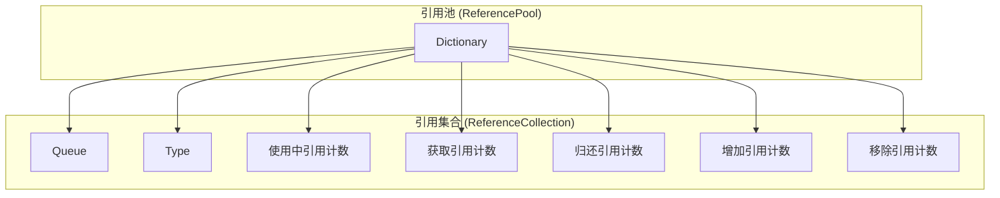
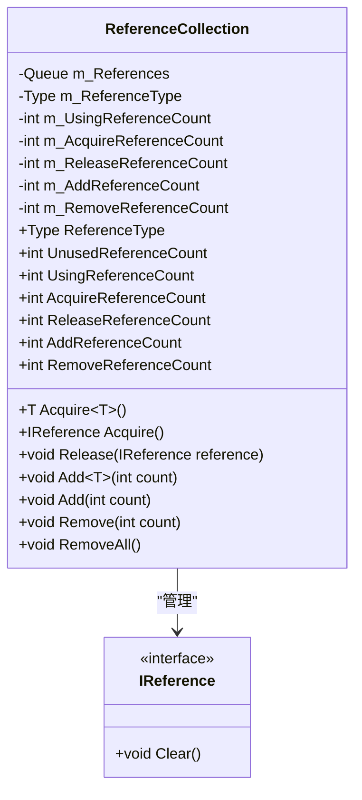
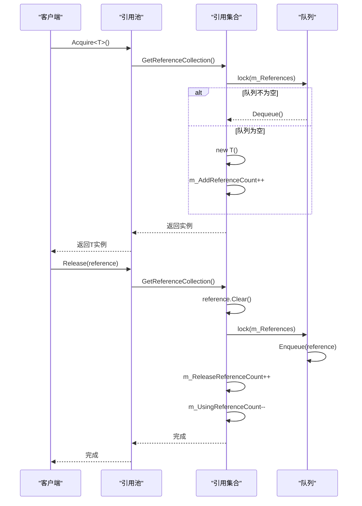
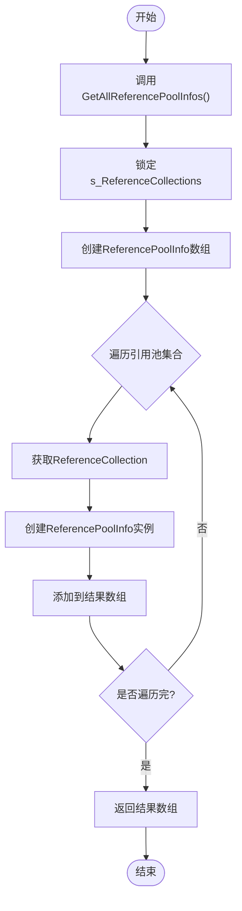

# 引用池 (ReferencePool)

<cite>
**本文档中引用的文件**
- [IReference.cs](file://GameFramework/Base/ReferencePool/IReference.cs)
- [ReferencePool.cs](file://GameFramework/Base/ReferencePool/ReferencePool.cs)
- [ReferencePool.ReferenceCollection.cs](file://GameFramework/Base/ReferencePool/ReferencePool.ReferenceCollection.cs)
- [ReferencePoolInfo.cs](file://GameFramework/Base/ReferencePool/ReferencePoolInfo.cs)
- [ObjectBase.cs](file://GameFramework/ObjectPool/ObjectBase.cs)
- [ObjectPoolManager.Object.cs](file://GameFramework/ObjectPool/ObjectPoolManager.Object.cs)
</cite>

## 目录
1. [简介](#简介)
2. [核心设计原理](#核心设计原理)
3. [IReference 接口的作用](#ireference-接口的作用)
4. [引用池的管理机制](#引用池的管理机制)
5. [对象的获取、释放与清除流程](#对象的获取释放与清除流程)
6. [缓存机制与性能监控](#缓存机制与性能监控)
7. [定义可复用引用类的最佳实践](#定义可复用引用类的最佳实践)
8. [引用池与对象池的区别与适用场景](#引用池与对象池的区别与适用场景)
9. [总结](#总结)

## 简介
引用池（ReferencePool）是 GameFramework 框架中的一个核心组件，旨在通过对象复用减少 C# 的垃圾回收（GC）压力，从而提升应用程序的性能。在频繁创建和销毁对象的场景中，GC 会频繁触发，导致性能下降。引用池通过维护一组可复用的对象实例，避免了频繁的内存分配和回收操作，有效降低了 GC 的负担。

引用池的设计基于对象池模式，但更加轻量级，专注于管理实现了 `IReference` 接口的引用类型对象。它提供了一套完整的 API 来管理这些对象的生命周期，包括获取（Acquire）、释放（Release）和清除（Clear）等操作。同时，引用池还提供了性能监控功能，可以通过 `ReferencePoolInfo` 结构体获取各个引用池的运行时信息。

## 核心设计原理
引用池的核心设计原理是通过预分配和缓存对象实例，避免在运行时频繁地进行内存分配和垃圾回收。当需要一个对象时，引用池首先尝试从缓存中获取一个未使用的实例；如果缓存中没有可用实例，则创建一个新的实例。当对象使用完毕后，不直接销毁，而是将其归还到引用池中，以便后续复用。

引用池使用 `Dictionary<Type, ReferenceCollection>` 来管理不同类型对象的集合，其中 `Type` 是对象的类型，`ReferenceCollection` 是该类型对象的集合。每个 `ReferenceCollection` 内部使用 `Queue<IReference>` 来存储未使用的对象实例，并通过一系列计数器来跟踪对象的使用情况。



**图示来源**
- [ReferencePool.cs](file://GameFramework/Base/ReferencePool/ReferencePool.cs#L12-L225)
- [ReferencePool.ReferenceCollection.cs](file://GameFramework/Base/ReferencePool/ReferencePool.ReferenceCollection.cs#L12-L200)

**本节来源**
- [ReferencePool.cs](file://GameFramework/Base/ReferencePool/ReferencePool.cs#L12-L225)
- [ReferencePool.ReferenceCollection.cs](file://GameFramework/Base/ReferencePool/ReferencePool.ReferenceCollection.cs#L12-L200)

## IReference 接口的作用
`IReference` 接口是引用池中所有可复用对象的标记接口，定义了 `Clear()` 方法，用于在对象归还到引用池之前清理其内部状态。任何希望被引用池管理的类都必须实现 `IReference` 接口，并正确实现 `Clear()` 方法。

```csharp
public interface IReference
{
    /// <summary>
    /// 清理引用。
    /// </summary>
    void Clear();
}
```

`Clear()` 方法的作用是将对象恢复到初始状态，以便下次复用时不会受到之前使用的影响。例如，如果一个类包含一些字段或集合，在 `Clear()` 方法中应该将这些字段重置为默认值，清空集合等。这是确保对象复用安全性的关键步骤。

许多框架内部的类都实现了 `IReference` 接口，如 `EventPool.Event`、`TaskBase`、`Variable`、`DownloadCounterNode`、`EntityInfo`、`ShowEntityInfo`、`ObjectBase`、`LoadBinaryInfo`、`PlaySoundParams`、`PlaySoundInfo`、`OpenUIFormInfo` 和 `UIFormInfo` 等。这表明引用池在框架中被广泛用于管理各种临时对象。

**本节来源**
- [IReference.cs](file://GameFramework/Base/ReferencePool/IReference.cs#L12-L18)

## 引用池的管理机制
引用池通过 `ReferenceCollection` 类来管理特定类型对象的集合。每个 `ReferenceCollection` 实例对应一种引用类型，负责该类型对象的获取、释放和统计。

`ReferenceCollection` 内部维护了一个 `Queue<IReference>`，用于存储未使用的对象实例。当调用 `Acquire<T>()` 方法获取对象时，引用池会首先检查队列中是否有可用实例。如果有，则从队列头部取出一个实例并返回；如果没有，则通过 `new T()` 创建一个新的实例。

为了保证线程安全，`ReferenceCollection` 在对队列进行操作时使用了 `lock` 语句。此外，`ReferenceCollection` 还维护了多个计数器，用于跟踪对象的使用情况：
- `m_UsingReferenceCount`：正在使用的引用数量
- `m_AcquireReferenceCount`：获取引用的总次数
- `m_ReleaseReferenceCount`：归还引用的总次数
- `m_AddReferenceCount`：增加引用的总次数
- `m_RemoveReferenceCount`：移除引用的总次数

这些计数器为性能监控提供了数据支持。



**图示来源**
- [ReferencePool.ReferenceCollection.cs](file://GameFramework/Base/ReferencePool/ReferencePool.ReferenceCollection.cs#L12-L200)
- [IReference.cs](file://GameFramework/Base/ReferencePool/IReference.cs#L12-L18)

**本节来源**
- [ReferencePool.ReferenceCollection.cs](file://GameFramework/Base/ReferencePool/ReferencePool.ReferenceCollection.cs#L12-L200)

## 对象的获取、释放与清除流程
### 获取对象 (Acquire)
获取对象是引用池的核心操作之一。当需要一个对象时，调用 `ReferencePool.Acquire<T>()` 方法：

1. 调用 `GetReferenceCollection(typeof(T))` 获取对应类型的 `ReferenceCollection`
2. 在 `ReferenceCollection.Acquire<T>()` 方法中：
   - 增加 `m_UsingReferenceCount` 和 `m_AcquireReferenceCount`
   - 使用 `lock` 锁定 `m_References` 队列
   - 检查队列是否为空，如果不为空则从队列头部取出一个实例
   - 如果队列为空，则通过 `new T()` 创建一个新的实例，并增加 `m_AddReferenceCount`
3. 返回获取到的对象实例

### 释放对象 (Release)
释放对象是将使用完毕的对象归还到引用池的过程。调用 `ReferencePool.Release(IReference reference)` 方法：

1. 调用 `GetReferenceCollection(reference.GetType())` 获取对应类型的 `ReferenceCollection`
2. 在 `ReferenceCollection.Release(IReference reference)` 方法中：
   - 调用 `reference.Clear()` 清理对象内部状态
   - 使用 `lock` 锁定 `m_References` 队列
   - 如果启用了严格检查且对象已在队列中，则抛出异常
   - 将对象加入队列尾部
   - 增加 `m_ReleaseReferenceCount`，减少 `m_UsingReferenceCount`
3. 对象成功归还到引用池，等待下次复用

### 清除对象 (Clear)
清除操作包括从引用池中移除指定数量的引用或清除所有引用：

- `Remove<T>(int count)`：从指定类型的引用池中移除指定数量的引用
- `RemoveAll<T>()`：移除指定类型引用池中的所有引用
- `ClearAll()`：清除所有引用池中的所有引用

这些操作通常在内存紧张或需要重置引用池状态时使用。



**图示来源**
- [ReferencePool.cs](file://GameFramework/Base/ReferencePool/ReferencePool.cs#L83-L198)
- [ReferencePool.ReferenceCollection.cs](file://GameFramework/Base/ReferencePool/ReferencePool.ReferenceCollection.cs#L112-L150)

**本节来源**
- [ReferencePool.cs](file://GameFramework/Base/ReferencePool/ReferencePool.cs#L83-L198)
- [ReferencePool.ReferenceCollection.cs](file://GameFramework/Base/ReferencePool/ReferencePool.ReferenceCollection.cs#L112-L150)

## 缓存机制与性能监控
引用池的缓存机制基于 `Queue<IReference>` 实现，采用先进先出（FIFO）的策略。这种策略确保了最久未使用的对象优先被复用，有助于保持对象的"新鲜度"。

为了监控引用池的性能，框架提供了 `ReferencePoolInfo` 结构体，用于收集和展示各个引用池的运行时信息：

```csharp
public struct ReferencePoolInfo
{
    private readonly Type m_Type;
    private readonly int m_UnusedReferenceCount;
    private readonly int m_UsingReferenceCount;
    private readonly int m_AcquireReferenceCount;
    private readonly int m_ReleaseReferenceCount;
    private readonly int m_AddReferenceCount;
    private readonly int m_RemoveReferenceCount;

    public Type Type { get; }
    public int UnusedReferenceCount { get; }
    public int UsingReferenceCount { get; }
    public int AcquireReferenceCount { get; }
    public int ReleaseReferenceCount { get; }
    public int AddReferenceCount { get; }
    public int RemoveReferenceCount { get; }
}
```

通过调用 `ReferencePool.GetAllReferencePoolInfos()` 方法，可以获取所有引用池的信息，这对于性能分析和内存优化非常有帮助。开发者可以根据这些数据判断哪些类型的对象被频繁创建和销毁，进而优化代码或调整引用池的预分配策略。



**图示来源**
- [ReferencePoolInfo.cs](file://GameFramework/Base/ReferencePool/ReferencePoolInfo.cs#L15-L123)
- [ReferencePool.cs](file://GameFramework/Base/ReferencePool/ReferencePool.cs#L46-L81)

**本节来源**
- [ReferencePoolInfo.cs](file://GameFramework/Base/ReferencePool/ReferencePoolInfo.cs#L15-L123)
- [ReferencePool.cs](file://GameFramework/Base/ReferencePool/ReferencePool.cs#L46-L81)

## 定义可复用引用类的最佳实践
要定义一个可被引用池复用的类，需要遵循以下最佳实践：

1. **实现 IReference 接口**：确保类实现了 `IReference` 接口，并正确实现 `Clear()` 方法。

2. **提供无参构造函数**：由于引用池通过 `new T()` 创建新实例，因此类必须提供一个公共的无参构造函数。

3. **在 Clear() 方法中重置状态**：`Clear()` 方法应将所有字段重置为默认值，清空集合，断开事件监听等，确保对象处于干净的状态。

4. **避免持有外部引用**：尽量避免在对象中持有外部对象的强引用，以防止内存泄漏。

5. **考虑线程安全**：如果对象可能在多线程环境中使用，需要考虑线程安全问题。

```csharp
public sealed class MyReferenceClass : IReference
{
    public int Value { get; set; }
    public string Text { get; set; }
    public List<int> Data { get; set; }

    public MyReferenceClass()
    {
        Data = new List<int>();
    }

    public void Clear()
    {
        Value = 0;
        Text = null;
        Data.Clear();
        // 重置其他字段
    }
}
```

使用时，通过 `ReferencePool.Acquire<MyReferenceClass>()` 获取实例，使用完毕后通过 `ReferencePool.Release(instance)` 归还。

**本节来源**
- [IReference.cs](file://GameFramework/Base/ReferencePool/IReference.cs#L12-L18)
- [ReferencePool.cs](file://GameFramework/Base/ReferencePool/ReferencePool.cs#L83-L102)

## 引用池与对象池的区别与适用场景
虽然引用池和对象池都基于对象复用的思想，但它们在设计和使用上有显著的区别：

| 特性 | 引用池 (ReferencePool) | 对象池 (ObjectPool) |
|------|------------------------|---------------------|
| **管理对象** | 实现了 `IReference` 接口的引用类型 | 继承自 `ObjectBase` 的对象 |
| **复杂度** | 轻量级，简单高效 | 更复杂，功能丰富 |
| **生命周期管理** | 简单的获取和释放 | 支持加锁、优先级、过期时间等 |
| **适用场景** | 频繁创建和销毁的临时对象，如事件、参数对象等 | 需要复杂生命周期管理的游戏对象、UI元素等 |

引用池适用于那些生命周期短、创建和销毁频繁的临时对象，如事件参数、网络消息、协程参数等。它的设计目标是尽可能减少 GC 压力，提高性能。

对象池则适用于那些需要更复杂生命周期管理的对象，如游戏中的实体、UI 界面、特效等。对象池提供了更多的控制选项，如对象加锁、优先级、自动释放等，适合管理那些可能在不同场景下重复使用的对象。

在 `ObjectPoolManager.Object<T>` 类中，我们可以看到对象池内部也使用了引用池来管理其内部对象，这表明引用池是对象池的基础组件之一：

```csharp
public static Object<T> Create(T obj, bool spawned)
{
    if (obj == null)
    {
        throw new GameFrameworkException("Object is invalid.");
    }

    Object<T> internalObject = ReferencePool.Acquire<Object<T>>();
    internalObject.m_Object = obj;
    internalObject.m_SpawnCount = spawned ? 1 : 0;
    if (spawned)
    {
        obj.OnSpawn();
    }

    return internalObject;
}
```

这说明引用池在框架中扮演着基础服务的角色，为更高级的对象池提供支持。

**本节来源**
- [ObjectPoolManager.Object.cs](file://GameFramework/ObjectPool/ObjectPoolManager.Object.cs#L94-L138)
- [ObjectBase.cs](file://GameFramework/ObjectPool/ObjectBase.cs#L14-L207)

## 总结
引用池（ReferencePool）是 GameFramework 框架中一个重要的性能优化组件，通过对象复用有效减少了 C# 的垃圾回收压力。其核心设计基于 `IReference` 接口和 `ReferenceCollection` 类，提供了高效的对象获取、释放和清除机制。

引用池的轻量级设计使其非常适合管理频繁创建和销毁的临时对象，而其内置的性能监控功能则为开发者提供了宝贵的优化数据。通过正确实现 `IReference` 接口和遵循最佳实践，开发者可以充分利用引用池来提升应用程序的性能。

与更复杂的对象池相比，引用池专注于解决特定的性能问题，是框架中不可或缺的基础组件。理解引用池的工作原理和适用场景，对于开发高性能的 C# 应用程序具有重要意义。