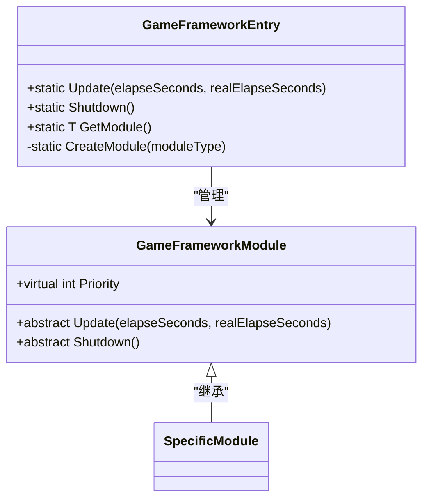
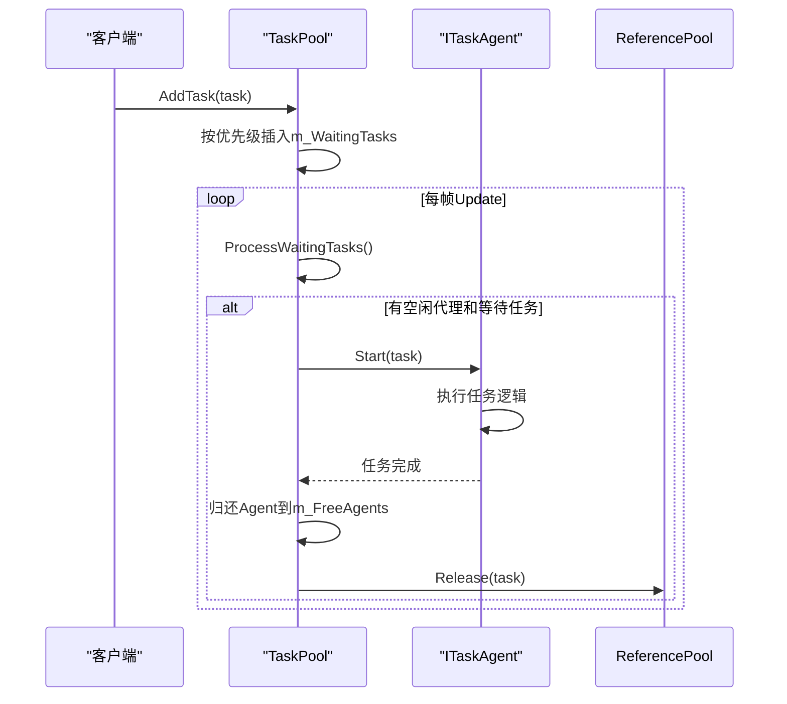
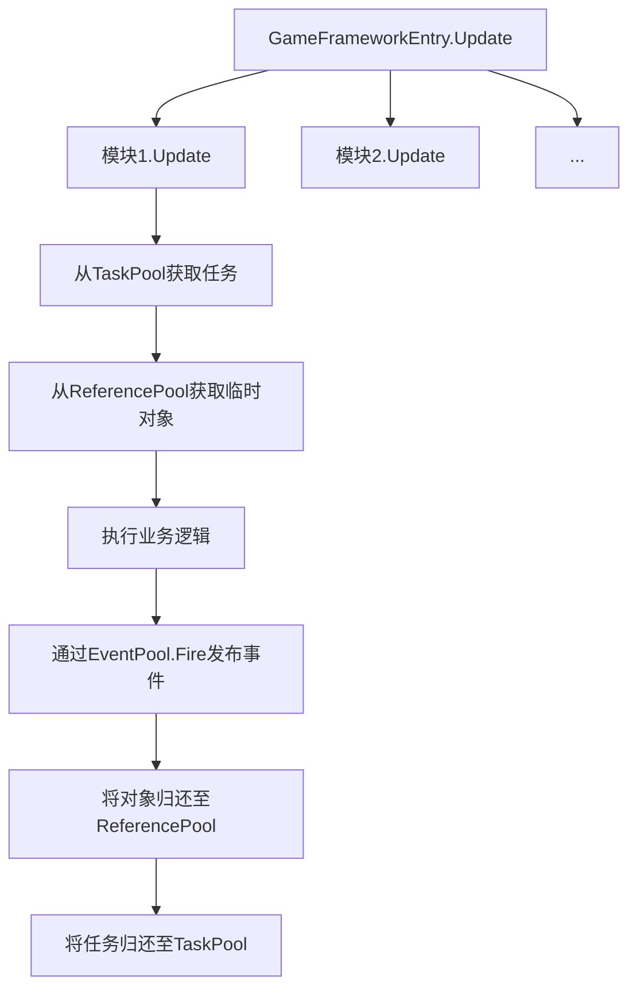

# 核心基础

<cite>
**本文档中引用的文件**  
- [GameFrameworkEntry.cs](file://GameFramework/Base/GameFrameworkEntry.cs)
- [GameFrameworkModule.cs](file://GameFramework/Base/GameFrameworkModule.cs)
- [ReferencePool.cs](file://GameFramework/Base/ReferencePool/ReferencePool.cs)
- [TaskPool.cs](file://GameFramework/Base/TaskPool/TaskPool.cs)
- [EventPool.cs](file://GameFramework/Base/EventPool/EventPool.cs)
- [IReference.cs](file://GameFramework/Base/ReferencePool/IReference.cs)
- [TaskBase.cs](file://GameFramework/Base/TaskPool/TaskBase.cs)
- [ITaskAgent.cs](file://GameFramework/Base/TaskPool/ITaskAgent.cs)
- [BaseEventArgs.cs](file://GameFramework/Base/EventPool/BaseEventArgs.cs)
- [Utility.cs](file://GameFramework/Utility/Utility.cs)
</cite>

## 目录
1. [简介](#简介)
2. [框架入口与模块管理](#框架入口与模块管理)
3. [引用池机制](#引用池机制)
4. [任务池调度模型](#任务池调度模型)
5. [事件池与线程安全广播](#事件池与线程安全广播)
6. [通用工具类](#通用工具类)
7. [核心组件协同工作流程](#核心组件协同工作流程)
8. [最佳实践与设计模式分析](#最佳实践与设计模式分析)
9. [总结](#总结)

## 简介
GameFramework 是一个为 Unity 游戏开发设计的高效、可扩展的基础框架。其核心基础设施由多个关键组件构成，包括框架入口 `GameFrameworkEntry`、模块基类 `GameFrameworkModule`、引用池 `ReferencePool`、任务池 `TaskPool`、事件池 `EventPool` 以及通用工具类 `Utility`。这些组件共同构建了一个稳定、高性能的运行时环境，支撑上层业务逻辑的开发。本文档将深入剖析这些基础组件的设计原理、实现机制以及它们之间的协同工作方式，帮助开发者理解框架的底层运作机制。

## 框架入口与模块管理

`GameFrameworkEntry` 是整个框架的统一入口点，负责所有游戏框架模块的生命周期管理。它通过一个优先级排序的双向链表 `s_GameFrameworkModules` 来管理所有已注册的模块。开发者通过 `GetModule<T>()` 接口获取特定模块的实例，该接口采用接口类型作为泛型参数，内部通过反射机制自动创建并注册模块，实现了模块的延迟初始化和单例模式。

模块的轮询和关闭操作由 `Update` 和 `Shutdown` 方法统一调度。`Update` 方法会按优先级顺序遍历所有模块并调用其 `Update` 方法，确保高优先级模块（如资源管理、网络）能优先处理逻辑。`Shutdown` 方法则反向遍历模块链表，确保模块能按正确的顺序关闭，避免资源释放冲突。



**图示来源**
- [GameFrameworkEntry.cs](file://GameFramework/Base/GameFrameworkEntry.cs#L15-L131)
- [GameFrameworkModule.cs](file://GameFramework/Base/GameFrameworkModule.cs#L12-L37)

**本节来源**
- [GameFrameworkEntry.cs](file://GameFramework/Base/GameFrameworkEntry.cs#L15-L131)
- [GameFrameworkModule.cs](file://GameFramework/Base/GameFrameworkModule.cs#L12-L37)

## 引用池机制

`ReferencePool` 是一个基于对象池模式的内存管理组件，旨在减少频繁的内存分配与垃圾回收（GC）带来的性能开销。它通过为每种实现了 `IReference` 接口的类型维护一个独立的 `ReferenceCollection` 来实现对象的复用。

`IReference` 接口定义了 `Clear()` 方法，用于在对象归还池中时重置其内部状态，确保下次获取时是一个干净的实例。`ReferencePool` 提供了 `Acquire<T>()` 和 `Release()` 方法用于获取和归还对象。当池中没有可用对象时，`Acquire` 会通过 `Activator.CreateInstance` 创建新实例；当对象使用完毕后，必须调用 `Release` 将其归还，此时对象的 `Clear()` 方法会被调用，然后对象被放入队列等待下次复用。

```mermaid
flowchart TD
A[调用 Acquire<T>()] --> B{池中是否有可用对象?}
B --> |是| C[从队列取出对象]
B --> |否| D[创建新实例]
C --> E[返回对象]
D --> E
E --> F[使用对象]
F --> G[调用 Release()]
G --> H[调用对象的 Clear() 方法]
H --> I[将对象放回队列]
I --> B
```

**图示来源**
- [ReferencePool.cs](file://GameFramework/Base/ReferencePool/ReferencePool.cs#L15-L225)
- [IReference.cs](file://GameFramework/Base/ReferencePool/IReference.cs#L12-L18)

**本节来源**
- [ReferencePool.cs](file://GameFramework/Base/ReferencePool/ReferencePool.cs#L15-L225)
- [IReference.cs](file://GameFramework/Base/ReferencePool/IReference.cs#L12-L18)

## 任务池调度模型

`TaskPool<T>` 是一个通用的异步任务调度器，用于管理不同类型的任务（`T` 必须继承自 `TaskBase`）。它采用生产者-消费者模式，将任务的提交与执行解耦。任务池内部维护了三个核心队列：`m_WaitingTasks`（等待队列）、`m_FreeAgents`（空闲代理栈）和 `m_WorkingAgents`（工作代理链表）。

任务代理 `ITaskAgent<T>` 是实际执行任务的工作者。当有空闲代理和等待任务时，`ProcessWaitingTasks` 方法会将任务分配给代理，代理通过 `Start(T task)` 方法开始处理。任务的执行状态（`TaskStatus`）由代理在 `Update` 中维护。任务完成后，代理被归还到空闲栈，任务对象则通过 `ReferencePool.Release(task)` 归还到引用池以供复用。

任务的优先级调度通过在 `m_WaitingTasks` 链表中按优先级降序插入来实现，确保高优先级任务能优先被处理。



**图示来源**
- [TaskPool.cs](file://GameFramework/Base/TaskPool/TaskPool.cs#L15-L442)
- [TaskBase.cs](file://GameFramework/Base/TaskPool/TaskBase.cs#L12-L135)
- [ITaskAgent.cs](file://GameFramework/Base/TaskPool/ITaskAgent.cs#L13-L51)

**本节来源**
- [TaskPool.cs](file://GameFramework/Base/TaskPool/TaskPool.cs#L15-L442)
- [TaskBase.cs](file://GameFramework/Base/TaskPool/TaskBase.cs#L12-L135)
- [ITaskAgent.cs](file://GameFramework/Base/TaskPool/ITaskAgent.cs#L13-L51)

## 事件池与线程安全广播

`EventPool<T>` 实现了一个线程安全的事件广播系统，遵循观察者模式。它允许模块间通过事件进行松耦合通信。其核心设计在于 `Fire` 和 `FireNow` 方法的区别。

`FireNow` 方法会立即在当前线程调用所有事件处理器，这要求调用者确保在主线程执行，否则可能导致Unity API调用异常。而 `Fire` 方法则是线程安全的，它将事件包装成 `Event` 对象（同样来自引用池），并线程安全地（通过 `lock(m_Events)`）放入一个待处理队列 `m_Events`。在主线程的 `Update` 周期中，`EventPool` 会从队列中取出所有事件并分发，从而保证了事件处理器总是在主线程执行。

事件处理器通过 `Subscribe` 和 `Unsubscribe` 进行管理，支持多种模式（如是否允许多个处理器、是否允许重复订阅），并通过 `m_CachedNodes` 字典在遍历过程中安全地处理取消订阅操作，避免了 `ConcurrentModificationException`。

```mermaid
flowchart LR
A[其他线程调用Fire()] --> B[创建Event对象]
B --> C[线程安全地加入m_Events队列]
C --> D[主线程Update()]
D --> E[从m_Events队列取出事件]
E --> F[调用HandleEvent分发]
F --> G[执行所有订阅的处理器]
G --> H[归还Event和EventArgs到引用池]
```

**图示来源**
- [EventPool.cs](file://GameFramework/Base/EventPool/EventPool.cs#L29-L285)
- [EventPool.Event.cs](file://GameFramework/Base/EventPool/EventPool.Event.cs#L9-L55)
- [BaseEventArgs.cs](file://GameFramework/Base/EventPool/BaseEventArgs.cs#L12-L21)

**本节来源**
- [EventPool.cs](file://GameFramework/Base/EventPool/EventPool.cs#L29-L285)
- [EventPool.Event.cs](file://GameFramework/Base/EventPool/EventPool.Event.cs#L9-L55)
- [BaseEventArgs.cs](file://GameFramework/Base/EventPool/BaseEventArgs.cs#L12-L21)

## 通用工具类

`Utility` 类是一个静态工具集合，提供了各种常用的辅助功能，被框架的各个模块广泛依赖。它被设计为多个嵌套的静态类，如 `Utility.Text`、`Utility.Json`、`Utility.Path` 等，以实现功能的模块化。

例如，`Utility.Text.Format` 方法封装了字符串格式化，`Utility.Assembly` 类提供了对程序集中类型进行缓存和查找的功能，避免了频繁的反射开销。这些工具类的设计遵循了单一职责原则，将通用的、与业务无关的逻辑集中管理，提高了代码的复用性和可维护性。

**本节来源**
- [Utility.cs](file://GameFramework/Utility/Utility.cs#L12-L16)
- [Utility.Assembly.cs](file://GameFramework/Utility/Utility.Assembly.cs#L12-L107)

## 核心组件协同工作流程

GameFramework 的核心组件通过 `GameFrameworkEntry` 的 `Update` 循环紧密协作。每一帧，`GameFrameworkEntry` 会按优先级顺序调用所有模块的 `Update` 方法。这些模块内部会利用 `TaskPool` 调度异步任务，使用 `ReferencePool` 获取和归还临时对象，并通过 `EventPool` 发布或监听事件。

例如，一个资源加载模块在 `Update` 中检查 `TaskPool`，发现有新的加载任务后，会启动加载流程。加载过程中，它可能从 `ReferencePool` 获取一个 `LoadEventArgs` 对象来传递进度信息，并通过 `EventPool.Fire` 发布进度事件。加载完成后，它会将结果通过 `EventPool` 广播，并将任务对象和事件参数归还到各自的池中。整个流程高效且低开销，体现了各组件协同工作的强大能力。



**图示来源**
- [GameFrameworkEntry.cs](file://GameFramework/Base/GameFrameworkEntry.cs#L15-L131)
- [TaskPool.cs](file://GameFramework/Base/TaskPool/TaskPool.cs#L15-L442)
- [ReferencePool.cs](file://GameFramework/Base/ReferencePool/ReferencePool.cs#L15-L225)
- [EventPool.cs](file://GameFramework/Base/EventPool/EventPool.cs#L29-L285)

## 最佳实践与设计模式分析

GameFramework 的设计中蕴含了多种经典的设计模式：

1.  **单例模式 (Singleton)**：`GameFrameworkEntry` 作为静态类，提供了全局唯一的访问点，其管理的模块也通过 `GetModule<T>()` 实现了单例。
2.  **对象池模式 (Object Pool)**：`ReferencePool` 和 `TaskPool` 都是对象池的典型应用，有效减少了GC压力。
3.  **观察者模式 (Observer)**：`EventPool` 允许对象订阅和发布事件，实现了对象间的解耦。
4.  **策略模式 (Strategy)**：`ITaskAgent<T>` 接口定义了任务执行的策略，不同的任务类型可以有不同的代理实现。
5.  **模板方法模式 (Template Method)**：`GameFrameworkModule` 定义了 `Update` 和 `Shutdown` 的骨架，具体模块实现其细节。

**最佳实践建议**：
- **及时归还**：从 `ReferencePool` 获取的任何对象，使用完毕后必须调用 `Release`，否则会导致内存泄漏和对象池失效。
- **优先级管理**：合理设置 `GameFrameworkModule` 的 `Priority`，确保关键模块能及时响应。
- **线程安全**：在非主线程中，应使用 `EventPool.Fire` 而非 `FireNow` 来发布事件。
- **避免循环依赖**：模块间应通过事件通信，避免直接相互持有引用，防止循环依赖。

**本节来源**
- [GameFrameworkEntry.cs](file://GameFramework/Base/GameFrameworkEntry.cs#L15-L131)
- [ReferencePool.cs](file://GameFramework/Base/ReferencePool/ReferencePool.cs#L15-L225)
- [TaskPool.cs](file://GameFramework/Base/TaskPool/TaskPool.cs#L15-L442)
- [EventPool.cs](file://GameFramework/Base/EventPool/EventPool.cs#L29-L285)

## 总结
GameFramework 的核心基础设施通过精心设计的 `GameFrameworkEntry`、`ReferencePool`、`TaskPool`、`EventPool` 等组件，构建了一个高效、稳定、可扩展的运行时环境。这些组件不仅各自解决了特定的技术问题（如内存管理、异步调度、事件通信），更通过清晰的接口和协同机制，共同支撑了整个框架的上层模块。理解这些基础组件的工作原理和设计模式，是深入掌握和高效使用 GameFramework 的关键。