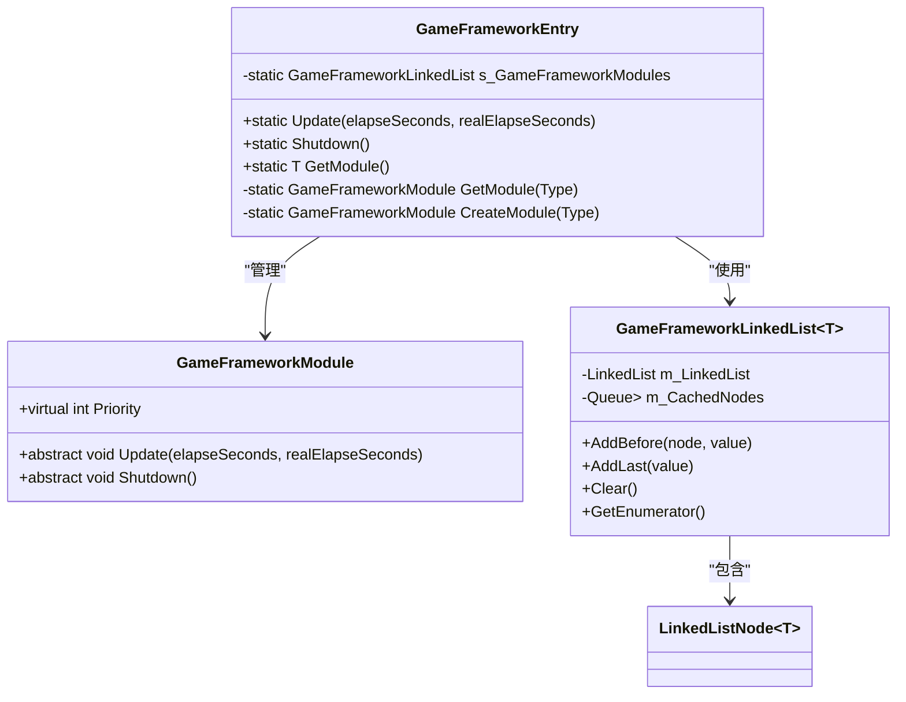
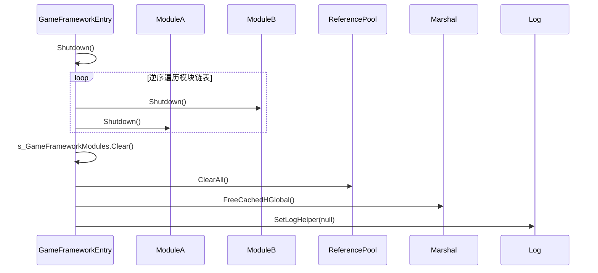

# 框架入口 (GameFrameworkEntry)

<cite>
**Referenced Files in This Document**   
- [GameFrameworkEntry.cs](file://GameFramework/Base/GameFrameworkEntry.cs)
- [GameFrameworkModule.cs](file://GameFramework/Base/GameFrameworkModule.cs)
- [GameFrameworkLinkedList.cs](file://GameFramework/Base/GameFrameworkLinkedList.cs)
- [ReferencePool.cs](file://GameFramework/Base/ReferencePool/ReferencePool.cs)
- [GameFrameworkLog.cs](file://GameFramework/Base/Log/GameFrameworkLog.cs)
- [Marshal.cs](file://GameFramework/Base/Utility/Marshal.cs)
</cite>

## 目录
1. [简介](#简介)
2. [核心职责与生命周期管理](#核心职责与生命周期管理)
3. [模块注册与访问机制](#模块注册与访问机制)
4. [优先级排序与轮询更新](#优先级排序与轮询更新)
5. [关闭清理与资源回收](#关闭清理与资源回收)
6. [线程安全与最佳实践](#线程安全与最佳实践)

## 简介

`GameFrameworkEntry` 是整个游戏框架的静态入口点，扮演着核心协调者的角色。它通过一个中心化的静态类，统一管理所有框架模块（`GameFrameworkModule`）的生命周期，包括模块的自动创建、优先级排序、轮询更新和关闭清理。该设计模式实现了模块间的解耦，为开发者提供了一个清晰、稳定且可扩展的框架初始化和交互视图。

**Section sources**
- [GameFrameworkEntry.cs](file://GameFramework/Base/GameFrameworkEntry.cs#L15-L131)

## 核心职责与生命周期管理

`GameFrameworkEntry` 的核心职责是作为框架的“心脏”，驱动所有模块的生命周期。它通过一个静态的 `GameFrameworkLinkedList<GameFrameworkModule>` 链表来存储和管理所有已创建的模块实例。

模块的生命周期由 `GetModule<T>()`、`Update()` 和 `Shutdown()` 三个核心方法驱动：
1.  **初始化与获取**：通过 `GetModule<T>()` 泛型方法，开发者可以按接口类型获取模块实例。如果模块尚未创建，该方法会自动完成创建和注册。
2.  **持续更新**：在游戏主循环中，框架会定期调用 `Update()` 方法，该方法会遍历链表中的所有模块，并调用它们各自的 `Update` 方法，实现逻辑的持续驱动。
3.  **优雅关闭**：当游戏退出时，调用 `Shutdown()` 方法，该方法会逆序调用所有模块的 `Shutdown` 方法，并执行全局资源清理。

```mermaid
flowchart TD
A[应用启动] --> B[调用 GetModule<T>()]
B --> C{模块已存在?}
C --> |是| D[返回现有实例]
C --> |否| E[创建新模块]
E --> F[按优先级插入链表]
F --> D
D --> G[主循环]
G --> H[调用 GameFrameworkEntry.Update()]
H --> I[遍历链表]
I --> J[调用每个模块的 Update()]
J --> G
G --> K[应用关闭]
K --> L[调用 GameFrameworkEntry.Shutdown()]
L --> M[逆序遍历链表]
M --> N[调用每个模块的 Shutdown()]
N --> O[清理全局资源]
O --> P[退出]
```

**Diagram sources**
- [GameFrameworkEntry.cs](file://GameFramework/Base/GameFrameworkEntry.cs#L15-L131)
- [GameFrameworkModule.cs](file://GameFramework/Base/GameFrameworkModule.cs#L12-L37)

**Section sources**
- [GameFrameworkEntry.cs](file://GameFramework/Base/GameFrameworkEntry.cs#L15-L131)
- [GameFrameworkModule.cs](file://GameFramework/Base/GameFrameworkModule.cs#L12-L37)

## 模块注册与访问机制

`GameFrameworkEntry` 通过 `GetModule<T>()` 泛型方法实现了模块的注册与访问，其核心是基于接口的反射创建机制。

### 工作流程
1.  **接口验证**：方法首先检查泛型参数 `T` 是否为一个接口类型，且其命名空间以 `GameFramework.` 开头，确保了类型安全。
2.  **类型映射**：根据接口名称（如 `IResourceModule`）动态推导出对应的实现类名称（如 `ResourceModule`），并使用 `Type.GetType()` 获取其 `Type` 对象。
3.  **实例获取或创建**：调用私有的 `GetModule(Type)` 方法。该方法会遍历链表，检查目标类型是否已存在。若存在，则直接返回；若不存在，则调用 `CreateModule()` 创建新实例。

### 泛型方法实现
```csharp
public static T GetModule<T>() where T : class
{
    Type interfaceType = typeof(T);
    // ... 接口验证逻辑 ...
    string moduleName = Utility.Text.Format("{0}.{1}", interfaceType.Namespace, interfaceType.Name.Substring(1));
    Type moduleType = Type.GetType(moduleName);
    // ... 类型验证逻辑 ...
    return GetModule(moduleType) as T;
}
```

**Section sources**
- [GameFrameworkEntry.cs](file://GameFramework/Base/GameFrameworkEntry.cs#L65-L100)

## 优先级排序与轮询更新

为了确保模块间依赖关系的正确执行，`GameFrameworkEntry` 使用 `GameFrameworkLinkedList` 实现了基于优先级的排序机制。

### 优先级排序
- **排序依据**：每个 `GameFrameworkModule` 派生类都可以通过重写 `Priority` 属性来定义自己的优先级。优先级数值越大，表示优先级越高。
- **插入逻辑**：在 `CreateModule()` 方法中，新创建的模块会从链表头部开始遍历，找到第一个优先级低于自己的模块，并将其插入到该模块之前。如果所有现有模块的优先级都更高，则将其添加到链表末尾。
- **数据结构**：`GameFrameworkLinkedList` 是对 .NET `LinkedList<T>` 的封装，提供了节点缓存（`m_CachedNodes`）以减少 GC 压力，提升了性能。

### 轮询更新
`Update()` 方法的实现非常简洁，它利用 `GameFrameworkLinkedList` 的迭代器，按照链表中模块的顺序（即优先级从高到低）依次调用每个模块的 `Update` 方法，确保了高优先级模块能优先处理逻辑。



**Diagram sources**
- [GameFrameworkEntry.cs](file://GameFramework/Base/GameFrameworkEntry.cs#L15-L131)
- [GameFrameworkModule.cs](file://GameFramework/Base/GameFrameworkModule.cs#L12-L37)
- [GameFrameworkLinkedList.cs](file://GameFramework/Base/GameFrameworkLinkedList.cs#L18-L451)

**Section sources**
- [GameFrameworkEntry.cs](file://GameFramework/Base/GameFrameworkEntry.cs#L101-L130)
- [GameFrameworkLinkedList.cs](file://GameFramework/Base/GameFrameworkLinkedList.cs#L18-L451)

## 关闭清理与资源回收

`Shutdown()` 方法不仅负责关闭所有模块，还承担了全局资源的清理工作，确保应用能优雅退出。

### 关闭流程
1.  **逆序关闭模块**：从链表的最后一个节点（即优先级最低的模块）开始，逆序向前遍历并调用每个模块的 `Shutdown()` 方法。这保证了依赖其他模块的模块会先被关闭，而被依赖的模块后关闭，避免了资源提前释放的问题。
2.  **清理模块链表**：调用 `s_GameFrameworkModules.Clear()` 清空链表。
3.  **全局资源回收**：
    - **引用池**：调用 `ReferencePool.ClearAll()`，释放所有被缓存的引用对象，归还给系统。
    - **非托管内存**：调用 `Utility.Marshal.FreeCachedHGlobal()`，释放框架内部缓存的非托管内存。
    - **日志系统**：调用 `GameFrameworkLog.SetLogHelper(null)`，解除日志辅助器的引用，防止在应用退出后仍有日志写入。



**Diagram sources**
- [GameFrameworkEntry.cs](file://GameFramework/Base/GameFrameworkEntry.cs#L40-L55)
- [ReferencePool.cs](file://GameFramework/Base/ReferencePool/ReferencePool.cs#L70-L81)
- [GameFrameworkLog.cs](file://GameFramework/Base/Log/GameFrameworkLog.cs#L20-L23)

**Section sources**
- [GameFrameworkEntry.cs](file://GameFramework/Base/GameFrameworkEntry.cs#L40-L55)
- [ReferencePool.cs](file://GameFramework/Base/ReferencePool/ReferencePool.cs#L70-L81)
- [GameFrameworkLog.cs](file://GameFramework/Base/Log/GameFrameworkLog.cs#L20-L23)

## 线程安全与最佳实践

### 线程安全考虑
`GameFrameworkEntry` 的设计主要面向单线程的主循环场景。其内部的 `GameFrameworkLinkedList` 和模块操作本身不是线程安全的。因此，`GetModule<T>()`、`Update()` 和 `Shutdown()` 等核心方法应确保在主线程中调用。对于需要在多线程中访问模块的场景，开发者应自行实现线程同步机制。

### 最佳实践
1.  **按接口编程**：始终通过 `GetModule<IYourModule>()` 的方式获取模块，而不是直接引用具体实现类，这符合依赖倒置原则。
2.  **合理设置优先级**：在自定义模块时，根据模块间的依赖关系合理设置 `Priority` 属性。例如，日志模块（`LogModule`）通常需要在大多数模块之前初始化，以便记录启动日志。
3.  **及时清理资源**：在模块的 `Shutdown()` 方法中，应负责清理自身分配的所有资源，如事件监听、定时器、异步任务等，避免内存泄漏。
4.  **避免循环依赖**：设计模块时应避免出现循环依赖，否则可能导致 `GetModule<T>()` 时出现死锁或无限递归。