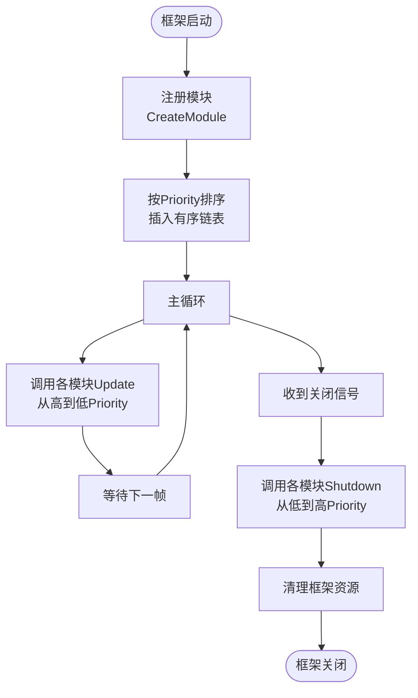

# 模块基类 (GameFrameworkModule)

<cite>
**本文档中引用的文件**  
- [GameFrameworkModule.cs](file://GameFramework/Base/GameFrameworkModule.cs)
- [GameFrameworkEntry.cs](file://GameFramework/Base/GameFrameworkEntry.cs)
- [EventManager.cs](file://GameFramework/Event/EventManager.cs)
- [DownloadManager.cs](file://GameFramework/Download/DownloadManager.cs)
- [ConfigManager.cs](file://GameFramework/Config/ConfigManager.cs)
- [ResourceManager.cs](file://GameFramework/Resource/ResourceManager.cs)
</cite>

## 目录
1. [简介](#简介)
2. [核心设计与成员解析](#核心设计与成员解析)
3. [访问修饰符设计意图](#访问修饰符设计意图)
4. [框架入口与轮询机制](#框架入口与轮询机制)
5. [子模块实现示例分析](#子模块实现示例分析)
6. [生命周期管理流程图](#生命周期管理流程图)
7. [模块优先级排序机制](#模块优先级排序机制)
8. [开发者实现规范](#开发者实现规范)
9. [总结](#总结)

## 简介
`GameFrameworkModule` 是游戏框架中所有功能模块的抽象基类，定义了模块生命周期管理的核心契约。作为框架的基石，它为资源管理、事件系统、下载管理等子系统提供了统一的接口规范，确保各模块能够被框架统一调度和管理。

## 核心设计与成员解析

`GameFrameworkModule` 抽象类定义了三个核心成员，构成了模块生命周期管理的基础：

- **Priority 属性**：获取模块的优先级，决定模块在更新和关闭时的执行顺序。优先级较高的模块会优先进行轮询，而在关闭时则会后执行。
- **Update 方法**：每帧调用的轮询方法，用于处理模块的逻辑更新。该方法接收逻辑流逝时间和真实流逝时间两个参数，以支持不同类型的更新逻辑。
- **Shutdown 方法**：用于关闭并清理模块资源的方法，在框架关闭时被调用。

这些成员共同构成了模块与框架交互的核心接口，使得框架能够以统一的方式管理所有子模块。

**Section sources**
- [GameFrameworkModule.cs](file://GameFramework/Base/GameFrameworkModule.cs#L18-L36)

## 访问修饰符设计意图
`GameFrameworkModule` 类及其核心成员均使用 `internal` 访问修饰符，这一设计具有明确的架构意图：

- **框架内部封装**：将模块基类限制在框架程序集内部，防止外部代码直接继承或实现，确保框架的完整性和一致性。
- **控制扩展点**：通过 `internal` 修饰符，框架开发者可以精确控制哪些类型可以作为游戏框架模块存在，避免外部随意扩展导致的架构混乱。
- **安全边界**：创建了一个清晰的安全边界，确保只有经过验证的内部模块才能参与框架的核心生命周期管理。

这种设计体现了框架设计中的"封闭-开放"原则，即对扩展开放，对修改封闭，保证了框架的稳定性和可维护性。

**Section sources**
- [GameFrameworkModule.cs](file://GameFramework/Base/GameFrameworkModule.cs#L15-L38)

## 框架入口与轮询机制
框架通过 `GameFrameworkEntry` 类提供统一的入口点，实现了对所有模块的集中管理：

- **模块注册**：通过 `GetModule<T>()` 方法获取指定类型的模块实例，如果不存在则自动创建并根据优先级插入到有序链表中。
- **统一更新**：`Update` 方法遍历所有已注册的模块，依次调用其 `Update` 方法，实现每帧的统一轮询。
- **有序关闭**：`Shutdown` 方法从链表尾部开始反向遍历，依次调用各模块的 `Shutdown` 方法，确保高优先级模块后关闭。

这种机制确保了模块间的执行顺序可控，为复杂系统的稳定运行提供了保障。

**Section sources**
- [GameFrameworkEntry.cs](file://GameFramework/Base/GameFrameworkEntry.cs#L0-L131)

## 子模块实现示例分析
多个子模块继承 `GameFrameworkModule` 并实现了其核心方法，展示了标准的实现模式：

### 事件管理器 (EventManager)
- **Priority**: 返回 7，表明其具有较高的更新优先级
- **Update**: 调用内部的事件池进行更新，处理事件的分发
- **Shutdown**: 关闭并清理事件池资源

### 下载管理器 (DownloadManager)
- **Priority**: 返回 5，优先级适中
- **Update**: 更新任务池和下载计数器
- **Shutdown**: 关闭任务池和下载计数器

### 资源管理器 (ResourceManager)
- **Priority**: 返回 3，优先级较低
- **Update**: 根据当前状态更新资源校验器、更新器或资源加载器
- **Shutdown**: 依次清理各个子系统和资源

这些实现展示了如何通过重写基类方法来参与框架的生命周期管理，同时保持各自业务逻辑的独立性。

**Section sources**
- [EventManager.cs](file://GameFramework/Event/EventManager.cs#L14-L147)
- [DownloadManager.cs](file://GameFramework/Download/DownloadManager.cs#L15-L486)
- [ResourceManager.cs](file://GameFramework/Resource/ResourceManager.cs#L16-L1599)

## 生命周期管理流程图

**Diagram sources**
- [GameFrameworkModule.cs](file://GameFramework/Base/GameFrameworkModule.cs#L18-L36)
- [GameFrameworkEntry.cs](file://GameFramework/Base/GameFrameworkEntry.cs#L24-L46)

## 模块优先级排序机制
框架使用 `GameFrameworkLinkedList<GameFrameworkModule>` 存储所有模块，并在创建时根据 `Priority` 属性进行排序：

- **创建时排序**：`CreateModule` 方法在创建新模块时，会遍历链表找到合适的位置插入，确保高优先级模块位于链表前端。
- **更新顺序**：`Update` 方法按链表顺序从前向后遍历，因此高优先级模块优先更新。
- **关闭顺序**：`Shutdown` 方法从链表尾部开始向前遍历，因此低优先级模块先关闭，高优先级模块后关闭。

这种设计确保了模块间依赖关系的正确处理，例如资源管理器（低优先级）在事件系统（高优先级）之前关闭，避免了资源提前释放的问题。

**Section sources**
- [GameFrameworkEntry.cs](file://GameFramework/Base/GameFrameworkEntry.cs#L93-L132)

## 开发者实现规范
当开发者需要创建自定义模块时，应遵循以下规范：

1. **继承基类**：创建的模块类必须继承 `GameFrameworkModule` 抽象类
2. **重写方法**：必须实现 `Update` 和 `Shutdown` 方法，根据需要重写 `Priority` 属性
3. **优先级设置**：合理设置 `Priority` 值，避免与其他模块冲突
4. **资源管理**：在 `Shutdown` 方法中确保释放所有分配的资源
5. **线程安全**：考虑 `Update` 方法可能在不同线程中调用，确保线程安全性

通过遵循这些规范，开发者可以确保自定义模块能够无缝集成到框架中，参与统一的生命周期管理。

**Section sources**
- [GameFrameworkModule.cs](file://GameFramework/Base/GameFrameworkModule.cs#L15-L38)
- [GameFrameworkEntry.cs](file://GameFramework/Base/GameFrameworkEntry.cs#L62-L94)

## 总结
`GameFrameworkModule` 作为游戏框架的抽象基类，通过定义 `Priority`、`Update` 和 `Shutdown` 三个核心成员，为所有子模块提供了统一的生命周期管理接口。其 `internal` 访问修饰符的设计确保了框架的封闭性和安全性，而通过 `GameFrameworkEntry` 实现的轮询机制则保证了模块间的有序执行。这种设计模式不仅提高了框架的可维护性，也为开发者提供了清晰的扩展规范，是游戏框架架构中的关键组成部分。