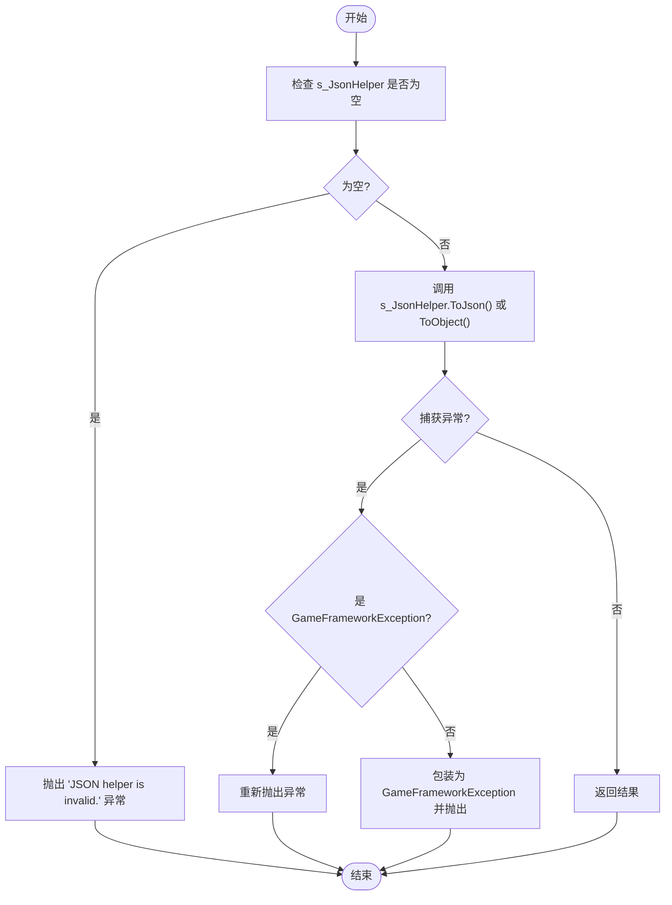
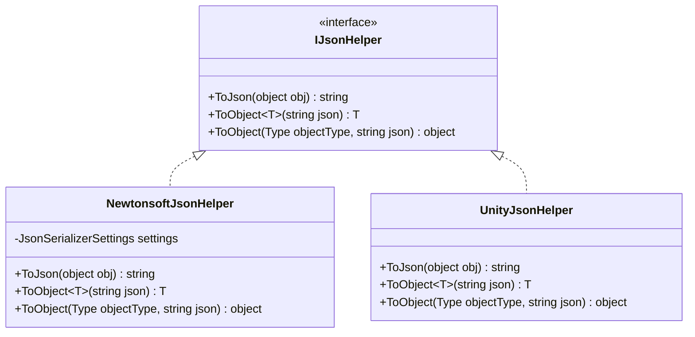
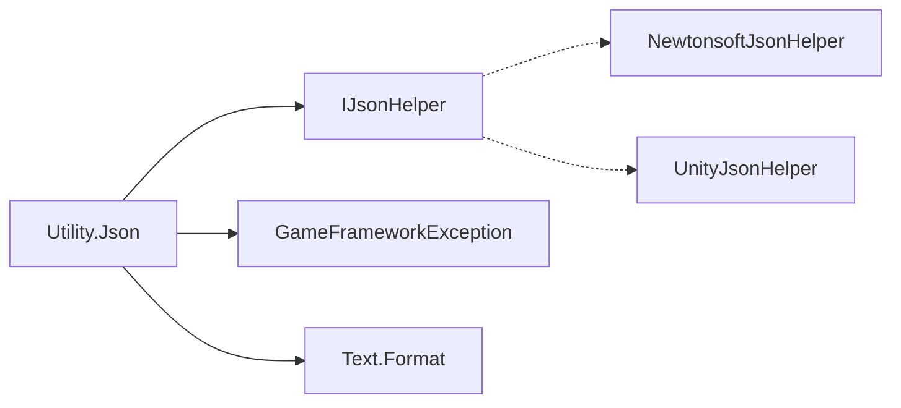

<cite>
**本文档中引用的文件**   
- [Utility.Json.cs](file://GameFramework/Utility/Utility.Json.cs)
- [Utility.Json.IJsonHelper.cs](file://GameFramework/Utility/Utility.Json.IJsonHelper.cs)
</cite>

## 目录
1. [简介](#简介)
2. [核心组件](#核心组件)
3. [架构概述](#架构概述)
4. [详细组件分析](#详细组件分析)
5. [依赖分析](#依赖分析)
6. [性能考虑](#性能考虑)
7. [故障排除指南](#故障排除指南)
8. [结论](#结论)

## 简介
`Utility.Json` 模块是 GameFramework 中用于处理对象与 JSON 字符串之间序列化和反序列化的核心工具。该模块通过定义 `IJsonHelper` 接口，实现了对底层 JSON 库的抽象，允许开发者灵活替换不同的 JSON 实现（如 Newtonsoft.Json 或 Unity 内置的 JsonUtility），从而在不同项目需求或性能要求下进行优化。本文档将深入讲解该模块的设计原理、使用方法、扩展机制以及性能建议。

## 核心组件
`Utility.Json` 模块的核心由两个主要部分构成：静态工具类 `Utility.Json` 和接口 `IJsonHelper`。前者为开发者提供了简洁易用的序列化与反序列化方法，后者则定义了底层 JSON 操作的契约，实现了与具体实现的解耦。

**Section sources**
- [Utility.Json.cs](file://GameFramework/Utility/Utility.Json.cs#L18-L119)
- [Utility.Json.IJsonHelper.cs](file://GameFramework/Utility/Utility.Json.IJsonHelper.cs#L18-L42)

## 架构概述
该模块采用“接口隔离 + 静态门面”的设计模式。`IJsonHelper` 接口隔离了具体的 JSON 库实现，而 `Utility.Json` 静态类则作为门面（Facade），为上层应用提供统一的调用入口。这种设计使得上层代码无需关心底层使用的是哪个 JSON 库，只需通过 `SetJsonHelper` 方法注入一个实现了 `IJsonHelper` 的实例即可。

```mermaid
graph TB
subgraph "上层应用"
A[业务逻辑]
end
subgraph "Utility.Json 模块"
B[Utility.Json.ToJson]
C[Utility.Json.ToObject<T>]
D[Utility.Json.ToObject(Type, string)]
E[IJsonHelper]
end
subgraph "第三方库"
F[Newtonsoft.Json]
G[Unity.JsonUtility]
H[其他自定义实现]
end
A --> B
A --> C
A --> D
B --> E
C --> E
D --> E
E --> F
E --> G
E --> H
style A fill:#f9f,stroke:#333
style B fill:#bbf,stroke:#333
style C fill:#bbf,stroke:#333
style D fill:#bbf,stroke:#333
style E fill:#f96,stroke:#333
style F fill:#9f9,stroke:#333
style G fill:#9f9,stroke:#333
style H fill:#9f9,stroke:#333
```

**Diagram sources **
- [Utility.Json.cs](file://GameFramework/Utility/Utility.Json.cs#L18-L119)
- [Utility.Json.IJsonHelper.cs](file://GameFramework/Utility/Utility.Json.IJsonHelper.cs#L18-L42)

## 详细组件分析

### Utility.Json 静态类分析
`Utility.Json` 是一个静态类，提供了 `ToJson`、`ToObject<T>` 和 `ToObject(Type, string)` 三个核心方法。这些方法本身不执行具体的序列化/反序列化逻辑，而是委托给一个由 `SetJsonHelper` 方法设置的 `IJsonHelper` 实例。这种设计确保了工具类的无状态性和可扩展性。

该类在调用前会检查 `s_JsonHelper` 是否已设置，若未设置则抛出 `GameFrameworkException`。此外，它还捕获了底层 JSON 操作可能抛出的异常，并将其包装为更具体的 `GameFrameworkException`，便于上层进行统一的错误处理。

#### 序列化与反序列化流程图


**Diagram sources **
- [Utility.Json.cs](file://GameFramework/Utility/Utility.Json.cs#L18-L119)

**Section sources**
- [Utility.Json.cs](file://GameFramework/Utility/Utility.Json.cs#L18-L119)

### IJsonHelper 接口分析
`IJsonHelper` 接口是整个模块的扩展点。任何实现了该接口的类都可以作为 `Utility.Json` 的底层实现。接口定义了三个方法，分别对应对象到 JSON 字符串的序列化，以及从 JSON 字符串到泛型对象和指定类型的对象的反序列化。

#### 接口类图


**Diagram sources **
- [Utility.Json.IJsonHelper.cs](file://GameFramework/Utility/Utility.Json.IJsonHelper.cs#L18-L42)

**Section sources**
- [Utility.Json.IJsonHelper.cs](file://GameFramework/Utility/Utility.Json.IJsonHelper.cs#L18-L42)

## 依赖分析
`Utility.Json` 模块的依赖关系清晰且松散。其核心依赖是 `IJsonHelper` 接口，该接口本身不依赖任何具体实现。`Utility.Json` 类依赖于 `GameFrameworkException` 和 `Text.Format` 方法，用于异常处理和消息格式化。



**Diagram sources **
- [Utility.Json.cs](file://GameFramework/Utility/Utility.Json.cs#L18-L119)
- [Utility.Json.IJsonHelper.cs](file://GameFramework/Utility/Utility.Json.IJsonHelper.cs#L18-L42)

**Section sources**
- [Utility.Json.cs](file://GameFramework/Utility/Utility.Json.cs#L18-L119)

## 性能考虑
虽然 `Utility.Json` 模块本身不直接处理性能，但它为性能优化提供了基础。开发者应遵循以下建议：
1. **避免频繁序列化大型对象**：序列化/反序列化是相对耗时的操作，尤其是在处理大型或复杂对象图时。应尽量减少此类操作的频率，或考虑使用二进制序列化等更高效的方式。
2. **选择合适的底层库**：对于性能要求极高的场景，应选择性能更优的 JSON 库（如 Newtonsoft.Json 的某些配置）并实现 `IJsonHelper` 接口。
3. **预热和缓存**：在启动时设置好 `IJsonHelper` 实例，并尽可能复用，避免在运行时频繁创建和销毁。

## 故障排除指南
使用 `Utility.Json` 模块时，最常见的问题是 `GameFrameworkException`，提示 "JSON helper is invalid."。这通常是因为在调用 `ToJson` 或 `ToObject` 方法之前，没有通过 `SetJsonHelper` 方法设置一个有效的 `IJsonHelper` 实现。

**Section sources**
- [Utility.Json.cs](file://GameFramework/Utility/Utility.Json.cs#L35-L37)
- [Utility.Json.cs](file://GameFramework/Utility/Utility.Json.cs#L55-L57)

## 结论
`Utility.Json` 模块通过简洁的接口设计和灵活的依赖注入机制，为 GameFramework 提供了一个强大且可扩展的 JSON 处理方案。开发者可以轻松地集成不同的 JSON 库，并根据项目需求进行性能优化。理解其核心原理和使用方法，对于高效、稳定地开发基于 GameFramework 的应用至关重要。