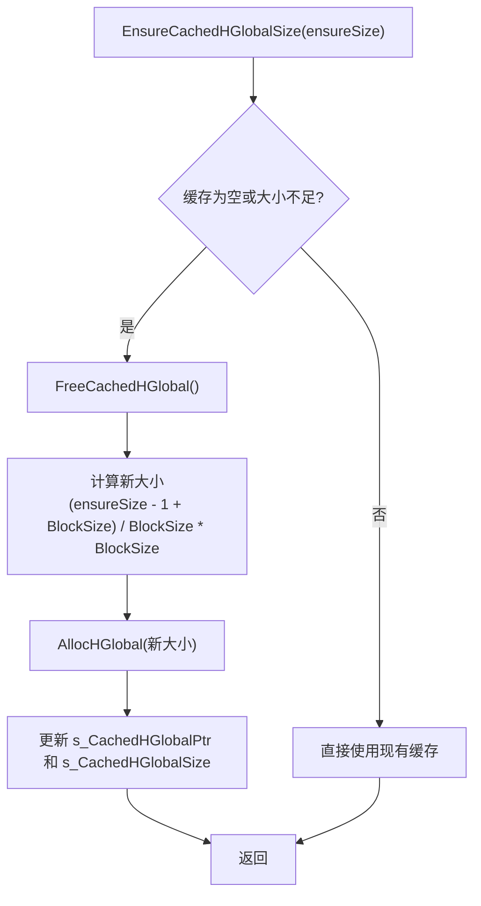

<cite>
**Referenced Files in This Document**   
- [Utility.Marshal.cs](file://GameFramework/Utility/Utility.Marshal.cs)
</cite>

## 目录
1. [内存与指针操作工具 (Utility.Marshal)](#内存与指针操作工具-utilitymarshal)
2. [核心功能概述](#核心功能概述)
3. [非托管内存管理](#非托管内存管理)
4. [结构体与字节数组互转](#结构体与字节数组互转)
5. [使用示例](#使用示例)
6. [安全与性能考量](#安全与性能考量)
7. [总结](#总结)

## 内存与指针操作工具 (Utility.Marshal)

`Utility.Marshal` 是 Game Framework 中提供的一个静态工具类，专门用于处理与非托管内存、结构体序列化和低级数据操作相关的任务。它封装了 .NET `System.Runtime.InteropServices.Marshal` 类的复杂操作，为开发者提供了一套更安全、更便捷的内存操作接口。该模块主要服务于性能敏感的场景，如网络数据包的序列化/反序列化、与原生插件（Native Plugin）的数据交换以及需要直接操作内存的底层功能。

**Section sources**
- [Utility.Marshal.cs](file://GameFramework/Utility/Utility.Marshal.cs#L1-L20)

## 核心功能概述

`Utility.Marshal` 模块的核心功能可以归纳为两大类：**非托管内存的缓存管理**和**结构体与字节数组的高效互转**。

1.  **非托管内存缓存 (`CachedHGlobal`)**
    该模块通过 `EnsureCachedHGlobalSize` 和 `FreeCachedHGlobal` 方法，维护了一块可复用的非托管内存区域。这避免了在频繁进行序列化操作时，反复调用 `AllocHGlobal` 和 `FreeHGlobal` 所带来的性能开销和潜在的内存碎片问题。

2.  **结构体序列化 (`StructureToBytes` / `BytesToStructure`)**
    提供了多种重载方法，可以将任意标记为 `[StructLayout]` 的 C# 结构体实例直接转换为字节数组，反之亦然。这是实现数据持久化或网络传输的关键功能。

**Section sources**
- [Utility.Marshal.cs](file://GameFramework/Utility/Utility.Marshal.cs#L25-L30)
- [Utility.Marshal.cs](file://GameFramework/Utility/Utility.Marshal.cs#L66-L89)
- [Utility.Marshal.cs](file://GameFramework/Utility/Utility.Marshal.cs#L163-L191)

## 非托管内存管理

直接操作非托管内存是危险且低效的，如果管理不当，极易导致内存泄漏或访问冲突。`Utility.Marshal` 通过一个内部缓存机制来解决这个问题。

### 缓存机制

模块内部维护了两个静态字段：
- `s_CachedHGlobalPtr`: 指向已分配的非托管内存的指针 (`IntPtr`)。
- `s_CachedHGlobalSize`: 当前缓存内存块的大小。

### 关键方法



**Diagram sources**
- [Utility.Marshal.cs](file://GameFramework/Utility/Utility.Marshal.cs#L35-L55)

- **`EnsureCachedHGlobalSize(int ensureSize)`**: 这是所有操作的基础。在进行任何结构体转换之前，该方法会检查当前缓存的内存块是否足够大。如果不够，它会先释放旧的内存块，然后分配一个足够大且按 `BlockSize` (4KB) 对齐的新内存块。这种预分配和复用策略极大地提升了性能。
- **`FreeCachedHGlobal()`**: 用于手动释放缓存的非托管内存。虽然 .NET 的垃圾回收器最终会处理 `IntPtr`，但显式调用此方法可以确保资源被及时释放，尤其是在长时间运行的应用中。
- **`CachedHGlobalSize`**: 一个只读属性，返回当前缓存内存块的实际大小，可用于调试或监控。

**Section sources**
- [Utility.Marshal.cs](file://GameFramework/Utility/Utility.Marshal.cs#L32-L60)

## 结构体与字节数组互转

这是 `Utility.Marshal` 最常用的功能，允许开发者将结构化的数据（C# 结构体）转换为连续的字节流，以便于存储或传输。

### 序列化：结构体 -> 字节数组

```csharp
public static byte[] StructureToBytes<T>(T structure)
```
此方法是最简单的序列化入口。它会：
1.  使用 `Marshal.SizeOf(typeof(T))` 计算结构体 `T` 的大小。
2.  调用 `EnsureCachedHGlobalSize` 确保有足够的缓存内存。
3.  使用 `Marshal.StructureToPtr` 将结构体 `structure` 的数据复制到缓存的非托管内存中。
4.  使用 `Marshal.Copy` 将非托管内存中的数据复制到一个新的 `byte[]` 数组中并返回。

**Section sources**
- [Utility.Marshal.cs](file://GameFramework/Utility/Utility.Marshal.cs#L66-L90)

### 反序列化：字节数组 -> 结构体

```csharp
public static T BytesToStructure<T>(byte[] buffer)
```
此方法将字节流还原为结构体实例。它会：
1.  同样计算结构体大小。
2.  检查输入的 `buffer` 是否足够长。
3.  使用 `Marshal.Copy` 将字节数据从 `buffer` 复制到缓存的非托管内存中。
4.  使用 `Marshal.PtrToStructure` 从非托管内存中读取数据并创建一个新的 `T` 类型实例返回。

**Section sources**
- [Utility.Marshal.cs](file://GameFramework/Utility/Utility.Marshal.cs#L163-L191)

## 使用示例

以下是一个将 C# 结构体序列化为字节流以用于网络传输的完整示例。

```csharp
using System;
using System.Runtime.InteropServices;

// 定义一个用于网络传输的玩家信息结构体
[StructLayout(LayoutKind.Sequential, Pack = 1)]
public struct PlayerInfo
{
    public int Id;
    [MarshalAs(UnmanagedType.ByValTStr, SizeConst = 32)]
    public string Name;
    public float Health;
    public bool IsAlive;
}

// --- 使用 Utility.Marshal 进行序列化 ---
PlayerInfo player = new PlayerInfo
{
    Id = 1001,
    Name = "Alice",
    Health = 100.0f,
    IsAlive = true
};

// 将结构体序列化为字节数组
byte[] data = Utility.Marshal.StructureToBytes(player);

// 此时 data 可以通过网络发送或写入文件
// SendOverNetwork(data);
// WriteToFile(data);

// --- 接收端反序列化 ---
// 假设从网络接收到了相同的字节数组
PlayerInfo receivedPlayer = Utility.Marshal.BytesToStructure<PlayerInfo>(data);

Console.WriteLine($"ID: {receivedPlayer.Id}, Name: {receivedPlayer.Name}, Health: {receivedPlayer.Health}, Alive: {receivedPlayer.IsAlive}");
// 输出: ID: 1001, Name: Alice, Health: 100, Alive: True
```

**Section sources**
- [Utility.Marshal.cs](file://GameFramework/Utility/Utility.Marshal.cs#L66-L90)
- [Utility.Marshal.cs](file://GameFramework/Utility/Utility.Marshal.cs#L163-L191)

## 安全与性能考量

尽管 `Utility.Marshal` 提供了便利，但其底层操作涉及非托管内存和指针，因此必须谨慎使用。

### 风险提示
- **仅限关键路径**: 此模块的操作虽然高效，但远比普通的对象序列化（如 JSON）复杂且危险。**强烈建议仅在性能是决定性因素的场景下使用**，例如高频网络通信或与 C/C++ 编写的原生插件进行数据交换。
- **内存安全**: 虽然 `Utility.Marshal` 通过缓存机制降低了风险，但开发者仍需确保传入的结构体是可安全封送（blittable）的，或正确使用 `[MarshalAs]` 属性。错误的结构体定义可能导致内存越界读写，引发程序崩溃。
- **手动释放**: 虽然 `EnsureCachedHGlobalSize` 会自动管理内存，但在应用生命周期结束时，调用 `FreeCachedHGlobal()` 是一个良好的实践，以确保所有非托管资源被彻底释放。

### 性能优势
- **零分配序列化**: `StructureToBytes(T structure, byte[] result)` 这种接受预分配 `byte[]` 的重载方法，可以在循环中避免频繁的内存分配（GC Alloc），对于性能要求极高的场景至关重要。
- **缓存复用**: 内置的内存缓存避免了 `AllocHGlobal`/`FreeHGlobal` 的系统调用开销，使得连续的序列化操作速度更快。

**Section sources**
- [Utility.Marshal.cs](file://GameFramework/Utility/Utility.Marshal.cs#L32-L60)
- [Utility.Marshal.cs](file://GameFramework/Utility/Utility.Marshal.cs#L133-L161)

## 总结

`Utility.Marshal` 模块是一个强大但需要谨慎使用的工具。它通过智能的非托管内存缓存和高效的封送处理，为 C# 结构体与字节流之间的转换提供了接近原生的性能。开发者在利用其高性能优势的同时，必须深刻理解其背后的风险，严格遵守使用规范，确保代码的稳定性和安全性。在绝大多数情况下，应优先考虑使用更安全的序列化方案，仅在性能瓶颈无法通过其他方式解决时，才考虑采用此类低级操作。