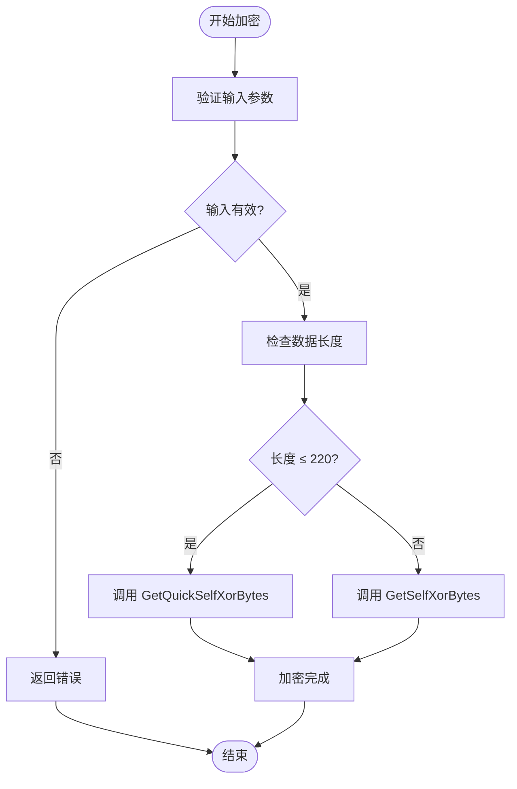

# 数据加密工具 (Utility.Encryption)

<cite>
**Referenced Files in This Document**   
- [Utility.Encryption.cs](file://GameFramework/Utility/Utility.Encryption.cs)
- [FileSystem.HeaderData.cs](file://GameFramework/FileSystem/FileSystem.HeaderData.cs)
- [FileSystem.StringData.cs](file://GameFramework/FileSystem/FileSystem.StringData.cs)
- [ResourceManager.ResourceLoader.cs](file://GameFramework/Resource/ResourceManager.ResourceLoader.cs)
- [DecryptResourceCallback.cs](file://GameFramework/Resource/DecryptResourceCallback.cs)
</cite>

## 目录
1. [简介](#简介)
2. [核心加密方法](#核心加密方法)
3. [应用场景与配置参数](#应用场景与配置参数)
4. [密钥管理与安全存储](#密钥管理与安全存储)
5. [性能影响与最佳实践](#性能影响与最佳实践)
6. [加密操作流程图](#加密操作流程图)

## 简介

`Utility.Encryption` 模块是 Game Framework 中用于数据加密与解密的核心工具类。该模块主要通过异或（XOR）运算实现轻量级的数据混淆，适用于保护游戏中的敏感数据，如玩家配置、文件系统信息和资源内容。尽管该模块未直接实现 AES、DES 或 RSA 等标准加密算法，但其设计模式可作为这些算法的集成基础。

本文档详细描述了 `Utility.Encryption` 提供的加密方法，涵盖其应用场景、配置参数、密钥管理策略以及性能考量，旨在指导开发者安全有效地使用该工具。

**Section sources**
- [Utility.Encryption.cs](file://GameFramework/Utility/Utility.Encryption.cs#L0-L134)

## 核心加密方法

`Utility.Encryption` 类提供了多种基于异或运算的加密方法，支持对字节数组进行加密和解密操作。所有方法均以静态方式提供，便于在项目中直接调用。

### 异或加密方法

该模块的核心是 `GetXorBytes` 和 `GetSelfXorBytes` 方法族，它们通过将输入数据与密钥流进行逐字节异或运算来实现加密。

- `GetXorBytes(byte[] bytes, byte[] code)`：返回一个新的加密后的字节数组，原始数据保持不变。
- `GetSelfXorBytes(byte[] bytes, byte[] code)`：直接在原数组上执行加密操作，避免额外内存分配，提升性能。
- `GetQuickXorBytes` 和 `GetQuickSelfXorBytes`：针对前 220 字节的快速加密版本，适用于小数据块的高效处理。

这些方法接受两个参数：`bytes` 表示待加密的原始数据，`code` 表示用作密钥的字节数组。密钥流会循环使用以匹配数据长度。

**Section sources**
- [Utility.Encryption.cs](file://GameFramework/Utility/Utility.Encryption.cs#L57-L134)

## 应用场景与配置参数

`Utility.Encryption` 模块在框架中被广泛应用于多个场景，主要用于保护存储在文件系统或内存中的敏感数据。

### 文件系统数据保护

在 `FileSystem` 模块中，`HeaderData` 和 `StringData` 结构使用 `Utility.Encryption` 来保护文件头和字符串数据。

- **HeaderData**：在创建文件系统头时，会生成一个 4 字节的随机加密密钥（`encryptBytes`），并将其存储在文件头中。该密钥用于后续数据的加密和解密。
- **StringData**：字符串数据在写入前会使用 `GetSelfXorBytes` 方法进行加密，在读取时则进行解密，确保数据在存储介质上的安全性。

### 资源加密与解密

资源管理系统（`ResourceManager`）利用 `Utility.Encryption` 实现资源文件的动态解密。

- 当资源以 `LoadFromBinaryAndDecrypt` 或 `LoadFromMemoryAndDecrypt` 模式加载时，系统会调用 `DefaultDecryptResourceCallback` 回调函数。
- 该回调函数使用资源的哈希值作为密钥，通过 `GetSelfXorBytes` 或 `GetQuickSelfXorBytes` 方法对资源数据进行解密。

**Section sources**
- [FileSystem.HeaderData.cs](file://GameFramework/FileSystem/FileSystem.HeaderData.cs#L32-L104)
- [FileSystem.StringData.cs](file://GameFramework/FileSystem/FileSystem.StringData.cs#L45-L69)
- [ResourceManager.ResourceLoader.cs](file://GameFramework/Resource/ResourceManager.ResourceLoader.cs#L884-L912)

## 密钥管理与安全存储

密钥管理是加密系统安全性的核心。`Utility.Encryption` 模块本身不提供密钥存储机制，但其设计鼓励安全的密钥管理实践。

### 动态密钥生成

在 `FileSystem.HeaderData` 的构造函数中，系统会调用 `Utility.Random.GetRandomBytes(m_EncryptBytes)` 生成一个随机的 4 字节密钥。这种动态生成方式避免了在代码中硬编码密钥，提高了安全性。

### 密钥与数据绑定

密钥通常与特定数据绑定，例如资源的哈希值被用作其自身的解密密钥。这种方式确保了即使密钥泄露，也仅影响单个资源的安全性。

### 安全存储建议

虽然当前实现将密钥存储在文件头中，但在生产环境中，建议结合平台提供的安全存储机制（如 iOS 的 Keychain 或 Android 的 Keystore）来保护密钥。避免将密钥以明文形式存储在可访问的文件中。

**Section sources**
- [FileSystem.HeaderData.cs](file://GameFramework/FileSystem/FileSystem.HeaderData.cs#L32-L40)
- [ResourceManager.ResourceLoader.cs](file://GameFramework/Resource/ResourceManager.ResourceLoader.cs#L884-L890)

## 性能影响与最佳实践

加密操作会带来一定的性能开销，因此需要权衡安全性和性能。

### 性能考量

- `GetSelfXorBytes` 方法由于直接在原数组上操作，避免了内存分配，性能优于 `GetXorBytes`。
- `GetQuickSelfXorBytes` 针对小数据块优化，适合频繁调用的场景。
- 异或运算是轻量级操作，整体性能影响较小，但仍不建议对大量非敏感数据进行加密。

### 最佳实践

1. **仅加密敏感数据**：避免对所有数据进行加密，只对玩家配置、存档、认证信息等敏感内容进行保护。
2. **避免硬编码密钥**：始终使用动态生成的密钥，或从安全存储中读取。
3. **结合平台安全机制**：利用操作系统提供的加密服务和安全存储来增强整体安全性。
4. **定期更新加密策略**：随着安全威胁的演变，定期评估和更新加密方法和密钥管理策略。

**Section sources**
- [Utility.Encryption.cs](file://GameFramework/Utility/Utility.Encryption.cs#L0-L134)
- [ResourceManager.ResourceLoader.cs](file://GameFramework/Resource/ResourceManager.ResourceLoader.cs#L884-L912)

## 加密操作流程图

**Diagram sources**
- [Utility.Encryption.cs](file://GameFramework/Utility/Utility.Encryption.cs#L57-L134)