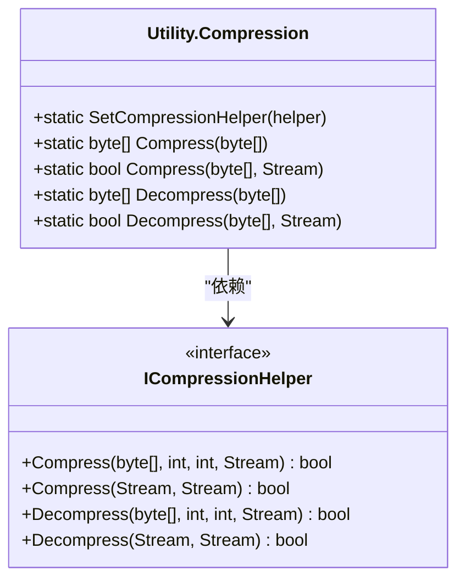
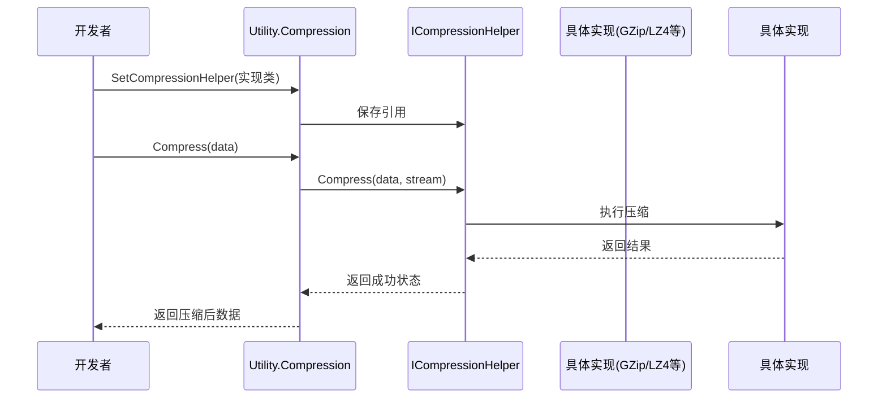
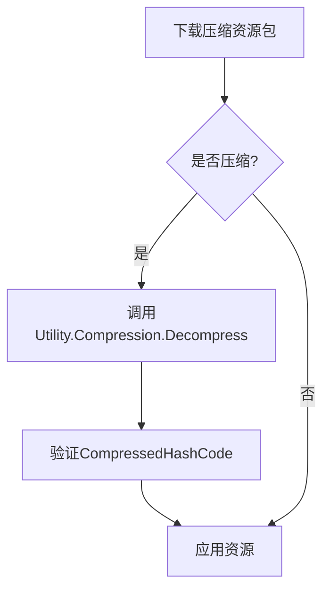

# 数据压缩工具 (Utility.Compression)

<cite>
**本文档中引用的文件**  
- [Utility.Compression.cs](file://GameFramework/Utility/Utility.Compression.cs)
- [Utility.Compression.ICompressionHelper.cs](file://GameFramework/Utility/Utility.Compression.ICompressionHelper.cs)
- [ResourceManager.ResourceUpdater.ApplyInfo.cs](file://GameFramework/Resource/ResourceManager.ResourceUpdater.ApplyInfo.cs)
- [ResourceManager.ResourceUpdater.UpdateInfo.cs](file://GameFramework/Resource/ResourceManager.ResourceUpdater.UpdateInfo.cs)
- [ResourcePackVersionList.Resource.cs](file://GameFramework/Resource/ResourcePackVersionList.Resource.cs)
- [UpdatableVersionList.Resource.cs](file://GameFramework/Resource/UpdatableVersionList.Resource.cs)
</cite>

## 目录
1. [简介](#简介)
2. [核心功能与接口设计](#核心功能与接口设计)
3. [压缩与解压方法详解](#压缩与解压方法详解)
4. [可扩展性机制：ICompressionHelper接口](#可扩展性机制：icompressionhelper接口)
5. [实际应用示例](#实际应用示例)
6. [性能与压缩比权衡分析](#性能与压缩比权衡分析)
7. [自定义压缩算法注册指南](#自定义压缩算法注册指南)
8. [资源系统中的压缩数据管理](#资源系统中的压缩数据管理)
9. [结论](#结论)

## 简介
`Utility.Compression` 模块是 Game Framework 中用于处理数据压缩与解压缩的核心工具集。它为开发者提供了统一、高效且可扩展的 API，支持对任意二进制数据流进行压缩和解压操作。该模块广泛应用于资源包处理、网络传输优化和本地存储压缩等场景，旨在帮助开发者在存储空间与 CPU 消耗之间做出合理权衡。

本模块通过抽象接口 `ICompressionHelper` 实现了算法的可插拔性，允许项目根据需求集成 GZip、LZ4 或其他自定义压缩算法。其设计遵循高内聚、低耦合原则，确保核心逻辑与具体实现分离，提升了系统的灵活性和可维护性。

## 核心功能与接口设计

`Utility.Compression` 模块的核心是一个静态工具类，封装了所有压缩与解压的公共方法。其设计围绕两个关键组件展开：高层工具方法和底层辅助器接口。

该模块不直接实现具体的压缩算法，而是通过依赖注入的方式，将实际的压缩/解压操作委托给实现了 `ICompressionHelper` 接口的外部组件。这种设计模式使得框架本身保持轻量，同时赋予项目极大的灵活性，可以根据平台性能、数据类型或业务需求选择最合适的压缩算法。



**图示来源**  
- [Utility.Compression.cs](file://GameFramework/Utility/Utility.Compression.cs#L1-L344)
- [Utility.Compression.ICompressionHelper.cs](file://GameFramework/Utility/Utility.Compression.ICompressionHelper.cs#L18-L55)

**本节来源**  
- [Utility.Compression.cs](file://GameFramework/Utility/Utility.Compression.cs#L1-L344)
- [Utility.Compression.ICompressionHelper.cs](file://GameFramework/Utility/Utility.Compression.ICompressionHelper.cs#L1-L59)

## 压缩与解压方法详解

`Utility.Compression` 提供了多种重载方法，以适应不同的使用场景和数据类型。所有方法最终都通过 `s_CompressionHelper` 实例调用底层实现。

### 基于字节数组的操作
- `Compress(byte[] bytes)`：将整个字节数组压缩，返回新的压缩后字节数组。
- `Compress(byte[] bytes, int offset, int length)`：压缩指定偏移和长度的字节数组片段。
- `Compress(byte[] bytes, Stream compressedStream)`：将压缩结果直接写入目标流，避免内存拷贝，适用于大文件处理。

### 基于数据流的操作
- `Compress(Stream stream, Stream compressedStream)`：直接对输入流进行压缩，并将结果写入输出流，适用于文件或网络流的处理。
- `Decompress(Stream stream, Stream decompressedStream)`：从输入流读取压缩数据并解压到输出流。

所有方法在调用前都会进行严格的参数校验，包括空值检查、边界检查和辅助器有效性检查。若 `s_CompressionHelper` 未设置，将抛出 `GameFrameworkException` 异常，确保调用方及时发现配置问题。

**本节来源**  
- [Utility.Compression.cs](file://GameFramework/Utility/Utility.Compression.cs#L42-L343)

## 可扩展性机制：ICompressionHelper接口

`ICompressionHelper` 接口是实现压缩算法可扩展性的关键。它定义了四个核心方法，分别对应字节数组和数据流的压缩与解压操作。

通过 `SetCompressionHelper` 方法，开发者可以在运行时动态设置具体的压缩实现。例如，可以在项目启动时根据平台（如移动设备或PC）选择性能更优的 LZ4 算法，或在需要高压缩比时选择 GZip。

这种设计使得框架能够轻松集成第三方压缩库（如 `System.IO.Compression.GZipStream` 或 `K4os.Compression.LZ4`），而无需修改框架核心代码。任何实现了 `ICompressionHelper` 的类都可以作为压缩引擎被框架使用。



**图示来源**  
- [Utility.Compression.cs](file://GameFramework/Utility/Utility.Compression.cs#L1-L344)
- [Utility.Compression.ICompressionHelper.cs](file://GameFramework/Utility/Utility.Compression.ICompressionHelper.cs#L18-L55)

**本节来源**  
- [Utility.Compression.cs](file://GameFramework/Utility/Utility.Compression.cs#L1-L344)
- [Utility.Compression.ICompressionHelper.cs](file://GameFramework/Utility/Utility.Compression.ICompressionHelper.cs#L18-L55)

## 实际应用示例

### 压缩资源文件
```csharp
// 读取原始资源文件
byte[] rawData = File.ReadAllBytes("resource.dat");

// 使用已注册的压缩器进行压缩
byte[] compressedData = Utility.Compression.Compress(rawData);

// 保存压缩后的文件
File.WriteAllBytes("resource.dat.compressed", compressedData);
```

### 解压网络传输数据
```csharp
// 从网络流接收压缩数据
using (MemoryStream receivedStream = new MemoryStream(receivedBytes))
using (MemoryStream decompressedStream = new MemoryStream())
{
    // 执行解压
    bool success = Utility.Compression.Decompress(receivedStream, decompressedStream);
    if (success)
    {
        byte[] originalData = decompressedStream.ToArray();
        // 处理原始数据
    }
}
```

**本节来源**  
- [Utility.Compression.cs](file://GameFramework/Utility/Utility.Compression.cs#L83-L343)

## 性能与压缩比权衡分析

选择压缩算法时，开发者需在 **压缩比** 和 **CPU开销** 之间进行权衡。

- **GZip**：提供较高的压缩比，适合存储空间受限的场景（如移动应用资源包），但压缩和解压速度较慢，CPU占用高。
- **LZ4**：以极快的压缩和解压速度著称，CPU开销极低，适合实时性要求高的场景（如网络数据传输），但压缩比相对较低。

`Utility.Compression` 模块的设计允许项目在不同环境下切换算法。例如，在资源打包阶段使用 GZip 以节省分发体积，在运行时加载资源时使用 LZ4 以减少加载时间。开发者应根据实际测试数据（如压缩率、处理时间、内存占用）选择最适合项目需求的算法。

**本节来源**  
- [Utility.Compression.cs](file://GameFramework/Utility/Utility.Compression.cs#L1-L344)

## 自定义压缩算法注册指南

要集成自定义压缩算法，需执行以下步骤：

1. 创建一个类实现 `ICompressionHelper` 接口。
2. 在该类中实现 `Compress` 和 `Decompress` 方法，调用具体的压缩库。
3. 在游戏初始化阶段，调用 `Utility.Compression.SetCompressionHelper()` 注册该实例。

```csharp
public class MyCustomCompressionHelper : ICompressionHelper
{
    public bool Compress(byte[] bytes, int offset, int length, Stream compressedStream)
    {
        // 调用自定义压缩逻辑
        return MyCompressor.Compress(bytes, offset, length, compressedStream);
    }

    public bool Decompress(byte[] bytes, int offset, int length, Stream decompressedStream)
    {
        // 调用自定义解压逻辑
        return MyCompressor.Decompress(bytes, offset, length, decompressedStream);
    }

    // 其他重载方法...
}

// 在初始化代码中
var helper = new MyCustomCompressionHelper();
Utility.Compression.SetCompressionHelper(helper);
```

**本节来源**  
- [Utility.Compression.ICompressionHelper.cs](file://GameFramework/Utility/Utility.Compression.ICompressionHelper.cs#L18-L55)
- [Utility.Compression.cs](file://GameFramework/Utility/Utility.Compression.cs#L1-L344)

## 资源系统中的压缩数据管理

`Utility.Compression` 模块与资源管理系统深度集成。在资源版本列表（如 `ResourcePackVersionList.Resource` 和 `UpdatableVersionList.Resource`）中，每个资源条目都包含 `CompressedLength` 和 `CompressedHashCode` 字段，用于记录压缩后的大小和校验码。

在资源更新流程中，`ResourceManager.ResourceUpdater` 会使用 `Utility.Compression.Decompress` 方法解压下载的资源包，并通过 `CompressedHashCode` 验证解压后的数据完整性，确保资源在传输和存储过程中未被损坏。



**图示来源**  
- [ResourceManager.ResourceUpdater.ApplyInfo.cs](file://GameFramework/Resource/ResourceManager.ResourceUpdater.ApplyInfo.cs#L100-L168)
- [ResourcePackVersionList.Resource.cs](file://GameFramework/Resource/ResourcePackVersionList.Resource.cs#L114-L159)
- [Utility.Compression.cs](file://GameFramework/Utility/Utility.Compression.cs#L304-L343)

**本节来源**  
- [ResourceManager.ResourceUpdater.ApplyInfo.cs](file://GameFramework/Resource/ResourceManager.ResourceUpdater.ApplyInfo.cs#L100-L168)
- [ResourceManager.ResourceUpdater.UpdateInfo.cs](file://GameFramework/Resource/ResourceManager.ResourceUpdater.UpdateInfo.cs#L98-L151)
- [ResourcePackVersionList.Resource.cs](file://GameFramework/Resource/ResourcePackVersionList.Resource.cs#L114-L159)
- [UpdatableVersionList.Resource.cs](file://GameFramework/Resource/UpdatableVersionList.Resource.cs#L105-L159)

## 结论
`Utility.Compression` 模块通过简洁的 API 和灵活的接口设计，为 Game Framework 提供了强大的数据压缩能力。其基于 `ICompressionHelper` 的可扩展架构，使得项目能够自由选择最适合的压缩算法，无论是追求高压缩比的 GZip，还是追求高性能的 LZ4，亦或是完全自定义的解决方案。开发者应根据具体应用场景，在压缩效率、CPU 开销和存储成本之间做出最佳平衡，以优化整体系统性能。