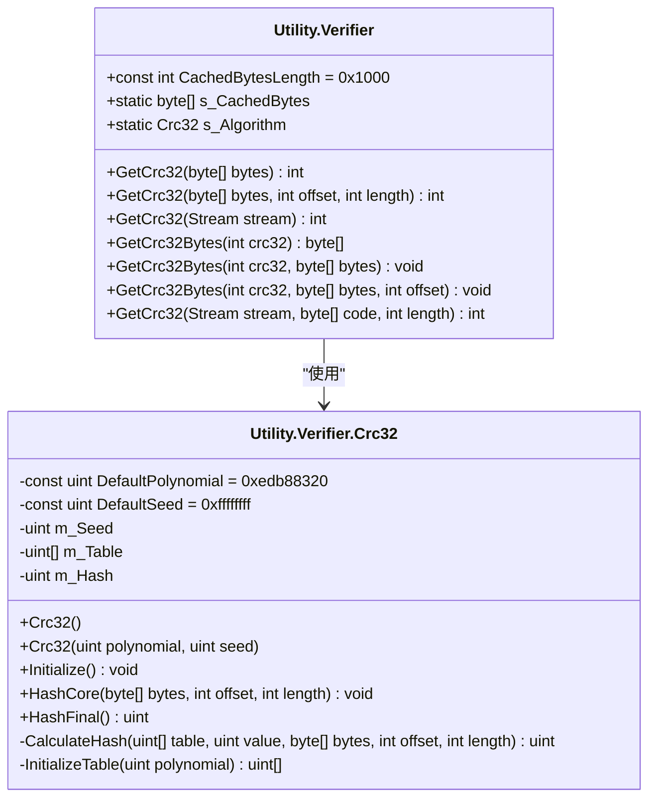
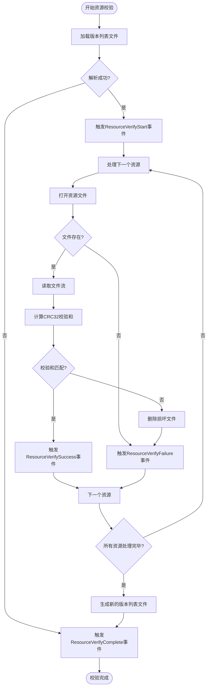

# 数据校验工具 (Utility.Verifier)

<cite>
**Referenced Files in This Document**   
- [Utility.Verifier.cs](file://GameFramework/Utility/Utility.Verifier.cs)
- [Utility.Verifier.Crc32.cs](file://GameFramework/Utility/Utility.Verifier.Crc32.cs)
- [ResourceManager.ResourceVerifier.cs](file://GameFramework/Resource/ResourceManager.ResourceVerifier.cs)
- [ResourceVerifyStartEventArgs.cs](file://GameFramework/Resource/ResourceVerifyStartEventArgs.cs)
- [ResourceVerifySuccessEventArgs.cs](file://GameFramework/Resource/ResourceVerifySuccessEventArgs.cs)
- [ResourceVerifyFailureEventArgs.cs](file://GameFramework/Resource/ResourceVerifyFailureEventArgs.cs)
</cite>

## 目录
1. [简介](#简介)
2. [核心功能与架构](#核心功能与架构)
3. [CRC32校验和计算原理](#crc32校验和计算原理)
4. [核心API详解](#核心api详解)
5. [实际应用场景](#实际应用场景)
6. [性能优化策略](#性能优化策略)
7. [扩展性与未来方向](#扩展性与未来方向)
8. [错误处理与事件通知](#错误处理与事件通知)
9. [总结](#总结)

## 简介

`Utility.Verifier` 模块是 Game Framework 中负责数据完整性校验的核心组件。它提供了一套高效、可靠的工具，用于验证数据在存储、传输或处理过程中是否保持完整，未被篡改或损坏。该模块的核心功能是基于 CRC32（循环冗余校验）算法实现的，这是一种广泛应用于数据校验的快速哈希算法。

本模块在资源管理、版本控制和数据安全等场景中扮演着至关重要的角色。通过计算和比对数据的校验和，系统能够自动检测到文件损坏、传输错误或恶意篡改，从而保障游戏运行的稳定性和数据的可靠性。

## 核心功能与架构

`Utility.Verifier` 模块的设计遵循了简洁和高效的原则，其核心由两个主要部分构成：一个公开的静态工具类 `Verifier` 和一个私有的、专门实现 CRC32 算法的 `Crc32` 类。



**Diagram sources**
- [Utility.Verifier.cs](file://GameFramework/Utility/Utility.Verifier.cs)
- [Utility.Verifier.Crc32.cs](file://GameFramework/Utility/Utility.Verifier.Crc32.cs)

**Section sources**
- [Utility.Verifier.cs](file://GameFramework/Utility/Utility.Verifier.cs)
- [Utility.Verifier.Crc32.cs](file://GameFramework/Utility/Utility.Verifier.Crc32.cs)

## CRC32校验和计算原理

CRC32（Cyclic Redundancy Check 32-bit）是一种非加密的哈希函数，它将任意长度的数据映射为一个32位（4字节）的固定长度校验值。其核心思想是利用一个预定义的多项式（在本实现中为 `0xedb88320`）对数据进行模2除法运算，最终的余数即为校验和。

该算法的实现包含两个关键步骤：

1.  **查表法优化**：为了提高计算速度，`Crc32` 类在初始化时会预先计算一个包含256个元素的查找表（`m_Table`）。这个表是通过将0到255的每一个字节值作为初始数据，应用CRC32算法计算其校验和而生成的。
2.  **逐字节处理**：当计算实际数据的校验和时，算法会逐字节读取数据。对于每一个字节，它会将当前的哈希值右移8位，然后与查找表中对应于（当前字节值 XOR 哈希值低8位）的条目进行异或运算。这个过程高效地模拟了完整的多项式除法。

最终，`HashFinal()` 方法会返回 `~m_Hash`（哈希值的按位取反），这是CRC32标准的常见做法。

## 核心API详解

`Utility.Verifier` 提供了多个重载的 `GetCrc32` 方法，以适应不同的使用场景。

### 计算内存块的CRC32

此方法用于计算存储在 `byte[]` 数组中的数据的校验和。

```csharp
// [Utility.Verifier.GetCrc32(byte[])](file://GameFramework/Utility/Utility.Verifier.cs#L38-L47)
int crc32 = Utility.Verifier.GetCrc32(dataBytes);

// [Utility.Verifier.GetCrc32(byte[], int, int)](file://GameFramework/Utility/Utility.Verifier.cs#L57-L68)
int crc32 = Utility.Verifier.GetCrc32(dataBytes, offset, length);
```

### 计算文件流的CRC32

此方法适用于计算大文件或来自网络等不可随机访问的数据流的校验和。它通过内部缓存（`s_CachedBytes`）分块读取流，避免了将整个文件加载到内存中。

```csharp
// [Utility.Verifier.GetCrc32(Stream)](file://GameFramework/Utility/Utility.Verifier.cs#L78-L95)
using (FileStream fs = new FileStream("path/to/file", FileMode.Open))
{
    int crc32 = Utility.Verifier.GetCrc32(fs);
}
```

### 计算加密数据的CRC32

`Utility.Verifier` 还提供了一个内部方法，用于在计算校验和之前对数据流进行简单的异或（XOR）解密。这在处理经过轻量级加密的资源文件时非常有用，可以在不解密整个文件的情况下直接进行完整性校验。

```csharp
// [Utility.Verifier.GetCrc32(Stream, byte[], int)](file://GameFramework/Utility/Utility.Verifier.cs#L158-L195)
int crc32 = Utility.Verifier.GetCrc32(fileStream, encryptionKey, dataLength);
```

### 校验和的二进制表示

`GetCrc32Bytes` 方法可以将计算出的32位整数校验和转换为一个4字节的数组，便于存储或在网络上传输。

```csharp
// [Utility.Verifier.GetCrc32Bytes(int)](file://GameFramework/Utility/Utility.Verifier.cs#L105-L110)
byte[] crc32Bytes = Utility.Verifier.GetCrc32Bytes(crc32Value);
```

**Section sources**
- [Utility.Verifier.cs](file://GameFramework/Utility/Utility.Verifier.cs)

## 实际应用场景

### 资源文件校验

`Utility.Verifier` 最典型的应用是在 `ResourceManager` 的资源校验流程中。当游戏启动或更新时，系统会校验所有可读写路径下的资源文件。

```mermaid
sequenceDiagram
participant RM as ResourceManager
participant RV as ResourceVerifier
participant FS as FileStream
participant V as Utility.Verifier
RM->>RV : VerifyResources()
RV->>RV : LoadBytes(读取版本列表)
RV->>RV : 解析版本列表，获取所有资源信息
loop 对每个待校验资源
RV->>RV : 打开资源文件流
alt 资源已加密
RV->>V : GetCrc32(流, 加密密钥, 长度)
else 未加密
RV->>V : GetCrc32(流)
end
RV->>RV : 比较计算出的CRC32与版本列表中的记录
alt 校验成功
RV->>RM : 触发ResourceVerifySuccess事件
else 校验失败
RV->>RM : 触发ResourceVerifyFailure事件
RV->>FS : 删除损坏文件
end
end
RV->>RM : 触发ResourceVerifyComplete事件
```



**Diagram sources**
- [ResourceManager.ResourceVerifier.cs](file://GameFramework/Resource/ResourceManager.ResourceVerifier.cs)

**Section sources**
- [ResourceManager.ResourceVerifier.cs](file://GameFramework/Resource/ResourceManager.ResourceVerifier.cs)

### 版本比对

在版本更新系统中，CRC32校验和可以作为资源的唯一标识符。通过比较本地资源和远程服务器上资源的CRC32值，可以精确地判断哪些文件需要更新，避免了不必要的下载。

### 数据传输验证

在网络通信或文件传输过程中，发送方可以计算数据的CRC32并随数据一同发送。接收方在收到数据后重新计算CRC32，如果两个值不匹配，则说明数据在传输过程中发生了错误。

## 性能优化策略

`Utility.Verifier` 模块在设计上已经包含了多项性能优化措施：

1.  **查表法**：如前所述，使用预计算的查找表将复杂的位运算转换为简单的数组访问，极大地提升了计算速度。
2.  **流式处理**：`GetCrc32(Stream)` 方法使用固定大小的缓冲区（`CachedBytesLength = 4096`）分块读取数据，使得该方法可以高效处理任意大小的文件，而不会消耗大量内存。
3.  **对象复用**：`Crc32` 算法实例（`s_Algorithm`）是静态的，并在每次计算后通过 `Initialize()` 方法重置状态，避免了频繁创建和销毁对象的开销。

对于需要处理海量小文件的场景，可以借鉴 `ResourceVerifier` 的设计，将校验任务分帧执行，避免单帧耗时过长导致游戏卡顿。

## 扩展性与未来方向

虽然当前模块专注于CRC32算法，但其设计具有良好的扩展性。

1.  **支持多种算法**：可以通过创建 `Utility.Verifier` 的新内部类（如 `Md5`、`Sha1`）来支持其他哈希算法，并提供相应的静态方法。
2.  **异步校验**：对于超大文件，可以提供异步版本的 `GetCrc32Async` 方法，避免阻塞主线程。
3.  **校验和管理**：可以构建一个更高级的 `ChecksumManager`，用于自动为项目中的所有资源生成、存储和验证校验和。

## 错误处理与事件通知

`Utility.Verifier` 本身在输入参数无效时会抛出 `GameFrameworkException`。在更高层的应用中，如资源校验，系统通过事件机制来通知校验结果。



**Diagram sources**
- [ResourceManager.ResourceVerifier.cs](file://GameFramework/Resource/ResourceManager.ResourceVerifier.cs)
- [ResourceVerifyStartEventArgs.cs](file://GameFramework/Resource/ResourceVerifyStartEventArgs.cs)
- [ResourceVerifySuccessEventArgs.cs](file://GameFramework/Resource/ResourceVerifySuccessEventArgs.cs)
- [ResourceVerifyFailureEventArgs.cs](file://GameFramework/Resource/ResourceVerifyFailureEventArgs.cs)

**Section sources**
- [ResourceManager.ResourceVerifier.cs](file://GameFramework/Resource/ResourceManager.ResourceVerifier.cs)
- [ResourceVerifyStartEventArgs.cs](file://GameFramework/Resource/ResourceVerifyStartEventArgs.cs)
- [ResourceVerifySuccessEventArgs.cs](file://GameFramework/Resource/ResourceVerifySuccessEventArgs.cs)
- [ResourceVerifyFailureEventArgs.cs](file://GameFramework/Resource/ResourceVerifyFailureEventArgs.cs)

## 总结

`Utility.Verifier` 模块是一个功能强大且设计精良的数据完整性校验工具。它以高效的CRC32算法为核心，提供了灵活的API来满足内存块、文件流等多种场景的校验需求。其在资源管理中的应用，确保了游戏数据的可靠性和安全性。通过理解其内部原理和最佳实践，开发者可以有效地利用该模块来构建更加健壮的应用程序。