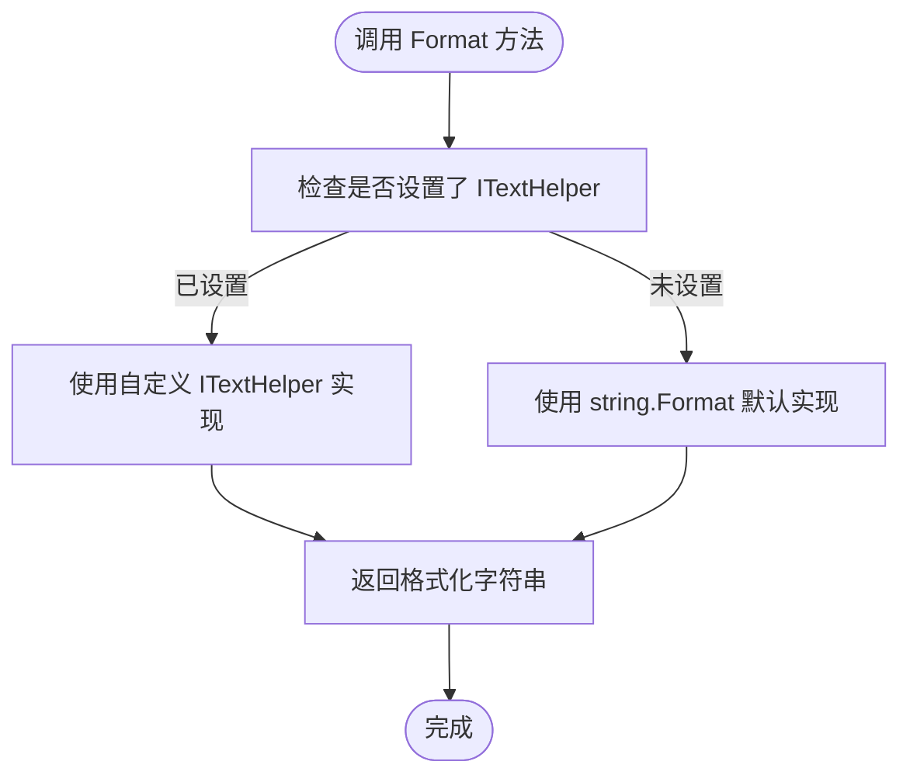
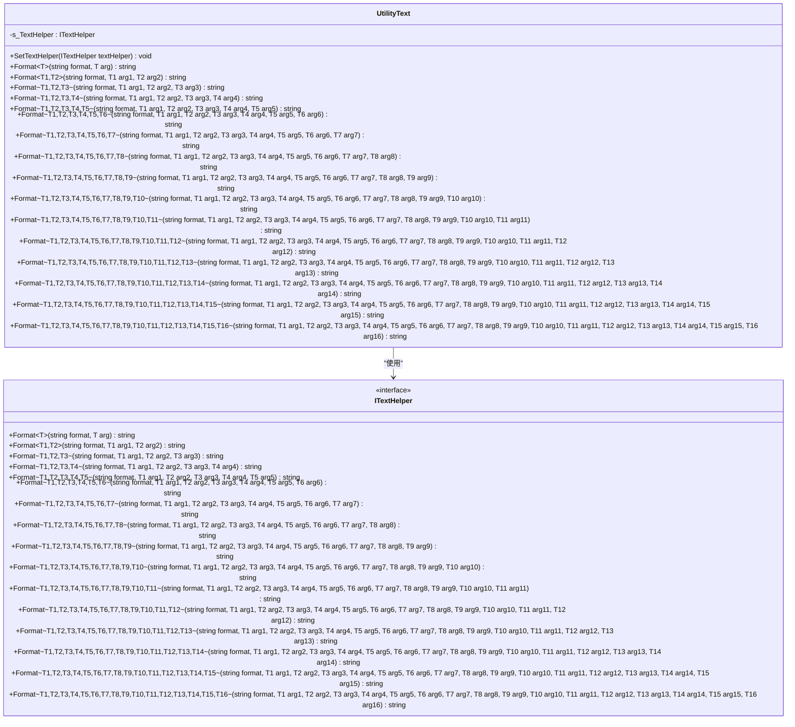

# 文本处理工具 (Utility.Text)

<cite>
**Referenced Files in This Document**  
- [Utility.Text.cs](file://GameFramework/Utility/Utility.Text.cs)
- [Utility.Text.ITextHelper.cs](file://GameFramework/Utility/Utility.Text.ITextHelper.cs)
</cite>

## 目录
1. [简介](#简介)
2. [核心功能](#核心功能)
3. [接口扩展机制](#接口扩展机制)
4. [线程安全性与性能优化](#线程安全性与性能优化)
5. [使用场景示例](#使用场景示例)
6. [结论](#结论)

## 简介

`Utility.Text` 模块是 Game Framework 中用于处理字符串格式化和文本操作的核心工具集。该模块提供了一套类型安全、可扩展的字符串格式化功能，旨在替代传统的 `string.Format` 方法，同时保持高度的灵活性和性能。通过定义 `ITextHelper` 接口，该模块允许开发者根据项目需求自定义文本处理逻辑，适用于日志记录、UI 文本生成、数据解析等多种场景。

**Section sources**
- [Utility.Text.cs](file://GameFramework/Utility/Utility.Text.cs#L1-L50)

## 核心功能

`Utility.Text` 模块的核心功能围绕字符串的格式化展开，提供了从单参数到十六参数的泛型 `Format` 方法重载。这些方法通过类型参数确保了编译时的类型安全，避免了运行时类型转换错误。

当未设置自定义的 `ITextHelper` 实现时，模块会回退到 .NET 原生的 `string.Format` 方法进行处理。这种设计既保证了功能的可用性，又为性能优化和功能扩展提供了可能。

模块支持的格式化方法覆盖了绝大多数实际应用场景，开发者无需关心底层实现细节，只需调用相应的 `Format` 方法即可完成复杂的字符串拼接任务。



**Diagram sources**
- [Utility.Text.cs](file://GameFramework/Utility/Utility.Text.cs#L50-L600)

**Section sources**
- [Utility.Text.cs](file://GameFramework/Utility/Utility.Text.cs#L50-L621)
- [Utility.Text.ITextHelper.cs](file://GameFramework/Utility/Utility.Text.ITextHelper.cs#L15-L400)

## 接口扩展机制

`ITextHelper` 接口是 `Utility.Text` 模块实现可扩展性的关键。通过实现该接口，开发者可以完全控制字符串格式化的具体行为，例如：

- 集成第三方高性能字符串格式化库
- 添加特定于项目的文本处理逻辑（如自动转义、内容过滤）
- 实现多语言支持的动态文本替换
- 记录格式化操作的性能指标

通过 `SetTextHelper` 方法，可以在运行时动态替换默认的文本处理实现，这为模块的热更新和 A/B 测试提供了便利。



**Diagram sources**
- [Utility.Text.cs](file://GameFramework/Utility/Utility.Text.cs#L10-L621)
- [Utility.Text.ITextHelper.cs](file://GameFramework/Utility/Utility.Text.ITextHelper.cs#L15-L400)

**Section sources**
- [Utility.Text.cs](file://GameFramework/Utility/Utility.Text.cs#L10-L621)
- [Utility.Text.ITextHelper.cs](file://GameFramework/Utility/Utility.Text.ITextHelper.cs#L15-L400)

## 线程安全性与性能优化

`Utility.Text` 模块在设计上充分考虑了线程安全性和性能优化。静态字段 `s_TextHelper` 的赋值操作虽然不是原子的，但由于 `SetTextHelper` 通常在应用初始化阶段调用一次后不再修改，因此在实际使用中不会产生竞态条件。

性能优化方面，模块通过以下策略避免不必要的内存分配：
1. **延迟初始化**：仅在需要时才创建字符串格式化对象
2. **接口抽象**：允许替换为更高效的第三方实现
3. **泛型约束**：减少装箱/拆箱操作

尽管当前实现依赖于 .NET 的 `string.Format`，但其架构为集成更高性能的字符串格式化库（如 `FastFormat` 或 `StringFormatter`）提供了便利，开发者可以通过实现 `ITextHelper` 接口来显著提升文本处理性能。

**Section sources**
- [Utility.Text.cs](file://GameFramework/Utility/Utility.Text.cs#L10-L621)

## 使用场景示例

### 日志输出
```csharp
// 使用 Utility.Text 格式化日志消息
string logMessage = Utility.Text.Format("用户 {0} 在 {1} 执行了 {2} 操作", userId, timestamp, action);
GameFrameworkLog.Info(logMessage);
```

### UI 文本生成
```csharp
// 动态生成 UI 显示文本
string uiText = Utility.Text.Format("当前进度: {0}/{1} ({2:P})", current, total, (float)current/total);
uiLabel.text = uiText;
```

### 数据解析
```csharp
// 格式化从外部系统获取的数据
string formattedData = Utility.Text.Format("数据包 [{0}]: 类型={1}, 长度={2}, 校验码={3:X8}", 
                                         packetId, dataType, dataLength, crc32);
```

这些示例展示了 `Utility.Text` 模块在不同场景下的应用，其统一的 API 设计使得代码更加一致和可维护。

**Section sources**
- [Utility.Text.cs](file://GameFramework/Utility/Utility.Text.cs#L50-L600)

## 结论

`Utility.Text` 模块通过简洁的 API 设计和灵活的扩展机制，为游戏开发中的文本处理提供了可靠的解决方案。其基于接口的设计模式不仅保证了功能的可扩展性，还为性能优化留下了充足的空间。开发者可以根据具体需求实现自定义的 `ITextHelper`，以满足特定场景下的性能或功能要求。该模块的线程安全特性和对内存分配的优化使其成为处理高频文本操作的理想选择。