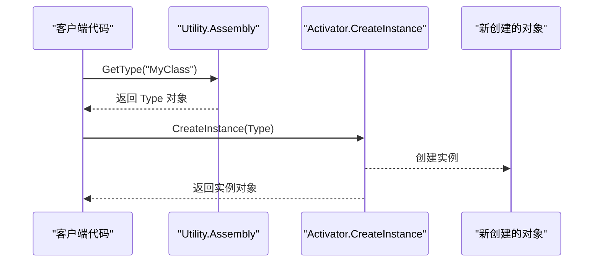

# 程序集与反射工具 (Utility.Assembly)

<cite>
**Referenced Files in This Document**   
- [Utility.Assembly.cs](file://GameFramework/Utility/Utility.Assembly.cs)
- [GameFrameworkEntry.cs](file://GameFramework/Base/GameFrameworkEntry.cs)
- [TypeNamePair.cs](file://GameFramework/Base/DataStruct/TypeNamePair.cs)
</cite>

## 目录
1. [简介](#简介)
2. [核心功能](#核心功能)
3. [程序集加载与类型获取](#程序集加载与类型获取)
4. [动态实例化与方法调用](#动态实例化与方法调用)
5. [插件系统与热更新应用](#插件系统与热更新应用)
6. [性能警告与优化建议](#性能警告与优化建议)
7. [代码示例](#代码示例)

## 简介

`Utility.Assembly` 模块是 Game Framework 中用于处理程序集加载和反射操作的核心工具类。它提供了便捷的静态方法来访问当前域中所有已加载的程序集及其类型信息，支持通过类型名称字符串动态获取类型、创建实例和调用方法。该模块在实现插件系统、模块化架构和热更新机制中扮演着关键角色，为框架的扩展性和灵活性提供了基础支持。

**Section sources**
- [Utility.Assembly.cs](file://GameFramework/Utility/Utility.Assembly.cs#L1-L10)

## 核心功能

`Utility.Assembly` 类提供了三个主要的公共静态方法，构成了其核心功能集：

1. **GetAssemblies()**: 获取当前应用程序域中所有已加载的程序集数组。
2. **GetTypes()**: 遍历所有已加载的程序集，获取其中包含的所有类型。
3. **GetType(string typeName)**: 根据指定的类型名称字符串，从已加载的程序集中查找并返回对应的 `Type` 对象。

这些方法封装了底层的反射 API，简化了开发者对程序集和类型信息的访问，避免了重复编写繁琐的查找逻辑。

**Section sources**
- [Utility.Assembly.cs](file://GameFramework/Utility/Utility.Assembly.cs#L20-L30)

## 程序集加载与类型获取

### 程序集加载

`Utility.Assembly` 在静态构造函数中通过 `AppDomain.CurrentDomain.GetAssemblies()` 一次性获取当前域中所有已加载的程序集，并将其缓存到静态只读字段 `s_Assemblies` 中。这种设计确保了程序集列表的获取是高效的，避免了在每次调用 `GetAssemblies()` 时都进行域遍历。

```mermaid
flowchart TD
A[静态构造函数] --> B[调用 AppDomain.CurrentDomain.GetAssemblies()]
B --> C[将结果缓存到 s_Assemblies]
C --> D[后续调用 GetAssemblies() 直接返回缓存]
```

**Diagram sources**
- [Utility.Assembly.cs](file://GameFramework/Utility/Utility.Assembly.cs#L15-L20)

### 类型获取

`GetTypes()` 方法通过遍历 `s_Assemblies` 数组，调用每个程序集的 `GetTypes()` 方法来收集所有公开类型，并将它们合并到一个数组中返回。该方法提供了两种重载：一种返回新的类型数组，另一种接受一个 `List<Type>` 参数用于填充结果，以减少不必要的内存分配。

`GetType(string typeName)` 是最核心的方法，它实现了智能的类型查找逻辑：
1. 首先检查内部的 `s_CachedTypes` 字典缓存。
2. 如果缓存未命中，则尝试使用 `Type.GetType(typeName)` 进行直接查找。
3. 如果直接查找失败，则遍历所有已加载的程序集，使用 `Type.GetType($"{typeName}, {assembly.FullName}")` 的格式进行精确查找。
4. 一旦找到类型，立即将其加入 `s_CachedTypes` 缓存，以便后续快速访问。

```mermaid
flowchart TD
Start([GetType(typeName)]) --> CheckCache{"缓存中存在?"}
CheckCache --> |是| ReturnFromCache["返回缓存中的Type"]
CheckCache --> |否| DirectLookup["尝试 Type.GetType(typeName)"]
DirectLookup --> Found{"找到类型?"}
Found --> |是| CacheAndReturn["缓存并返回"]
Found --> |否| LoopAssemblies["遍历所有程序集"]
LoopAssemblies --> GetAssembly["获取下一个程序集"]
GetAssembly --> BuildTypeName["构建完整类型名"]
BuildTypeName --> TryGetType["尝试 Type.GetType(完整名)"]
TryGetType --> FoundInAssembly{"找到类型?"}
FoundInAssembly --> |是| CacheAndReturn
FoundInAssembly --> |否| NextAssembly{"还有程序集?"}
NextAssembly --> |是| GetAssembly
NextAssembly --> |否| ReturnNull["返回 null"]
CacheAndReturn --> End([结束])
ReturnFromCache --> End
ReturnNull --> End
```

**Diagram sources**
- [Utility.Assembly.cs](file://GameFramework/Utility/Utility.Assembly.cs#L69-L108)

**Section sources**
- [Utility.Assembly.cs](file://GameFramework/Utility/Utility.Assembly.cs#L30-L68)

## 动态实例化与方法调用

虽然 `Utility.Assembly` 模块本身不直接提供实例化和方法调用的功能，但它获取的 `Type` 对象是进行这些操作的基础。结合 .NET 的 `Activator.CreateInstance()` 和 `MethodInfo.Invoke()` 等反射 API，可以实现完整的动态操作。

在 `GameFrameworkEntry.cs` 文件中可以找到一个典型的使用示例：`CreateModule` 方法通过 `Type.GetType(moduleName)` 获取模块类型，然后使用 `Activator.CreateInstance(moduleType)` 创建该类型的实例。这展示了如何将 `Utility.Assembly` 的 `GetType` 功能与动态实例化相结合。



**Diagram sources**
- [Utility.Assembly.cs](file://GameFramework/Utility/Utility.Assembly.cs#L69-L108)
- [GameFrameworkEntry.cs](file://GameFramework/Base/GameFrameworkEntry.cs#L103)

**Section sources**
- [GameFrameworkEntry.cs](file://GameFramework/Base/GameFrameworkEntry.cs#L93-L105)

## 插件系统与热更新应用

`Utility.Assembly` 模块的设计天然适用于插件系统和热更新场景。

在插件系统中，主程序可以在运行时动态加载包含新功能的程序集（DLL 文件）。通过 `Utility.Assembly.GetAssemblies()` 可以发现这些新加载的程序集，然后使用 `GetTypes()` 或 `GetType()` 来查找实现了特定接口（如 `IPlugin`）的类型，并动态创建其实例，从而实现功能的扩展。

对于热更新，游戏资源或代码可以被打包成程序集，在不重启应用的情况下加载。`Utility.Assembly` 提供的类型查找能力使得新版本的类可以被识别和使用，旧版本的引用可以被逐步替换。

`TypeNamePair.cs` 文件中的 `ToString()` 方法展示了如何生成一个完整的类型名称字符串，这正是 `GetType()` 方法所期望的输入格式，体现了框架内部组件间的协同工作。

**Section sources**
- [Utility.Assembly.cs](file://GameFramework/Utility/Utility.Assembly.cs#L20-L30)
- [TypeNamePair.cs](file://GameFramework/Base/DataStruct/TypeNamePair.cs#L70-L80)

## 性能警告与优化建议

反射操作是 .NET 中相对昂贵的操作，因为它涉及大量的元数据查询和安全检查。频繁地调用 `GetType()` 或 `GetMethod()` 会对性能产生显著影响，尤其是在游戏的主循环等高频执行路径中。

`Utility.Assembly` 模块已经内置了重要的性能优化：通过 `s_CachedTypes` 字典对 `Type` 对象进行缓存。这意味着对于同一个类型名称，第一次查找后，后续的查找将直接从内存中获取，避免了重复的程序集遍历。

**优化建议**：
1. **缓存 Type 对象**：在初始化阶段或加载时，使用 `Utility.Assembly.GetType()` 获取所需的 `Type` 对象，并将其存储在静态字段或成员变量中，避免在运行时重复查找。
2. **缓存 MethodInfo 对象**：如果需要频繁调用某个方法，应使用 `Type.GetMethod()` 获取 `MethodInfo` 对象并缓存，然后通过 `MethodInfo.Invoke()` 调用，而不是每次都通过字符串查找方法。
3. **避免运行时高频反射**：尽量将反射操作移至初始化、加载或配置阶段。在游戏的每一帧中执行反射查找是不可取的。
4. **考虑替代方案**：对于性能要求极高的场景，可以考虑使用委托（Delegate）缓存、表达式树（Expression Trees）编译或 IL Emit 等技术来替代反射调用，以获得接近原生代码的性能。

**Section sources**
- [Utility.Assembly.cs](file://GameFramework/Utility/Utility.Assembly.cs#L12-L14)

## 代码示例

以下代码示例展示了 `Utility.Assembly` 模块的典型用法：

### 通过类型名称字符串创建对象实例
```csharp
// [Utility.Assembly.GetType](file://GameFramework/Utility/Utility.Assembly.cs#L69-L108)
// [Activator.CreateInstance](file://GameFramework/Base/GameFrameworkEntry.cs#L103)
string typeName = "MyNamespace.MyClass";
Type type = Utility.Assembly.GetType(typeName);
if (type != null)
{
    object instance = Activator.CreateInstance(type);
    // 使用实例...
}
else
{
    // 处理类型未找到的情况
}
```

### 遍历程序集中所有类
```csharp
// [Utility.Assembly.GetTypes](file://GameFramework/Utility/Utility.Assembly.cs#L36-L48)
Type[] allTypes = Utility.Assembly.GetTypes();
foreach (Type type in allTypes)
{
    // 检查类型是否满足特定条件，例如实现了某个接口
    if (typeof(IMyInterface).IsAssignableFrom(type) && !type.IsInterface && !type.IsAbstract)
    {
        // 处理找到的类型
        Console.WriteLine($"找到插件: {type.FullName}");
    }
}
```

### 在初始化阶段缓存类型（推荐做法）
```csharp
public class MyManager
{
    // 在类级别缓存Type对象
    private static Type s_CachedComponentType = null;

    public void Initialize()
    {
        // 在初始化时执行一次查找
        s_CachedComponentType = Utility.Assembly.GetType("MyGame.MyComponent");
        if (s_CachedComponentType == null)
        {
            // 记录错误或采取其他措施
            return;
        }
        // ... 其他初始化逻辑
    }

    public void SomeRuntimeMethod()
    {
        // 在运行时直接使用缓存的Type对象，无性能开销
        if (s_CachedComponentType != null)
        {
            GameObject.AddComponent(s_CachedComponentType);
        }
    }
}
```