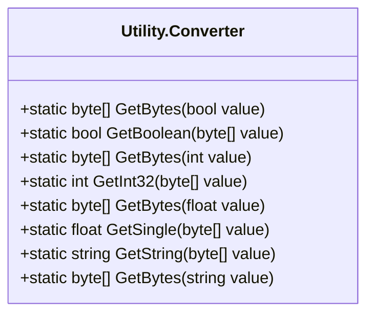
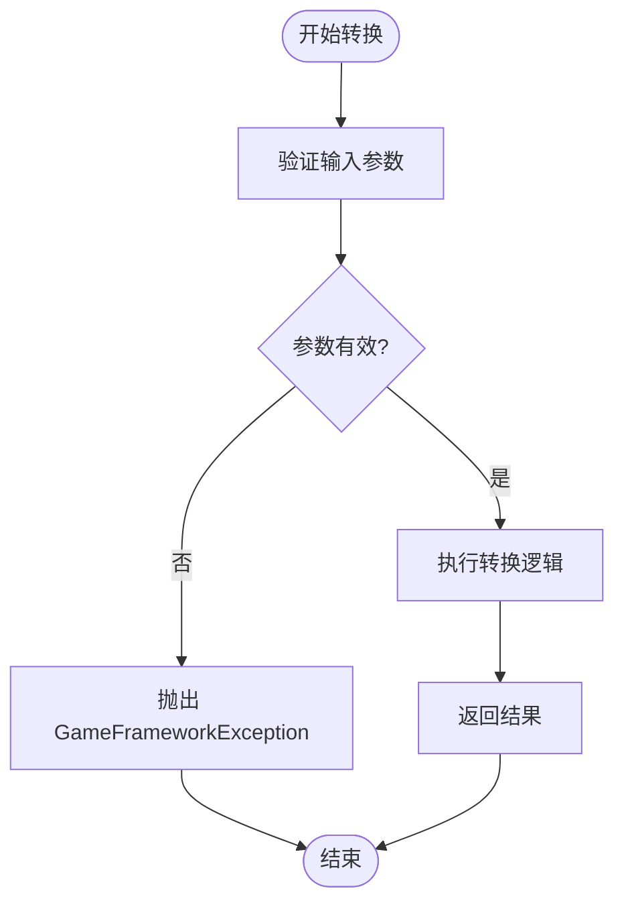

# 类型转换工具 (Utility.Converter)

<cite>
**本文档中引用的文件**   
- [Utility.Converter.cs](file://GameFramework/Utility/Utility.Converter.cs)
- [GameFrameworkException.cs](file://GameFramework/Base/GameFrameworkException.cs)
</cite>

## 目录
1. [简介](#简介)
2. [核心功能](#核心功能)
3. [基本类型转换](#基本类型转换)
4. [字符串与字节数组转换](#字符串与字节数组转换)
5. [安全转换与异常处理](#安全转换与异常处理)
6. [使用场景示例](#使用场景示例)
7. [与其他转换方式的对比优势](#与其他转换方式的对比优势)
8. [结论](#结论)

## 简介

`Utility.Converter` 是 Game Framework 框架中提供的一个静态工具类，位于 `GameFramework.Utility` 命名空间下。该模块专注于提供一系列安全、高效且易于使用的类型转换方法，特别适用于处理基本数据类型之间的转换、字节数组与原始类型之间的序列化/反序列化，以及字符串编码转换等场景。

该工具类的设计目标是简化开发过程中常见的类型转换操作，同时通过内置的边界检查、空值验证和异常处理机制，显著减少因类型转换不当而引发的运行时错误。它在解析配置文件、处理用户输入、网络数据反序列化等关键环节中发挥着重要作用。

**Section sources**
- [Utility.Converter.cs](file://GameFramework/Utility/Utility.Converter.cs#L0-L40)

## 核心功能

`Utility.Converter` 模块提供了三大类核心功能：

1.  **基础数据类型与字节数组的转换**：支持布尔值、字符、有符号/无符号整数（16/32/64位）、浮点数（单精度/双精度）与字节数组之间的相互转换。
2.  **字符串与字节数组的编码转换**：支持将字符串按照指定编码（默认为UTF-8）转换为字节数组，以及将字节数组解码为字符串。
3.  **物理单位转换**：提供基于屏幕DPI的像素（Pixels）、英寸（Inches）和厘米（Centimeters）之间的相互转换。

这些功能通过一组命名清晰、重载丰富的静态方法实现，开发者可以轻松地在不同数据表示形式之间进行转换。

```mermaid
graph TD
A[Utility.Converter] --> B[基础类型转换]
A --> C[字符串编码转换]
A --> D[物理单位转换]
B --> B1[GetBytes]
B --> B2[GetInt32, GetBoolean等]
C --> C1[GetString]
C --> C2[GetBytes(string)]
D --> D1[GetPixelsFromCentimeters]
D --> D2[GetInchesFromPixels]
```

**Diagram sources **
- [Utility.Converter.cs](file://GameFramework/Utility/Utility.Converter.cs#L0-L40)

**Section sources**
- [Utility.Converter.cs](file://GameFramework/Utility/Utility.Converter.cs#L0-L40)

## 基本类型转换

`Utility.Converter` 提供了全面的方法来处理基本数据类型与字节数组之间的转换，这是实现数据序列化和网络通信的基础。

### 布尔值转换

- **转换为字节数组**：`GetBytes(bool value)` 方法将布尔值 `true` 转换为字节 `1`，`false` 转换为字节 `0`，并返回一个长度为1的字节数组。
- **从字节数组转换**：`GetBoolean(byte[] value)` 和 `GetBoolean(byte[] value, int startIndex)` 方法从字节数组的指定位置读取一个字节，并将其转换为布尔值（非零字节为 `true`）。

### 整数与浮点数转换

对于各种整数和浮点数类型，`Utility.Converter` 提供了成对的方法：

- **获取字节数组**：`GetBytes(T value)` 系列方法（如 `GetBytes(int value)`, `GetBytes(float value)`）将指定的数值转换为对应字节序的字节数组。
- **从字节数组获取数值**：`GetInt32(byte[] value)`, `GetSingle(byte[] value)` 等方法从字节数组的起始位置或指定位置读取相应数量的字节，并将其转换回原始数值类型。

这些方法底层依赖于 `BitConverter` 类，并通过 `unsafe` 代码块直接操作内存，确保了转换的高效性。



**Diagram sources **
- [Utility.Converter.cs](file://GameFramework/Utility/Utility.Converter.cs#L107-L161)
- [Utility.Converter.cs](file://GameFramework/Utility/Utility.Converter.cs#L273-L372)

**Section sources**
- [Utility.Converter.cs](file://GameFramework/Utility/Utility.Converter.cs#L107-L161)
- [Utility.Converter.cs](file://GameFramework/Utility/Utility.Converter.cs#L273-L372)

## 字符串与字节数组转换

在处理文本数据时，字符串与字节数组的转换是必不可少的，尤其是在网络传输和文件存储中。

- **字符串转字节数组**：`GetBytes(string value)` 方法使用 UTF-8 编码将字符串转换为字节数组。重载方法允许指定其他编码（`Encoding`）以及输出缓冲区。
- **字节数组转字符串**：`GetString(byte[] value)` 方法将字节数组按照 UTF-8 编码解码为字符串。同样，提供了重载方法以支持指定编码、起始索引和长度。

这些方法在内部调用了 `System.Text.Encoding` 类的相关功能，并对输入参数（如 `value` 和 `encoding` 是否为 `null`）进行了严格的检查，防止空引用异常。

**Section sources**
- [Utility.Converter.cs](file://GameFramework/Utility/Utility.Converter.cs#L615-L678)

## 安全转换与异常处理

`Utility.Converter` 的核心优势在于其“安全”转换。它通过以下机制优雅地处理潜在的转换失败：

1.  **参数验证**：所有方法在执行前都会检查输入参数的有效性。例如，`GetBytes(string value)` 会检查 `value` 是否为 `null`，`GetBytes(bool value, byte[] buffer, int startIndex)` 会检查 `buffer` 是否为 `null` 以及 `startIndex` 是否在有效范围内。
2.  **抛出可捕获异常**：当检测到无效参数或状态时，方法会抛出 `GameFrameworkException`。例如，在调用 `GetCentimetersFromPixels` 时，如果 `ScreenDpi` 尚未设置（即 `ScreenDpi <= 0`），则会抛出异常，提示“必须先设置屏幕DPI”。
3.  **明确的错误信息**：抛出的异常都带有清晰的错误消息（如 "Buffer is invalid.", "Value is invalid."），便于开发者快速定位问题。

这种设计模式强制开发者在使用这些方法时必须考虑异常情况，从而编写出更健壮的代码。



**Diagram sources **
- [Utility.Converter.cs](file://GameFramework/Utility/Utility.Converter.cs#L50-L60)
- [Utility.Converter.cs](file://GameFramework/Utility/Utility.Converter.cs#L200-L210)

**Section sources**
- [Utility.Converter.cs](file://GameFramework/Utility/Utility.Converter.cs#L50-L60)
- [Utility.Converter.cs](file://GameFramework/Utility/Utility.Converter.cs#L200-L210)
- [GameFrameworkException.cs](file://GameFramework/Base/GameFrameworkException.cs#L15-L54)

## 使用场景示例

### 解析配置文件

当从二进制配置文件中读取数据时，可以使用 `Utility.Converter` 将字节数组解析为具体的数据类型。

```csharp
// 假设 configBytes 是从文件读取的字节数组
int playerLevel = Utility.Converter.GetInt32(configBytes, 0); // 从索引0读取一个int
float playerHealth = Utility.Converter.GetSingle(configBytes, 4); // 从索引4读取一个float
bool isHardMode = Utility.Converter.GetBoolean(configBytes, 8); // 从索引8读取一个bool
```

### 处理用户输入

在将用户输入的字符串转换为数值时，虽然 `Utility.Converter` 主要处理字节数组，但其安全理念可借鉴。实际应用中，可结合 `int.TryParse` 等方法，并利用 `Utility.Converter` 进行后续的序列化。

### 网络数据反序列化

在网络通信中，接收到的数据包通常是字节数组。`Utility.Converter` 是反序列化过程中的关键工具。

```csharp
// 假设 packetData 是接收到的网络数据包
string playerName = Utility.Converter.GetString(packetData, 0, 32); // 读取前32字节作为玩家名
int playerScore = Utility.Converter.GetInt32(packetData, 32); // 读取接下来的4字节作为分数
```

**Section sources**
- [Utility.Converter.cs](file://GameFramework/Utility/Utility.Converter.cs#L615-L678)
- [ConfigManager.cs](file://GameFramework/Config/ConfigManager.cs#L208-L294)

## 与其他转换方式的对比优势

相比于直接使用 `BitConverter` 或 `Convert` 类，`Utility.Converter` 具有显著优势：

| 特性 | `Utility.Converter` | `BitConverter` / `Convert` |
| :--- | :--- | :--- |
| **空值处理** | 显式检查 `null` 并抛出 `GameFrameworkException` | `BitConverter` 对 `null` 数组会抛出 `ArgumentNullException`，`Convert` 对 `null` 字符串行为不一 |
| **边界检查** | 严格检查 `startIndex` 和 `buffer` 长度 | `BitConverter` 会检查，但错误信息可能不够明确 |
| **统一异常** | 统一抛出框架定义的 `GameFrameworkException` | 抛出 .NET 基础类库的异常（如 `ArgumentException`） |
| **易用性** | 提供了更简洁的重载方法，如 `GetBytes(bool)` | 需要更详细的参数 |
| **功能集成** | 集成了物理单位转换等实用功能 | 仅提供基础的类型转换 |

总而言之，`Utility.Converter` 通过封装和增强，提供了一个更安全、更一致、更符合游戏开发框架规范的类型转换解决方案。

**Section sources**
- [Utility.Converter.cs](file://GameFramework/Utility/Utility.Converter.cs#L0-L848)
- [GameFrameworkException.cs](file://GameFramework/Base/GameFrameworkException.cs#L15-L54)

## 结论

`Utility.Converter` 模块是 Game Framework 中一个功能强大且设计精良的工具类。它不仅提供了对基本数据类型、字符串和物理单位的全面转换支持，更重要的是，它通过内置的参数验证和统一的异常处理机制，极大地提升了类型转换操作的安全性。在解析配置、处理网络数据等场景下，使用 `Utility.Converter` 可以有效避免常见的运行时错误，帮助开发者构建更加稳定可靠的应用程序。