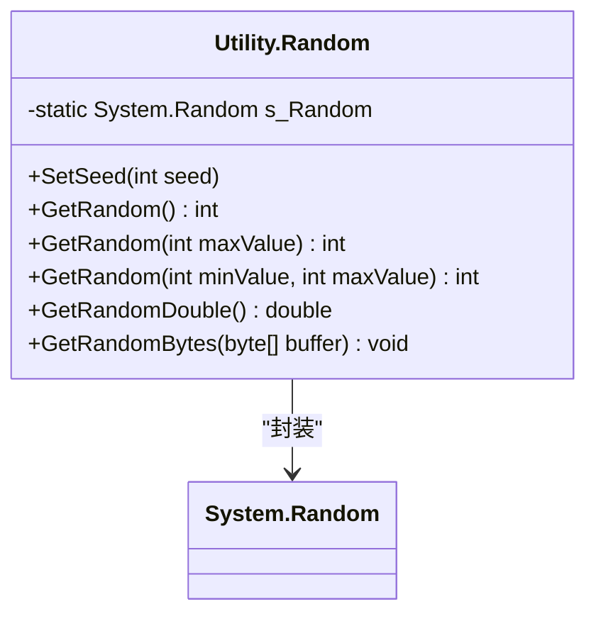
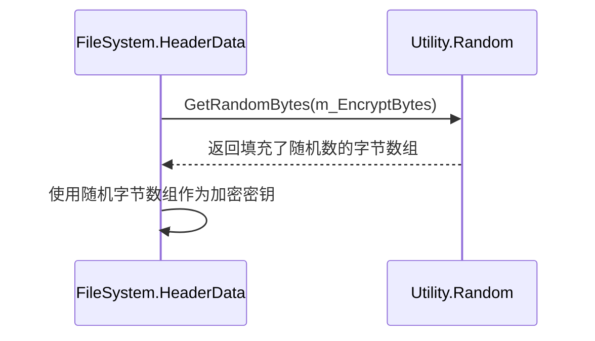
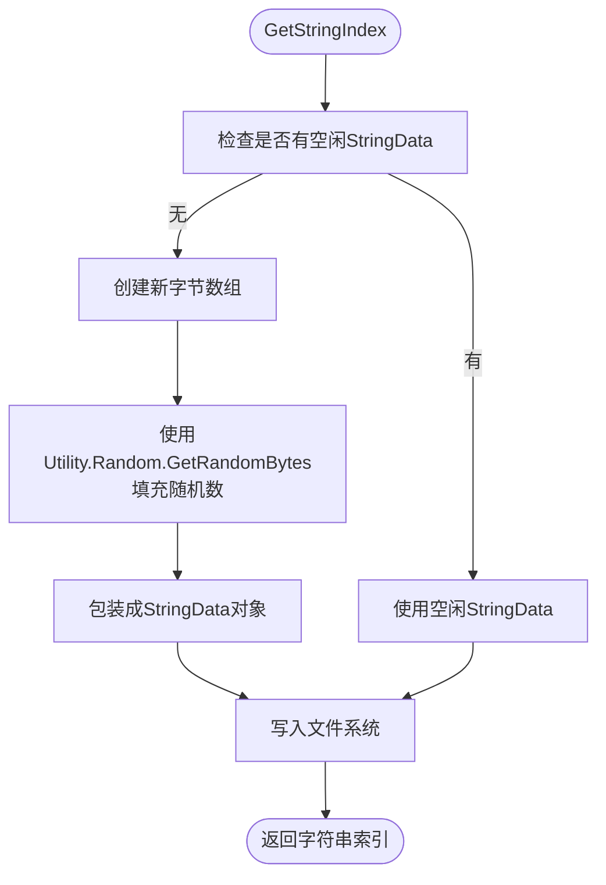

# 随机数生成工具 (Utility.Random)

<cite>
**Referenced Files in This Document**  
- [Utility.Random.cs](file://GameFramework/Utility/Utility.Random.cs)
- [FileSystem.HeaderData.cs](file://GameFramework/FileSystem/FileSystem.HeaderData.cs)
- [FileSystem.cs](file://GameFramework/FileSystem/FileSystem.cs)
</cite>

## 目录
1. [简介](#简介)
2. [核心功能与API](#核心功能与api)
3. [底层实现机制](#底层实现机制)
4. [实际应用案例](#实际应用案例)
5. [使用注意事项与安全建议](#使用注意事项与安全建议)

## 简介

`Utility.Random` 模块是 Game Framework 中用于生成随机数的实用工具类。它封装了 .NET 原生的 `System.Random` 类，提供了一套简洁、易用的静态方法，用于生成整数、浮点数、布尔值以及在指定范围内的随机值。该模块广泛应用于游戏开发中的各种场景，如概率计算、AI行为决策和数据加密等。

尽管 `Utility.Random` 提供了便捷的随机数生成功能，但开发者应意识到其生成的是伪随机数，具有可预测性。在需要高安全性的场景下，应考虑使用加密级别的随机源。

**Section sources**
- [Utility.Random.cs](file://GameFramework/Utility/Utility.Random.cs#L1-L80)

## 核心功能与API

`Utility.Random` 类提供了多种静态方法，满足不同场景下的随机数生成需求：

- **`GetRandom()`**: 返回一个大于等于零且小于 `System.Int32.MaxValue` 的非负随机整数。
- **`GetRandom(int maxValue)`**: 返回一个大于等于零且小于指定最大值 `maxValue` 的随机整数。
- **`GetRandom(int minValue, int maxValue)`**: 返回一个大于等于 `minValue` 且小于 `maxValue` 的随机整数，用于生成指定范围内的随机值。
- **`GetRandomDouble()`**: 返回一个大于等于 0.0 且小于 1.0 的双精度浮点数，常用于概率计算。
- **`GetRandomBytes(byte[] buffer)`**: 用随机数填充指定字节数组的元素，适用于生成随机密钥或初始化加密数据。
- **`SetSeed(int seed)`**: 设置随机数生成器的种子，允许生成可重复的随机序列，对于调试和测试非常有用。

这些方法的设计旨在简化随机数的使用，使开发者能够快速实现各种随机逻辑。

**Section sources**
- [Utility.Random.cs](file://GameFramework/Utility/Utility.Random.cs#L15-L70)

## 底层实现机制

`Utility.Random` 的核心是一个静态的 `System.Random` 实例 `s_Random`。该实例在类初始化时，使用 `DateTime.UtcNow.Ticks` 的低32位作为种子进行初始化，确保每次程序启动时都能获得不同的随机序列。

**Diagram sources**
- [Utility.Random.cs](file://GameFramework/Utility/Utility.Random.cs#L10-L15)

当调用 `SetSeed` 方法时，会创建一个新的 `System.Random` 实例，并使用指定的种子进行初始化，从而改变后续随机数的生成序列。所有 `GetRandom` 系列方法最终都委托给内部的 `s_Random` 实例来完成实际的随机数生成。

**Section sources**
- [Utility.Random.cs](file://GameFramework/Utility/Utility.Random.cs#L10-L70)

## 实际应用案例

`Utility.Random` 模块在 Game Framework 的文件系统组件中得到了实际应用，主要用于生成加密相关的随机数据。

### 文件系统加密数据生成

在 `FileSystem.HeaderData` 类的构造函数中，`Utility.Random.GetRandomBytes` 被用来初始化一个长度为 `EncryptBytesLength` 的字节数组 `m_EncryptBytes`。这个随机生成的字节数组被用作文件系统的加密密钥，增加了数据的安全性。

**Diagram sources**
- [FileSystem.HeaderData.cs](file://GameFramework/FileSystem/FileSystem.HeaderData.cs#L39)
- [Utility.Random.cs](file://GameFramework/Utility/Utility.Random.cs#L65-L70)

### 字符串数据初始化

在 `FileSystem` 类的 `GetStringIndex` 方法中，当没有可用的空闲字符串数据时，会创建一个新的字节数组，并使用 `Utility.Random.GetRandomBytes` 填充随机数据，然后将其包装成 `StringData` 对象。这确保了新创建的数据具有一定的随机性。

**Diagram sources**
- [FileSystem.cs](file://GameFramework/FileSystem/FileSystem.cs#L1319)
- [Utility.Random.cs](file://GameFramework/Utility/Utility.Random.cs#L65-L70)

虽然这些案例主要集中在数据加密和初始化上，但 `Utility.Random` 的 API 设计使其同样适用于游戏开发中的其他常见场景，例如：
- **掉落概率**: 使用 `GetRandomDouble()` 生成 0 到 1 之间的随机数，与预设的掉落率进行比较。
- **AI行为决策**: 使用 `GetRandom()` 或 `GetRandom(0, n)` 从多个行为选项中随机选择一个。
- **地图生成**: 使用 `GetRandom()` 生成随机的地形特征或资源分布。

**Section sources**
- [FileSystem.HeaderData.cs](file://GameFramework/FileSystem/FileSystem.HeaderData.cs#L39)
- [FileSystem.cs](file://GameFramework/FileSystem/FileSystem.cs#L1319)

## 使用注意事项与安全建议

`Utility.Random` 是一个基于 `System.Random` 的伪随机数生成器（PRNG）。这意味着：
1. **可预测性**: 给定相同的种子，它将生成完全相同的随机数序列。虽然这在调试和测试中很有用，但在需要不可预测性的场景（如在线游戏的赌博机制）中可能成为安全隐患。
2. **周期性**: 伪随机数序列最终会重复。
3. **非加密安全**: `System.Random` 的算法并非为密码学安全而设计，其输出可能被有经验的攻击者预测。

**安全建议**:
- **一般用途**: 对于游戏内的普通随机事件（如怪物掉落、技能命中），`Utility.Random` 完全足够且性能良好。
- **高安全性需求**: 在涉及用户资金、敏感数据加密或需要防止作弊的场景中，应使用 .NET 提供的加密安全随机数生成器 `System.Security.Cryptography.RandomNumberGenerator` 来替代 `Utility.Random`。

**Section sources**
- [Utility.Random.cs](file://GameFramework/Utility/Utility.Random.cs#L10-L15)