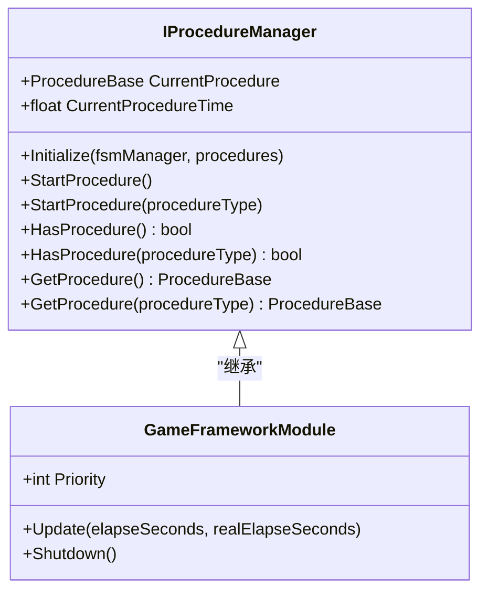
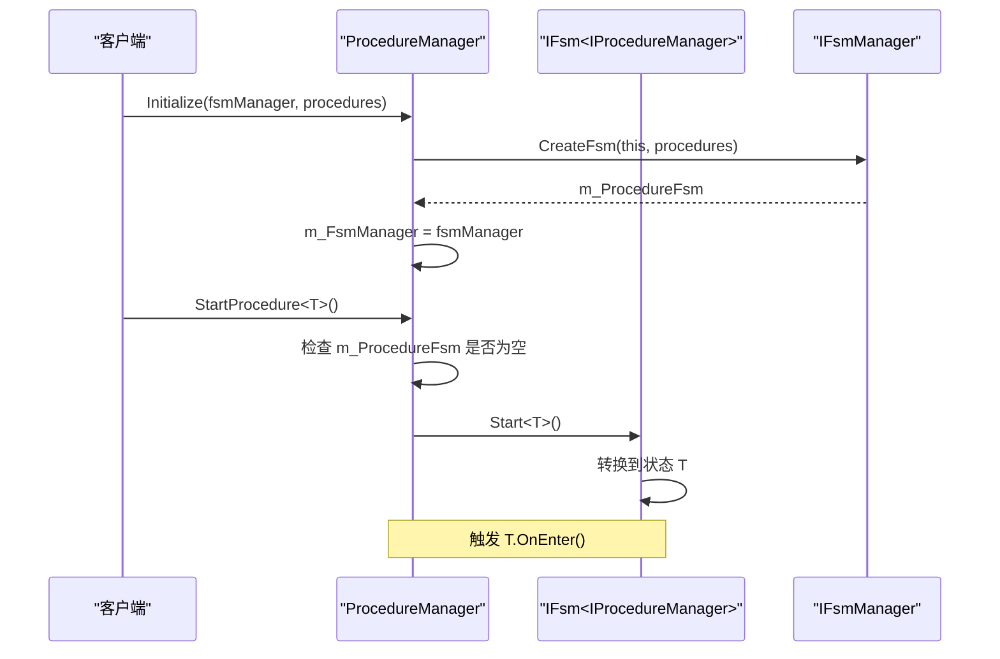
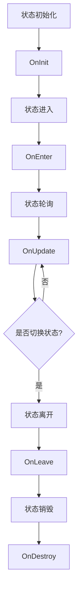
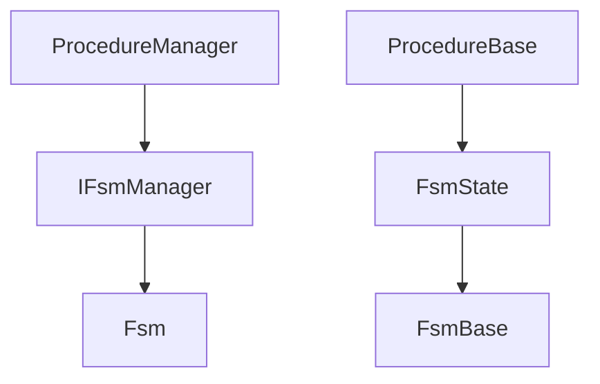

# 流程管理

<cite>
**Referenced Files in This Document**   
- [IProcedureManager.cs](file://GameFramework/Procedure/IProcedureManager.cs)
- [ProcedureManager.cs](file://GameFramework/Procedure/ProcedureManager.cs)
- [ProcedureBase.cs](file://GameFramework/Procedure/ProcedureBase.cs)
</cite>

## 目录
1. [简介](#简介)
2. [核心组件](#核心组件)
3. [架构概览](#架构概览)
4. [详细组件分析](#详细组件分析)
5. [依赖分析](#依赖分析)
6. [性能考量](#性能考量)
7. [故障排除指南](#故障排除指南)
8. [结论](#结论)

## 简介
流程管理模块是游戏框架中的核心状态管理组件，负责定义、切换和维护游戏主流程（如启动、登录、主城、战斗等）的有序执行。该模块通过有限状态机（FSM）模式实现，提供了一套完整的流程控制机制，包括流程初始化、状态切换、生命周期回调和事件通知等功能。本文档将深入解析 `IProcedureManager`、`ProcedureManager` 和 `ProcedureBase` 的设计理念与实现细节，阐述如何通过流程管理器控制游戏状态的有序切换。

## 核心组件
流程管理模块由三个核心组件构成：`IProcedureManager` 接口定义了流程管理器的公共契约，`ProcedureManager` 类实现了具体的流程管理逻辑，`ProcedureBase` 类作为所有具体流程的基类，提供了标准的生命周期回调方法。这些组件共同协作，实现了游戏状态的有序切换和状态维护。

**Section sources**
- [IProcedureManager.cs](file://GameFramework/Procedure/IProcedureManager.cs#L15-L79)
- [ProcedureManager.cs](file://GameFramework/Procedure/ProcedureManager.cs#L15-L202)
- [ProcedureBase.cs](file://GameFramework/Procedure/ProcedureBase.cs#L15-L64)

## 架构概览
流程管理模块采用经典的有限状态机（FSM）架构，`ProcedureManager` 作为流程管理器，内部持有一个由 `IFsmManager` 创建的有限状态机实例 `m_ProcedureFsm`。该状态机的持有者类型为 `IProcedureManager`，其状态集合由所有继承自 `ProcedureBase` 的具体流程类构成。游戏的主流程被抽象为一系列状态，流程切换即为状态机的状态转换。

```mermaid
graph TB
subgraph "流程管理模块"
IProcedureManager["IProcedureManager<br/>流程管理器接口"]
ProcedureManager["ProcedureManager<br/>流程管理器实现"]
ProcedureBase["ProcedureBase<br/>流程基类"]
FsmManager["IFsmManager<br/>有限状态机管理器"]
end
IProcedureManager --> ProcedureManager : "实现"
ProcedureBase --> |继承| FsmState["FsmState<IProcedureManager>"]
ProcedureManager --> FsmManager : "使用"
ProcedureManager --> |管理| ProcedureBase : "多个"
FsmManager --> |创建| Fsm["IFsm<IProcedureManager>"]
ProcedureManager --> Fsm : "持有"
```

**Diagram sources**
- [IProcedureManager.cs](file://GameFramework/Procedure/IProcedureManager.cs#L15-L79)
- [ProcedureManager.cs](file://GameFramework/Procedure/ProcedureManager.cs#L15-L202)
- [ProcedureBase.cs](file://GameFramework/Procedure/ProcedureBase.cs#L15-L64)

**Section sources**
- [ProcedureManager.cs](file://GameFramework/Procedure/ProcedureManager.cs#L15-L202)

## 详细组件分析

### IProcedureManager 接口分析
`IProcedureManager` 接口定义了流程管理器对外暴露的所有功能，是模块的公共契约。它继承自 `GameFrameworkModule`，确保了与游戏框架其他模块的集成。接口提供了获取当前流程、初始化流程、启动流程、检查流程存在性以及获取特定流程实例等核心方法。



**Diagram sources**
- [IProcedureManager.cs](file://GameFramework/Procedure/IProcedureManager.cs#L15-L79)

**Section sources**
- [IProcedureManager.cs](file://GameFramework/Procedure/IProcedureManager.cs#L15-L79)

### ProcedureManager 实现分析
`ProcedureManager` 是 `IProcedureManager` 接口的具体实现，是一个内部密封类。它通过组合 `IFsmManager` 和 `IFsm<IProcedureManager>` 来实现流程管理功能。其核心职责包括：通过 `Initialize` 方法初始化状态机，通过 `StartProcedure` 方法启动指定流程，以及通过属性 `CurrentProcedure` 和 `CurrentProcedureTime` 提供当前流程的访问。

#### 流程初始化与启动
流程管理器的初始化是通过 `Initialize` 方法完成的，该方法接收一个 `IFsmManager` 实例和一组 `ProcedureBase` 派生类的实例。它利用 `IFsmManager` 创建一个管理 `IProcedureManager` 的有限状态机，并将所有提供的流程作为状态注入其中。流程的启动则通过 `StartProcedure` 方法族实现，该方法最终委托给内部状态机的 `Start` 方法，触发状态机进入指定的初始状态。



**Diagram sources**
- [ProcedureManager.cs](file://GameFramework/Procedure/ProcedureManager.cs#L104-L113)
- [ProcedureManager.cs](file://GameFramework/Procedure/ProcedureManager.cs#L119-L127)

**Section sources**
- [ProcedureManager.cs](file://GameFramework/Procedure/ProcedureManager.cs#L104-L141)

### ProcedureBase 基类分析
`ProcedureBase` 是所有具体游戏流程的抽象基类，它继承自 `FsmState<IProcedureManager>`，表明每个流程本质上是状态机的一个状态。该类为流程的生命周期提供了标准的回调方法，开发者通过继承此类并重写这些方法来定义特定流程的行为。

#### 生命周期回调
`ProcedureBase` 定义了完整的状态生命周期回调，包括 `OnInit`（初始化）、`OnEnter`（进入）、`OnUpdate`（更新）、`OnLeave`（离开）和 `OnDestroy`（销毁）。这些方法在状态机状态转换的相应时机被自动调用，为开发者提供了精确的流程控制点。



**Diagram sources**
- [ProcedureBase.cs](file://GameFramework/Procedure/ProcedureBase.cs#L21-L24)
- [ProcedureBase.cs](file://GameFramework/Procedure/ProcedureBase.cs#L30-L33)
- [ProcedureBase.cs](file://GameFramework/Procedure/ProcedureBase.cs#L41-L44)
- [ProcedureBase.cs](file://GameFramework/Procedure/ProcedureBase.cs#L51-L54)
- [ProcedureBase.cs](file://GameFramework/Procedure/ProcedureBase.cs#L60-L63)

**Section sources**
- [ProcedureBase.cs](file://GameFramework/Procedure/ProcedureBase.cs#L15-L64)

## 依赖分析
流程管理模块高度依赖于框架的有限状态机系统（`Fsm` 模块）。`ProcedureManager` 依赖 `IFsmManager` 来创建和管理状态机，而 `ProcedureBase` 直接继承自 `FsmState<IProcedureManager>`，其生命周期完全由状态机驱动。这种设计实现了关注点分离，流程管理器专注于流程的组织和调度，而状态机则负责底层的状态转换逻辑。



**Diagram sources**
- [ProcedureManager.cs](file://GameFramework/Procedure/ProcedureManager.cs#L18-L19)
- [ProcedureBase.cs](file://GameFramework/Procedure/ProcedureBase.cs#L15)

**Section sources**
- [ProcedureManager.cs](file://GameFramework/Procedure/ProcedureManager.cs#L15-L202)
- [ProcedureBase.cs](file://GameFramework/Procedure/ProcedureBase.cs#L15-L64)

## 性能考量
`ProcedureManager` 的 `Update` 方法为空实现，表明流程管理器本身不进行主动轮询，其状态更新完全由底层状态机驱动，这保证了高效的性能。流程切换操作（`StartProcedure`）的时间复杂度取决于底层状态机的实现，通常为 O(1) 或 O(log n)。建议在 `OnUpdate` 回调中避免执行耗时操作，以防止影响游戏的帧率。

## 故障排除指南
常见问题包括在调用 `StartProcedure` 前未调用 `Initialize`，这将导致抛出 `GameFrameworkException`。确保在游戏启动时正确初始化流程管理器。另一个问题是流程类未正确继承 `ProcedureBase` 或未在 `Initialize` 时注册，这将导致 `HasProcedure` 返回 `false` 或 `StartProcedure` 失败。检查流程类的继承关系和初始化参数。

**Section sources**
- [ProcedureManager.cs](file://GameFramework/Procedure/ProcedureManager.cs#L119-L127)
- [ProcedureManager.cs](file://GameFramework/Procedure/ProcedureManager.cs#L133-L141)

## 结论
流程管理模块通过 `IProcedureManager`、`ProcedureManager` 和 `ProcedureBase` 三个核心组件，构建了一个清晰、高效且易于扩展的游戏状态管理系统。其基于有限状态机的设计模式，使得复杂的游戏主流程能够被分解为一系列独立且有序的状态，极大地提升了代码的可维护性和可读性。开发者可以通过继承 `ProcedureBase` 并实现其生命周期方法，轻松地定义和管理游戏中的各种流程。