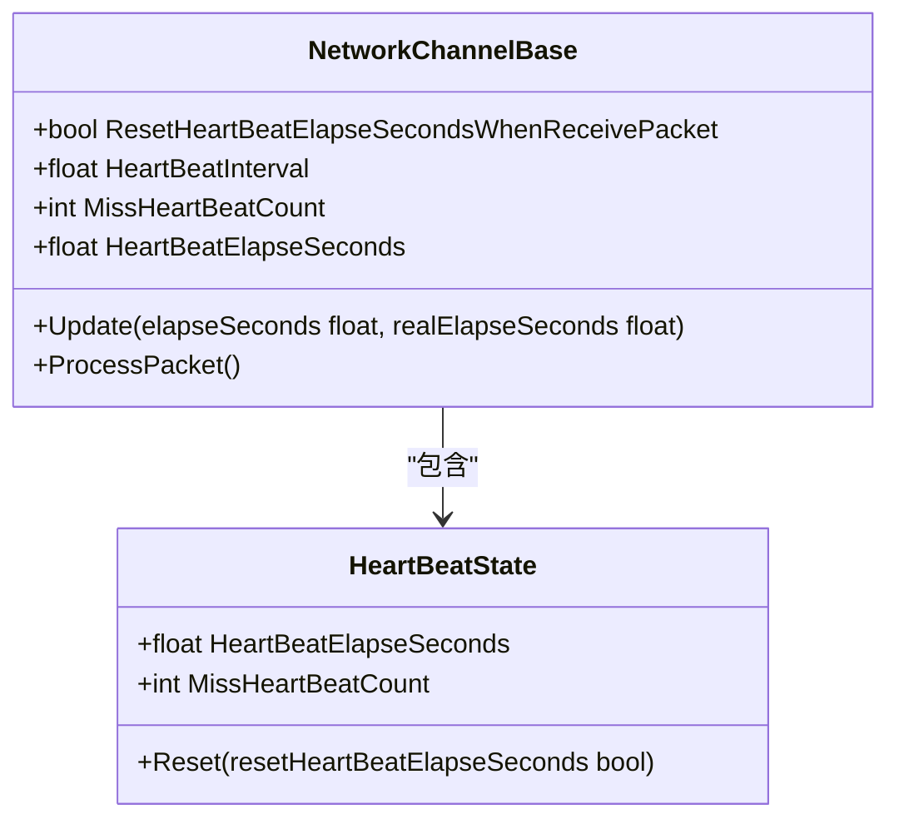
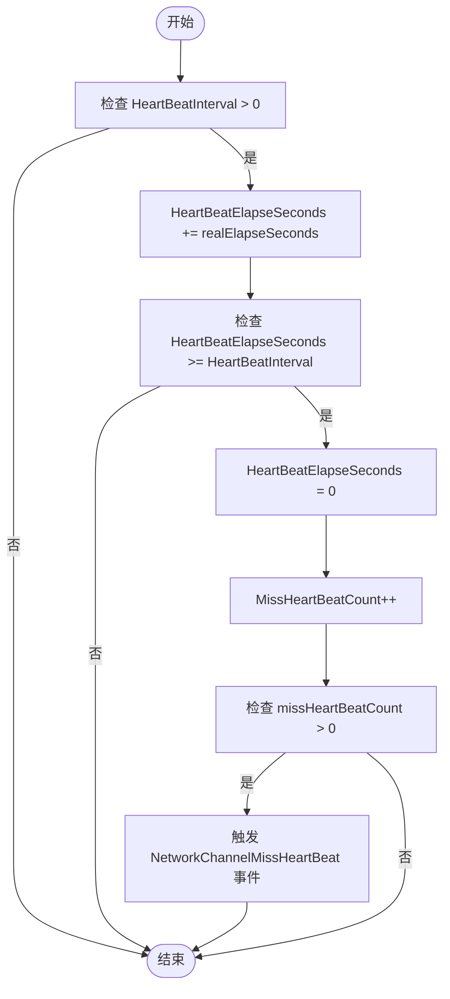
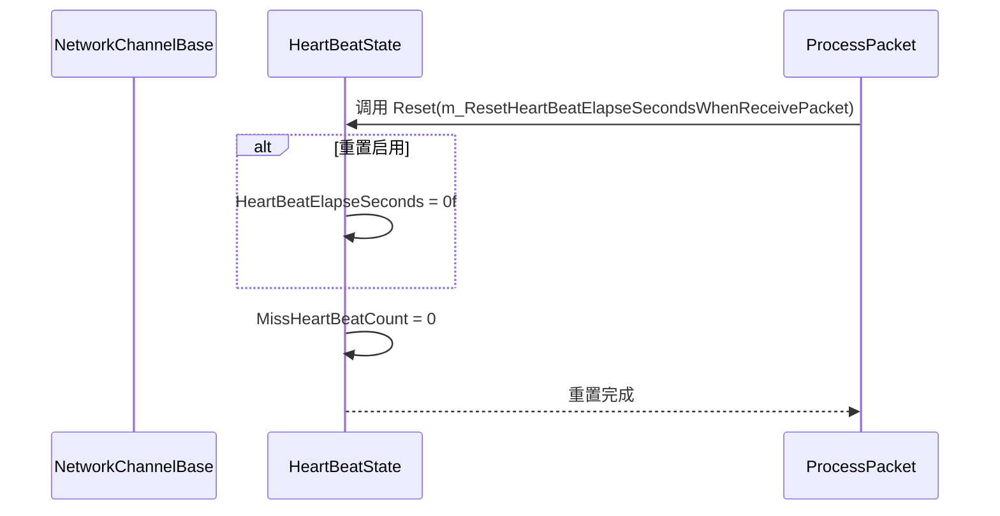
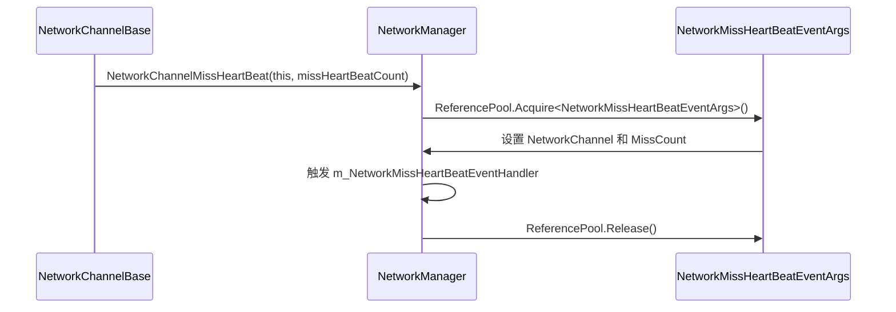

# 心跳机制

<cite>
**Referenced Files in This Document**   
- [NetworkManager.cs](file://GameFramework/Network/NetworkManager.cs)
- [NetworkManager.NetworkChannelBase.cs](file://GameFramework/Network/NetworkManager.NetworkChannelBase.cs)
- [NetworkManager.HeartBeatState.cs](file://GameFramework/Network/NetworkManager.HeartBeatState.cs)
- [NetworkMissHeartBeatEventArgs.cs](file://GameFramework/Network/NetworkMissHeartBeatEventArgs.cs)
</cite>

## 目录
1. [心跳机制概述](#心跳机制概述)
2. [核心属性详解](#核心属性详解)
3. [心跳丢失检测流程](#心跳丢失检测流程)
4. [数据包接收时的心跳重置逻辑](#数据包接收时的心跳重置逻辑)
5. [心跳事件通知机制](#心跳事件通知机制)
6. [心跳参数调优建议](#心跳参数调优建议)
7. [高延迟网络环境下的实践方案](#高延迟网络环境下的实践方案)

## 心跳机制概述

心跳机制是网络通信中用于维持连接活性的关键技术。在本框架中，`NetworkManager`通过其内部的`NetworkChannelBase`类实现了一套完整的心跳检测系统。该系统通过定时器检测心跳流逝时间，当超过预设阈值时判定为心跳丢失，并触发相应的事件通知。整个机制旨在确保网络连接的稳定性，及时发现并处理异常断线情况。

**Section sources**
- [NetworkManager.cs](file://GameFramework/Network/NetworkManager.cs#L1-L353)
- [NetworkManager.NetworkChannelBase.cs](file://GameFramework/Network/NetworkManager.NetworkChannelBase.cs#L1-L636)

## 核心属性详解

心跳机制的核心由三个关键属性构成：`HeartBeatInterval`、`HeartBeatElapseSeconds`和`MissHeartBeatCount`。

`HeartBeatInterval`表示心跳包的发送间隔，单位为秒，默认值为30秒。该属性决定了心跳检测的频率，是判断连接是否活跃的基础时间单位。

`HeartBeatElapseSeconds`记录了当前心跳等待的流逝时间，单位为秒。该值在每次轮询时累加真实流逝时间，当其值达到或超过`HeartBeatInterval`时，系统将判定为一次心跳丢失。

`MissHeartBeatCount`统计了连续丢失的心跳次数。每次心跳超时后，该计数器会递增，用于判断是否需要触发更高级别的连接异常处理。

**Diagram sources**
- [NetworkManager.HeartBeatState.cs](file://GameFramework/Network/NetworkManager.HeartBeatState.cs#L11-L55)
- [NetworkManager.NetworkChannelBase.cs](file://GameFramework/Network/NetworkManager.NetworkChannelBase.cs#L178-L260)

**Section sources**
- [NetworkManager.NetworkChannelBase.cs](file://GameFramework/Network/NetworkManager.NetworkChannelBase.cs#L178-L219)

## 心跳丢失检测流程

心跳丢失的检测由`NetworkChannelBase.Update`方法在每次轮询时执行。该流程通过定时器持续监控`HeartBeatElapseSeconds`是否超过`HeartBeatInterval`来判断心跳状态。

检测流程首先检查`HeartBeatInterval`是否大于0，若为0则表示禁用心跳功能。当心跳功能启用时，系统会在每次轮询中将`realElapseSeconds`（真实流逝时间）累加到`HeartBeatElapseSeconds`上。当`HeartBeatElapseSeconds`达到或超过`HeartBeatInterval`时，系统判定为一次心跳丢失，此时会重置`HeartBeatElapseSeconds`为0，并将`MissHeartBeatCount`计数器递增。

**Diagram sources**
- [NetworkManager.NetworkChannelBase.cs](file://GameFramework/Network/NetworkManager.NetworkChannelBase.cs#L219-L260)

**Section sources**
- [NetworkManager.NetworkChannelBase.cs](file://GameFramework/Network/NetworkManager.NetworkChannelBase.cs#L219-L260)

## 数据包接收时的心跳重置逻辑

`ResetHeartBeatElapseSecondsWhenReceivePacket`配置项控制着在收到数据包时是否重置心跳计时器。当该配置项为`true`时，每次成功处理接收到的数据包后，系统会自动将`HeartBeatElapseSeconds`重置为0。

这一逻辑在`ProcessPacket`方法中实现，通过调用`HeartBeatState.Reset`方法并传入`m_ResetHeartBeatElapseSecondsWhenReceivePacket`的值来决定是否重置流逝时间。这种设计允许应用程序根据实际需求灵活选择心跳策略：若希望任何数据交互都能刷新心跳状态，则启用此配置；若需要严格按固定间隔检测心跳，则可禁用此功能。

**Diagram sources**
- [NetworkManager.NetworkChannelBase.cs](file://GameFramework/Network/NetworkManager.NetworkChannelBase.cs#L588-L614)
- [NetworkManager.HeartBeatState.cs](file://GameFramework/Network/NetworkManager.HeartBeatState.cs#L45-L55)

**Section sources**
- [NetworkManager.NetworkChannelBase.cs](file://GameFramework/Network/NetworkManager.NetworkChannelBase.cs#L588-L614)

## 心跳事件通知机制

当检测到心跳丢失时，系统会触发`NetworkMissHeartBeatEventArgs`事件，通知上层应用连接可能出现异常。该事件通过`NetworkChannelMissHeartBeat`委托进行传播，携带了发生心跳丢失的网络频道和已丢失的心跳次数信息。

事件的创建和分发由`NetworkManager`统一管理。当`NetworkChannelBase`检测到心跳丢失时，会调用`OnNetworkChannelMissHeartBeat`方法，该方法通过`ReferencePool`对象池创建`NetworkMissHeartBeatEventArgs`实例，并触发相应的事件处理器。这种设计既保证了事件通知的及时性，又通过对象池机制避免了频繁的内存分配。

**Diagram sources**
- [NetworkManager.cs](file://GameFramework/Network/NetworkManager.cs#L313-L324)
- [NetworkMissHeartBeatEventArgs.cs](file://GameFramework/Network/NetworkMissHeartBeatEventArgs.cs#L47-L53)

**Section sources**
- [NetworkManager.cs](file://GameFramework/Network/NetworkManager.cs#L313-L324)

## 心跳参数调优建议

合理配置心跳参数对于平衡网络性能和连接稳定性至关重要。建议根据应用场景选择合适的`HeartBeatInterval`值：对于实时性要求高的游戏应用，可将间隔设置为10-15秒；对于普通应用，20-30秒的默认值通常足够。

`MissHeartBeatCount`的阈值应与心跳间隔相匹配。例如，若`HeartBeatInterval`为30秒，建议设置最多允许2-3次心跳丢失（即1-1.5分钟），超过此阈值则判定为连接断开。这样既能容忍短暂的网络波动，又能及时发现真正的连接问题。

在低带宽环境下，应适当延长心跳间隔以减少网络开销；而在高可靠性要求的场景中，可缩短间隔以更快地检测到连接异常。

## 高延迟网络环境下的实践方案

在高延迟网络环境下，为避免误判心跳丢失，建议采取以下措施：首先，适当增加`HeartBeatInterval`值，通常设置为网络RTT（往返时间）的3-5倍；其次，启用`ResetHeartBeatElapseSecondsWhenReceivePacket`配置，利用正常的数据交互来刷新心跳计时器。

此外，可结合应用层的心跳确认机制，即发送心跳包后等待对方回复确认，只有在连续多次未收到确认时才判定为心跳丢失。这种双向确认机制能有效区分网络延迟和真正的连接中断。

对于移动网络等不稳定环境，建议实现动态心跳调整算法，根据网络状况自动调节心跳间隔，在网络良好时使用较短间隔，在网络较差时自动延长间隔，从而实现性能与稳定性的最佳平衡。