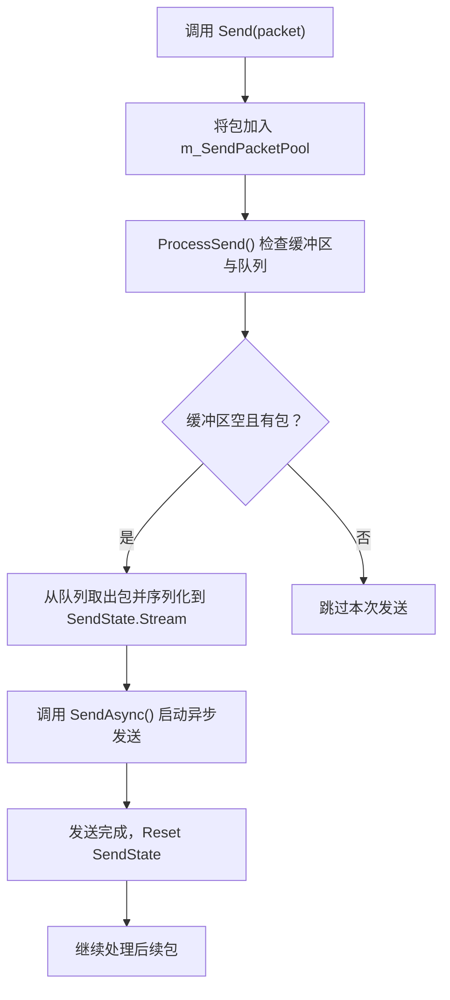
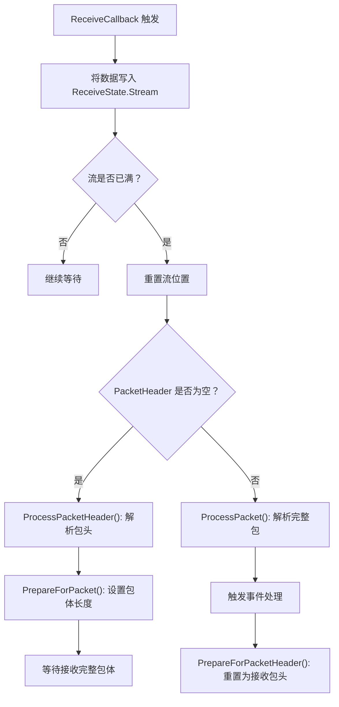

# 收发状态机

<cite>
**本文档中引用的文件**  
- [NetworkManager.SendState.cs](file://GameFramework/Network/NetworkManager.SendState.cs)
- [NetworkManager.ReceiveState.cs](file://GameFramework/Network/NetworkManager.ReceiveState.cs)
- [NetworkManager.NetworkChannelBase.cs](file://GameFramework/Network/NetworkManager.NetworkChannelBase.cs)
- [NetworkManager.TcpNetworkChannel.cs](file://GameFramework/Network/NetworkManager.TcpNetworkChannel.cs)
- [NetworkManager.cs](file://GameFramework/Network/NetworkManager.cs)
</cite>

## 目录
1. [引言](#引言)
2. [SendState：发送状态管理](#sendstate发送状态管理)
3. [ReceiveState：接收状态与粘包处理](#receivestate接收状态与粘包处理)
4. [NetworkManager 中的收发循环调度](#networkmanager-中的收发循环调度)
5. [高并发下的线程安全性保障](#高并发下的线程安全性保障)
6. [性能监控建议](#性能监控建议)
7. [结论](#结论)

## 引言

在游戏网络通信中，高效、可靠的数据收发机制是系统稳定运行的核心。GameFramework 的网络模块通过 `SendState` 和 `ReceiveState` 两个内部状态机，分别管理数据的异步发送与分阶段接收流程。本文深入文档化这两个状态机的内部实现机制，涵盖缓冲区管理、流量控制、粘包/拆包处理、线程安全设计及性能监控建议。

**Section sources**  
- [NetworkManager.cs](file://GameFramework/Network/NetworkManager.cs#L1-L354)

## SendState：发送状态管理

`SendState` 类负责管理待发送数据的缓冲区，封装了 `MemoryStream` 作为数据暂存区，支持异步发送与流量控制。

### 缓冲区与数据暂存

`SendState` 内部维护一个 `MemoryStream` 实例，默认初始容量为 64KB（`DefaultBufferLength`），用于累积待发送的数据包。当调用 `Send<T>(T packet)` 方法时，消息包被加入 `m_SendPacketPool` 队列，但尚未序列化。

### 异步发送流程

在 `NetworkChannelBase.ProcessSend()` 中，系统会检查当前 `SendState.Stream` 是否为空且存在待发送包。若满足条件，则从 `m_SendPacketPool` 中逐个取出包，通过 `INetworkChannelHelper.Serialize` 方法将其序列化至 `SendState.Stream` 中。序列化完成后，调用 `SendAsync()` 启动异步发送。

### 流量控制机制

发送流程采用“按需填充”策略：仅当发送缓冲区为空且存在待发包时才进行序列化，避免内存浪费。发送完成后，调用 `m_SendState.Reset()` 重置流位置与长度，为下一次发送做准备。

**Diagram sources**  
- [NetworkManager.SendState.cs](file://GameFramework/Network/NetworkManager.SendState.cs#L1-L67)
- [NetworkManager.NetworkChannelBase.cs](file://GameFramework/Network/NetworkManager.NetworkChannelBase.cs#L200-L250)

**Section sources**  
- [NetworkManager.SendState.cs](file://GameFramework/Network/NetworkManager.SendState.cs#L1-L67)
- [NetworkManager.NetworkChannelBase.cs](file://GameFramework/Network/NetworkManager.NetworkChannelBase.cs#L200-L250)

## ReceiveState：接收状态与粘包处理

`ReceiveState` 负责处理 TCP 流式数据中的粘包与拆包问题，通过分阶段读取实现完整消息包的重组。

### 分阶段读取机制

接收流程分为两个关键阶段：

1. **头部读取阶段**：初始化时调用 `PrepareForPacketHeader()`，设置 `MemoryStream` 长度为包头长度（由 `INetworkChannelHelper.PacketHeaderLength` 提供），等待接收完整包头。
2. **包体读取阶段**：包头接收完成后，通过 `DeserializePacketHeader()` 解析出实际包长度，调用 `PrepareForPacket()` 设置流长度为目标包长，继续接收完整包体。

### 粘包/拆包处理流程

当 `ReceiveCallback` 被触发时，接收到的数据写入 `ReceiveState.Stream`。若流已满，则根据当前状态判断：
- 若 `PacketHeader` 为空，说明正在接收包头，调用 `ProcessPacketHeader()` 解析包头。
- 若 `PacketHeader` 不为空，说明正在接收包体，调用 `ProcessPacket()` 解析完整包并触发事件。

解析完成后，重置 `ReceiveState` 为接收下一个包头的状态。

**Diagram sources**  
- [NetworkManager.ReceiveState.cs](file://GameFramework/Network/NetworkManager.ReceiveState.cs#L1-L98)
- [NetworkManager.NetworkChannelBase.cs](file://GameFramework/Network/NetworkManager.NetworkChannelBase.cs#L350-L400)

**Section sources**  
- [NetworkManager.ReceiveState.cs](file://GameFramework/Network/NetworkManager.ReceiveState.cs#L1-L98)
- [NetworkManager.NetworkChannelBase.cs](file://GameFramework/Network/NetworkManager.NetworkChannelBase.cs#L350-L400)

## NetworkManager 中的收发循环调度

`NetworkManager` 通过 `Update()` 方法驱动所有网络频道的轮询，而具体收发逻辑由 `NetworkChannelBase.Update()` 实现。

### 发送循环

`ProcessSend()` 检查是否需要序列化新包。若需要，则填充 `SendState.Stream` 并调用 `SendAsync()` 启动异步发送。发送完成回调 `SendCallback` 中，更新已发送包计数并重置 `SendState`。

### 接收循环

对于异步接收（`TcpNetworkChannel`），`ReceiveAsync()` 启动异步读取，数据到达后由 `ReceiveCallback` 处理。对于同步接收（`TcpWithSyncReceiveNetworkChannel`），`ProcessReceive()` 在每次 `Update()` 中轮询 `Socket.Available`，调用 `ReceiveSync()` 处理可用数据。

### 心跳机制

`Update()` 中还包含心跳逻辑：若心跳间隔已到，调用 `INetworkChannelHelper.SendHeartBeat()` 发送心跳包，并重置心跳状态。若连续丢失心跳，触发 `NetworkChannelMissHeartBeat` 事件。

**Section sources**  
- [NetworkManager.NetworkChannelBase.cs](file://GameFramework/Network/NetworkManager.NetworkChannelBase.cs#L150-L200)
- [NetworkManager.TcpNetworkChannel.cs](file://GameFramework/Network/NetworkManager.TcpNetworkChannel.cs#L1-L291)

## 高并发下的线程安全性保障

尽管 .NET 的 `Socket` 异步操作在 I/O 完成端口线程上执行，但 GameFramework 仍通过以下机制保障线程安全：

### 锁机制

- **发送队列**：在 `Send()` 和 `ProcessSend()` 中操作 `m_SendPacketPool` 时使用 `lock(m_SendPacketPool)`，防止多线程同时修改队列。
- **心跳状态**：`HeartBeatState` 的读写通过 `lock(m_HeartBeatState)` 保护，避免并发修改。
- **事件处理器**：事件订阅与触发使用 `lock` 保护，确保事件链的线程安全。

### 状态机隔离

`SendState` 和 `ReceiveState` 为每个 `NetworkChannel` 独立实例，避免状态共享。`MemoryStream` 的操作在单个频道的上下文中进行，无需跨频道同步。

### 原子操作与标志位

使用 `m_Active` 标志位控制频道活跃状态，配合 `lock(this)` 在 `Close()` 中原子化关闭流程，防止资源竞争。

**Section sources**  
- [NetworkManager.NetworkChannelBase.cs](file://GameFramework/Network/NetworkManager.NetworkChannelBase.cs#L200-L400)
- [NetworkManager.TcpNetworkChannel.cs](file://GameFramework/Network/NetworkManager.TcpNetworkChannel.cs#L1-L291)

## 性能监控建议

为监控网络模块性能，可暴露以下统计指标：

| 指标名称 | 数据类型 | 业务用途 | 来源 |
|---------|--------|--------|------|
| SendPacketCount | int | 当前待发送包数量，用于判断发送队列积压情况 | `NetworkChannelBase.SendPacketCount` |
| SentPacketCount | int | 累计发送包数，用于统计吞吐量 | `NetworkChannelBase.SentPacketCount` |
| ReceivePacketCount | int | 已接收未处理包数，反映事件处理延迟 | `NetworkChannelBase.ReceivePacketCount` |
| ReceivedPacketCount | int | 累计接收包数，用于统计接收吞吐量 | `NetworkChannelBase.ReceivedPacketCount` |
| MissHeartBeatCount | int | 连续丢失心跳次数，用于判断网络质量 | `NetworkChannelBase.MissHeartBeatCount` |

这些指标可用于实时监控、告警系统及性能调优。

**Section sources**  
- [NetworkManager.NetworkChannelBase.cs](file://GameFramework/Network/NetworkManager.NetworkChannelBase.cs#L100-L150)

## 结论

`SendState` 和 `ReceiveState` 构成了 GameFramework 网络模块的核心状态机，分别实现了高效的异步发送与可靠的粘包处理。通过 `NetworkChannelBase` 的统一调度与锁机制，系统在高并发场景下保持了良好的线程安全性。结合合理的性能监控指标，开发者可全面掌握网络通信状态，确保游戏服务的稳定与高效。