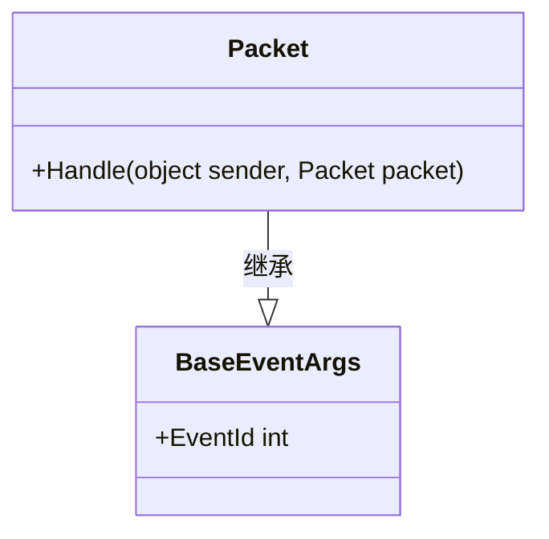
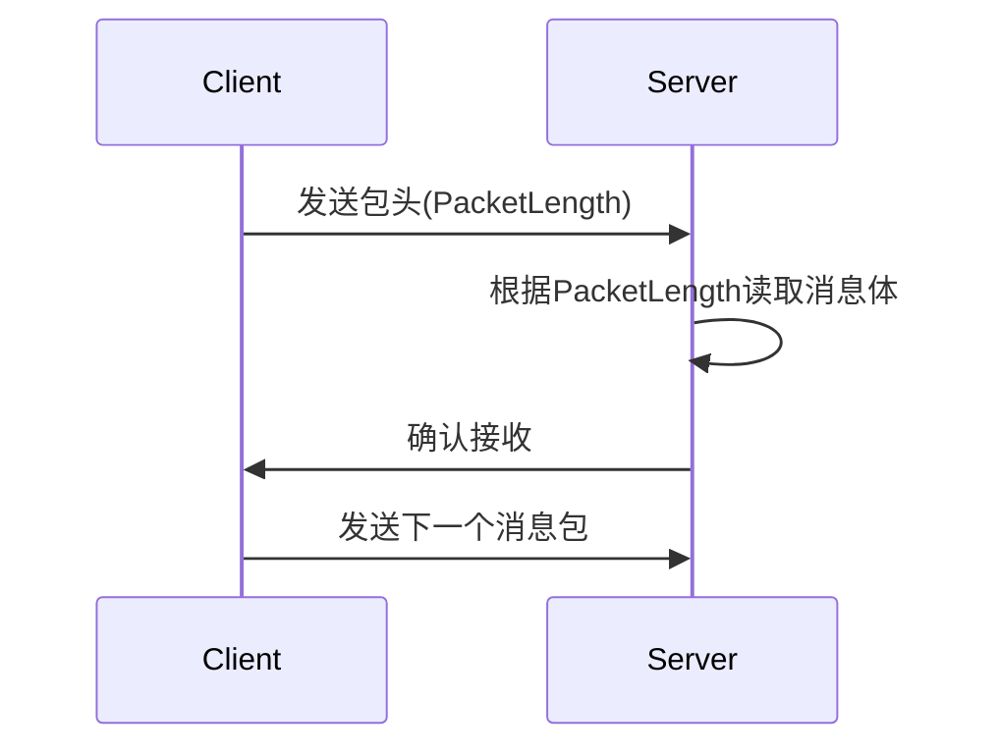
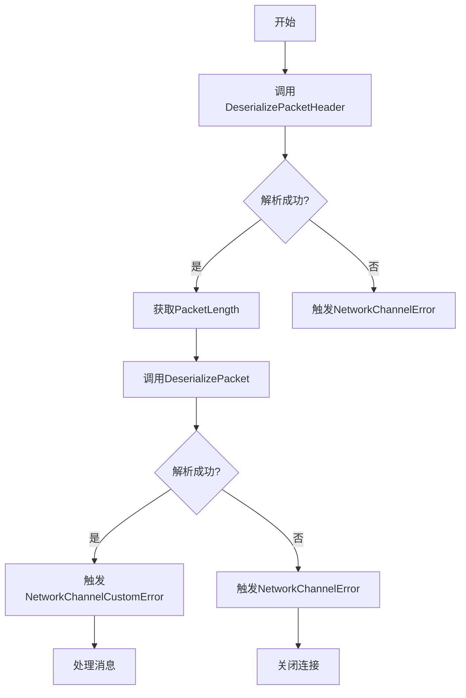
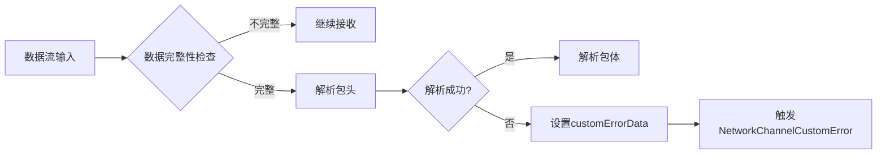
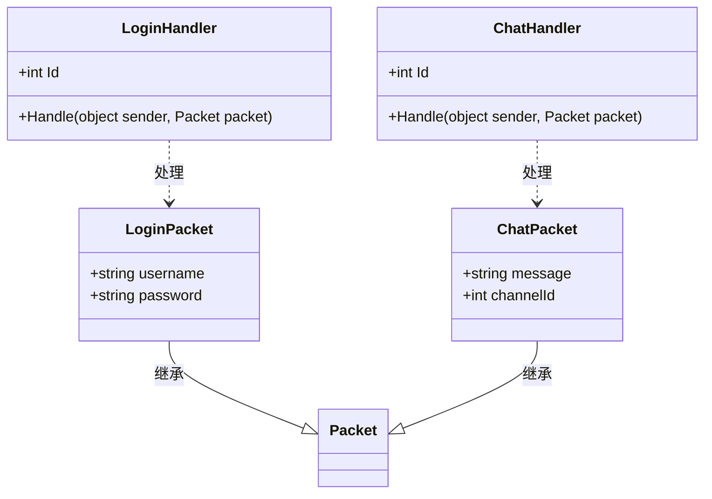
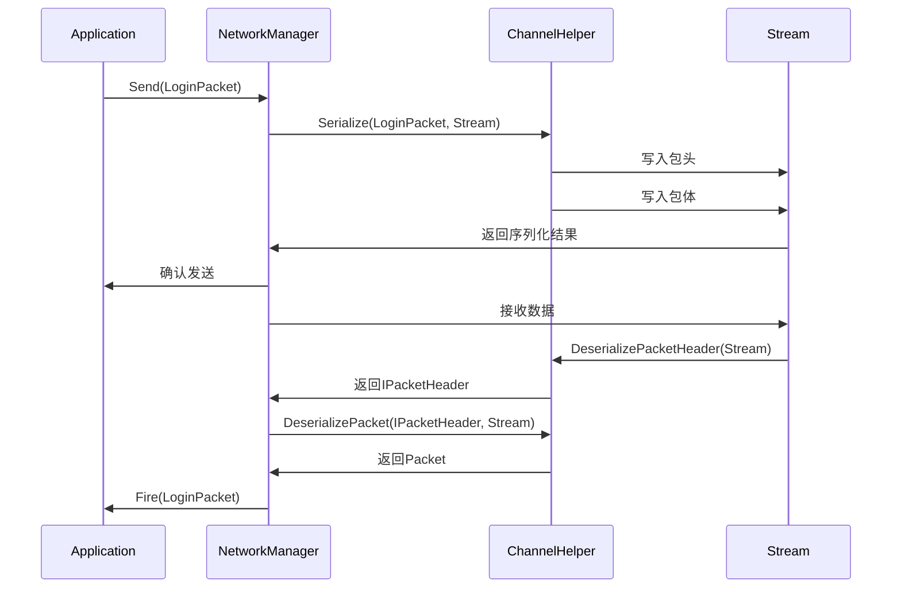

# 数据包协议

<cite>
**本文档中引用的文件**   
- [Packet.cs](file://GameFramework/Network/Packet.cs)
- [IPacketHeader.cs](file://GameFramework/Network/IPacketHeader.cs)
- [INetworkChannelHelper.cs](file://GameFramework/Network/INetworkChannelHelper.cs)
- [IPacketHandler.cs](file://GameFramework/Network/IPacketHandler.cs)
- [NetworkManager.NetworkChannelBase.cs](file://GameFramework/Network/NetworkManager.NetworkChannelBase.cs)
- [NetworkManager.ReceiveState.cs](file://GameFramework/Network/NetworkManager.ReceiveState.cs)
</cite>

## 目录
1. [引言](#引言)
2. [数据包封装与解析机制](#数据包封装与解析机制)
3. [Packet抽象类设计意图](#packet抽象类设计意图)
4. [IPacketHeader接口与帧同步](#ipacketheader接口与帧同步)
5. [INetworkChannelHelper消息处理流程](#inetworkchannelhelper消息处理流程)
6. [数据流处理与错误传递机制](#数据流处理与错误传递机制)
7. [自定义Packet实现与协议路由](#自定义packet实现与协议路由)
8. [序列化与反序列化流程图](#序列化与反序列化流程图)
9. [结论](#结论)

## 引言
本文档系统性地文档化GameFramework中网络数据包的封装与解析机制。重点分析Packet抽象类作为所有网络消息基类的设计意图，阐述IPacketHeader接口中PacketLength字段在帧同步中的关键作用。详细说明INetworkChannelHelper中DeserializePacketHeader和DeserializePacket方法如何协同完成消息头解析与消息体反序列化。结合Stream参数说明数据流处理过程，阐述customErrorData在协议解析失败时的错误传递机制。提供自定义Packet实现示例，展示如何定义协议ID并注册到IPacketHandler进行路由。

## 数据包封装与解析机制
GameFramework的网络模块采用分层设计模式，将数据包的封装与解析过程解耦。通过INetworkChannelHelper接口定义序列化与反序列化的标准流程，实现了网络协议的可扩展性。该机制支持TCP协议的异步通信，通过内存流（MemoryStream）缓冲接收到的数据，确保数据包的完整性和顺序性。

**Section sources**
- [INetworkChannelHelper.cs](file://GameFramework/Network/INetworkChannelHelper.cs#L14-L71)
- [NetworkManager.NetworkChannelBase.cs](file://GameFramework/Network/NetworkManager.NetworkChannelBase.cs#L29-L636)

## Packet抽象类设计意图
Packet抽象类作为所有网络消息包的基类，继承自BaseEventArgs，体现了事件驱动的设计思想。该设计意图在于将网络消息视为系统事件进行处理，便于集成到GameFramework的事件池（EventPool）机制中。通过继承Packet类，开发者可以定义具有特定业务逻辑的网络消息类型，同时保持与网络层的松耦合。

**Diagram sources **
- [Packet.cs](file://GameFramework/Network/Packet.cs#L12-L14)
- [BaseEventArgs.cs](file://GameFramework/Base/EventPool/BaseEventArgs.cs)

**Section sources**
- [Packet.cs](file://GameFramework/Network/Packet.cs#L12-L14)

## IPacketHeader接口与帧同步
IPacketHeader接口定义了网络消息包头的基本结构，其中PacketLength属性在帧同步中起着至关重要的作用。该字段表示整个消息包的长度（包括包头和包体），用于确定消息的边界。在接收数据时，系统首先读取包头获取PacketLength，然后根据该长度读取完整的消息体，确保数据帧的完整性和同步性。

**Diagram sources **
- [IPacketHeader.cs](file://GameFramework/Network/IPacketHeader.cs#L12-L21)
- [NetworkManager.ReceiveState.cs](file://GameFramework/Network/NetworkManager.ReceiveState.cs#L36-L42)

**Section sources**
- [IPacketHeader.cs](file://GameFramework/Network/IPacketHeader.cs#L12-L21)

## INetworkChannelHelper消息处理流程
INetworkChannelHelper接口定义了消息处理的核心流程，其中DeserializePacketHeader和DeserializePacket方法协同工作完成消息的完整解析。首先调用DeserializePacketHeader从数据流中解析出消息包头，获取PacketLength等元数据；然后根据包头信息调用DeserializePacket方法解析具体的消息内容。这种分步解析机制提高了协议的灵活性和可扩展性。

**Diagram sources **
- [INetworkChannelHelper.cs](file://GameFramework/Network/INetworkChannelHelper.cs#L61-L70)
- [NetworkManager.NetworkChannelBase.cs](file://GameFramework/Network/NetworkManager.NetworkChannelBase.cs#L500-L550)

**Section sources**
- [INetworkChannelHelper.cs](file://GameFramework/Network/INetworkChannelHelper.cs#L61-L70)

## 数据流处理与错误传递机制
数据流处理过程以Stream参数为核心，采用MemoryStream作为缓冲区。在接收数据时，系统持续将数据写入MemoryStream，直到达到PacketLength指定的长度。customErrorData机制在协议解析失败时提供详细的错误信息传递，允许上层应用根据具体的错误类型进行差异化处理。当DeserializePacketHeader或DeserializePacket方法返回null时，customErrorData包含具体的错误原因，通过NetworkChannelCustomError事件通知上层。

**Diagram sources **
- [INetworkChannelHelper.cs](file://GameFramework/Network/INetworkChannelHelper.cs#L61-L70)
- [NetworkManager.ReceiveState.cs](file://GameFramework/Network/NetworkManager.ReceiveState.cs#L15-L30)

**Section sources**
- [INetworkChannelHelper.cs](file://GameFramework/Network/INetworkChannelHelper.cs#L61-L70)
- [NetworkManager.ReceiveState.cs](file://GameFramework/Network/NetworkManager.ReceiveState.cs#L15-L30)

## 自定义Packet实现与协议路由
自定义Packet实现需要继承Packet抽象类并实现具体的业务逻辑。通过IPacketHandler接口注册到网络管理器，实现协议路由。每个IPacketHandler实现必须提供唯一的Id属性值，该值对应特定的协议编号。当网络层接收到消息后，根据协议编号将消息路由到相应的处理器进行处理，实现了消息的分发与多路复用。

**Diagram sources **
- [Packet.cs](file://GameFramework/Network/Packet.cs#L12-L14)
- [IPacketHandler.cs](file://GameFramework/Network/IPacketHandler.cs#L12-L28)
- [NetworkManager.NetworkChannelBase.cs](file://GameFramework/Network/NetworkManager.NetworkChannelBase.cs#L292-L323)

**Section sources**
- [Packet.cs](file://GameFramework/Network/Packet.cs#L12-L14)
- [IPacketHandler.cs](file://GameFramework/Network/IPacketHandler.cs#L12-L28)

## 序列化与反序列化流程图
以下流程图展示了完整的序列化与反序列化过程，从消息创建到网络传输再到接收处理的完整生命周期。

**Diagram sources **
- [INetworkChannelHelper.cs](file://GameFramework/Network/INetworkChannelHelper.cs#L50-L70)
- [NetworkManager.NetworkChannelBase.cs](file://GameFramework/Network/NetworkManager.NetworkChannelBase.cs#L400-L600)

## 结论
GameFramework的网络数据包机制通过分层设计和接口抽象，实现了高效、灵活的网络通信。Packet抽象类作为所有消息的基类，与事件系统深度集成；IPacketHeader接口的PacketLength字段确保了帧同步的可靠性；INetworkChannelHelper的分步解析机制支持协议的可扩展性；customErrorData提供了精细化的错误处理能力；通过IPacketHandler的协议路由机制，实现了消息的高效分发。这一整套机制为构建稳定可靠的网络应用提供了坚实的基础。