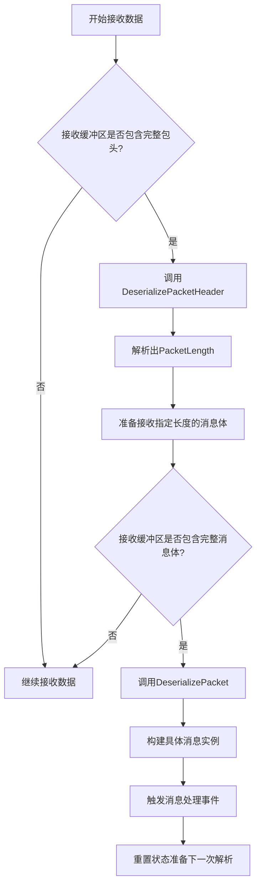
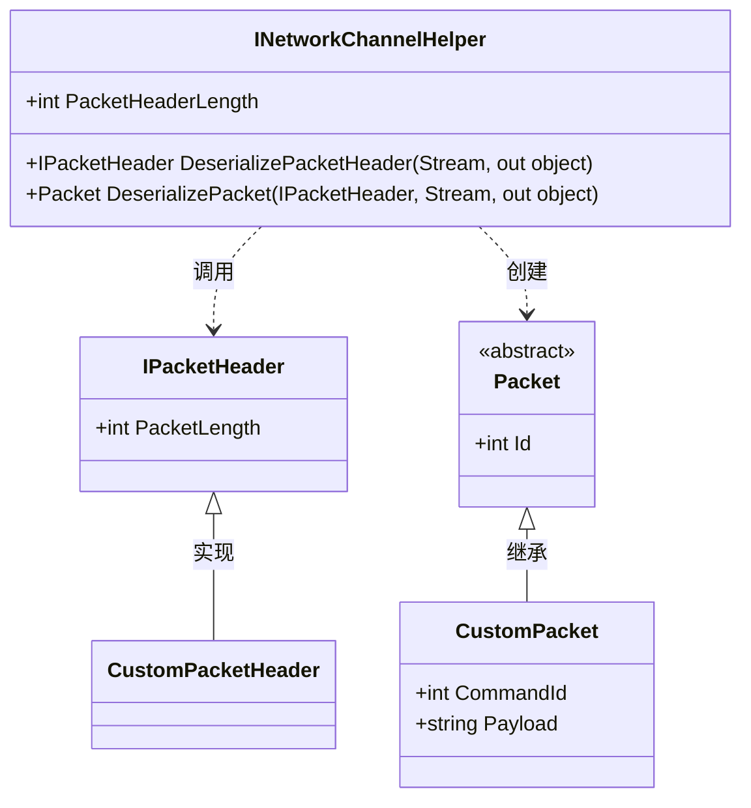
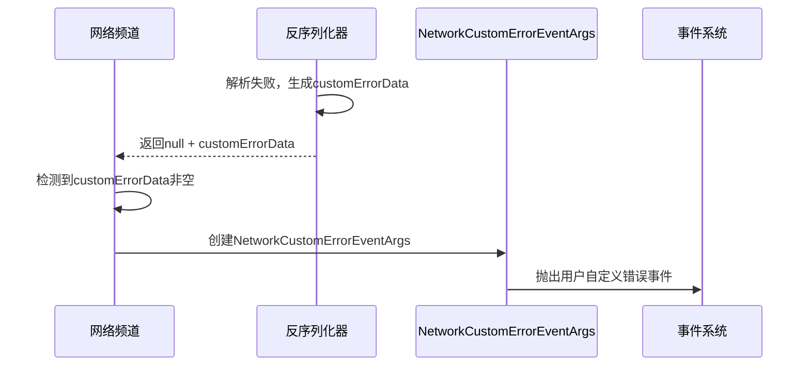

# 数据包反序列化

<cite>
**本文档引用的文件**  
- [INetworkChannelHelper.cs](file://GameFramework/Network/INetworkChannelHelper.cs)
- [IPacketHeader.cs](file://GameFramework/Network/IPacketHeader.cs)
- [Packet.cs](file://GameFramework/Network/Packet.cs)
- [NetworkManager.NetworkChannelBase.cs](file://GameFramework/Network/NetworkManager.NetworkChannelBase.cs)
- [NetworkCustomErrorEventArgs.cs](file://GameFramework/Network/NetworkCustomErrorEventArgs.cs)
</cite>

## 目录
1. [引言](#引言)
2. [核心组件分析](#核心组件分析)
3. [反序列化流程详解](#反序列化流程详解)
4. [IPacketHeader接口在帧同步中的作用](#ipacketheader接口在帧同步中的作用)
5. [Packet抽象类与反序列化器的协作机制](#packet抽象类与反序列化器的协作机制)
6. [customErrorData错误传递机制分析](#customerrordata错误传递机制分析)
7. [自定义反序列化器实现示例](#自定义反序列化器实现示例)
8. [结论](#结论)

## 引言
本文深入解析GameFramework网络模块中`INetworkChannelHelper`接口的`DeserializePacketHeader`和`DeserializePacket`方法的协作流程，重点阐述数据包反序列化的完整过程。通过分析消息头与消息体的分阶段读取机制、帧同步中的关键设计、错误传递策略等内容，为开发者提供清晰的协议解析实现路径。

## 核心组件分析

本文涉及的核心组件包括：
- `INetworkChannelHelper`：网络频道辅助器接口，定义了序列化与反序列化的核心方法
- `IPacketHeader`：网络消息包头接口，用于描述消息长度等元信息
- `Packet`：网络消息包基类，所有具体消息类型的抽象基类
- `NetworkManager.NetworkChannelBase`：网络频道基类，负责实际调用反序列化逻辑
- `NetworkCustomErrorEventArgs`：用户自定义网络错误事件，承载协议解析失败时的上下文信息

**本节来源**  
- [INetworkChannelHelper.cs](file://GameFramework/Network/INetworkChannelHelper.cs#L12-L73)
- [IPacketHeader.cs](file://GameFramework/Network/IPacketHeader.cs#L12-L21)
- [Packet.cs](file://GameFramework/Network/Packet.cs#L12-L14)

## 反序列化流程详解

数据包反序列化采用两阶段处理模式，确保高效且安全地从原始字节流中提取完整消息：



**图示来源**  
- [INetworkChannelHelper.cs](file://GameFramework/Network/INetworkChannelHelper.cs#L61-L70)
- [NetworkManager.NetworkChannelBase.cs](file://GameFramework/Network/NetworkManager.NetworkChannelBase.cs#L522-L556)

### 第一阶段：读取消息头获取长度
`DeserializePacketHeader`方法从输入流中读取固定长度的包头（由`PacketHeaderLength`属性指定），解析出`IPacketHeader`对象。该对象的`PacketLength`属性返回整个消息包的总长度（包含包头和消息体）。

### 第二阶段：读取完整消息体
一旦获得`PacketLength`，系统将等待接收足够长度的数据。当完整的消息体到达后，`DeserializePacket`方法被调用，传入已解析的`packetHeader`和包含完整消息体的流，最终返回一个具体的`Packet`派生类实例。

**本节来源**  
- [INetworkChannelHelper.cs](file://GameFramework/Network/INetworkChannelHelper.cs#L61-L70)
- [NetworkManager.NetworkChannelBase.cs](file://GameFramework/Network/NetworkManager.NetworkChannelBase.cs#L522-L556)

## IPacketHeader接口在帧同步中的作用

`IPacketHeader`接口是实现帧同步通信的关键抽象。其核心作用如下：

1. **长度预知**：通过`PacketLength`属性提前获知消息体大小，避免粘包/拆包问题
2. **协议解耦**：允许不同协议格式实现各自的包头结构（如长度前缀、校验码、时间戳等）
3. **性能优化**：支持零拷贝或缓冲区复用策略，减少内存分配开销
4. **扩展性**：可在包头中嵌入版本号、压缩标志等元数据，便于协议演进

在帧同步场景中，客户端和服务端必须严格遵循相同的包头格式，确保每一帧的操作指令能被准确解析和执行。

**本节来源**  
- [IPacketHeader.cs](file://GameFramework/Network/IPacketHeader.cs#L12-L21)
- [NetworkManager.NetworkChannelBase.cs](file://GameFramework/Network/NetworkManager.NetworkChannelBase.cs#L36-L42)

## Packet抽象类与反序列化器的协作机制

`Packet`作为所有网络消息的基类，继承自`BaseEventArgs`，具备事件系统集成能力。其与反序列化器的协作流程如下：



**图示来源**  
- [Packet.cs](file://GameFramework/Network/Packet.cs#L12-L14)
- [INetworkChannelHelper.cs](file://GameFramework/Network/INetworkChannelHelper.cs#L61-L70)

具体协作步骤：
1. 反序列化器实现`INetworkChannelHelper`接口
2. `DeserializePacketHeader`返回实现`IPacketHeader`的类实例
3. `DeserializePacket`根据消息ID或其他标识创建对应的`Packet`派生类实例
4. 构建完成的消息实例通过事件池分发给注册的处理器

这种设计实现了协议解析与业务逻辑的完全解耦。

**本节来源**  
- [Packet.cs](file://GameFramework/Network/Packet.cs#L12-L14)
- [INetworkChannelHelper.cs](file://GameFramework/Network/INetworkChannelHelper.cs#L61-L70)

## customErrorData错误传递机制分析

当协议解析失败时，`customErrorData`参数提供了一种灵活的错误上下文传递机制：



**图示来源**  
- [NetworkManager.NetworkChannelBase.cs](file://GameFramework/Network/NetworkManager.NetworkChannelBase.cs#L522-L556)
- [NetworkCustomErrorEventArgs.cs](file://GameFramework/Network/NetworkCustomErrorEventArgs.cs#L41-L64)

### 实际调试中的应用价值
1. **精准定位**：可携带原始字节、期望长度、实际长度等诊断信息
2. **协议兼容**：支持向前/向后兼容的降级处理策略
3. **日志追踪**：结合日志系统输出详细的错误上下文
4. **热修复**：运行时动态调整解析策略，无需重启服务

例如，`customErrorData`可封装为包含错误码、原始数据快照、堆栈信息的结构体，极大提升线上问题排查效率。

**本节来源**  
- [NetworkManager.NetworkChannelBase.cs](file://GameFramework/Network/NetworkManager.NetworkChannelBase.cs#L522-L556)
- [NetworkCustomErrorEventArgs.cs](file://GameFramework/Network/NetworkCustomErrorEventArgs.cs#L0-L65)

## 自定义反序列化器实现示例

以下是一个完整的自定义反序列化器实现，涵盖异常捕获与恢复策略：

```csharp
public class CustomNetworkHelper : INetworkChannelHelper
{
    public int PacketHeaderLength => 4; // 4字节长度前缀

    public void Initialize(INetworkChannel networkChannel) { /* 初始化逻辑 */ }
    public void Shutdown() { /* 清理逻辑 */ }
    public void PrepareForConnecting() { /* 连接准备 */ }
    public bool SendHeartBeat() => true;

    public bool Serialize<T>(T packet, Stream destination) where T : Packet
    {
        try
        {
            // 序列化实现...
            return true;
        }
        catch (Exception e)
        {
            // 记录错误日志
            return false;
        }
    }

    public IPacketHeader DeserializePacketHeader(Stream source, out object customErrorData)
    {
        customErrorData = null;
        try
        {
            byte[] headerBytes = new byte[PacketHeaderLength];
            int read = source.Read(headerBytes, 0, headerBytes.Length);
            if (read != headerBytes.Length)
                throw new InvalidDataException("Header incomplete");

            int packetLength = BitConverter.ToInt32(headerBytes, 0);
            return new CustomPacketHeader(packetLength);
        }
        catch (Exception e)
        {
            customErrorData = new CustomErrorData
            {
                ErrorCode = 1001,
                ErrorMessage = "Failed to deserialize header",
                RawData = GetStreamSnapshot(source, 64)
            };
            return null;
        }
    }

    public Packet DeserializePacket(IPacketHeader packetHeader, Stream source, out object customErrorData)
    {
        customErrorData = null;
        try
        {
            // 读取并解析消息体...
            int messageId = ReadInt32(source);
            return PacketFactory.Create(messageId, source);
        }
        catch (Exception e)
        {
            customErrorData = new CustomErrorData
            {
                ErrorCode = 1002,
                ErrorMessage = $"Failed to deserialize packet: {e.Message}",
                MessageId = PeekInt32(source)
            };
            return null;
        }
    }
}
```

**本节来源**  
- [INetworkChannelHelper.cs](file://GameFramework/Network/INetworkChannelHelper.cs#L61-L70)
- [NetworkManager.NetworkChannelBase.cs](file://GameFramework/Network/NetworkManager.NetworkChannelBase.cs#L522-L556)

## 结论
通过对`INetworkChannelHelper`反序列化流程的深入分析，可以看出该设计具有高度的灵活性和健壮性。两阶段解析机制有效解决了TCP粘包问题，`IPacketHeader`和`Packet`的抽象分离了协议层与业务层，而`customErrorData`机制则为协议调试和容错处理提供了强大支持。开发者在实现自定义反序列化器时，应充分利用这些特性，构建稳定高效的网络通信系统。