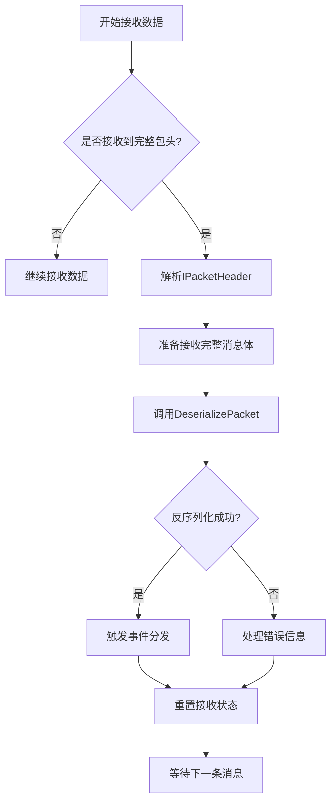
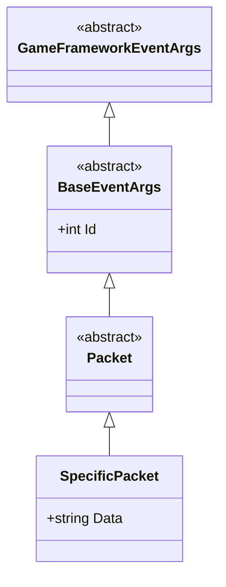
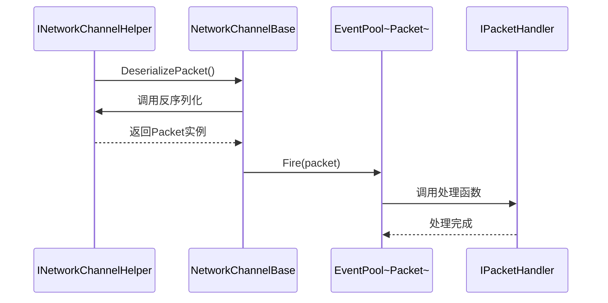
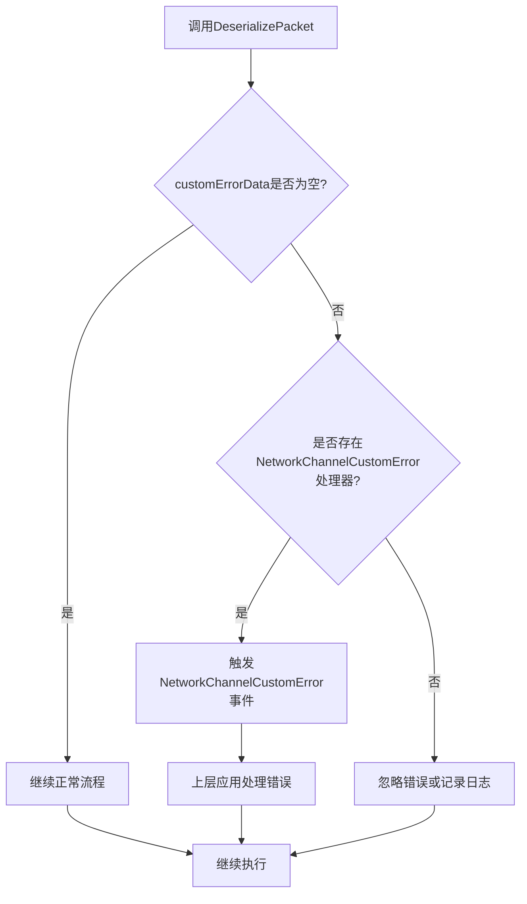
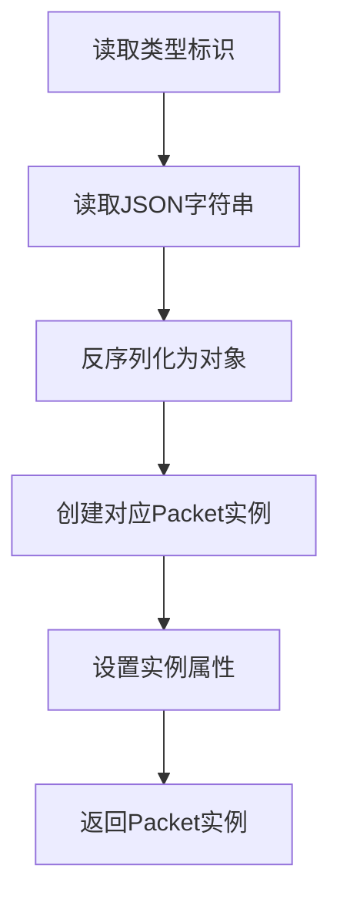
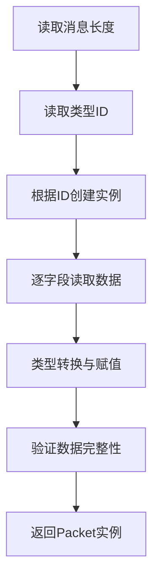

# 消息体反序列化

<cite>
**本文档引用的文件**   
- [INetworkChannelHelper.cs](file://GameFramework/Network/INetworkChannelHelper.cs)
- [Packet.cs](file://GameFramework/Network/Packet.cs)
- [BaseEventArgs.cs](file://GameFramework/Base/EventPool/BaseEventArgs.cs)
- [NetworkCustomErrorEventArgs.cs](file://GameFramework/Network/NetworkCustomErrorEventArgs.cs)
- [NetworkManager.NetworkChannelBase.cs](file://GameFramework/Network/NetworkManager.NetworkChannelBase.cs)
</cite>

## 目录
1. [引言](#引言)
2. [核心组件分析](#核心组件分析)
3. [反序列化工作流程](#反序列化工作流程)
4. [事件分发机制](#事件分发机制)
5. [错误处理机制](#错误处理机制)
6. [协议反序列化实现示例](#协议反序列化实现示例)
7. [结论](#结论)

## 引言
本文档深入讲解INetworkChannelHelper接口中DeserializePacket方法的工作流程，描述其如何基于已解析的IPacketHeader信息，从字节流中读取完整消息体并构造成具体的Packet派生类实例。分析Packet抽象类作为事件参数基类（BaseEventArgs）的多态特性，及其在事件分发系统中的传递机制。说明反序列化过程中customErrorData对协议格式错误的封装与上报方式。

## 核心组件分析

### INetworkChannelHelper接口
该接口定义了网络频道辅助器的核心功能，包括消息包头长度获取、初始化、关闭、连接准备、心跳发送以及消息包的序列化与反序列化等方法。

**Section sources**
- [INetworkChannelHelper.cs](file://GameFramework/Network/INetworkChannelHelper.cs#L12-L73)

### Packet抽象类
Packet类作为网络消息包的基类，继承自BaseEventArgs，是所有具体消息包类型的共同父类。它为网络通信中的消息传递提供了统一的事件参数结构。

**Section sources**
- [Packet.cs](file://GameFramework/Network/Packet.cs#L12-L14)
- [BaseEventArgs.cs](file://GameFramework/Base/EventPool/BaseEventArgs.cs#L12-L21)

## 反序列化工作流程

### 反序列化流程概述
反序列化过程始于网络接收线程从Socket读取数据到内存流中。当完整的消息包头被解析后，系统根据包头中的长度信息准备接收完整的消息体。随后调用DeserializePacket方法完成消息体的反序列化。

**Diagram sources**
- [NetworkManager.NetworkChannelBase.cs](file://GameFramework/Network/NetworkManager.NetworkChannelBase.cs#L588-L614)
- [INetworkChannelHelper.cs](file://GameFramework/Network/INetworkChannelHelper.cs#L70-L70)

### 类型标识解析
在反序列化过程中，首先需要从字节流中读取类型标识信息。这个标识通常位于消息体的前几个字节，用于确定后续数据应被解析为哪种具体的Packet派生类。

### 数据绑定过程
根据解析出的类型标识，系统会创建对应类型的Packet实例，并将剩余的字节流数据绑定到该实例的各个属性上。这一过程可能涉及JSON解析、二进制反序列化或其他数据映射技术。

**Section sources**
- [INetworkChannelHelper.cs](file://GameFramework/Network/INetworkChannelHelper.cs#L70-L70)
- [NetworkManager.NetworkChannelBase.cs](file://GameFramework/Network/NetworkManager.NetworkChannelBase.cs#L588-L614)

## 事件分发机制

### Packet的多态特性
Packet类继承自BaseEventArgs，这使得它可以作为事件参数在事件系统中传递。不同的Packet派生类可以携带不同类型的数据，但都能以统一的方式被事件处理器接收和处理。

**Diagram sources**
- [Packet.cs](file://GameFramework/Network/Packet.cs#L12-L14)
- [BaseEventArgs.cs](file://GameFramework/Base/EventPool/BaseEventArgs.cs#L12-L21)

### 事件传递流程
当消息体成功反序列化为Packet实例后，该实例会被提交到事件池中。事件池根据Packet的类型ID将其分发给注册了相应处理函数的监听者。

**Diagram sources**
- [NetworkManager.NetworkChannelBase.cs](file://GameFramework/Network/NetworkManager.NetworkChannelBase.cs#L588-L614)
- [Packet.cs](file://GameFramework/Network/Packet.cs#L12-L14)

## 错误处理机制

### customErrorData的作用
当反序列化过程中发生协议格式错误时，DeserializePacket方法通过out参数返回customErrorData对象。这个对象封装了具体的错误信息，可用于后续的错误上报和处理。

### 错误上报流程
如果customErrorData不为空且存在自定义错误事件处理器，则会触发NetworkChannelCustomError事件，将错误信息传递给上层应用。

**Diagram sources**
- [NetworkManager.NetworkChannelBase.cs](file://GameFramework/Network/NetworkManager.NetworkChannelBase.cs#L588-L592)
- [NetworkCustomErrorEventArgs.cs](file://GameFramework/Network/NetworkCustomErrorEventArgs.cs#L12-L63)

**Section sources**
- [NetworkCustomErrorEventArgs.cs](file://GameFramework/Network/NetworkCustomErrorEventArgs.cs#L12-L63)
- [NetworkManager.NetworkChannelBase.cs](file://GameFramework/Network/NetworkManager.NetworkChannelBase.cs#L588-L592)

## 协议反序列化实现示例

### JSON协议反序列化

### 二进制协议反序列化

### 异常恢复机制
在反序列化失败时，系统应具备一定的容错能力：
1. 记录错误日志
2. 跳过当前损坏的消息
3. 重置接收状态，准备接收下一条消息
4. 上报错误信息给监控系统

**Section sources**
- [INetworkChannelHelper.cs](file://GameFramework/Network/INetworkChannelHelper.cs#L70-L70)
- [NetworkManager.NetworkChannelBase.cs](file://GameFramework/Network/NetworkManager.NetworkChannelBase.cs#L588-L614)

## 结论
INetworkChannelHelper接口中的DeserializePacket方法是网络通信中消息处理的关键环节。它不仅负责将字节流转换为有意义的对象，还通过与事件系统的集成实现了松耦合的消息处理架构。通过合理的错误处理机制，系统能够在面对协议错误时保持稳定运行。Packet类作为BaseEventArgs的派生类，在事件分发系统中发挥了重要作用，实现了类型安全的消息传递。