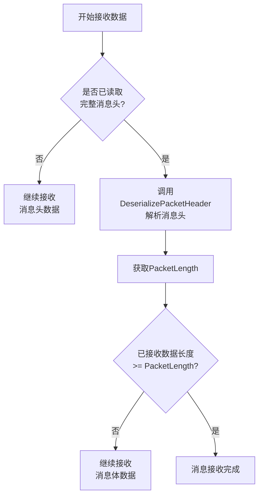
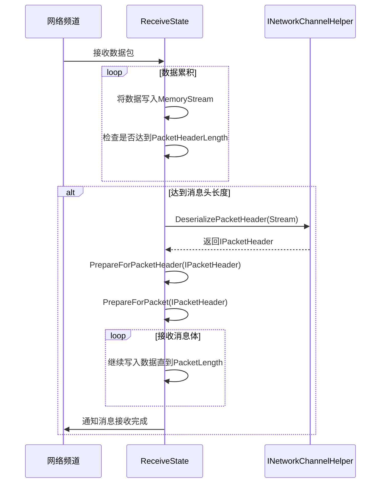

<cite>
**本文档中引用的文件**   
- [INetworkChannelHelper.cs](file://GameFramework/Network/INetworkChannelHelper.cs)
- [IPacketHeader.cs](file://GameFramework/Network/IPacketHeader.cs)
- [NetworkManager.ReceiveState.cs](file://GameFramework/Network/NetworkManager.ReceiveState.cs)
- [NetworkManager.cs](file://GameFramework/Network/NetworkManager.cs)
</cite>

## 目录
1. [消息头反序列化机制](#消息头反序列化机制)
2. [IPacketHeader接口设计与帧同步](#ipacketheader接口设计与帧同步)
3. [接收状态机中的时序分析](#接收状态机中的时序分析)
4. [自定义实现示例](#自定义实现示例)

## 消息头反序列化机制

`INetworkChannelHelper`接口中的`DeserializePacketHeader`方法是网络消息解析流程的起点，负责从原始字节流中提取并解析网络消息头。该方法接收一个`Stream`类型的源数据流，并通过`out`参数返回用户自定义的错误数据`customErrorData`，其核心作用是将二进制流中的前几个字节（长度由`PacketHeaderLength`属性定义）解析为一个实现了`IPacketHeader`接口的对象。

此方法的实现机制通常涉及字节序处理、字段偏移计算和数据类型转换。开发者在实现该接口时，需要根据预定义的协议格式，从`source`流中读取固定长度的字节，然后按照协议规范解析出消息长度等关键信息。如果解析过程中发生错误（如数据不完整、校验失败），则通过`customErrorData`参数传递详细的错误上下文，以便上层进行错误处理。

**Section sources**
- [INetworkChannelHelper.cs](file://GameFramework/Network/INetworkChannelHelper.cs#L61-L61)

## IPacketHeader接口设计与帧同步

`IPacketHeader`接口的设计目的是为网络消息头提供一个统一的抽象，其核心在于`PacketLength`属性，该属性返回网络消息包的总长度（包括消息头和消息体）。这一设计在网络帧同步中扮演着至关重要的角色。

在接收数据时，网络系统首先读取固定长度的消息头（由`INetworkChannelHelper.PacketHeaderLength`指定），然后调用`DeserializePacketHeader`方法将其解析为`IPacketHeader`对象。通过访问该对象的`PacketLength`属性，系统能够准确获知整个消息包的预期总长度。这一信息是后续接收完整消息体的关键，系统将根据`PacketLength`值持续接收数据，直到累积的字节数达到该长度，从而确保消息的完整性，实现帧同步。这种“先读头，后读体”的模式有效解决了TCP流式传输中的粘包和拆包问题。



**Diagram sources**
- [IPacketHeader.cs](file://GameFramework/Network/IPacketHeader.cs#L12-L21)

**Section sources**
- [IPacketHeader.cs](file://GameFramework/Network/IPacketHeader.cs#L12-L21)

## 接收状态机中的时序分析

`NetworkManager.ReceiveState`类是网络接收状态机的核心组件，它清晰地展示了`PacketHeader`在接收流程中的时序位置。该类内部维护一个`MemoryStream`用于暂存接收到的数据，并通过`m_PacketHeader`字段持有解析后的消息头对象。

接收流程的时序如下：当接收到数据时，`ReceiveState`首先处于准备读取消息头的状态。一旦累积的数据量达到`PacketHeaderLength`，系统便会调用`INetworkChannelHelper.DeserializePacketHeader`方法，将暂存流中的数据解析为`IPacketHeader`对象，并通过`PrepareForPacketHeader`方法将其赋值给`m_PacketHeader`。随后，状态机立即调用`PrepareForPacket`方法，利用`m_PacketHeader.PacketLength`的值来重置内部流，准备接收完整的消息体。这表明`PacketHeader`的解析是接收流程中一个承上启下的关键节点，它标志着从“读头阶段”向“读体阶段”的正式切换。



**Diagram sources**
- [NetworkManager.ReceiveState.cs](file://GameFramework/Network/NetworkManager.ReceiveState.cs#L36-L42)
- [NetworkManager.cs](file://GameFramework/Network/NetworkManager.cs#L300-L310)

**Section sources**
- [NetworkManager.ReceiveState.cs](file://GameFramework/Network/NetworkManager.ReceiveState.cs#L36-L42)

## 自定义实现示例

以下是一个基于二进制流的自定义消息头反序列化实现示例，该实现遵循了`INetworkChannelHelper`接口的规范：

```csharp
public class CustomPacketHeader : IPacketHeader
{
    public int PacketLength { get; private set; }
    public ushort MessageId { get; private set; }

    public CustomPacketHeader(ushort messageId, int length)
    {
        MessageId = messageId;
        PacketLength = length;
    }
}

public class CustomNetworkHelper : INetworkChannelHelper
{
    public int PacketHeaderLength => 6; // 2字节消息ID + 4字节长度

    public IPacketHeader DeserializePacketHeader(Stream source, out object customErrorData)
    {
        customErrorData = null;
        try
        {
            // 检查流中是否有足够的数据
            if (source.Length - source.Position < PacketHeaderLength)
            {
                customErrorData = new CustomErrorData("数据不足", source.Position, PacketHeaderLength);
                return null;
            }

            // 处理字节序：假设协议使用小端序
            byte[] headerBytes = new byte[PacketHeaderLength];
            int bytesRead = source.Read(headerBytes, 0, PacketHeaderLength);
            if (bytesRead != PacketHeaderLength)
            {
                throw new IOException("无法读取完整的消息头");
            }

            // 解析消息ID (2字节)
            ushort messageId = BitConverter.ToUInt16(headerBytes, 0);
            // 解析消息长度 (4字节)
            int packetLength = BitConverter.ToInt32(headerBytes, 2);

            // 长度校验
            if (packetLength <= 0 || packetLength > 1024 * 1024) // 限制最大1MB
            {
                customErrorData = new CustomErrorData("消息长度非法", messageId, packetLength);
                return null;
            }

            return new CustomPacketHeader(messageId, packetLength);
        }
        catch (Exception ex)
        {
            // 捕获所有边界异常，并通过customErrorData传递上下文
            customErrorData = new CustomErrorData("解析失败", ex.Message, ex.StackTrace);
            return null;
        }
    }

    // 其他接口方法...
}

// 用于传递错误上下文的自定义数据类
public class CustomErrorData
{
    public string Reason { get; }
    public object Context { get; }

    public CustomErrorData(string reason, params object[] context)
    {
        Reason = reason;
        Context = context;
    }
}
```

在上述示例中，`customErrorData`在协议解析失败时起到了关键的错误上下文传递作用。当发生“数据不足”、“消息长度非法”或“解析异常”等情况时，`customErrorData`会被赋值为一个包含错误原因和相关上下文（如当前读取位置、消息ID、异常堆栈等）的`CustomErrorData`对象。这个对象随后会通过`NetworkManager`的`NetworkCustomError`事件向上层应用系统传递，使得开发者能够精确地定位和诊断网络协议层面的问题，而不仅仅是收到一个模糊的“网络错误”通知。