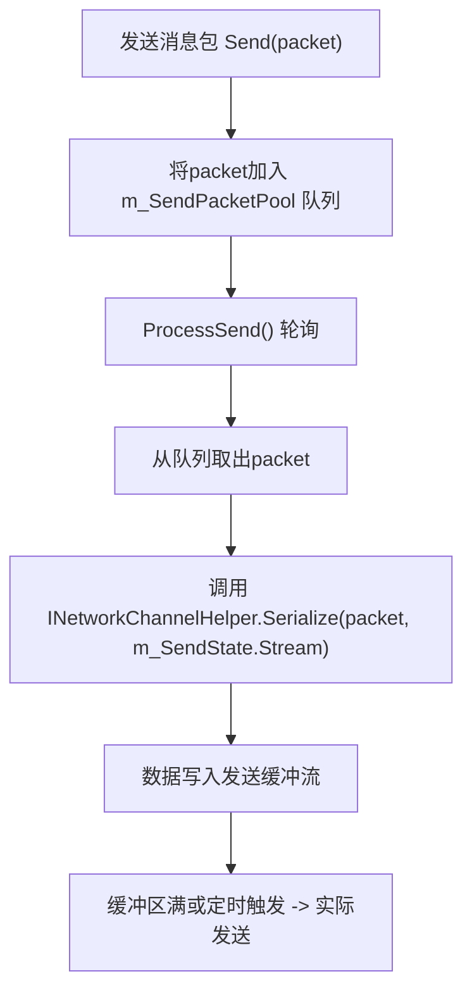
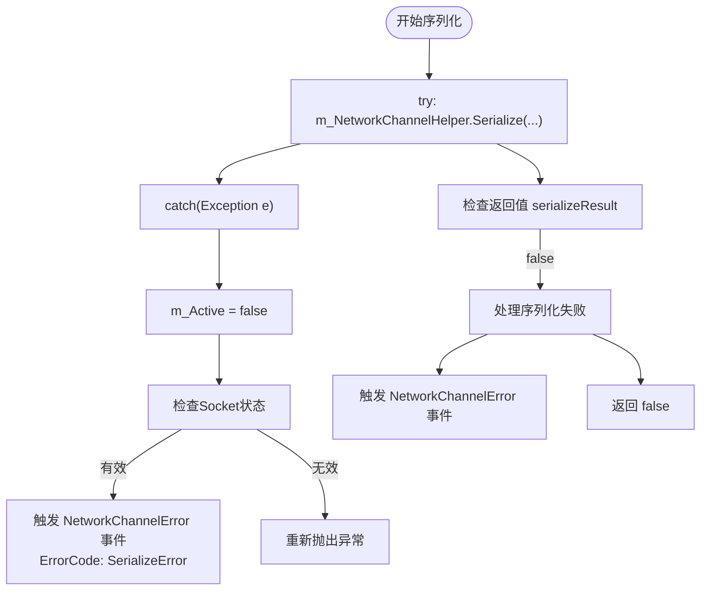
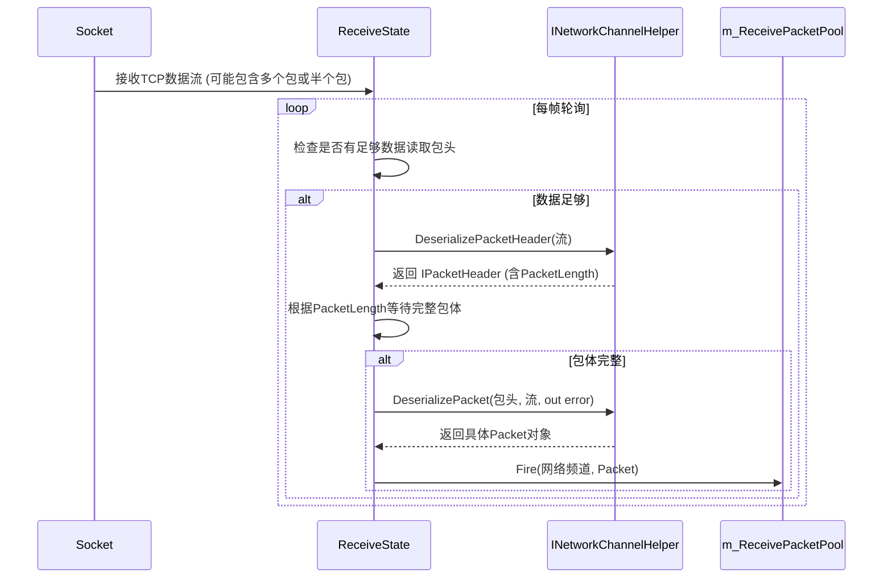

# 数据包序列化

<cite>
**本文档中引用的文件**  
- [INetworkChannelHelper.cs](file://GameFramework/Network/INetworkChannelHelper.cs)
- [Packet.cs](file://GameFramework/Network/Packet.cs)
- [IPacketHeader.cs](file://GameFramework/Network/IPacketHeader.cs)
- [NetworkManager.NetworkChannelBase.cs](file://GameFramework/Network/NetworkManager.NetworkChannelBase.cs)
</cite>

## 目录
1. [引言](#引言)
2. [泛型约束与类型安全机制](#泛型约束与类型安全机制)
3. [序列化过程与流处理](#序列化过程与流处理)
4. [异常处理与错误传播](#异常处理与错误传播)
5. [自定义Packet实现与序列化示例](#自定义packet实现与序列化示例)
6. [TCP粘包拆包处理机制](#tcp粘包拆包处理机制)
7. [与PacketHeaderLength的协同工作](#与packetheadernlength的协同工作)
8. [总结](#总结)

## 引言
在游戏框架的网络通信模块中，数据包的序列化是实现客户端与服务器之间可靠数据传输的核心环节。`INetworkChannelHelper` 接口中的 `Serialize<T>` 方法为消息包的序列化提供了统一的抽象机制。该方法不仅确保了类型安全，还通过与流操作、包头解析和错误处理机制的深度集成，支持高效、稳定的网络通信。本文将深入剖析该方法的设计与实现机制，涵盖其泛型约束、数据写入策略、异常处理流程以及在TCP粘包处理中的关键作用。

**Section sources**
- [INetworkChannelHelper.cs](file://GameFramework/Network/INetworkChannelHelper.cs#L53-L53)

## 泛型约束与类型安全机制
`Serialize<T>` 方法通过泛型约束 `where T : Packet` 确保了只有继承自 `Packet` 基类的类型才能被序列化。这一设计强制所有可序列化的消息包必须遵循统一的基类规范，从而在编译期就杜绝了非法类型的传入。

`Packet` 类作为所有网络消息包的抽象基类，继承自 `BaseEventArgs`，为消息包提供了事件驱动的处理能力。通过此继承关系，框架能够统一管理不同类型的消息包，并在反序列化后正确触发相应的事件处理器。

该机制不仅提升了类型安全性，还为后续的序列化逻辑提供了统一的接口契约，使得辅助器可以针对 `Packet` 类型进行通用处理，而无需关心具体的消息包实现细节。

**Section sources**
- [INetworkChannelHelper.cs](file://GameFramework/Network/INetworkChannelHelper.cs#L53-L53)
- [Packet.cs](file://GameFramework/Network/Packet.cs#L12-L14)

## 序列化过程与流处理
`Serialize<T>` 方法接收一个 `Stream` 类型的 `destination` 参数，用于写入序列化后的字节数据。该方法的实现由具体的网络频道辅助器（如自定义的 `NetworkChannelHelper` 实现类）提供，允许开发者根据协议需求（如二进制、JSON、Protobuf等）灵活定义序列化逻辑。

在数据写入过程中，字节序（Endianness）的处理至关重要。虽然接口本身不直接处理字节序，但其实现类必须确保在跨平台通信时，数据的字节顺序（如大端或小端）保持一致。通常，网络通信采用大端序（Big-Endian），因此在序列化数值类型时，需要进行必要的字节序转换。

缓冲策略方面，框架通过 `NetworkChannelBase` 类中的 `m_SendState.Stream` 作为发送缓冲区。待发送的 `Packet` 对象首先被加入 `m_SendPacketPool` 队列，然后在 `ProcessSend` 阶段由 `INetworkChannelHelper` 逐个序列化到缓冲流中。这种设计实现了发送操作的异步化和批处理，有效减少了直接的I/O调用次数，提升了网络吞吐量。



**Diagram sources**
- [INetworkChannelHelper.cs](file://GameFramework/Network/INetworkChannelHelper.cs#L53-L53)
- [NetworkManager.NetworkChannelBase.cs](file://GameFramework/Network/NetworkManager.NetworkChannelBase.cs#L489-L523)

**Section sources**
- [INetworkChannelHelper.cs](file://GameFramework/Network/INetworkChannelHelper.cs#L53-L53)
- [NetworkManager.NetworkChannelBase.cs](file://GameFramework/Network/NetworkManager.NetworkChannelBase.cs#L489-L523)

## 异常处理与错误传播
序列化过程中可能因多种原因失败，例如无效的数据、流操作异常或序列化逻辑内部错误。`Serialize<T>` 方法通过返回 `bool` 值指示操作是否成功，并通过异常机制传播严重错误。

在 `NetworkChannelBase.ProcessSend` 方法中，对 `Serialize` 的调用被包裹在 `try-catch` 块中。一旦捕获到异常，框架会立即将网络频道标记为非活跃状态（`m_Active = false`），并通过 `NetworkChannelError` 事件向高层逻辑报告错误，错误码为 `NetworkErrorCode.SerializeError`。这确保了错误能够被及时感知并触发相应的恢复或重连机制。

此外，`Serialize` 方法的返回值 `false` 也会被检查。如果序列化失败但未抛出异常，框架同样会触发 `NetworkChannelError` 事件，保证了错误处理的完备性。



**Diagram sources**
- [NetworkManager.NetworkChannelBase.cs](file://GameFramework/Network/NetworkManager.NetworkChannelBase.cs#L489-L523)

**Section sources**
- [NetworkManager.NetworkChannelBase.cs](file://GameFramework/Network/NetworkManager.NetworkChannelBase.cs#L489-L523)

## 自定义Packet实现与序列化示例
要使用自定义的 `Packet` 类，首先需要创建一个继承自 `Packet` 的具体类。例如：

```csharp
public class LoginPacket : Packet
{
    public string Username { get; set; }
    public string Password { get; set; }
}
```

接着，需要在 `INetworkChannelHelper` 的实现类中提供 `Serialize<T>` 方法的具体逻辑。例如，使用二进制格式进行序列化：

```csharp
public bool Serialize<T>(T packet, Stream destination) where T : Packet
{
    if (packet is LoginPacket loginPacket)
    {
        var writer = new BinaryWriter(destination);
        writer.Write(loginPacket.Username);
        writer.Write(loginPacket.Password);
        return true;
    }
    // 其他类型的packet...
    return false;
}
```

当通过 `INetworkChannel.Send(packet)` 发送 `LoginPacket` 实例时，框架会将其加入发送队列，并在后续的 `ProcessSend` 阶段调用上述 `Serialize` 方法，将数据写入发送流。

**Section sources**
- [Packet.cs](file://GameFramework/Network/Packet.cs#L12-L14)
- [INetworkChannelHelper.cs](file://GameFramework/Network/INetworkChannelHelper.cs#L53-L53)

## TCP粘包拆包处理机制
TCP协议是面向字节流的，不保证消息的边界，因此容易产生粘包（多个消息被合并成一个TCP包）和拆包（一个消息被拆分成多个TCP包）问题。`INetworkChannelHelper` 接口通过 `DeserializePacketHeader` 和 `DeserializePacket` 两个方法协同工作来解决此问题。

1.  **读取包头**：`ProcessReceive` 阶段首先确保接收缓冲区中有足够的数据来读取包头（长度为 `PacketHeaderLength`）。调用 `DeserializePacketHeader` 从流中解析出 `IPacketHeader`，该接口的 `PacketLength` 属性返回整个消息包的总长度。
2.  **读取完整包体**：根据包头中获取的 `PacketLength`，框架会持续接收数据，直到缓冲区中累积了完整的包体。
3.  **反序列化包体**：当完整的包数据（包头+包体）都到达后，调用 `DeserializePacket` 方法，将流中的数据反序列化为具体的 `Packet` 对象。

这个过程确保了即使数据在TCP层面被粘连或拆分，应用层也能正确地还原出一个个独立、完整的消息包。



**Diagram sources**
- [INetworkChannelHelper.cs](file://GameFramework/Network/INetworkChannelHelper.cs#L61-L61)
- [INetworkChannelHelper.cs](file://GameFramework/Network/INetworkChannelHelper.cs#L70-L70)
- [IPacketHeader.cs](file://GameFramework/Network/IPacketHeader.cs#L12-L21)
- [NetworkManager.NetworkChannelBase.cs](file://GameFramework/Network/NetworkManager.NetworkChannelBase.cs#L36-L42)

**Section sources**
- [INetworkChannelHelper.cs](file://GameFramework/Network/INetworkChannelHelper.cs#L61-L70)
- [IPacketHeader.cs](file://GameFramework/Network/IPacketHeader.cs#L12-L21)
- [NetworkManager.NetworkChannelBase.cs](file://GameFramework/Network/NetworkManager.NetworkChannelBase.cs#L36-L42)

## 与PacketHeaderLength的协同工作
`PacketHeaderLength` 是 `INetworkChannelHelper` 接口的一个关键属性，它定义了消息包头的固定字节长度。这个值在创建网络频道时被检查，必须大于等于零。

`PacketHeaderLength` 与序列化/反序列化机制紧密协作：
-   **反序列化起点**：它是 `ProcessPacketHeader` 阶段的触发条件。接收状态机（`ReceiveState`）会持续累积数据，直到其长度达到 `PacketHeaderLength`，然后才尝试调用 `DeserializePacketHeader`。
-   **内存预分配**：在 `NetworkChannelBase.Connect` 方法中，会调用 `m_ReceiveState.PrepareForPacketHeader(m_NetworkChannelHelper.PacketHeaderLength)`，为接收包头预分配缓冲区，优化了内存使用。
-   **协议一致性**：它强制了包头格式的统一。所有实现 `INetworkChannelHelper` 的类都必须使用相同长度的包头，这简化了接收端的解析逻辑。

因此，`PacketHeaderLength` 是连接底层TCP流与上层应用消息包的桥梁，确保了粘包拆包处理机制能够正确、高效地运行。

**Section sources**
- [INetworkChannelHelper.cs](file://GameFramework/Network/INetworkChannelHelper.cs#L44-L44)
- [NetworkManager.NetworkChannelBase.cs](file://GameFramework/Network/NetworkManager.NetworkChannelBase.cs#L45-L75)

## 总结
`INetworkChannelHelper.Serialize<T>` 方法通过泛型约束 `where T : Packet` 实现了类型安全的序列化机制，确保了只有符合规范的消息包才能被发送。该方法与 `Stream` 参数结合，提供了灵活的数据写入能力，其具体的实现由开发者根据通信协议定制。在异常处理方面，框架通过返回值和异常捕获双重机制，确保了网络通信的健壮性。通过与 `DeserializePacketHeader`、`DeserializePacket` 和 `PacketHeaderLength` 的协同工作，该序列化机制构成了处理TCP粘包拆包问题的核心，为上层应用提供了可靠、有序的消息传输服务。开发者通过实现自定义的 `Packet` 子类和 `INetworkChannelHelper`，可以无缝地集成到这套高效、稳定的网络通信架构中。