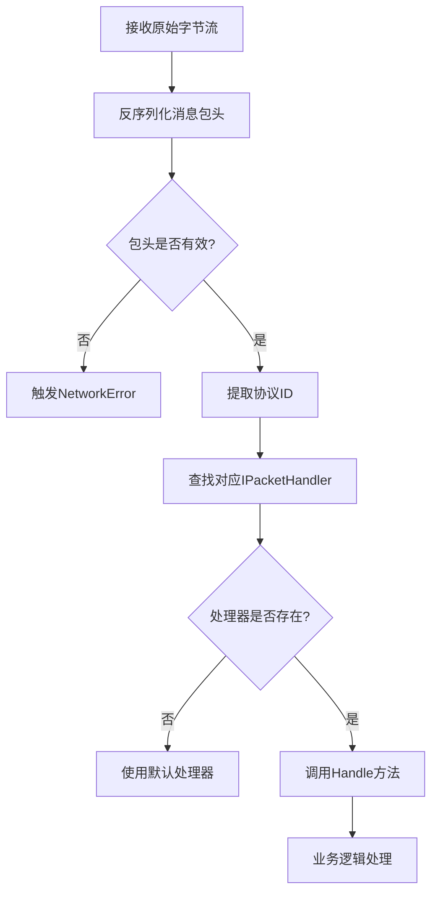
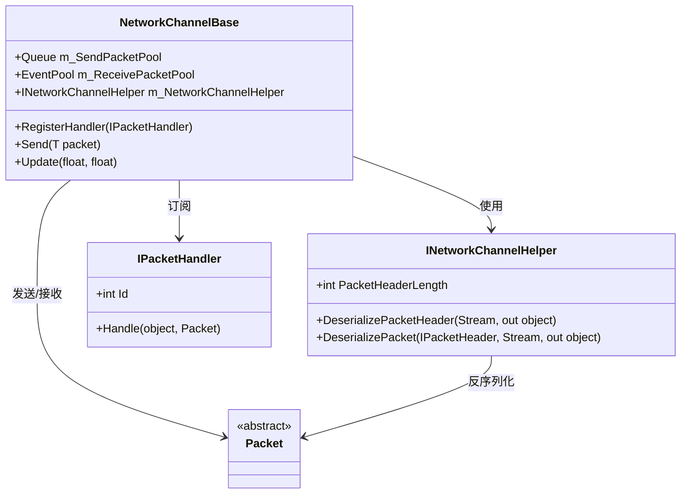

# 数据包路由

<cite>
**本文档中引用的文件**  
- [IPacketHandler.cs](file://GameFramework/Network/IPacketHandler.cs)
- [Packet.cs](file://GameFramework/Network/Packet.cs)
- [NetworkManager.cs](file://GameFramework/Network/NetworkManager.cs)
- [NetworkCustomErrorEventArgs.cs](file://GameFramework/Network/NetworkCustomErrorEventArgs.cs)
- [INetworkChannelHelper.cs](file://GameFramework/Network/INetworkChannelHelper.cs)
- [INetworkChannel.cs](file://GameFramework/Network/INetworkChannel.cs)
- [NetworkManager.NetworkChannelBase.cs](file://GameFramework/Network/NetworkManager.NetworkChannelBase.cs)
</cite>

## 目录
1. [简介](#简介)
2. [核心组件](#核心组件)
3. [数据包路由机制](#数据包路由机制)
4. [协议ID与处理器映射](#协议id与处理器映射)
5. [网络管理层分发流程](#网络管理层分发流程)
6. [异常传播路径与错误事件](#异常传播路径与错误事件)
7. [多协议路由表注册示例](#多协议路由表注册示例)
8. [线程安全与性能优化策略](#线程安全与性能优化策略)
9. [结论](#结论)

## 简介
本文档系统性地描述了基于 `IPacketHandler` 接口的数据包路由机制。该机制是游戏框架中网络通信的核心部分，负责将接收到的网络数据包根据协议ID分发到对应的处理器进行业务逻辑处理。文档详细说明了 `Packet` 派生类如何通过协议ID与处理器建立映射关系，网络管理层如何将反序列化后的 `Packet` 实例分发至对应的 `IPacketHandler`，并解释了异常传播路径及 `NetworkCustomErrorEventArgs` 错误事件的触发条件。此外，还提供了多协议路由表注册的实现方式，并讨论了线程安全与性能优化策略。

## 核心组件

本文档涉及的核心组件包括：
- `IPacketHandler`：网络消息包处理器接口，定义了协议ID和处理函数。
- `Packet`：网络消息包基类，所有具体协议数据包的派生类。
- `INetworkChannel`：网络频道接口，提供注册处理器和发送/接收数据包的方法。
- `NetworkChannelBase`：网络频道基类，实现了消息包的接收、反序列化和分发逻辑。
- `INetworkChannelHelper`：网络频道辅助器接口，负责数据包的序列化与反序列化。
- `NetworkCustomErrorEventArgs`：用户自定义网络错误事件，用于传递自定义错误信息。

**本节来源**  
- [IPacketHandler.cs](file://GameFramework/Network/IPacketHandler.cs#L12-L28)
- [Packet.cs](file://GameFramework/Network/Packet.cs#L12-L14)
- [INetworkChannel.cs](file://GameFramework/Network/INetworkChannel.cs#L128-L164)
- [NetworkManager.NetworkChannelBase.cs](file://GameFramework/Network/NetworkManager.NetworkChannelBase.cs#L296-L300)
- [INetworkChannelHelper.cs](file://GameFramework/Network/INetworkChannelHelper.cs#L70-L70)
- [NetworkCustomErrorEventArgs.cs](file://GameFramework/Network/NetworkCustomErrorEventArgs.cs#L12-L63)

## 数据包路由机制

数据包路由机制是网络通信中实现协议分发的关键。当网络频道接收到原始字节流后，首先通过 `INetworkChannelHelper` 反序列化出 `IPacketHeader`，从中提取协议ID。随后，系统根据协议ID查找已注册的 `IPacketHandler`，并将反序列化后的 `Packet` 实例传递给对应的处理器进行处理。整个过程由 `NetworkChannelBase` 的 `ProcessPacket` 方法驱动，确保每个数据包都能被正确路由和处理。



**图示来源**  
- [NetworkManager.NetworkChannelBase.cs](file://GameFramework/Network/NetworkManager.NetworkChannelBase.cs#L550-L580)
- [INetworkChannelHelper.cs](file://GameFramework/Network/INetworkChannelHelper.cs#L65-L70)

## 协议ID与处理器映射

`IPacketHandler` 接口通过 `Id` 属性定义了每个处理器所对应的协议编号。当调用 `INetworkChannel.RegisterHandler(IPacketHandler handler)` 方法时，系统会将该处理器注册到内部的事件池（`EventPool<Packet>`）中，以协议ID作为事件类型标识。这种设计实现了协议ID与处理器之间的松耦合映射关系，使得新增协议无需修改核心网络代码。

例如，一个处理登录请求的处理器可能如下定义：

```csharp
public class LoginPacketHandler : IPacketHandler
{
    public int Id => 1001; // 登录协议ID

    public void Handle(object sender, Packet packet)
    {
        // 处理登录逻辑
    }
}
```

注册时只需调用：
```csharp
networkChannel.RegisterHandler(new LoginPacketHandler());
```

**本节来源**  
- [IPacketHandler.cs](file://GameFramework/Network/IPacketHandler.cs#L12-L28)
- [NetworkManager.NetworkChannelBase.cs](file://GameFramework/Network/NetworkManager.NetworkChannelBase.cs#L296-L300)

## 网络管理层分发流程

网络管理层的分发流程由 `NetworkChannelBase.ProcessPacket()` 方法实现。该方法在成功反序列化数据包后，通过 `m_ReceivePacketPool.Fire(this, packet)` 触发事件，将数据包分发给对应的处理器。`EventPool<Packet>` 内部维护了一个以协议ID为键的订阅者列表，确保只有匹配的处理器才会被调用。

分发流程如下：
1. 接收完整数据包字节流
2. 调用 `INetworkChannelHelper.DeserializePacket()` 反序列化为 `Packet` 对象
3. 检查是否存在自定义错误数据，如有则触发 `NetworkChannelCustomError`
4. 调用 `EventPool<Packet>.Fire()` 分发事件
5. 对应的 `IPacketHandler.Handle()` 方法被调用

```mermaid
sequenceDiagram
participant Channel as NetworkChannelBase
participant Helper as INetworkChannelHelper
participant Pool as EventPool<Packet>
participant Handler as IPacketHandler
Channel->>Helper : DeserializePacket()
Helper-->>Channel : Packet实例
alt 存在自定义错误
Channel->>Channel : 触发NetworkCustomError
end
Channel->>Pool : Fire(sender, packet)
Pool->>Handler : 调用Handle方法
Handler-->> : 执行业务逻辑
```

**图示来源**  
- [NetworkManager.NetworkChannelBase.cs](file://GameFramework/Network/NetworkManager.NetworkChannelBase.cs#L560-L580)
- [INetworkChannelHelper.cs](file://GameFramework/Network/INetworkChannelHelper.cs#L70-L70)

**本节来源**  
- [NetworkManager.NetworkChannelBase.cs](file://GameFramework/Network/NetworkManager.NetworkChannelBase.cs#L550-L590)

## 异常传播路径与错误事件

在数据包处理过程中，异常通过事件机制进行传播。当反序列化或网络操作发生错误时，系统会调用相应的错误事件处理器。主要的异常传播路径如下：

- **网络层错误**：由 `NetworkChannelError` 事件处理，携带 `NetworkErrorCode` 和 `SocketError`。
- **自定义错误**：由 `NetworkChannelCustomError` 事件处理，携带用户自定义的错误数据。

`NetworkCustomErrorEventArgs` 是用户自定义网络错误事件的载体。当 `INetworkChannelHelper.DeserializePacketHeader` 或 `DeserializePacket` 方法返回非空的 `customErrorData` 时，系统会自动创建并触发 `NetworkCustomErrorEventArgs` 事件。这允许协议层在解析失败时传递详细的错误信息，而不仅仅是抛出异常。

例如：
```csharp
// 在反序列化辅助器中
public Packet DeserializePacket(IPacketHeader header, Stream source, out object customErrorData)
{
    try
    {
        // 解析逻辑
        customErrorData = null;
        return packet;
    }
    catch (InvalidDataException e)
    {
        customErrorData = new { Code = "INVALID_DATA", Message = e.Message };
        return null;
    }
}
```

**本节来源**  
- [NetworkCustomErrorEventArgs.cs](file://GameFramework/Network/NetworkCustomErrorEventArgs.cs#L12-L63)
- [NetworkManager.NetworkChannelBase.cs](file://GameFramework/Network/NetworkManager.NetworkChannelBase.cs#L560-L570)
- [NetworkManager.cs](file://GameFramework/Network/NetworkManager.cs#L339-L350)

## 多协议路由表注册示例

以下是一个多协议路由表的注册示例，展示了如何批量注册多个处理器：

```csharp
public class PacketHandlerRegister
{
    public static void RegisterHandlers(INetworkChannel channel)
    {
        channel.RegisterHandler(new LoginPacketHandler());
        channel.RegisterHandler(new MovePacketHandler());
        channel.RegisterHandler(new ChatPacketHandler());
        channel.RegisterHandler(new SkillPacketHandler());
    }
}
```

也可以通过字典方式动态注册：

```csharp
private Dictionary<int, IPacketHandler> m_HandlerMap = new Dictionary<int, IPacketHandler>();

public void RegisterHandler(IPacketHandler handler)
{
    m_HandlerMap[handler.Id] = handler;
    networkChannel.RegisterHandler(handler);
}

public void RegisterAllHandlers(INetworkChannel channel)
{
    foreach (var handler in m_HandlerMap.Values)
    {
        channel.RegisterHandler(handler);
    }
}
```

这种设计支持热更新和模块化加载，便于大型项目的协议管理。

**本节来源**  
- [INetworkChannel.cs](file://GameFramework/Network/INetworkChannel.cs#L128-L128)
- [NetworkManager.NetworkChannelBase.cs](file://GameFramework/Network/NetworkManager.NetworkChannelBase.cs#L296-L300)

## 线程安全与性能优化策略

### 线程安全
- **锁机制**：在关键操作（如发送队列、心跳状态）上使用 `lock` 确保线程安全。
- **不可变设计**：`Packet` 类为抽象基类，具体实现应避免共享可变状态。
- **事件池**：`EventPool<Packet>` 内部处理了多线程订阅与发布的同步问题。

### 性能优化
- **对象池**：使用 `ReferencePool` 管理 `NetworkCustomErrorEventArgs` 等频繁创建的对象，减少GC压力。
- **内存流复用**：`ReceiveState` 和 `SendState` 中的 `MemoryStream` 被重复利用，避免频繁分配内存。
- **批量处理**：发送队列 (`m_SendPacketPool`) 支持批量序列化，减少I/O调用次数。
- **心跳优化**：心跳检测在 `Update` 方法中按真实流逝时间计算，避免不必要的检查。



**图示来源**  
- [NetworkManager.NetworkChannelBase.cs](file://GameFramework/Network/NetworkManager.NetworkChannelBase.cs#L100-L150)
- [INetworkChannelHelper.cs](file://GameFramework/Network/INetworkChannelHelper.cs#L10-L70)
- [IPacketHandler.cs](file://GameFramework/Network/IPacketHandler.cs#L12-L28)

**本节来源**  
- [NetworkManager.NetworkChannelBase.cs](file://GameFramework/Network/NetworkManager.NetworkChannelBase.cs#L100-L636)
- [NetworkManager.ReceiveState.cs](file://GameFramework/Network/NetworkManager.ReceiveState.cs#L10-L98)
- [NetworkCustomErrorEventArgs.cs](file://GameFramework/Network/NetworkCustomErrorEventArgs.cs#L47-L53)

## 结论
本文档详细阐述了基于 `IPacketHandler` 接口的数据包路由机制。通过协议ID映射、事件驱动分发、异常事件传播等设计，实现了高效、灵活且线程安全的网络消息处理系统。结合对象池、内存复用等性能优化策略，该机制能够满足高并发游戏服务器的需求。开发者可通过注册自定义处理器轻松扩展协议，同时利用错误事件机制实现精细化的错误处理。