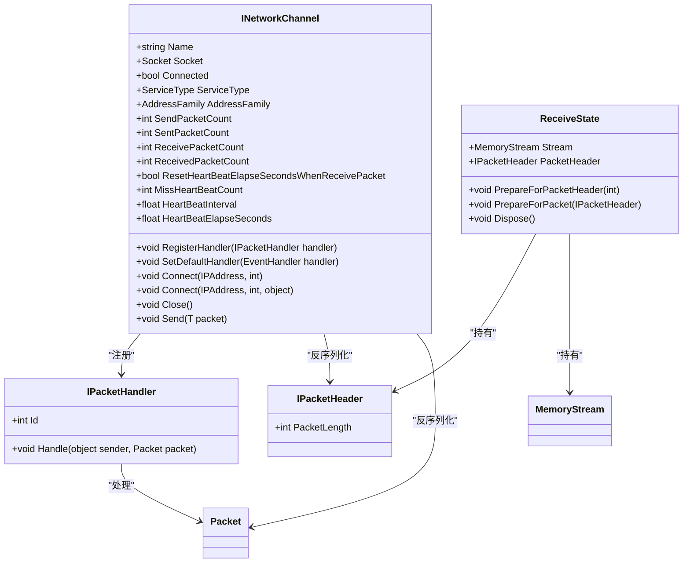
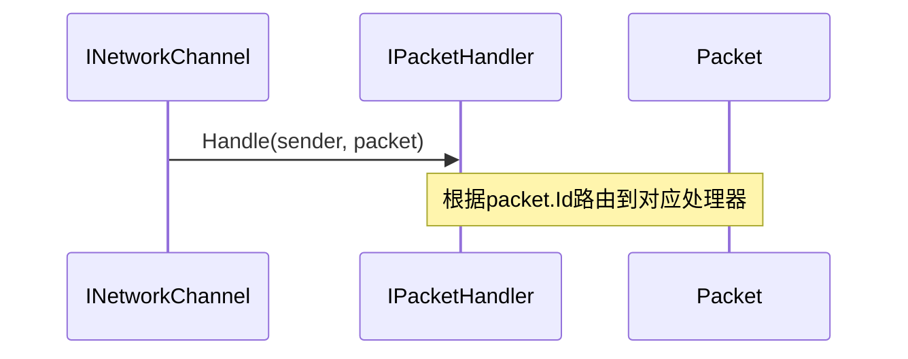
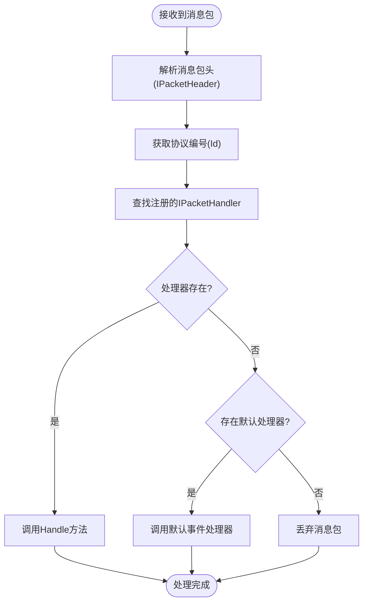

# 消息分发机制

<cite>
**本文档引用的文件**
- [IPacketHandler.cs](file://GameFramework/Network/IPacketHandler.cs)
- [INetworkChannel.cs](file://GameFramework/Network/INetworkChannel.cs)
- [NetworkManager.ReceiveState.cs](file://GameFramework/Network/NetworkManager.ReceiveState.cs)
- [IPacketHeader.cs](file://GameFramework/Network/IPacketHeader.cs)
- [Packet.cs](file://GameFramework/Network/Packet.cs)
- [NetworkManager.cs](file://GameFramework/Network/NetworkManager.cs)
</cite>

## 目录
1. [引言](#引言)
2. [核心组件分析](#核心组件分析)
3. [消息路由与处理器设计](#消息路由与处理器设计)
4. [网络频道注册机制](#网络频道注册机制)
5. [消息接收与流转路径](#消息接收与流转路径)
6. [多协议注册与优先级处理实践](#多协议注册与优先级处理实践)
7. [默认处理器兜底策略](#默认处理器兜底策略)
8. [线程安全注意事项](#线程安全注意事项)
9. [总结](#总结)

## 引言
本文深入文档化网络消息的分发与处理流程，重点解析基于 `IPacketHandler` 和 `INetworkChannel` 接口的消息路由机制。通过分析消息从接收缓冲区到具体处理器的完整流转路径，阐明协议编号作为路由键的设计原理、多处理器注册策略及其适用场景，并提供实际应用示例和线程安全建议。

## 核心组件分析

本节介绍实现消息分发机制的核心接口和类。

**组件关系图**


**图示来源**
- [IPacketHandler.cs](file://GameFramework/Network/IPacketHandler.cs#L12-L28)
- [INetworkChannel.cs](file://GameFramework/Network/INetworkChannel.cs#L16-L162)
- [IPacketHeader.cs](file://GameFramework/Network/IPacketHeader.cs#L12-L21)
- [Packet.cs](file://GameFramework/Network/Packet.cs#L12-L14)
- [NetworkManager.ReceiveState.cs](file://GameFramework/Network/NetworkManager.ReceiveState.cs#L36-L42)

**本节来源**
- [IPacketHandler.cs](file://GameFramework/Network/IPacketHandler.cs#L12-L28)
- [INetworkChannel.cs](file://GameFramework/Network/INetworkChannel.cs#L16-L162)
- [IPacketHeader.cs](file://GameFramework/Network/IPacketHeader.cs#L12-L21)
- [Packet.cs](file://GameFramework/Network/Packet.cs#L12-L14)
- [NetworkManager.ReceiveState.cs](file://GameFramework/Network/NetworkManager.ReceiveState.cs)

## 消息路由与处理器设计

`IPacketHandler` 接口是消息处理的核心契约，其 `Id` 属性作为消息路由键，决定了特定类型的消息包应由哪个处理器进行处理。该设计基于协议编号（Protocol ID）实现快速分发，避免了复杂的类型判断或反射调用，提升了性能。

`Handle` 方法接收两个参数：`sender` 表示消息来源（通常是 `INetworkChannel` 实例），`packet` 是具体的网络消息包内容。所有自定义消息处理器必须实现此接口，并确保 `Id` 返回唯一的协议编号。



**图示来源**
- [IPacketHandler.cs](file://GameFramework/Network/IPacketHandler.cs#L12-L28)

**本节来源**
- [IPacketHandler.cs](file://GameFramework/Network/IPacketHandler.cs#L12-L28)

## 网络频道注册机制

`INetworkChannel` 提供了两种消息处理器注册方式：`RegisterHandler` 和 `SetDefaultHandler`。

- `RegisterHandler(IPacketHandler handler)`：用于注册基于协议编号的精确处理器。每个处理器通过 `Id` 属性标识，系统根据消息包头中的协议ID查找并调用对应的处理器。
- `SetDefaultHandler(EventHandler<Packet> handler)`：设置一个默认的事件处理器，当没有找到匹配的 `IPacketHandler` 时触发。它适用于处理通用消息、日志记录或异常兜底。

两者的主要区别在于匹配机制和适用场景：
- `RegisterHandler` 适用于明确协议结构的业务消息处理。
- `SetDefaultHandler` 适用于监控、调试或处理未知/异常消息。



**图示来源**
- [INetworkChannel.cs](file://GameFramework/Network/INetworkChannel.cs#L128-L134)

**本节来源**
- [INetworkChannel.cs](file://GameFramework/Network/INetworkChannel.cs#L128-L134)

## 消息接收与流转路径

消息从接收缓冲区到处理器的流转过程由 `ReceiveState` 类协调管理。其核心字段 `PacketHeader` 在消息解析过程中起关键作用。

流程如下：
1. 接收数据流进入 `ReceiveState.Stream`。
2. 使用 `INetworkChannelHelper.DeserializePacketHeader` 解析出 `IPacketHeader`，并设置到 `ReceiveState.PacketHeader`。
3. 根据 `PacketHeader.PacketLength` 确定完整消息包长度。
4. 当数据完整后，调用 `INetworkChannelHelper.DeserializePacket` 将流数据反序列化为具体的 `Packet` 实例。
5. 提取 `Packet.Id`，通过 `INetworkChannel` 查找对应的 `IPacketHandler` 并调用 `Handle` 方法。

此设计实现了消息头与消息体的分步解析，有效处理了TCP粘包/拆包问题。

**本节来源**
- [NetworkManager.ReceiveState.cs](file://GameFramework/Network/NetworkManager.ReceiveState.cs#L36-L42)
- [INetworkChannelHelper.cs](file://GameFramework/Network/INetworkChannelHelper.cs#L61-L70)

## 多协议注册与优先级处理实践

在实际应用中，可通过多次调用 `RegisterHandler` 注册多个不同 `Id` 的处理器，实现多协议支持。系统内部通常使用字典（Dictionary）存储处理器映射，保证O(1)查找效率。

优先级处理可通过外部逻辑实现，例如：
- 按照注册顺序处理（先注册优先）
- 在处理器内部判断并转发
- 使用复合处理器模式统一调度

示例代码结构：
```csharp
// 注册登录处理器
networkChannel.RegisterHandler(new LoginPacketHandler());

// 注册移动处理器
networkChannel.RegisterHandler(new MovePacketHandler());

// 设置默认处理器用于日志
networkChannel.SetDefaultHandler((sender, packet) => {
    GameFrameworkLog.Info($"Received unknown packet with ID: {packet.Id}");
});
```

**本节来源**
- [INetworkChannel.cs](file://GameFramework/Network/INetworkChannel.cs#L128-L134)
- [IPacketHandler.cs](file://GameFramework/Network/IPacketHandler.cs#L12-L28)

## 默认处理器兜底策略

`SetDefaultHandler` 提供了重要的兜底能力。当收到未注册协议ID的消息时，系统不会直接崩溃或静默丢弃，而是交由默认处理器处理。这在以下场景中非常有用：
- 协议版本不一致时的兼容处理
- 安全审计和异常消息监控
- 开发调试阶段捕获未知消息

建议始终设置默认处理器以增强系统的健壮性和可观测性。

**本节来源**
- [INetworkChannel.cs](file://GameFramework/Network/INetworkChannel.cs#L134-L134)

## 线程安全注意事项

消息处理涉及网络I/O和主线程交互，需注意线程安全问题：
- `RegisterHandler` 和 `SetDefaultHandler` 应在初始化阶段完成，避免运行时并发修改。
- `Handle` 方法可能在异步网络线程中被调用，访问共享资源时应加锁或使用线程安全集合。
- 默认事件处理器的委托调用需进行空值检查和线程同步（如示例中使用 `lock`）。
- `ReceiveState` 对象池应确保线程安全的获取与归还。

**本节来源**
- [NetworkManager.cs](file://GameFramework/Network/NetworkManager.cs#L300-L353)

## 总结

本文详细解析了基于 `IPacketHandler` 和 `INetworkChannel` 的消息分发机制。通过协议编号 `Id` 实现高效路由，结合 `RegisterHandler` 精确匹配和 `SetDefaultHandler` 兜底策略，构建了灵活可靠的网络消息处理体系。`ReceiveState` 中对 `PacketHeader` 的使用确保了消息解析的正确性。在实际开发中，应合理规划协议ID，充分利用两种注册机制，并注意线程安全，以构建高性能、高可用的网络通信模块。