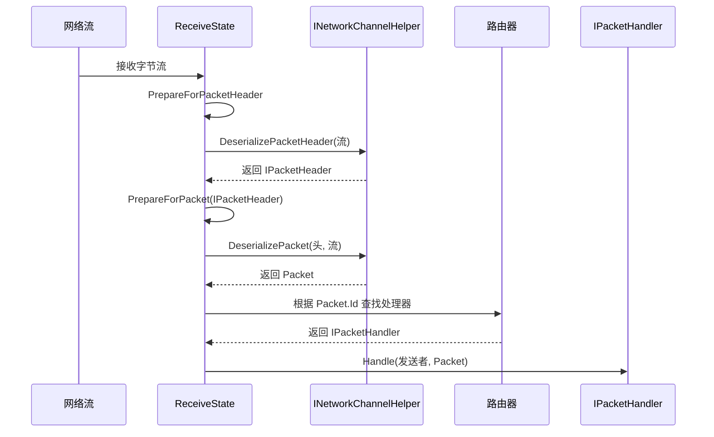

# 消息路由机制

<cite>
**本文档引用文件**  
- [IPacketHandler.cs](file://GameFramework/Network/IPacketHandler.cs)
- [IPacketHeader.cs](file://GameFramework/Network/IPacketHeader.cs)
- [NetworkManager.ReceiveState.cs](file://GameFramework/Network/NetworkManager.ReceiveState.cs)
- [NetworkManager.cs](file://GameFramework/Network/NetworkManager.cs)
</cite>

## 目录
1. [消息路由机制](#消息路由机制)
2. [消息流转过程](#消息流转过程)
3. [ReceiveState状态机](#receivestate状态机)
4. [数据包解析与处理器匹配](#数据包解析与处理器匹配)
5. [时序图：消息处理流程](#时序图消息处理流程)
6. [哈希表路由性能分析](#哈希表路由性能分析)

## 消息流转过程

消息从底层接收缓冲区到具体处理器的完整流转过程涉及多个核心组件的协同工作。当网络数据到达时，系统首先通过`INetworkChannelHelper`接口的`DeserializePacketHeader`方法从数据流中反序列化出`IPacketHeader`对象，该对象实现了对消息长度的解析。随后，系统根据消息头中的协议ID查找已注册的`IPacketHandler`处理器，并通过`DeserializePacket`方法完成完整数据包的解包。最终，匹配的处理器通过`Handle`方法处理该消息。

此过程确保了消息从原始字节流到业务逻辑处理的无缝衔接，同时通过状态机机制保证了接收流程的稳定性与可恢复性。

**Section sources**
- [NetworkManager.cs](file://GameFramework/Network/NetworkManager.cs#L53-L353)
- [IPacketHeader.cs](file://GameFramework/Network/IPacketHeader.cs#L12-L21)

## ReceiveState状态机

`ReceiveState`类作为网络接收状态的核心管理器，采用状态机模式控制消息接收流程。其内部通过`MemoryStream`维护接收缓冲区，并结合`IPacketHeader`字段实现分阶段接收。

状态机的工作流程如下：
1. **准备接收消息头**：调用`PrepareForPacketHeader`方法，初始化流以接收固定长度的消息头。
2. **解析消息头**：成功读取后，通过`DeserializePacketHeader`生成`IPacketHeader`实例，获取`PacketLength`。
3. **准备接收完整数据包**：调用`PrepareForPacket`方法，根据消息头长度重置流的长度，准备接收完整数据体。
4. **完成接收**：数据体接收完成后，触发后续解包与处理流程。

该状态机通过`Reset`方法统一管理流的重用，避免频繁创建与销毁内存流，提升了系统性能与内存利用率。

**Section sources**
- [NetworkManager.ReceiveState.cs](file://GameFramework/Network/NetworkManager.ReceiveState.cs#L36-L42)
- [NetworkManager.ReceiveState.cs](file://GameFramework/Network/NetworkManager.ReceiveState.cs#L12-L98)

## 数据包解析与处理器匹配

数据包的解析与处理器匹配是消息路由的核心环节。系统通过以下步骤实现高效路由：

1. **解包**：利用`INetworkChannelHelper`提供的`DeserializePacket`方法，将`IPacketHeader`和原始数据流转换为具体的`Packet`对象。
2. **ID提取**：每个实现`IPacketHandler`接口的处理器都通过`Id`属性声明其处理的消息协议编号。
3. **处理器查找**：系统维护一个以消息ID为键的哈希表，用于快速查找对应的`IPacketHandler`实例。

当消息到达时，系统首先解析其头部以获取协议ID，然后在哈希表中进行查找。若找到匹配的处理器，则调用其`Handle`方法进行处理；否则，丢弃或记录错误日志。

这种基于哈希表的路由机制确保了消息分发的高效性与准确性。

**Section sources**
- [IPacketHandler.cs](file://GameFramework/Network/IPacketHandler.cs#L12-L28)
- [NetworkManager.cs](file://GameFramework/Network/NetworkManager.cs#L29-L37)

## 时序图：消息处理流程

**Diagram sources**
- [NetworkManager.ReceiveState.cs](file://GameFramework/Network/NetworkManager.ReceiveState.cs#L36-L42)
- [IPacketHandler.cs](file://GameFramework/Network/IPacketHandler.cs#L12-L28)
- [NetworkManager.cs](file://GameFramework/Network/NetworkManager.cs#L53-L353)

## 哈希表路由性能分析

消息路由采用哈希表作为核心数据结构，具有以下性能特征：

- **时间复杂度**：查找操作的平均时间复杂度为O(1)，最坏情况下为O(n)，但在良好哈希函数和负载因子控制下，实际性能接近常数时间。
- **空间复杂度**：O(m)，其中m为注册的处理器数量，哈希表需为每个处理器存储键值对。
- **优势**：
  - 快速查找：无需遍历所有处理器，直接通过ID定位。
  - 动态扩展：支持运行时动态注册与注销处理器。
  - 低延迟：适用于高频消息通信场景。
- **优化建议**：
  - 预分配哈希表容量，减少扩容开销。
  - 使用枚举或紧凑整型作为消息ID，提升哈希计算效率。
  - 避免频繁注册/注销处理器，防止哈希表碎片化。

该设计在保证高性能的同时，提供了良好的可维护性与扩展性。

**Section sources**
- [NetworkManager.cs](file://GameFramework/Network/NetworkManager.cs#L53-L353)
- [IPacketHandler.cs](file://GameFramework/Network/IPacketHandler.cs#L12-L28)