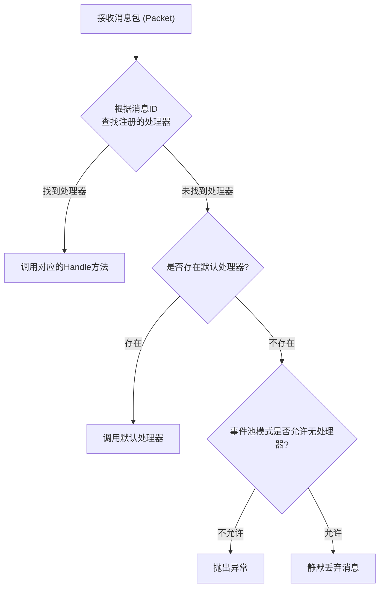
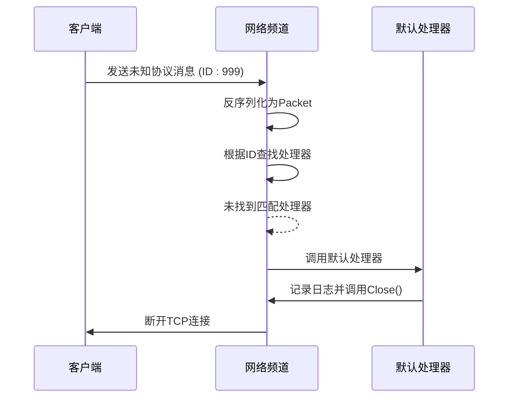

# 默认处理器与异常兜底

<cite>
**本文档引用文件**  
- [EventPool.cs](file://GameFramework/Base/EventPool/EventPool.cs)
- [NetworkManager.NetworkChannelBase.cs](file://GameFramework/Network/NetworkManager.NetworkChannelBase.cs)
- [INetworkChannel.cs](file://GameFramework/Network/INetworkChannel.cs)
- [IPacketHandler.cs](file://GameFramework/Network/IPacketHandler.cs)
- [Packet.cs](file://GameFramework/Network/Packet.cs)
</cite>

## 目录
1. [引言](#引言)
2. [SetDefaultHandler方法设计意图](#setdefaulthandler方法设计意图)
3. [默认处理器触发机制](#默认处理器触发机制)
4. [异常处理实践示例](#异常处理实践示例)
5. [线上环境中的必要性与调试价值](#线上环境中的必要性与调试价值)
6. [总结](#总结)

## 引言
在游戏框架的网络通信与事件处理系统中，消息的准确分发是保障系统稳定运行的核心。然而，在实际运行过程中，不可避免地会遇到未注册协议号的消息包或未知事件类型。为应对此类异常情况，框架提供了`SetDefaultHandler`机制，作为“兜底”方案，确保系统不会因无法处理的消息而崩溃。本文将深入解析该机制的设计意图、触发流程，并结合实际场景说明其在日志记录、安全断开连接等异常处理中的应用价值。

## SetDefaultHandler方法设计意图

`SetDefaultHandler`方法的核心设计意图是为事件池（EventPool）或网络频道（NetworkChannel）提供一个**默认的事件处理器**，用于处理那些**未匹配到任何已注册处理器的消息ID**。其本质是一种“最后防线”机制，确保即使在出现意料之外的消息时，系统仍能保持可控的响应行为，而非直接抛出异常或静默丢弃。

该方法广泛存在于框架的多个模块中：
- 在通用事件系统中，通过`EventPool<T>.SetDefaultHandler(EventHandler<T> handler)`设置默认事件处理器。
- 在网络模块中，通过`INetworkChannel.SetDefaultHandler(EventHandler<Packet> handler)`为特定网络频道设置默认消息包处理器。

其设计体现了以下原则：
- **容错性**：允许系统在面对未知消息时优雅降级，避免程序崩溃。
- **可扩展性**：新协议的引入无需立即修改核心分发逻辑，可通过默认处理器先行捕获并记录。
- **调试友好性**：为开发和运维人员提供捕获异常流量的入口，便于问题定位。

**Section sources**
- [EventPool.cs](file://GameFramework/Base/EventPool/EventPool.cs#L207-L210)
- [INetworkChannel.cs](file://GameFramework/Network/INetworkChannel.cs#L134-L134)

## 默认处理器触发机制

默认处理器的触发机制紧密集成在事件分发流程中。其核心逻辑位于`EventPool<T>.HandleEvent`方法内，具体流程如下：



**Diagram sources**
- [EventPool.cs](file://GameFramework/Base/EventPool/EventPool.cs#L251-L282)
- [NetworkManager.NetworkChannelBase.cs](file://GameFramework/Network/NetworkManager.NetworkChannelBase.cs#L310-L313)

**Section sources**
- [EventPool.cs](file://GameFramework/Base/EventPool/EventPool.cs#L251-L282)

1.  **消息接收**：网络频道接收到一个数据包，并通过`INetworkChannelHelper`将其反序列化为一个具体的`Packet`对象。每个`Packet`都继承自`BaseEventArgs`，并实现了`Id`属性，该`Id`即为消息的协议编号。
2.  **处理器查找**：事件池（`m_ReceivePacketPool`）根据`Packet.Id`在内部的`m_EventHandlers`字典中查找所有已注册的处理器。
3.  **条件判断与分发**：
    -   如果找到了匹配的处理器，则遍历并调用所有处理器的`Handle`方法。
    -   如果未找到任何匹配的处理器，则检查`m_DefaultHandler`是否为`null`。
    -   如果`m_DefaultHandler`不为`null`，则调用该默认处理器。
    -   如果`m_DefaultHandler`为`null`，则根据`EventPoolMode`的配置决定后续行为。若模式不允许无处理器（`AllowNoHandler`未设置），则会抛出`GameFrameworkException`；否则，消息将被静默释放。

此机制确保了消息处理的确定性，开发者可以通过配置`EventPoolMode`来选择是强制要求所有消息都有处理器，还是允许通过默认处理器进行兜底。

## 异常处理实践示例

默认处理器是实现健壮异常处理策略的关键组件。以下是几种典型的实践场景：

### 捕获未知协议
当客户端或服务端版本不一致时，可能会收到对方新增而本端尚未实现的协议消息。默认处理器可以捕获这些消息并进行记录。

```csharp
// 示例：在默认处理器中记录未知协议
void OnDefaultPacketHandler(object sender, Packet packet)
{
    // 记录未知协议ID和来源，便于后续分析
    GameFrameworkLog.Warning($"收到未知协议消息，ID: {packet.Id}, 来源: {sender}");
    // 可以选择断开连接以防止潜在的安全风险
    // ((INetworkChannel)sender).Close();
}
```

### 日志记录
将所有未处理的消息记录到日志中，是线上问题排查的重要手段。默认处理器可以作为统一的日志入口，记录消息的`Id`、时间戳、来源等信息，帮助分析异常流量模式。

**Section sources**
- [IPacketHandler.cs](file://GameFramework/Network/IPacketHandler.cs#L12-L28)
- [Packet.cs](file://GameFramework/Network/Packet.cs#L12-L14)

### 安全断开连接
在某些安全敏感的场景下，收到无法识别的消息可能被视为潜在的攻击或严重错误。此时，可以在默认处理器中主动关闭与该客户端的连接，以保护服务器的稳定性和数据安全。



**Diagram sources**
- [NetworkManager.NetworkChannelBase.cs](file://GameFramework/Network/NetworkManager.NetworkChannelBase.cs#L310-L313)
- [INetworkChannel.cs](file://GameFramework/Network/INetworkChannel.cs#L134-L134)

## 线上环境中的必要性与调试价值

在线上生产环境中，`SetDefaultHandler`机制具有不可替代的重要性。

### 必要性
- **系统稳定性**：防止因单个未知消息导致整个服务崩溃，保障了服务的高可用性。
- **版本兼容性**：在灰度发布或版本迭代期间，新旧客户端可能共存。默认处理器可以平滑处理协议不一致的情况，避免大规模服务中断。
- **防御性编程**：作为最后一道防线，抵御恶意或错误构造的数据包，提升系统的安全边界。

### 调试价值
- **问题定位**：当线上出现异常时，通过分析默认处理器捕获的日志，可以快速定位是哪个协议号的消息引发了问题，极大地缩短了排查时间。
- **流量分析**：收集的未知消息数据可以用于分析客户端行为，发现潜在的兼容性问题或异常用户行为。
- **开发辅助**：在开发阶段，开启默认处理器的日志可以帮助开发者及时发现协议注册遗漏或ID定义错误。

综上所述，`SetDefaultHandler`不仅是代码健壮性的体现，更是线上运维和故障排查的有力工具。

## 总结
`SetDefaultHandler`方法是GameFramework中一个精巧而关键的设计。它通过为事件分发系统提供一个“兜底”的处理器，有效解决了未知消息处理的难题。其触发机制清晰可靠，通过在`HandleEvent`流程中进行条件判断来激活。在实践中，该机制被广泛应用于捕获未知协议、记录关键日志和执行安全断开等异常处理策略。对于线上环境而言，它不仅是保障系统稳定运行的必要措施，更是宝贵的调试信息来源，其价值远超一个简单的错误处理函数。