# 网络通信

<cite>
**本文档引用的文件**
- [INetworkManager.cs](file://GameFramework/Network/INetworkManager.cs)
- [INetworkChannel.cs](file://GameFramework/Network/INetworkChannel.cs)
- [NetworkManager.cs](file://GameFramework/Network/NetworkManager.cs)
- [NetworkManager.NetworkChannelBase.cs](file://GameFramework/Network/NetworkManager.NetworkChannelBase.cs)
- [NetworkManager.TcpNetworkChannel.cs](file://GameFramework/Network/NetworkManager.TcpNetworkChannel.cs)
- [IPacketHandler.cs](file://GameFramework/Network/IPacketHandler.cs)
- [IPacketHeader.cs](file://GameFramework/Network/IPacketHeader.cs)
- [Packet.cs](file://GameFramework/Network/Packet.cs)
- [NetworkConnectedEventArgs.cs](file://GameFramework/Network/NetworkConnectedEventArgs.cs)
- [NetworkManager.ConnectState.cs](file://GameFramework/Network/NetworkManager.ConnectState.cs)
- [NetworkManager.SendState.cs](file://GameFramework/Network/NetworkManager.SendState.cs)
- [NetworkManager.ReceiveState.cs](file://GameFramework/Network/NetworkManager.ReceiveState.cs)
- [NetworkManager.HeartBeatState.cs](file://GameFramework/Network/NetworkManager.HeartBeatState.cs)
- [INetworkChannelHelper.cs](file://GameFramework/Network/INetworkChannelHelper.cs)
</cite>

## 目录
1. [简介](#简介)
2. [核心接口设计](#核心接口设计)
3. [连接管理机制](#连接管理机制)
4. [数据包处理流程](#数据包处理流程)
5. [心跳与断线重连](#心跳与断线重连)
6. [消息分发系统](#消息分发系统)
7. [状态机实现](#状态机实现)
8. [网络事件监听](#网络事件监听)
9. [自定义协议扩展](#自定义协议扩展)

## 简介
本系统提供完整的网络通信解决方案，支持TCP协议的可靠连接管理。系统采用模块化设计，通过INetworkManager统一管理多个网络频道（INetworkChannel），每个频道独立处理连接、心跳、数据收发等任务。系统内置心跳检测、断线重连、消息路由等核心功能，确保网络通信的稳定性和可靠性。

## 核心接口设计

### INetworkManager 接口
作为网络系统的顶层管理器，负责创建、管理和销毁网络频道。

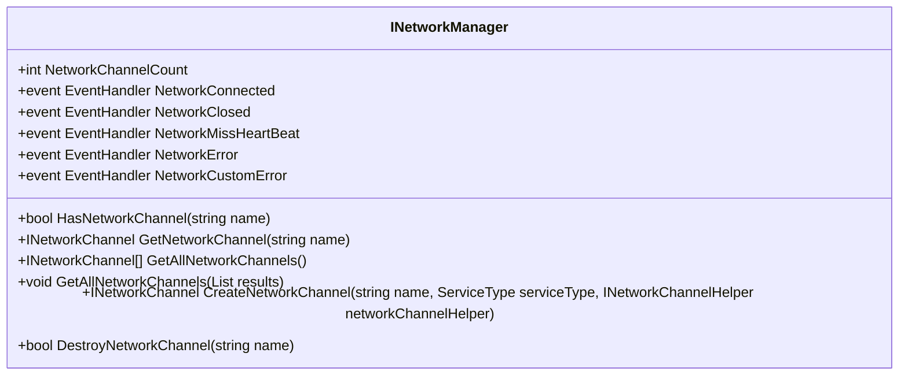

**图示来源**
- [INetworkManager.cs](file://GameFramework/Network/INetworkManager.cs#L15-L91)

### INetworkChannel 接口
定义网络频道的核心功能，包括连接管理、数据收发和状态监控。

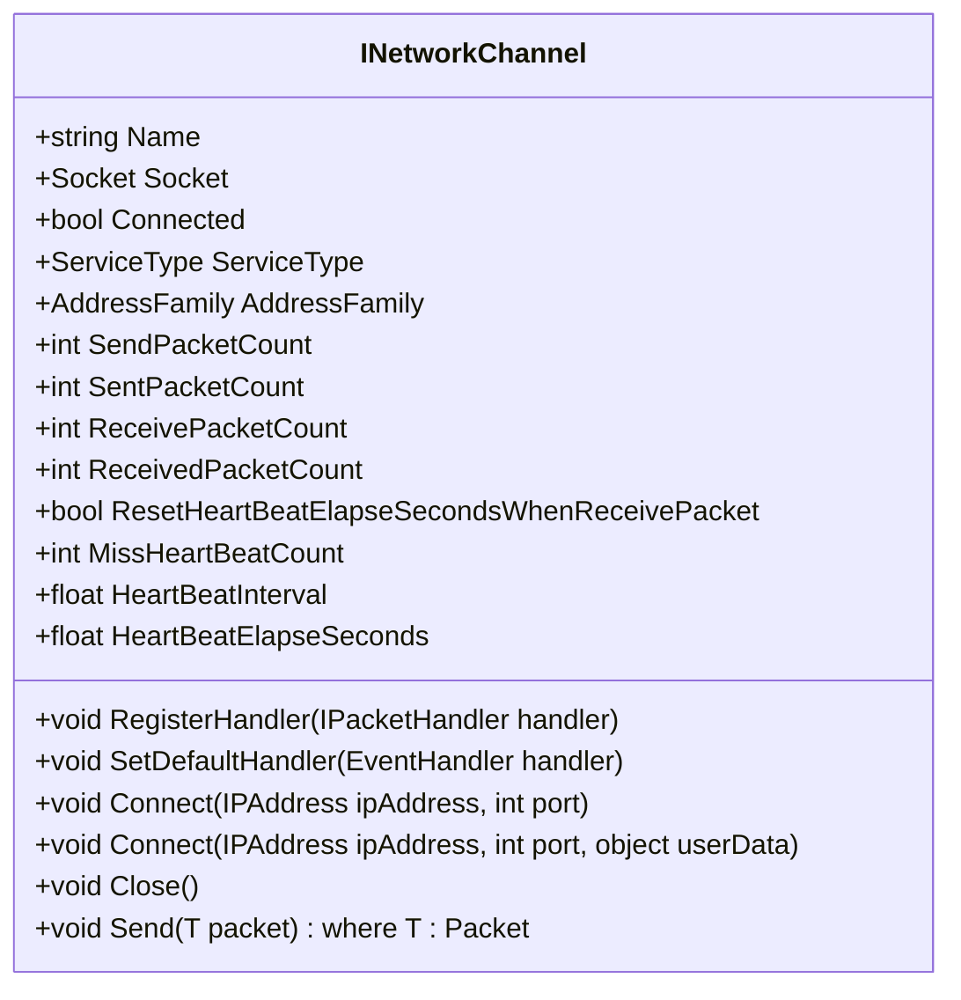

**图示来源**
- [INetworkChannel.cs](file://GameFramework/Network/INetworkChannel.cs#L16-L162)

### IPacketHandler 接口
定义网络消息包处理器的规范，实现消息路由功能。

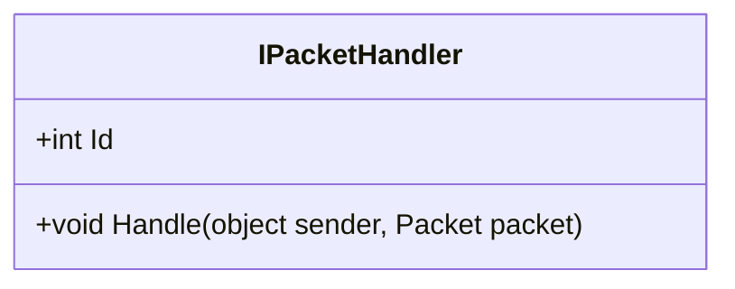

**图示来源**
- [IPacketHandler.cs](file://GameFramework/Network/IPacketHandler.cs#L12-L28)

### IPacketHeader 接口
定义网络消息包头的基本结构。

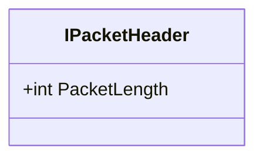

**图示来源**
- [IPacketHeader.cs](file://GameFramework/Network/IPacketHeader.cs#L12-L21)

**本节来源**
- [INetworkManager.cs](file://GameFramework/Network/INetworkManager.cs#L15-L91)
- [INetworkChannel.cs](file://GameFramework/Network/INetworkChannel.cs#L16-L162)
- [IPacketHandler.cs](file://GameFramework/Network/IPacketHandler.cs#L12-L28)
- [IPacketHeader.cs](file://GameFramework/Network/IPacketHeader.cs#L12-L21)

## 连接管理机制

### 连接状态管理
系统通过ConnectState类管理连接过程中的状态信息，包括Socket实例和用户自定义数据。

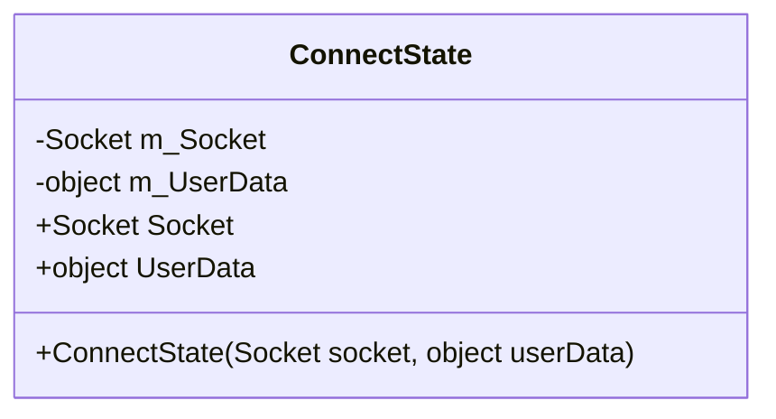

**图示来源**
- [NetworkManager.ConnectState.cs](file://GameFramework/Network/NetworkManager.ConnectState.cs#L11-L40)

### 连接流程
1. 调用CreateNetworkChannel创建网络频道
2. 调用Connect方法发起连接
3. 异步连接完成后触发NetworkConnected事件
4. 进入正常通信状态

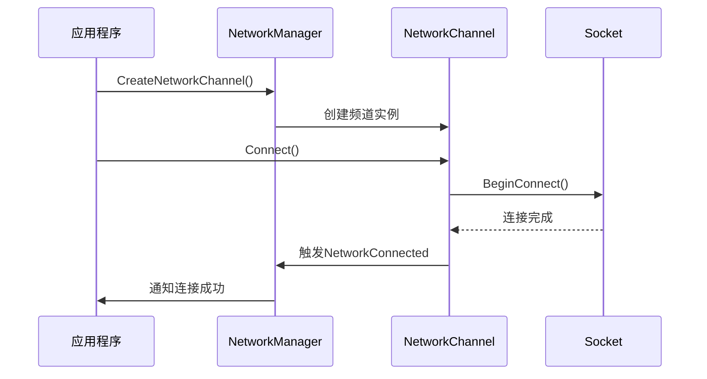

**图示来源**
- [NetworkManager.cs](file://GameFramework/Network/NetworkManager.cs#L224-L263)
- [NetworkManager.TcpNetworkChannel.cs](file://GameFramework/Network/NetworkManager.TcpNetworkChannel.cs#L65-L100)

**本节来源**
- [NetworkManager.ConnectState.cs](file://GameFramework/Network/NetworkManager.ConnectState.cs#L11-L40)
- [NetworkManager.cs](file://GameFramework/Network/NetworkManager.cs#L224-L263)
- [NetworkManager.TcpNetworkChannel.cs](file://GameFramework/Network/NetworkManager.TcpNetworkChannel.cs#L65-L100)

## 数据包处理流程

### Packet 基类
所有网络消息包都继承自Packet基类，作为事件参数传递。

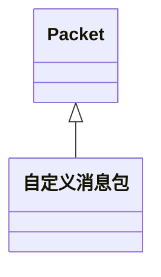

**图示来源**
- [Packet.cs](file://GameFramework/Network/Packet.cs#L12-L14)

### 数据包处理状态
系统使用SendState和ReceiveState管理收发缓冲区。

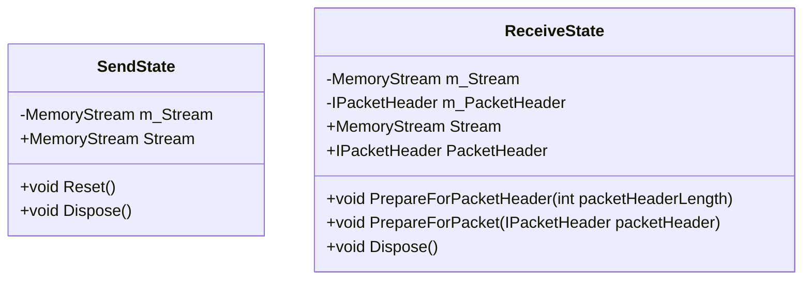

**图示来源**
- [NetworkManager.SendState.cs](file://GameFramework/Network/NetworkManager.SendState.cs#L14-L64)
- [NetworkManager.ReceiveState.cs](file://GameFramework/Network/NetworkManager.ReceiveState.cs#L14-L95)

### 数据包处理流程
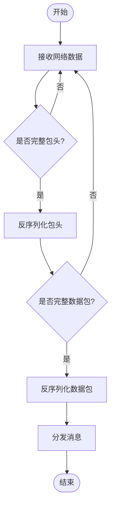

**图示来源**
- [NetworkManager.NetworkChannelBase.cs](file://GameFramework/Network/NetworkManager.NetworkChannelBase.cs#L400-L500)

**本节来源**
- [Packet.cs](file://GameFramework/Network/Packet.cs#L12-L14)
- [NetworkManager.SendState.cs](file://GameFramework/Network/NetworkManager.SendState.cs#L14-L64)
- [NetworkManager.ReceiveState.cs](file://GameFramework/Network/NetworkManager.ReceiveState.cs#L14-L95)
- [NetworkManager.NetworkChannelBase.cs](file://GameFramework/Network/NetworkManager.NetworkChannelBase.cs#L400-L500)

## 心跳与断线重连

### 心跳状态管理
HeartBeatState类负责管理心跳相关的状态信息。

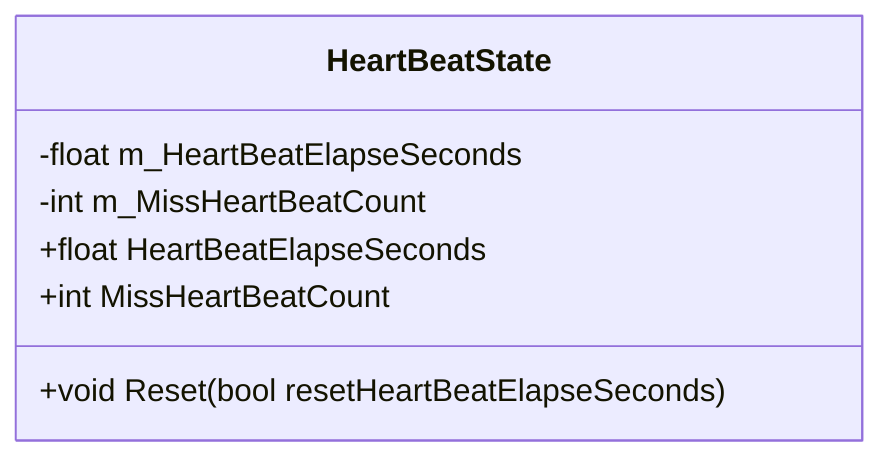

**图示来源**
- [NetworkManager.HeartBeatState.cs](file://GameFramework/Network/NetworkManager.HeartBeatState.cs#L11-L58)

### 心跳机制
系统通过定时检查心跳流逝时间来检测连接状态。

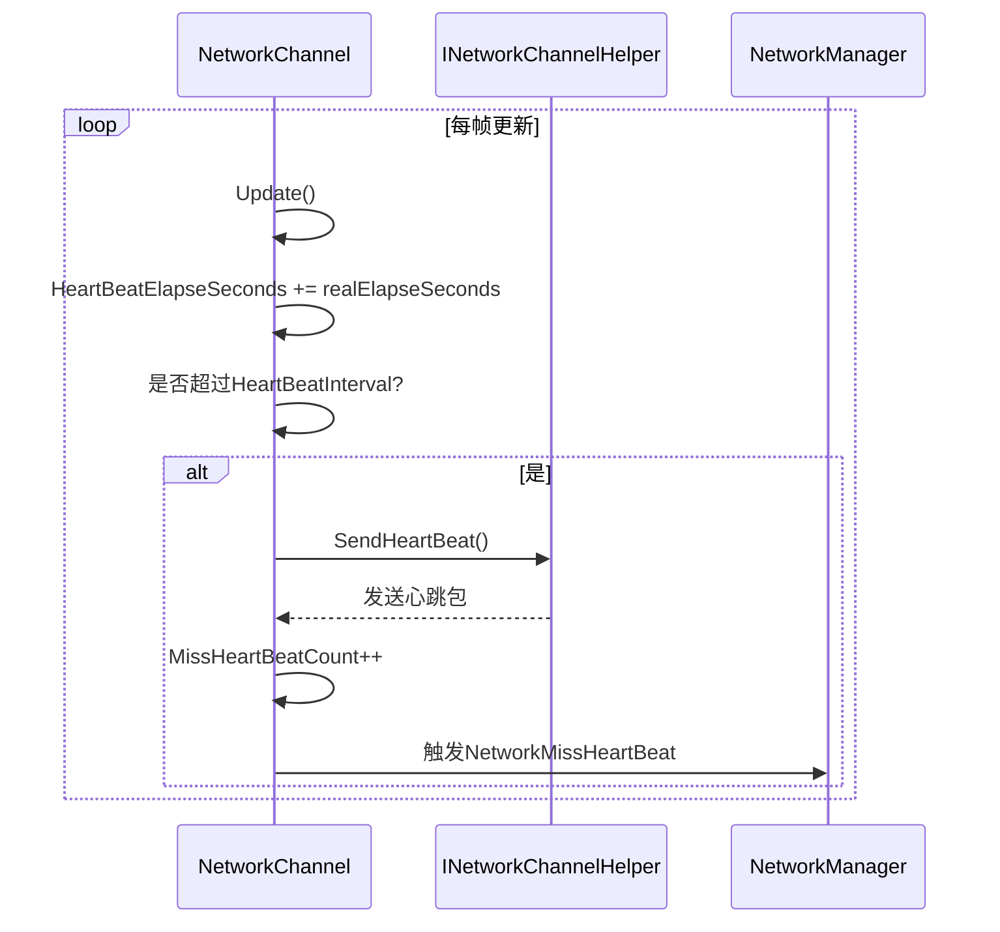

**图示来源**
- [NetworkManager.NetworkChannelBase.cs](file://GameFramework/Network/NetworkManager.NetworkChannelBase.cs#L200-L250)
- [INetworkChannelHelper.cs](file://GameFramework/Network/INetworkChannelHelper.cs#L44-L44)

**本节来源**
- [NetworkManager.HeartBeatState.cs](file://GameFramework/Network/NetworkManager.HeartBeatState.cs#L11-L58)
- [NetworkManager.NetworkChannelBase.cs](file://GameFramework/Network/NetworkManager.NetworkChannelBase.cs#L200-L250)
- [INetworkChannelHelper.cs](file://GameFramework/Network/INetworkChannelHelper.cs#L44-L44)

## 消息分发系统

### 消息路由机制
基于IPacketHandler接口实现消息的分类处理。

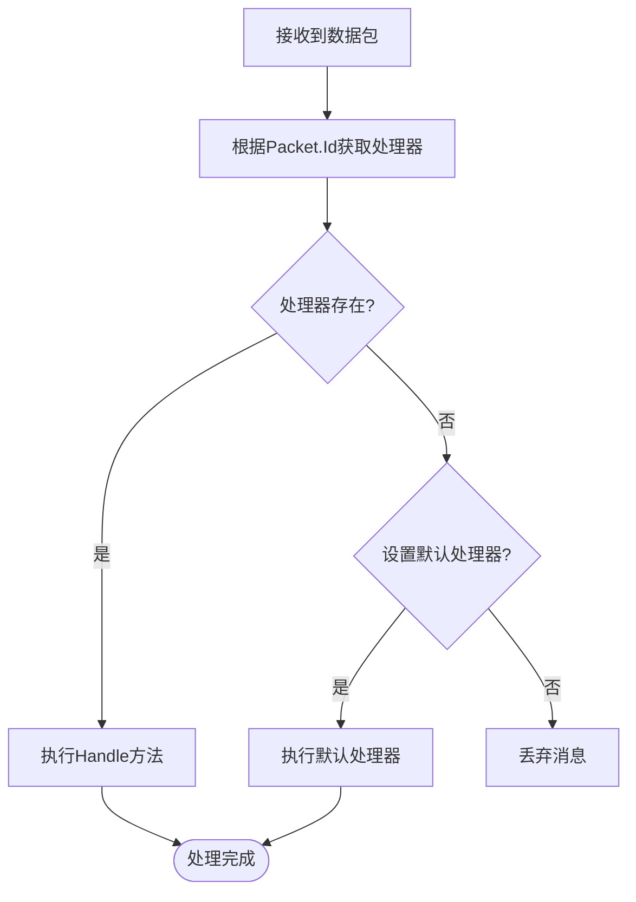

**图示来源**
- [NetworkManager.NetworkChannelBase.cs](file://GameFramework/Network/NetworkManager.NetworkChannelBase.cs#L300-L350)

### 消息处理器注册
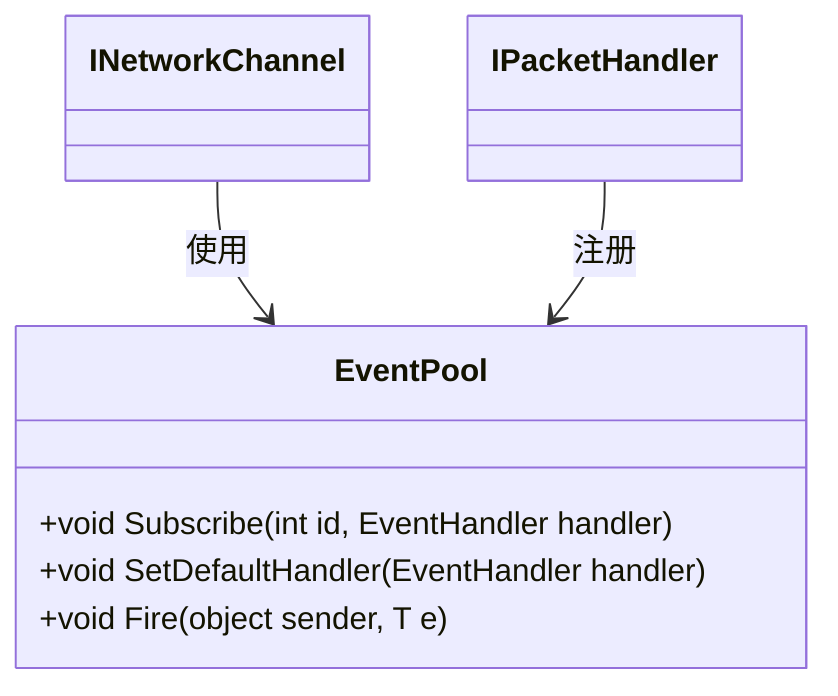

**图示来源**
- [NetworkManager.NetworkChannelBase.cs](file://GameFramework/Network/NetworkManager.NetworkChannelBase.cs#L150-L200)

**本节来源**
- [NetworkManager.NetworkChannelBase.cs](file://GameFramework/Network/NetworkManager.NetworkChannelBase.cs#L150-L350)

## 状态机实现

### 收发状态机
系统使用状态机管理数据收发过程。

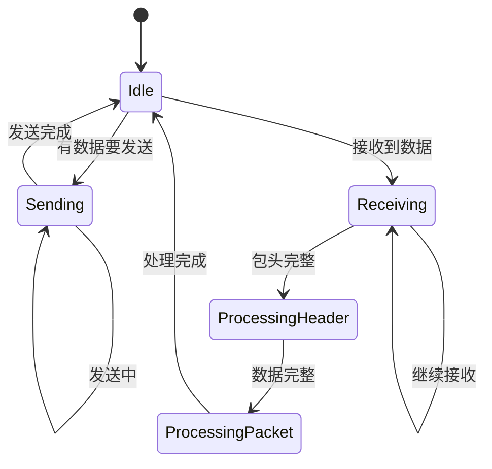

**图示来源**
- [NetworkManager.NetworkChannelBase.cs](file://GameFramework/Network/NetworkManager.NetworkChannelBase.cs#L400-L500)

### 连接状态机
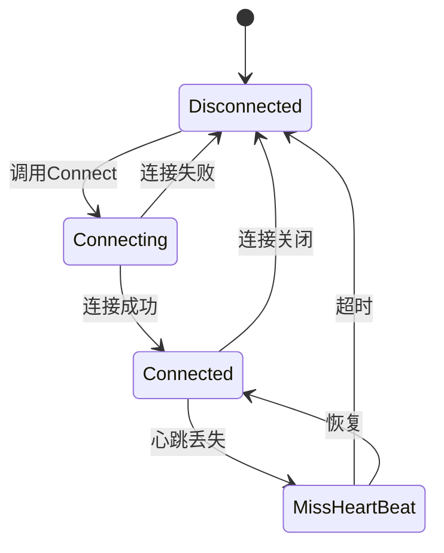

**图示来源**
- [NetworkManager.NetworkChannelBase.cs](file://GameFramework/Network/NetworkManager.NetworkChannelBase.cs#L100-L150)

**本节来源**
- [NetworkManager.NetworkChannelBase.cs](file://GameFramework/Network/NetworkManager.NetworkChannelBase.cs#L100-L500)

## 网络事件监听

### 事件类型
系统提供多种网络事件供外部监听：

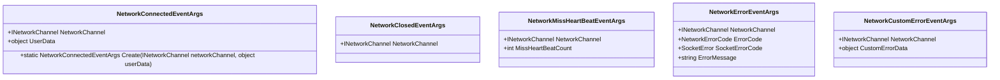

**图示来源**
- [NetworkConnectedEventArgs.cs](file://GameFramework/Network/NetworkConnectedEventArgs.cs#L12-L63)
- 其他事件类在Network目录下

### 事件监听方法
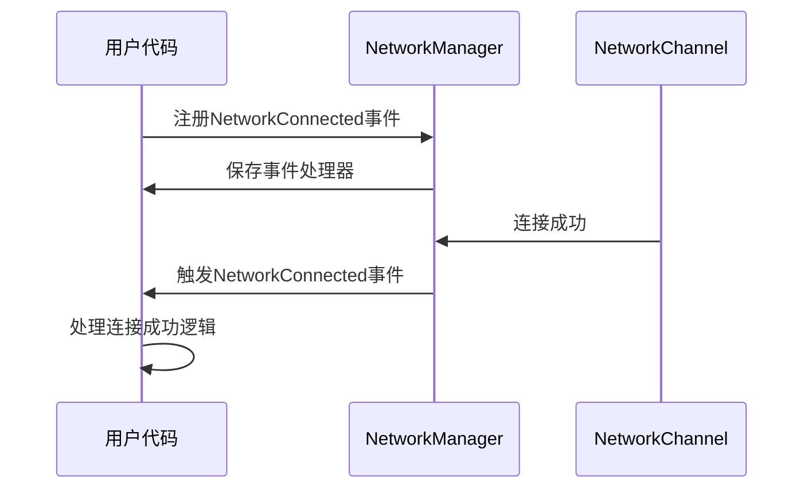

**图示来源**
- [NetworkManager.cs](file://GameFramework/Network/NetworkManager.cs#L50-L100)
- [NetworkConnectedEventArgs.cs](file://GameFramework/Network/NetworkConnectedEventArgs.cs#L12-L63)

**本节来源**
- [NetworkConnectedEventArgs.cs](file://GameFramework/Network/NetworkConnectedEventArgs.cs#L12-L63)
- [NetworkManager.cs](file://GameFramework/Network/NetworkManager.cs#L50-L100)

## 自定义协议扩展

### 协议扩展点
通过INetworkChannelHelper接口实现协议的自定义扩展。

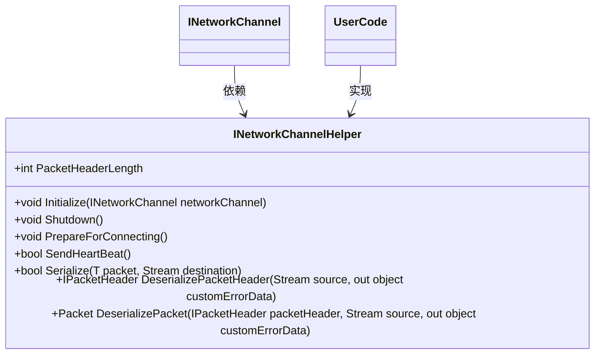

**图示来源**
- [INetworkChannelHelper.cs](file://GameFramework/Network/INetworkChannelHelper.cs#L14-L71)

### 扩展实现步骤
1. 实现INetworkChannelHelper接口
2. 重写序列化/反序列化方法
3. 在CreateNetworkChannel时传入自定义Helper
4. 系统自动使用自定义协议处理数据

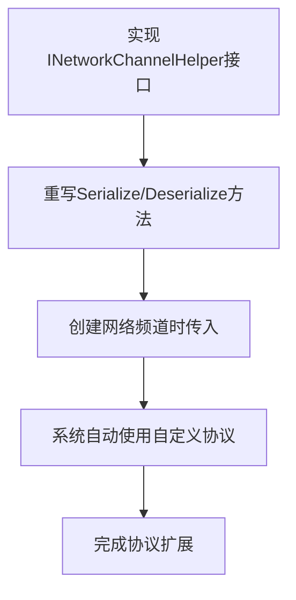

**图示来源**
- [INetworkChannelHelper.cs](file://GameFramework/Network/INetworkChannelHelper.cs#L14-L71)
- [NetworkManager.cs](file://GameFramework/Network/NetworkManager.cs#L224-L263)

**本节来源**
- [INetworkChannelHelper.cs](file://GameFramework/Network/INetworkChannelHelper.cs#L14-L71)
- [NetworkManager.cs](file://GameFramework/Network/NetworkManager.cs#L224-L263)