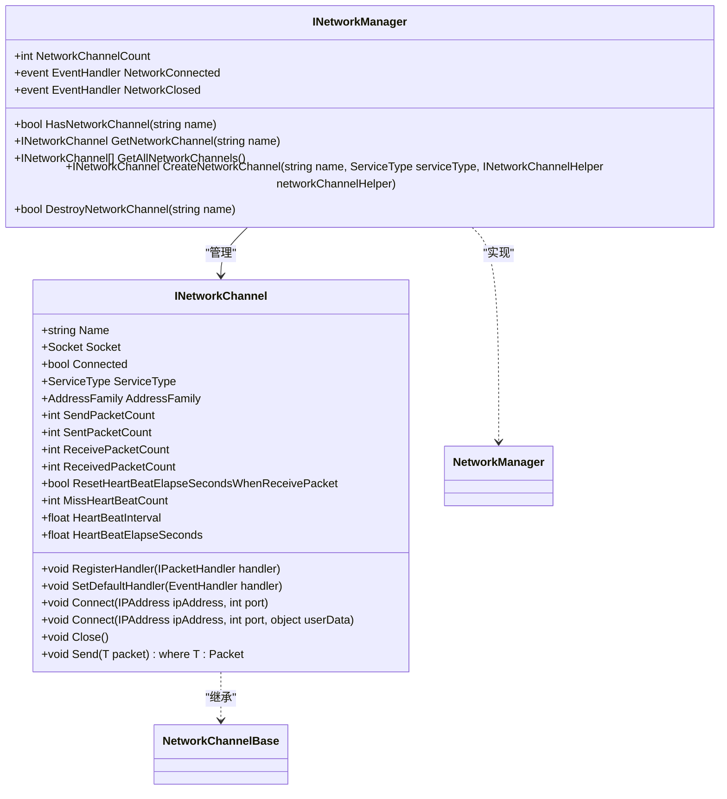
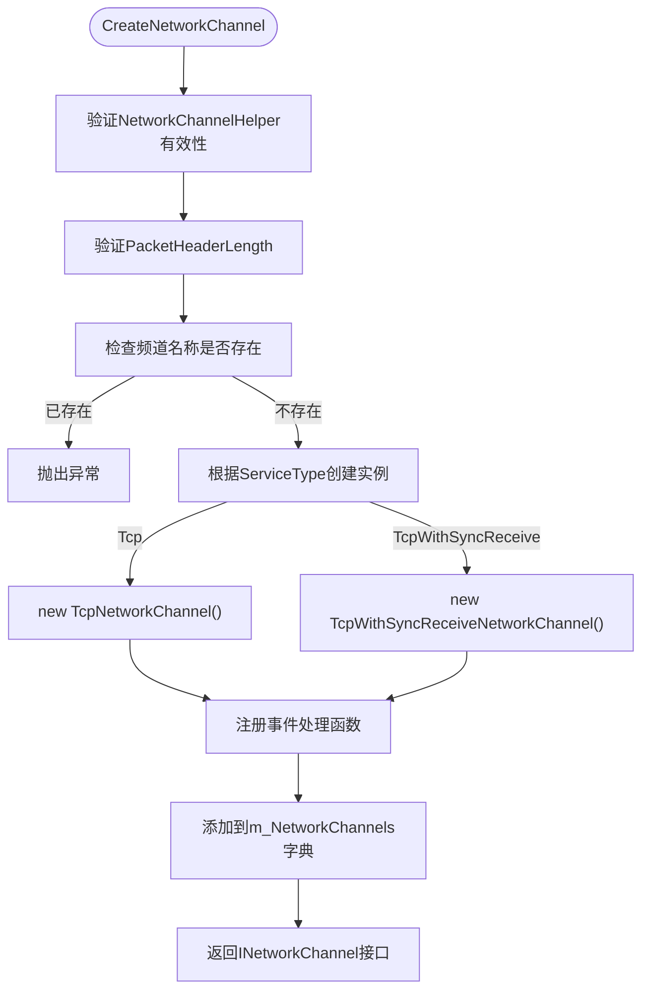
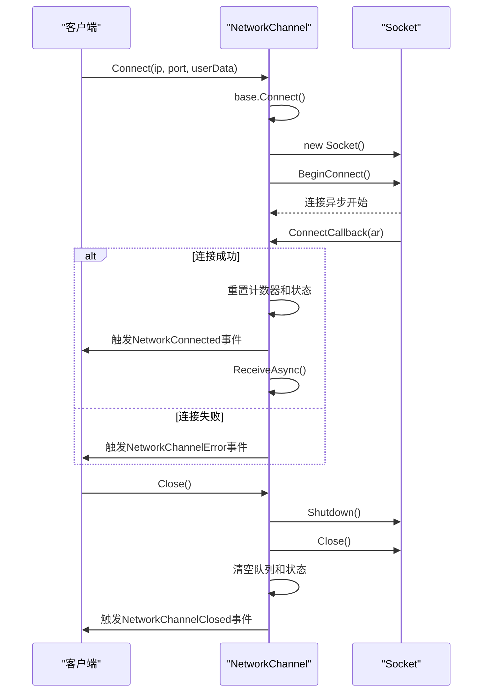
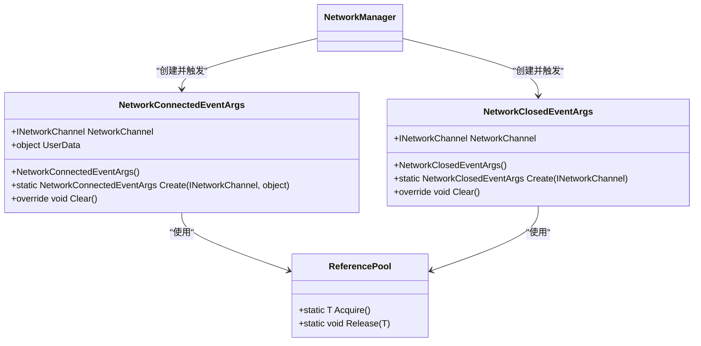
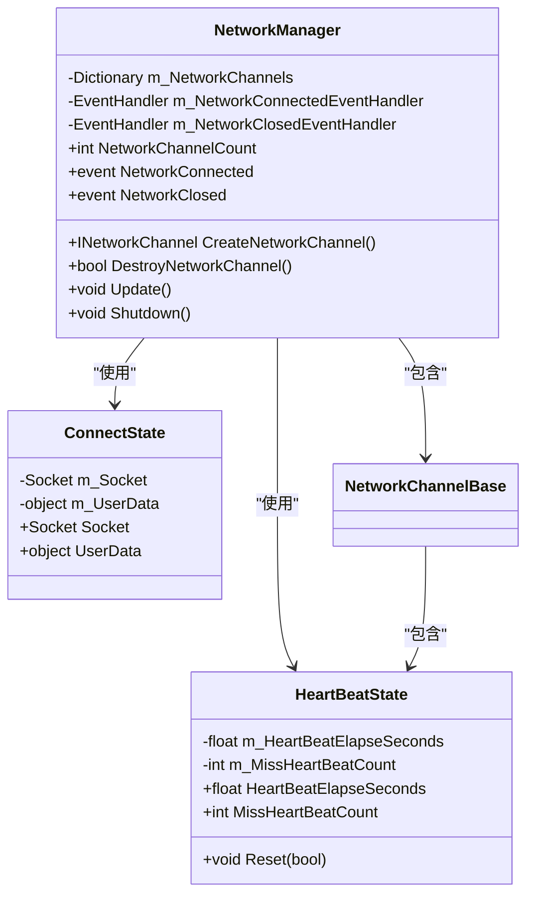

<cite>
**本文档中引用的文件**  
- [INetworkManager.cs](file://GameFramework/Network/INetworkManager.cs)
- [INetworkChannel.cs](file://GameFramework/Network/INetworkChannel.cs)
- [NetworkManager.cs](file://GameFramework/Network/NetworkManager.cs)
- [NetworkManager.ConnectState.cs](file://GameFramework/Network/NetworkManager.ConnectState.cs)
- [NetworkManager.NetworkChannelBase.cs](file://GameFramework/Network/NetworkManager.NetworkChannelBase.cs)
- [NetworkManager.TcpNetworkChannel.cs](file://GameFramework/Network/NetworkManager.TcpNetworkChannel.cs)
- [NetworkManager.TcpWithSyncReceiveNetworkChannel.cs](file://GameFramework/Network/NetworkManager.TcpWithSyncReceiveNetworkChannel.cs)
- [NetworkConnectedEventArgs.cs](file://GameFramework/Network/NetworkConnectedEventArgs.cs)
- [NetworkClosedEventArgs.cs](file://GameFramework/Network/NetworkClosedEventArgs.cs)
</cite>

# 连接管理

## 目录
1. [接口设计与职责划分](#接口设计与职责划分)
2. [网络频道创建机制](#网络频道创建机制)
3. [连接与关闭流程](#连接与关闭流程)
4. [事件系统与监听机制](#事件系统与监听机制)
5. [多频道管理与状态维护](#多频道管理与状态维护)
6. [完整代码示例](#完整代码示例)

## 接口设计与职责划分

网络连接管理机制通过 `INetworkManager` 和 `INetworkChannel` 两个核心接口实现职责分离。`INetworkManager` 作为网络系统的顶层管理者，负责全局网络频道的生命周期管理；`INetworkChannel` 则代表单个网络连接实例，封装具体通信逻辑。

`INetworkManager` 接口定义了网络频道的创建、销毁和查询功能，同时提供事件订阅机制，使上层系统能够监听网络状态变化。该接口通过字典结构 `m_NetworkChannels` 统一管理所有网络频道，确保系统内网络资源的有序组织。

`INetworkChannel` 接口则聚焦于单个连接的通信能力，提供连接、关闭、消息发送等基础操作。该接口抽象了不同网络服务类型的共性行为，为TCP异步和同步接收模式提供了统一的操作视图。



**Diagram sources**
- [INetworkManager.cs](file://GameFramework/Network/INetworkManager.cs#L15-L91)
- [INetworkChannel.cs](file://GameFramework/Network/INetworkChannel.cs#L16-L162)

**Section sources**
- [INetworkManager.cs](file://GameFramework/Network/INetworkManager.cs#L15-L91)
- [INetworkChannel.cs](file://GameFramework/Network/INetworkChannel.cs#L16-L162)

## 网络频道创建机制

网络频道的创建通过 `INetworkManager.CreateNetworkChannel` 方法实现，该方法根据指定的服务类型创建相应的网络频道实例。系统支持两种服务类型：`Tcp` 和 `TcpWithSyncReceive`，分别对应异步接收和同步接收模式。

创建过程首先验证网络频道辅助器的有效性，然后检查指定名称的频道是否已存在，避免重复创建。根据 `ServiceType` 参数，系统实例化对应的频道类型：`TcpNetworkChannel` 或 `TcpWithSyncReceiveNetworkChannel`。创建完成后，网络管理器会注册频道的事件处理函数，并将其加入 `m_NetworkChannels` 字典进行统一管理。



**Diagram sources**
- [NetworkManager.cs](file://GameFramework/Network/NetworkManager.cs#L224-L263)
- [NetworkManager.TcpNetworkChannel.cs](file://GameFramework/Network/NetworkManager.TcpNetworkChannel.cs#L25-L35)
- [NetworkManager.TcpWithSyncReceiveNetworkChannel.cs](file://GameFramework/Network/NetworkManager.TcpWithSyncReceiveNetworkChannel.cs#L25-L35)

**Section sources**
- [NetworkManager.cs](file://GameFramework/Network/NetworkManager.cs#L224-L263)

## 连接与关闭流程

### 连接流程

网络连接通过 `INetworkChannel.Connect` 方法启动。该方法首先调用基类 `NetworkChannelBase.Connect` 进行前置准备，包括设置地址族和重置发送/接收状态。随后，具体实现类（如 `TcpNetworkChannel`）创建 Socket 实例并发起异步连接。

在 `TcpNetworkChannel` 中，连接使用 `BeginConnect` 方法异步执行，传入 `ConnectState` 对象携带 Socket 实例和用户数据。连接回调 `ConnectCallback` 处理连接结果：成功时重置统计计数器和心跳状态，触发 `NetworkChannelConnected` 事件；失败时通过 `NetworkChannelError` 事件报告错误。

### 关闭流程

关闭操作通过 `INetworkChannel.Close` 方法执行。该方法首先标记频道为非活跃状态，然后调用 Socket 的 `Shutdown` 和 `Close` 方法终止连接。关闭过程中会清空发送和接收队列，重置心跳状态，并触发 `NetworkChannelClosed` 事件通知监听者。



**Diagram sources**
- [NetworkManager.NetworkChannelBase.cs](file://GameFramework/Network/NetworkManager.NetworkChannelBase.cs#L368-L418)
- [NetworkManager.TcpNetworkChannel.cs](file://GameFramework/Network/NetworkManager.TcpNetworkChannel.cs#L78-L158)
- [NetworkManager.TcpWithSyncReceiveNetworkChannel.cs](file://GameFramework/Network/NetworkManager.TcpWithSyncReceiveNetworkChannel.cs#L78-L138)

**Section sources**
- [NetworkManager.NetworkChannelBase.cs](file://GameFramework/Network/NetworkManager.NetworkChannelBase.cs#L368-L418)
- [NetworkManager.TcpNetworkChannel.cs](file://GameFramework/Network/NetworkManager.TcpNetworkChannel.cs#L78-L158)

## 事件系统与监听机制

网络系统通过事件机制实现状态变化的通知。核心事件包括 `NetworkConnectedEventArgs` 和 `NetworkClosedEventArgs`，分别在连接成功和关闭时触发。

`NetworkConnectedEventArgs` 包含 `NetworkChannel` 和 `UserData` 两个关键属性。`UserData` 允许在连接请求时传递上下文信息，这些信息会在连接成功事件中返回，便于关联异步操作。事件对象通过对象池 `ReferencePool` 管理，使用 `Create` 静态方法获取实例，使用后通过 `Release` 方法归还，避免频繁的内存分配。

事件监听通过标准的 C# 事件语法实现。用户可以通过 `+=` 操作符订阅事件，系统内部通过线程安全的锁机制确保事件处理的正确性。当网络状态变化时，管理器会创建相应的事件参数对象，触发事件，然后立即释放对象回池。



**Diagram sources**
- [NetworkConnectedEventArgs.cs](file://GameFramework/Network/NetworkConnectedEventArgs.cs#L12-L63)
- [NetworkClosedEventArgs.cs](file://GameFramework/Network/NetworkClosedEventArgs.cs#L12-L50)
- [NetworkManager.cs](file://GameFramework/Network/NetworkManager.cs#L445-L484)

**Section sources**
- [NetworkConnectedEventArgs.cs](file://GameFramework/Network/NetworkConnectedEventArgs.cs#L12-L63)
- [NetworkClosedEventArgs.cs](file://GameFramework/Network/NetworkClosedEventArgs.cs#L12-L50)

## 多频道管理与状态维护

`NetworkManager` 使用 `Dictionary<string, NetworkChannelBase>` 类型的 `m_NetworkChannels` 字典管理所有网络频道，以频道名称为键实现快速查找。这种设计支持同时维护多个到不同服务器的连接，每个连接独立运行互不干扰。

连接状态在异步Socket编程中至关重要。`ConnectState` 内部类封装了连接过程中的Socket实例和用户数据，确保这些信息在异步回调中可用。`ConnectState` 作为 `BeginConnect` 方法的状态对象传递，在 `ConnectCallback` 中被还原，实现了异步操作的上下文保持。

心跳机制通过 `HeartBeatState` 类维护，记录心跳流逝时间和丢失次数。在 `Update` 方法中，系统定期检查心跳状态，当超过设定间隔未收到响应时，会触发 `NetworkMissHeartBeat` 事件。这种设计确保了长连接的可靠性，能够及时发现并处理网络异常。



**Diagram sources**
- [NetworkManager.cs](file://GameFramework/Network/NetworkManager.cs#L29-L37)
- [NetworkManager.ConnectState.cs](file://GameFramework/Network/NetworkManager.ConnectState.cs#L11-L40)
- [NetworkManager.NetworkChannelBase.cs](file://GameFramework/Network/NetworkManager.NetworkChannelBase.cs#L105-L120)

**Section sources**
- [NetworkManager.cs](file://GameFramework/Network/NetworkManager.cs#L29-L37)
- [NetworkManager.ConnectState.cs](file://GameFramework/Network/NetworkManager.ConnectState.cs#L11-L40)

## 完整代码示例

以下示例展示了创建、连接和销毁网络频道的完整流程：

```csharp
// 1. 获取网络管理器实例
INetworkManager networkManager = GameFrameworkEntry.GetModule<INetworkManager>();

// 2. 创建TCP网络频道
INetworkChannel channel = networkManager.CreateNetworkChannel(
    "MainServer", 
    ServiceType.Tcp, 
    new CustomNetworkHelper()
);

// 3. 订阅连接事件
networkManager.NetworkConnected += OnNetworkConnected;
networkManager.NetworkClosed += OnNetworkClosed;

// 4. 发起连接（携带用户数据）
IPAddress ipAddress = IPAddress.Parse("127.0.0.1");
channel.Connect(ipAddress, 8080, new ConnectionContext { UserId = 12345 });

// 5. 连接成功事件处理
private void OnNetworkConnected(object sender, NetworkConnectedEventArgs e)
{
    // 获取连接上下文
    ConnectionContext context = e.UserData as ConnectionContext;
    Log.Info($"Connected to {e.NetworkChannel.Name} with user {context?.UserId}");
    
    // 发送登录消息
    LoginPacket loginPacket = new LoginPacket();
    e.NetworkChannel.Send(loginPacket);
}

// 6. 连接关闭事件处理
private void OnNetworkClosed(object sender, NetworkClosedEventArgs e)
{
    Log.Info($"Connection to {e.NetworkChannel.Name} closed");
}

// 7. 销毁网络频道
networkManager.DestroyNetworkChannel("MainServer");
```

**Section sources**
- [INetworkManager.cs](file://GameFramework/Network/INetworkManager.cs#L83-L83)
- [INetworkChannel.cs](file://GameFramework/Network/INetworkChannel.cs#L128-L145)
- [NetworkConnectedEventArgs.cs](file://GameFramework/Network/NetworkConnectedEventArgs.cs#L47-L53)
- [NetworkClosedEventArgs.cs](file://GameFramework/Network/NetworkClosedEventArgs.cs#L36-L41)