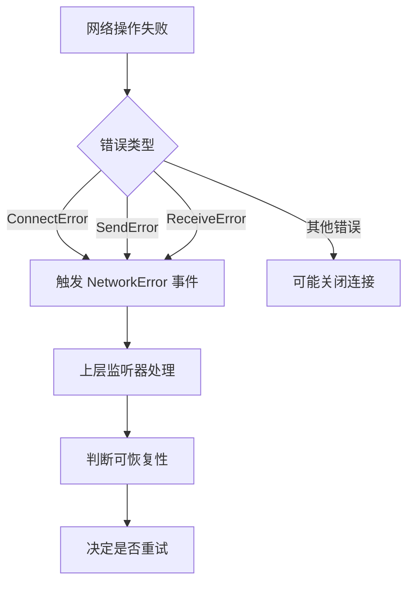
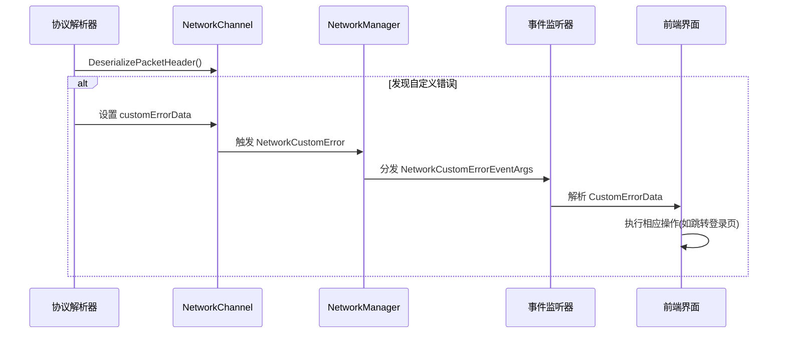
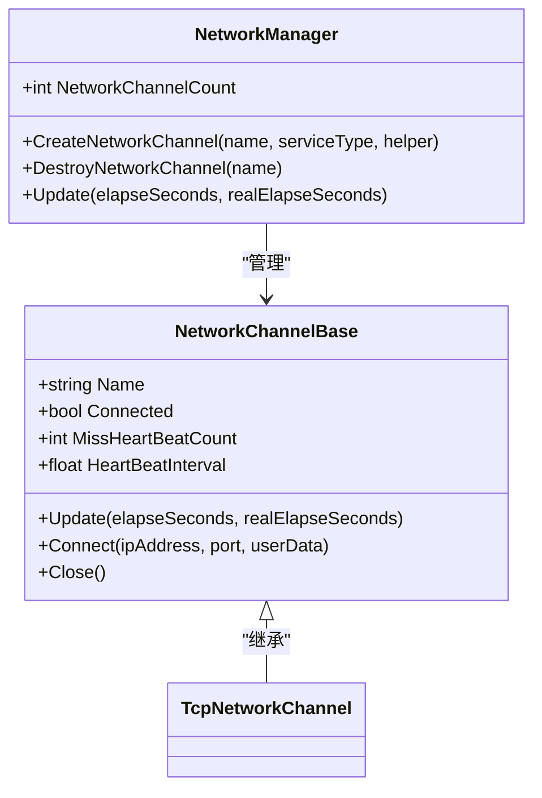
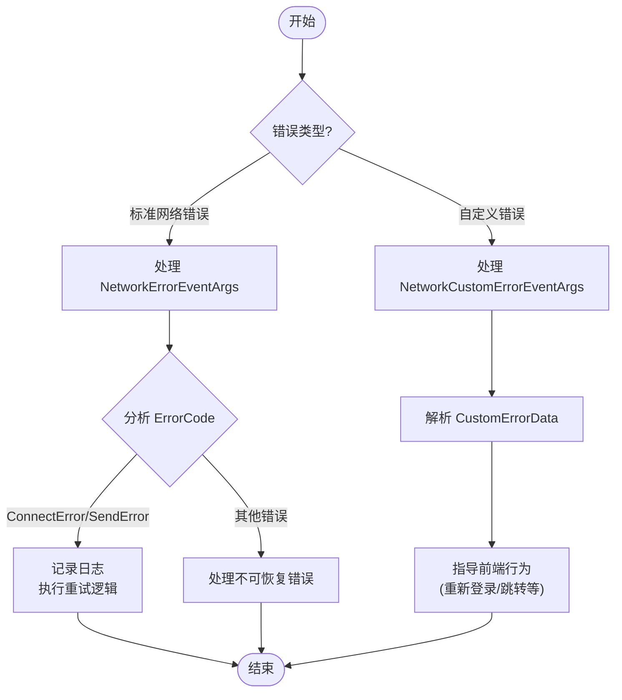

# 恢复策略与最佳实践

<cite>
**Referenced Files in This Document**   
- [NetworkErrorEventArgs.cs](file://GameFramework/Network/NetworkErrorEventArgs.cs)
- [NetworkCustomErrorEventArgs.cs](file://GameFramework/Network/NetworkCustomErrorEventArgs.cs)
- [NetworkErrorCode.cs](file://GameFramework/Network/NetworkErrorCode.cs)
- [NetworkManager.cs](file://GameFramework/Network/NetworkManager.cs)
- [NetworkManager.NetworkChannelBase.cs](file://GameFramework/Network/NetworkManager.NetworkChannelBase.cs)
- [NetworkManager.TcpNetworkChannel.cs](file://GameFramework/Network/NetworkManager.TcpNetworkChannel.cs)
- [INetworkManager.cs](file://GameFramework/Network/INetworkManager.cs)
</cite>

## 目录
1. [引言](#引言)
2. [核心错误事件结构](#核心错误事件结构)
3. [可恢复性判断机制](#可恢复性判断机制)
4. [自定义错误处理](#自定义错误处理)
5. [断线重连设计原则](#断线重连设计原则)
6. [完整错误处理流程](#完整错误处理流程)
7. [最佳实践总结](#最佳实践总结)

## 引言

在网络应用开发中，网络连接的稳定性是影响用户体验的关键因素。本文档系统性地总结了在 GameFramework 网络模块中发生网络错误后的常见恢复策略。通过分析 `NetworkErrorEventArgs` 和 `NetworkCustomErrorEventArgs` 等核心事件类型，阐述了如何基于错误码判断可恢复性、如何利用自定义错误数据指导前端行为，以及如何实现健壮的自动恢复机制。文档提供了完整的错误处理流程模板，帮助开发者快速集成可靠的网络容错能力。

## 核心错误事件结构

GameFramework 的网络模块通过事件驱动机制处理各种网络状态变化，其中错误处理主要依赖于两个核心事件类。

### 网络错误事件 (NetworkErrorEventArgs)

`NetworkErrorEventArgs` 类用于封装标准网络错误信息，包含以下关键属性：

- **NetworkChannel**: 发生错误的网络频道实例
- **ErrorCode**: 枚举类型的错误码，定义在 `NetworkErrorCode`
- **SocketErrorCode**: 底层 Socket 错误码
- **ErrorMessage**: 详细的错误描述信息

该事件通过 `Create` 静态方法创建，并由 `NetworkManager` 在检测到网络异常时触发。

**Section sources**
- [NetworkErrorEventArgs.cs](file://GameFramework/Network/NetworkErrorEventArgs.cs#L14-L91)

### 用户自定义错误事件 (NetworkCustomErrorEventArgs)

`NetworkCustomErrorEventArgs` 专门用于处理应用层自定义的网络错误，其结构更为灵活：

- **NetworkChannel**: 关联的网络频道
- **CustomErrorData**: 任意类型的用户自定义错误数据

此事件允许开发者在协议层或业务逻辑中传递特定的错误信息，为前端提供精确的恢复指导。

**Section sources**
- [NetworkCustomErrorEventArgs.cs](file://GameFramework/Network/NetworkCustomErrorEventArgs.cs#L12-L63)

## 可恢复性判断机制

### 错误码分类与判断

`NetworkErrorCode` 枚举定义了多种网络错误类型，开发者可根据具体错误码判断是否可恢复：

```csharp
public enum NetworkErrorCode : byte
{
    Unknown = 0,
    AddressFamilyError,
    SocketError,
    ConnectError,
    SendError,
    ReceiveError,
    SerializeError,
    DeserializePacketHeaderError,
    DeserializePacketError
}
```

- **可恢复错误**: `ConnectError`、`SendError`、`ReceiveError` 通常表示临时性网络问题，适合进行重试
- **不可恢复错误**: `AddressFamilyError`、`SerializeError` 等多为配置或协议错误，需修复后才能重连

### 错误处理流程

当网络错误发生时，`NetworkChannelBase` 会通过 `NetworkChannelError` 委托通知上层：



**Diagram sources**
- [NetworkManager.NetworkChannelBase.cs](file://GameFramework/Network/NetworkManager.NetworkChannelBase.cs#L500-L600)
- [NetworkErrorEventArgs.cs](file://GameFramework/Network/NetworkErrorEventArgs.cs#L71-L79)

**Section sources**
- [NetworkErrorCode.cs](file://GameFramework/Network/NetworkErrorCode.cs#L12-L58)

## 自定义错误处理

### 自定义错误数据传递

当协议解析或业务逻辑中检测到特定错误时，可通过 `NetworkCustomErrorEventArgs` 传递自定义数据：

```csharp
// 在反序列化过程中
object customErrorData = null;
IPacketHeader packetHeader = helper.DeserializePacketHeader(stream, out customErrorData);
if (customErrorData != null)
{
    NetworkChannelCustomError(this, customErrorData);
}
```

### 前端行为指导

自定义错误数据可包含前端需要的恢复指令，例如：

- **重新登录**: 携带会话过期信息，提示用户重新认证
- **页面跳转**: 指示需要导航到特定页面
- **数据刷新**: 通知前端重新获取数据



**Diagram sources**
- [NetworkManager.NetworkChannelBase.cs](file://GameFramework/Network/NetworkManager.NetworkChannelBase.cs#L450-L480)
- [NetworkCustomErrorEventArgs.cs](file://GameFramework/Network/NetworkCustomErrorEventArgs.cs#L47-L53)

**Section sources**
- [NetworkCustomErrorEventArgs.cs](file://GameFramework/Network/NetworkCustomErrorEventArgs.cs#L12-L63)

## 断线重连设计原则

### 重试机制设计

基于 `NetworkChannelBase` 的架构，可实现智能的重连策略：

- **最大重试次数**: 避免无限重试导致资源浪费
- **重试间隔**: 初始短间隔，随失败次数增加而延长
- **退避算法**: 采用指数退避或随机退避减少服务器压力

### 心跳机制与连接管理

`NetworkChannelBase` 内置心跳检测机制：

```csharp
// 心跳状态管理
lock (m_HeartBeatState)
{
    m_HeartBeatState.HeartBeatElapseSeconds += realElapseSeconds;
    if (m_HeartBeatState.HeartBeatElapseSeconds >= m_HeartBeatInterval)
    {
        sendHeartBeat = true;
        m_HeartBeatState.MissHeartBeatCount++;
    }
}
```

当连续丢失多个心跳包时，可判定连接失效并触发重连。



**Diagram sources**
- [NetworkManager.NetworkChannelBase.cs](file://GameFramework/Network/NetworkManager.NetworkChannelBase.cs#L100-L200)
- [NetworkManager.cs](file://GameFramework/Network/NetworkManager.cs#L100-L150)

**Section sources**
- [NetworkManager.NetworkChannelBase.cs](file://GameFramework/Network/NetworkManager.NetworkChannelBase.cs#L100-L600)

## 完整错误处理流程

### 事件监听注册

```csharp
// 注册网络事件监听器
networkManager.NetworkError += OnNetworkError;
networkManager.NetworkCustomError += OnNetworkCustomError;
networkManager.NetworkConnected += OnNetworkConnected;
networkManager.NetworkClosed += OnNetworkClosed;
```

### 错误分类处理模板



**Diagram sources**
- [NetworkManager.cs](file://GameFramework/Network/NetworkManager.cs#L250-L350)
- [NetworkErrorEventArgs.cs](file://GameFramework/Network/NetworkErrorEventArgs.cs#L14-L91)
- [NetworkCustomErrorEventArgs.cs](file://GameFramework/Network/NetworkCustomErrorEventArgs.cs#L12-L63)

**Section sources**
- [NetworkManager.cs](file://GameFramework/Network/NetworkManager.cs#L250-L350)

## 最佳实践总结

1. **分层处理**: 区分协议层错误和业务层错误，采用不同的处理策略
2. **智能重试**: 实现带退避算法的重试机制，避免雪崩效应
3. **用户反馈**: 通过自定义错误数据为用户提供明确的操作指引
4. **日志记录**: 记录详细的错误信息，便于问题排查
5. **资源管理**: 及时释放无效连接占用的资源，防止内存泄漏

通过合理利用 GameFramework 提供的网络事件系统，开发者可以构建出稳定可靠的网络应用，显著提升用户体验。