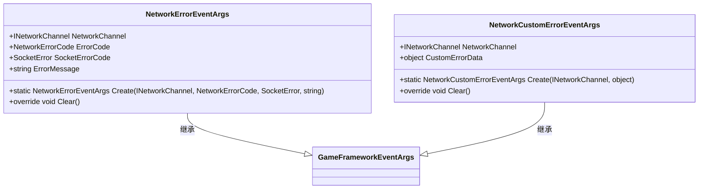
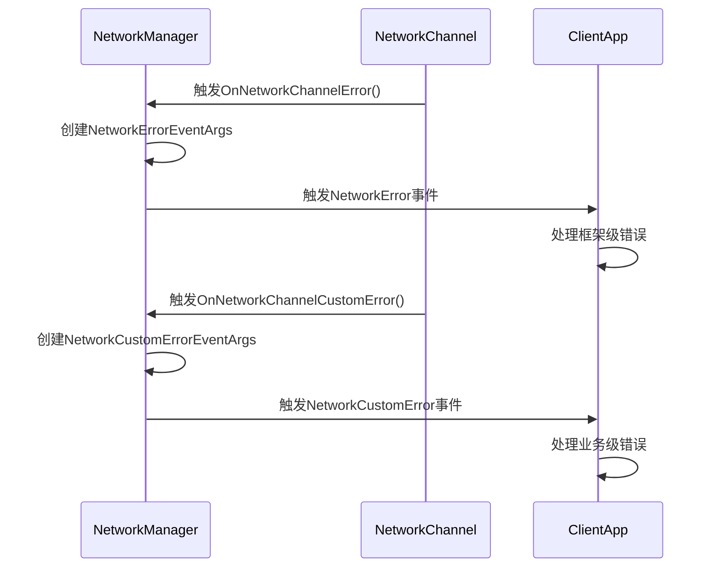

<cite>
**Referenced Files in This Document**   
- [NetworkErrorEventArgs.cs](file://GameFramework/Network/NetworkErrorEventArgs.cs)
- [NetworkCustomErrorEventArgs.cs](file://GameFramework/Network/NetworkCustomErrorEventArgs.cs)
- [NetworkErrorCode.cs](file://GameFramework/Network/NetworkErrorCode.cs)
- [NetworkManager.cs](file://GameFramework/Network/NetworkManager.cs)
</cite>

# 错误事件类型

## Table of Contents
1. [设计目的与使用场景](#设计目的与使用场景)
2. [字段结构对比](#字段结构对比)
3. [事件订阅与处理](#事件订阅与处理)

## 设计目的与使用场景

`NetworkErrorEventArgs` 和 `NetworkCustomErrorEventArgs` 是框架中用于处理网络通信异常的两个核心事件类，分别服务于不同层级的错误报告机制。

`NetworkErrorEventArgs` 旨在报告框架层面的底层网络通信错误，适用于处理与网络连接、数据收发直接相关的系统级异常。其典型使用场景包括：网络连接失败（如目标服务器不可达）、数据发送或接收过程中出现异常（如Socket错误）、网络包序列化/反序列化失败等。这类错误通常由网络库或操作系统底层触发，反映了通信链路本身的故障。

`NetworkCustomErrorEventArgs` 则用于传递用户自定义的业务逻辑错误。它不关注底层通信是否成功，而是为上层应用提供一个通道，用于报告在成功通信后，由业务逻辑本身引发的错误。例如，服务器返回了一个表示“用户余额不足”的业务错误码，或者客户端解析服务器响应时发现数据不符合业务规则。这种设计将底层网络问题与上层业务问题解耦，使错误处理逻辑更加清晰。

**Section sources**
- [NetworkErrorEventArgs.cs](file://GameFramework/Network/NetworkErrorEventArgs.cs#L14-L91)
- [NetworkCustomErrorEventArgs.cs](file://GameFramework/Network/NetworkCustomErrorEventArgs.cs#L12-L63)

## 字段结构对比

两个事件类的字段设计体现了其不同的职责和使用范围。

`NetworkErrorEventArgs` 包含了三个关键字段，专门用于描述底层网络异常：
- **ErrorCode**: 类型为 `NetworkErrorCode`，是一个枚举值，用于标识框架内部定义的错误类型，如 `ConnectError`（连接错误）、`SendError`（发送错误）、`ReceiveError`（接收错误）等。这为错误分类提供了统一的标准。
- **SocketErrorCode**: 类型为 `SocketError`，直接封装了来自底层Socket API的错误码，提供了最原始的错误信息，便于进行深度调试。
- **ErrorMessage**: 类型为 `string`，用于承载可读的错误描述信息，方便开发者和用户理解错误原因。

相比之下，`NetworkCustomErrorEventArgs` 的设计更为灵活，其核心字段是：
- **CustomErrorData**: 类型为 `object`，这是一个通用对象，允许开发者封装任意结构的自定义错误数据。例如，可以是一个包含错误码、错误消息和附加数据的复杂对象，也可以是一个简单的字符串或整数。这种设计提供了极大的灵活性，能够满足各种复杂的业务错误报告需求。



**Diagram sources**
- [NetworkErrorEventArgs.cs](file://GameFramework/Network/NetworkErrorEventArgs.cs#L14-L91)
- [NetworkCustomErrorEventArgs.cs](file://GameFramework/Network/NetworkCustomErrorEventArgs.cs#L12-L63)

## 事件订阅与处理

客户端通过订阅 `NetworkManager` 提供的事件来监听这两种错误。`NetworkManager` 定义了两个独立的事件委托，确保了错误的精确区分。



**Diagram sources**
- [NetworkManager.cs](file://GameFramework/Network/NetworkManager.cs#L29-L350)

以下是事件订阅和处理的代码示例：

```csharp
// 假设 networkManager 是一个已初始化的 NetworkManager 实例

// 订阅框架级网络错误
networkManager.NetworkError += OnNetworkError;

// 订阅用户自定义业务错误
networkManager.NetworkCustomError += OnNetworkCustomError;

// 处理框架级错误
private void OnNetworkError(object sender, NetworkErrorEventArgs e)
{
    // 从事件参数中提取关键信息
    var channel = e.NetworkChannel;
    var errorCode = e.ErrorCode;
    var socketErrorCode = e.SocketErrorCode;
    var errorMessage = e.ErrorMessage;

    // 根据错误码进行处理
    switch (errorCode)
    {
        case NetworkErrorCode.ConnectError:
            // 处理连接失败，例如提示用户检查网络
            break;
        case NetworkErrorCode.SendError:
            // 处理发送失败，可能需要重试
            break;
        default:
            // 处理其他错误
            break;
    }
}

// 处理用户自定义业务错误
private void OnNetworkCustomError(object sender, NetworkCustomErrorEventArgs e)
{
    // 从事件参数中提取自定义错误数据
    var customData = e.CustomErrorData;

    // 将 object 类型转换为实际的业务错误对象
    if (customData is MyBusinessError businessError)
    {
        // 根据业务错误码进行处理
        switch (businessError.Code)
        {
            case 1001:
                // 处理“余额不足”错误
                break;
            case 1002:
                // 处理“权限不足”错误
                break;
            default:
                // 处理其他业务错误
                break;
        }
    }
}
```

**Section sources**
- [NetworkManager.cs](file://GameFramework/Network/NetworkManager.cs#L29-L350)
- [NetworkErrorEventArgs.cs](file://GameFramework/Network/NetworkErrorEventArgs.cs#L71-L79)
- [NetworkCustomErrorEventArgs.cs](file://GameFramework/Network/NetworkCustomErrorEventArgs.cs#L47-L53)