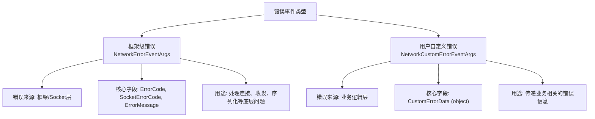

# 错误处理

<cite>
**Referenced Files in This Document**   
- [NetworkErrorEventArgs.cs](file://GameFramework/Network/NetworkErrorEventArgs.cs)
- [NetworkCustomErrorEventArgs.cs](file://GameFramework/Network/NetworkCustomErrorEventArgs.cs)
- [NetworkErrorCode.cs](file://GameFramework/Network/NetworkErrorCode.cs)
- [NetworkManager.cs](file://GameFramework/Network/NetworkManager.cs)
- [INetworkManager.cs](file://GameFramework/Network/INetworkManager.cs)
</cite>

## 目录
1. [引言](#引言)
2. [核心事件类型对比](#核心事件类型对比)
3. [网络错误码详解](#网络错误码详解)
4. [自定义错误数据设计](#自定义错误数据设计)
5. [错误事件监听与处理](#错误事件监听与处理)
6. [典型应对策略](#典型应对策略)
7. [总结](#总结)

## 引言

本文档系统性地阐述了游戏框架中的网络错误处理体系。该体系通过事件驱动机制，区分了框架级网络异常与用户自定义业务错误，为开发者提供了清晰、灵活的错误处理方案。文档将深入解析关键事件类、错误码枚举、自定义数据结构的设计原理，并提供完整的事件监听与错误应对策略。

## 核心事件类型对比

网络错误处理体系的核心在于区分两种不同性质的错误事件：`NetworkErrorEventArgs` 用于处理底层框架级错误，而 `NetworkCustomErrorEventArgs` 用于传递用户自定义的业务逻辑错误。

### 框架级错误事件 (NetworkErrorEventArgs)

`NetworkErrorEventArgs` 事件类专门用于封装由网络底层（如Socket层）引发的系统性错误。当发生连接失败、数据收发异常或序列化错误时，框架会自动触发此事件。

该事件提供了详细的错误信息，包括：
- **错误码 (ErrorCode)**: 一个 `NetworkErrorCode` 枚举值，精确标识错误类型。
- **Socket错误码 (SocketErrorCode)**: 来自底层Socket API的原生错误码，用于深度诊断。
- **错误信息 (ErrorMessage)**: 人类可读的错误描述字符串。

此事件的创建和分发由 `NetworkManager` 内部的 `OnNetworkChannelError` 方法管理，确保了框架级错误的统一处理。

**Section sources**
- [NetworkErrorEventArgs.cs](file://GameFramework/Network/NetworkErrorEventArgs.cs#L14-L91)
- [NetworkManager.cs](file://GameFramework/Network/NetworkManager.cs#L326-L337)

### 用户自定义错误事件 (NetworkCustomErrorEventArgs)

`NetworkCustomErrorEventArgs` 事件类为上层业务逻辑提供了自定义错误传递的通道。当业务层检测到特定的、非框架级的错误条件时（例如，服务器返回了表示“余额不足”的业务错误码），可以使用此事件将结构化的错误数据传递给监听者。

该事件的核心是 `CustomErrorData` 字段，其类型为 `object`，允许开发者传递任意序列化的数据对象，如包含错误码、消息和附加信息的自定义类实例。

此事件的触发由 `NetworkManager` 的 `OnNetworkChannelCustomError` 方法负责，它接收一个 `object` 类型的 `customErrorData` 参数，并将其封装后广播。

**Section sources**
- [NetworkCustomErrorEventArgs.cs](file://GameFramework/Network/NetworkCustomErrorEventArgs.cs#L12-L63)
- [NetworkManager.cs](file://GameFramework/Network/NetworkManager.cs#L339-L350)

### 事件对比总结



**Diagram sources**
- [NetworkErrorEventArgs.cs](file://GameFramework/Network/NetworkErrorEventArgs.cs#L14-L91)
- [NetworkCustomErrorEventArgs.cs](file://GameFramework/Network/NetworkCustomErrorEventArgs.cs#L12-L63)

## 网络错误码详解

`NetworkErrorCode` 枚举定义了框架级网络错误的分类，每个枚举值对应一种特定的错误场景。

### NetworkErrorCode 枚举值及其触发条件

| 错误码 (NetworkErrorCode) | 触发条件 |
| :--- | :--- |
| **Unknown** | 未知错误，当错误原因无法归类时使用。 |
| **AddressFamilyError** | 地址族错误，通常在创建Socket时指定的地址族（如IPv4/IPv6）不支持或配置错误时触发。 |
| **SocketError** | 通用的Socket操作错误，可能由底层Socket API调用失败引起。 |
| **ConnectError** | 连接错误，在尝试连接到服务器时失败（如连接超时、目标主机拒绝连接）。 |
| **SendError** | 发送错误，在向网络通道写入数据时发生异常。 |
| **ReceiveError** | 接收错误，在从网络通道读取数据时发生异常。 |
| **SerializeError** | 序列化错误，在将消息对象转换为字节流以供发送时失败。 |
| **DeserializePacketHeaderError** | 反序列化消息包头错误，在解析接收到的数据包头部信息时失败。 |
| **DeserializePacketError** | 反序列化消息包错误，在将接收到的字节流转换为完整的消息对象时失败。 |

这些错误码为开发者提供了标准化的错误分类，便于根据错误类型执行不同的恢复或提示逻辑。

**Section sources**
- [NetworkErrorCode.cs](file://GameFramework/Network/NetworkErrorCode.cs#L12-L58)

## 自定义错误数据设计

`customErrorData` 是 `NetworkCustomErrorEventArgs` 事件的核心，其设计旨在提供最大的灵活性。

### 结构设计

`customErrorData` 的类型为 `object`，这意味着它可以承载任何可序列化的数据结构。最佳实践是定义一个专门的类来封装业务错误信息，例如：

```csharp
public class BusinessErrorData
{
    public int Code { get; set; }
    public string Message { get; set; }
    public object ExtraData { get; set; }
}
```

### 序列化要求

由于 `customErrorData` 最终需要通过网络传输或在不同系统间传递，因此其承载的对象必须满足以下序列化要求：
1.  **可序列化**: 对象及其所有成员都必须是可序列化的。
2.  **类型兼容性**: 发送方和接收方必须对 `customErrorData` 的实际类型有共识，或具备类型识别和反序列化的能力。
3.  **轻量级**: 为保证网络性能，应避免传递过于庞大的对象。

框架通过 `ReferencePool` 管理 `NetworkCustomErrorEventArgs` 实例的生命周期，`customErrorData` 作为引用被持有，确保了数据传递的效率。

**Section sources**
- [NetworkCustomErrorEventArgs.cs](file://GameFramework/Network/NetworkCustomErrorEventArgs.cs#L12-L63)
- [NetworkManager.cs](file://GameFramework/Network/NetworkManager.cs#L339-L350)

## 错误事件监听与处理

开发者需要通过订阅 `INetworkManager` 接口暴露的事件来监听网络错误。

### 事件监听代码模板

以下是一个典型的事件监听代码模板：

```csharp
// 假设 networkManager 是 INetworkManager 的实例
networkManager.NetworkError += OnNetworkError;
networkManager.NetworkCustomError += OnNetworkCustomError;

private void OnNetworkError(object sender, NetworkErrorEventArgs e)
{
    // 处理框架级错误
    Log.Error($"网络错误: {e.ErrorCode}, Socket错误: {e.SocketErrorCode}, 信息: {e.ErrorMessage}");
    // 根据 e.ErrorCode 执行相应逻辑
    HandleFrameworkError(e.NetworkChannel, e.ErrorCode);
}

private void OnNetworkCustomError(object sender, NetworkCustomErrorEventArgs e)
{
    // 处理用户自定义错误
    var businessError = e.CustomErrorData as BusinessErrorData;
    if (businessError != null)
    {
        Log.Warning($"业务错误: {businessError.Code}, {businessError.Message}");
        // 根据 businessError.Code 执行相应逻辑
        HandleBusinessError(e.NetworkChannel, businessError);
    }
}

// 在适当时机（如退出游戏）取消订阅
private void UnsubscribeEvents()
{
    networkManager.NetworkError -= OnNetworkError;
    networkManager.NetworkCustomError -= OnNetworkCustomError;
}
```

**Section sources**
- [INetworkManager.cs](file://GameFramework/Network/INetworkManager.cs#L43-L48)
- [NetworkErrorEventArgs.cs](file://GameFramework/Network/NetworkErrorEventArgs.cs#L14-L91)
- [NetworkCustomErrorEventArgs.cs](file://GameFramework/Network/NetworkCustomErrorEventArgs.cs#L12-L63)

## 典型应对策略

根据监听到的错误类型，可以实施以下典型应对策略：

### 断线重连

当 `NetworkErrorEventArgs` 的 `ErrorCode` 为 `ConnectError` 或 `ReceiveError` 时，表明连接已中断，应启动重连逻辑。

```csharp
private void HandleFrameworkError(INetworkChannel channel, NetworkErrorCode errorCode)
{
    switch (errorCode)
    {
        case NetworkErrorCode.ConnectError:
        case NetworkErrorCode.ReceiveError:
            // 启动重连协程或计时器
            StartCoroutine(RetryConnect(channel));
            break;
        // ... 其他错误处理
    }
}
```

### 错误日志记录

所有错误都应被记录，以便后续分析。框架级错误使用 `Log.Error`，业务错误使用 `Log.Warning`。

```csharp
Log.Error($"[NetworkError] Channel: {e.NetworkChannel.Name}, Code: {e.ErrorCode}, Msg: {e.ErrorMessage}");
Log.Warning($"[BusinessError] Code: {businessError.Code}, Msg: {businessError.Message}");
```

### 用户提示

对于影响用户体验的错误，应及时向用户展示友好的提示信息。

```csharp
private void HandleBusinessError(INetworkChannel channel, BusinessErrorData error)
{
    switch (error.Code)
    {
        case 1001:
            ShowMessage("余额不足，请充值。");
            break;
        case 1002:
            ShowMessage("您的账号已在其他地方登录。");
            break;
        // ... 其他业务错误码
    }
}
```

**Section sources**
- [NetworkErrorEventArgs.cs](file://GameFramework/Network/NetworkErrorEventArgs.cs#L14-L91)
- [NetworkCustomErrorEventArgs.cs](file://GameFramework/Network/NetworkCustomErrorEventArgs.cs#L12-L63)

## 总结

本框架的网络错误处理体系通过 `NetworkErrorEventArgs` 和 `NetworkCustomErrorEventArgs` 两个事件类，清晰地划分了系统错误与业务错误的界限。`NetworkErrorCode` 枚举提供了标准化的错误分类，而 `customErrorData` 的设计则赋予了业务层极大的灵活性。通过订阅 `INetworkManager` 的事件，开发者可以实现断线重连、日志记录和用户提示等关键功能，构建出健壮、用户体验良好的网络应用。