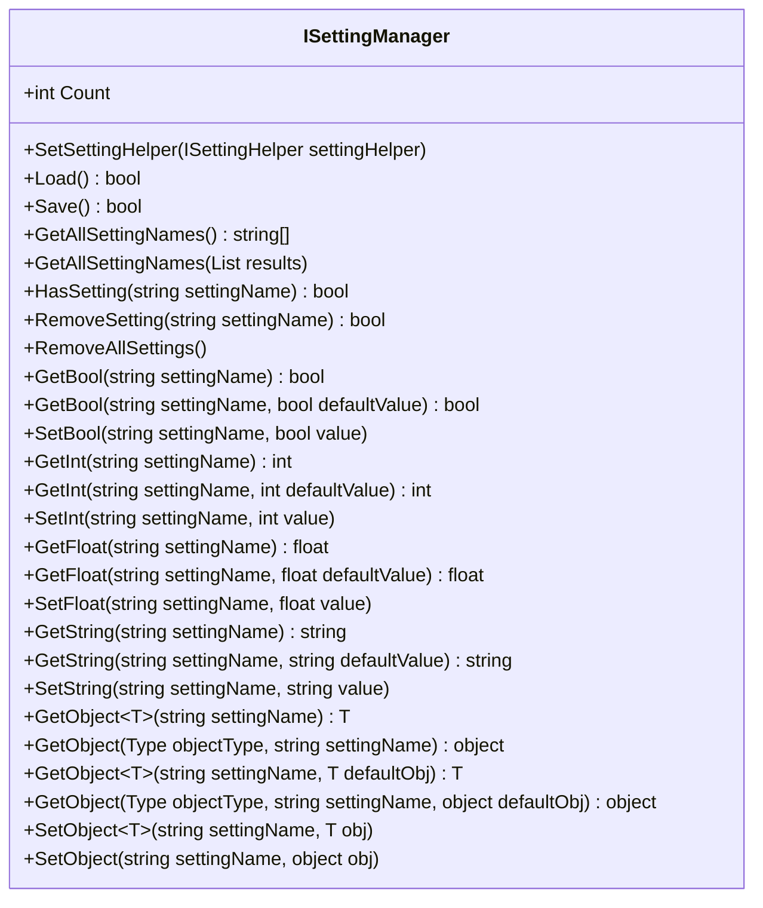
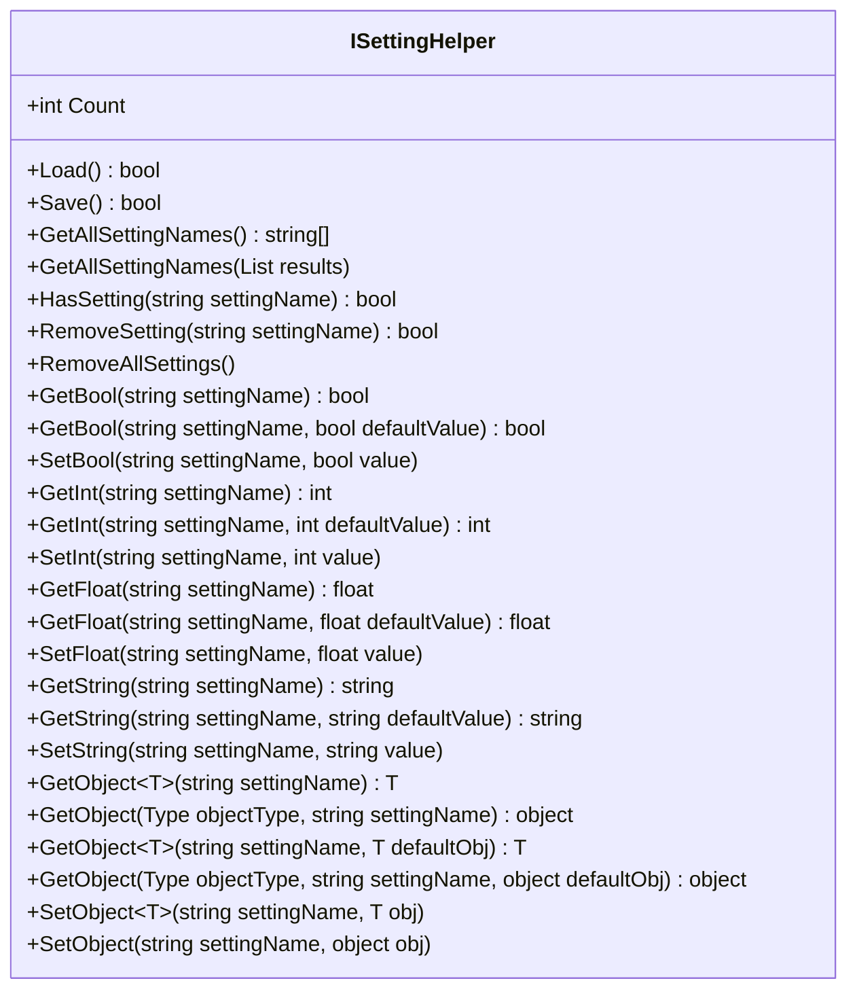
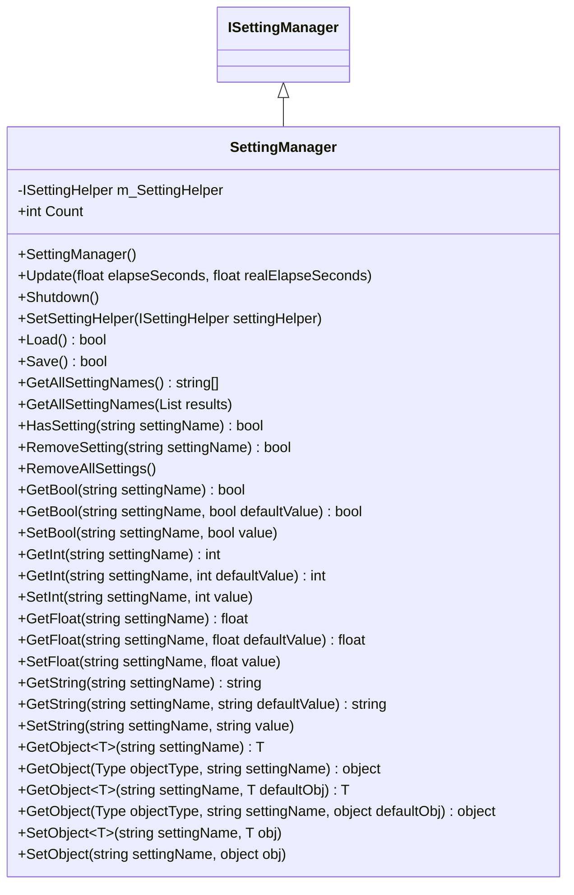
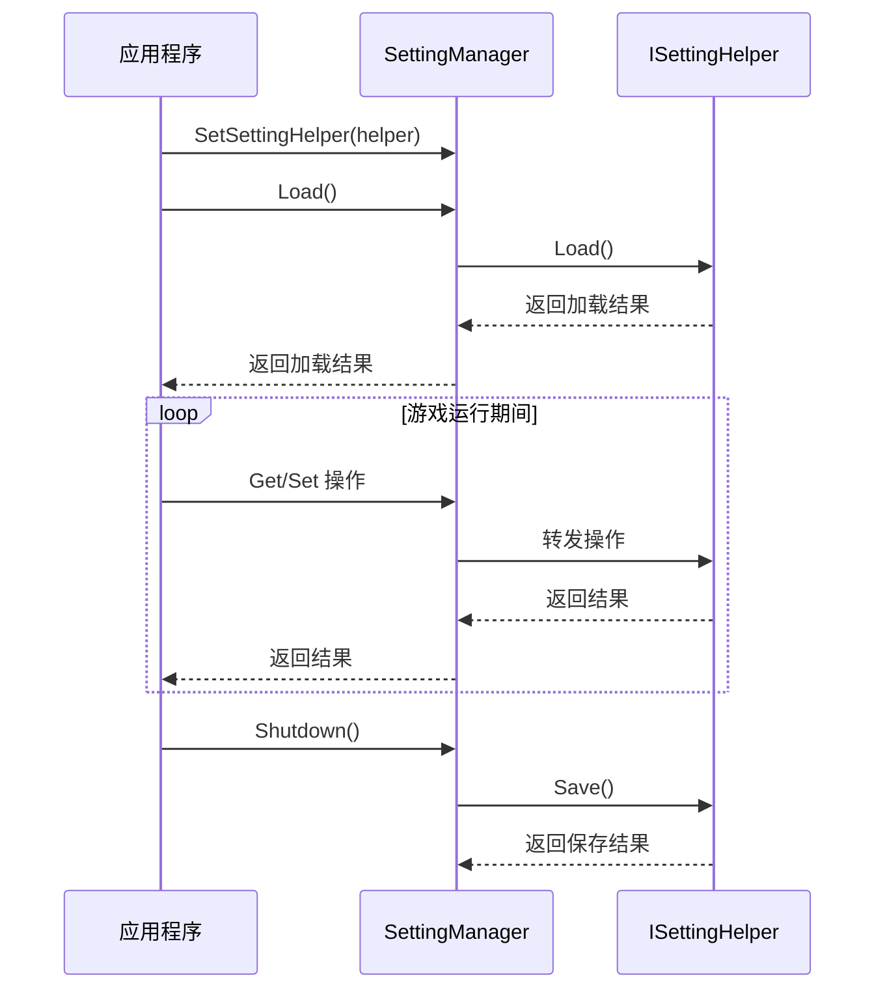
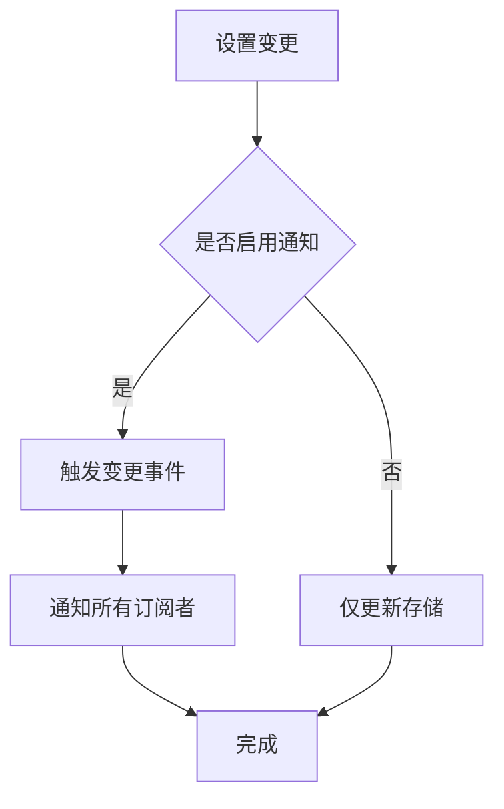
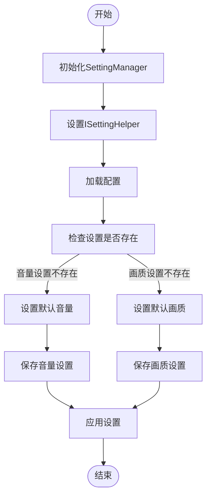
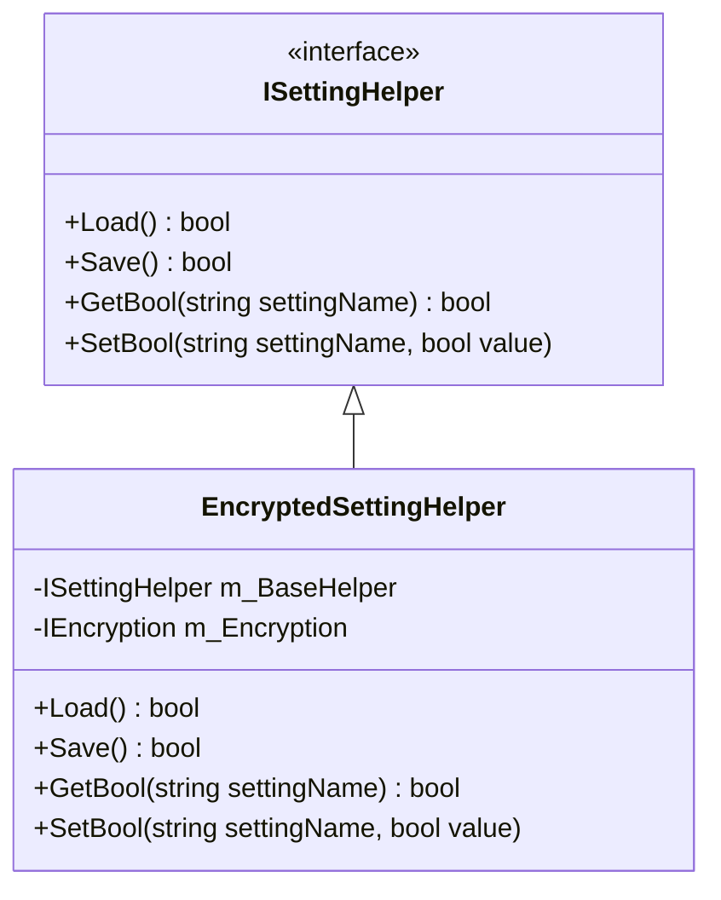

# 设置管理

<cite>
**本文档中引用的文件**  
- [ISettingManager.cs](file://GameFramework/Setting/ISettingManager.cs)
- [SettingManager.cs](file://GameFramework/Setting/SettingManager.cs)
- [ISettingHelper.cs](file://GameFramework/Setting/ISettingHelper.cs)
</cite>

## 目录
1. [简介](#简介)
2. [核心接口设计](#核心接口设计)
3. [实现类分析](#实现类分析)
4. [数据类型支持](#数据类型支持)
5. [持久化与跨平台兼容性](#持久化与跨平台兼容性)
6. [变更通知机制](#变更通知机制)
7. [常用设置管理示例](#常用设置管理示例)
8. [加密存储选项](#加密存储选项)

## 简介
设置管理模块负责玩家偏好设置的存储、读取、持久化及跨平台兼容性处理。该模块通过封装Unity的PlayerPrefs并提供更安全、高效的API，实现了对游戏配置项的统一管理。本模块采用接口与实现分离的设计模式，通过`ISettingManager`定义核心功能，`SettingManager`提供具体实现，并通过`ISettingHelper`辅助器接口实现底层存储逻辑的解耦。

**Section sources**
- [ISettingManager.cs](file://GameFramework/Setting/ISettingManager.cs#L15-L210)
- [SettingManager.cs](file://GameFramework/Setting/SettingManager.cs#L15-L563)

## 核心接口设计

### ISettingManager接口
`ISettingManager`接口定义了游戏配置管理器的核心功能，包括配置项的增删改查、加载保存等操作。该接口通过泛型方法支持多种数据类型的读写，并提供默认值参数以处理配置项不存在的情况。

**Diagram sources**
- [ISettingManager.cs](file://GameFramework/Setting/ISettingManager.cs#L15-L210)

**Section sources**
- [ISettingManager.cs](file://GameFramework/Setting/ISettingManager.cs#L15-L210)

### ISettingHelper接口
`ISettingHelper`接口作为底层存储辅助器，负责具体的加载、保存和数据读写操作。该接口与`ISettingManager`具有相似的方法签名，但专注于存储实现细节，使得上层管理器可以灵活切换不同的存储策略。

**Diagram sources**
- [ISettingHelper.cs](file://GameFramework/Setting/ISettingHelper.cs#L15-L204)

**Section sources**
- [ISettingHelper.cs](file://GameFramework/Setting/ISettingHelper.cs#L15-L204)

## 实现类分析

### SettingManager实现
`SettingManager`是`ISettingManager`接口的具体实现类，作为内部密封类，它继承自`GameFrameworkModule`并持有一个`ISettingHelper`类型的私有成员变量`m_SettingHelper`。该类通过委托模式将所有操作转发给`ISettingHelper`实例，实现了关注点分离。

**Diagram sources**
- [SettingManager.cs](file://GameFramework/Setting/SettingManager.cs#L15-L563)

**Section sources**
- [SettingManager.cs](file://GameFramework/Setting/SettingManager.cs#L15-L563)

## 数据类型支持
设置管理模块支持多种数据类型的存储与读取，包括基本数据类型和复杂对象类型：

| 数据类型 | 读取方法 | 写入方法 | 说明 |
|---------|---------|---------|------|
| 布尔值 | `GetBool()` | `SetBool()` | 支持带默认值的读取 |
| 整数值 | `GetInt()` | `SetInt()` | 支持带默认值的读取 |
| 浮点数值 | `GetFloat()` | `SetFloat()` | 支持带默认值的读取 |
| 字符串值 | `GetString()` | `SetString()` | 支持带默认值的读取 |
| 任意对象 | `GetObject<T>()` | `SetObject<T>()` | 通过序列化支持复杂对象存储 |

**Section sources**
- [ISettingManager.cs](file://GameFramework/Setting/ISettingManager.cs#L15-L210)

## 持久化与跨平台兼容性
设置管理模块通过`ISettingHelper`接口实现持久化操作的抽象，确保了跨平台兼容性。`Load()`和`Save()`方法分别负责从持久化存储加载配置和将当前配置保存到存储中。在`SettingManager`的`Shutdown()`方法中会自动调用`Save()`，确保应用退出时配置的持久化。

**Diagram sources**
- [SettingManager.cs](file://GameFramework/Setting/SettingManager.cs#L15-L563)
- [ISettingHelper.cs](file://GameFramework/Setting/ISettingHelper.cs#L15-L204)

**Section sources**
- [SettingManager.cs](file://GameFramework/Setting/SettingManager.cs#L15-L563)

## 变更通知机制
虽然当前代码中未直接体现变更通知机制，但通过`ISettingManager`和`ISettingHelper`的接口设计，可以很容易地扩展事件通知功能。当配置项发生变化时，可以在`Set`系列方法中触发相应的事件，通知订阅者配置已更新。

**Section sources**
- [ISettingManager.cs](file://GameFramework/Setting/ISettingManager.cs#L15-L210)

## 常用设置管理示例
以下示例展示了如何使用设置管理模块管理常见的游戏设置：

**Section sources**
- [SettingManager.cs](file://GameFramework/Setting/SettingManager.cs#L15-L563)

## 加密存储选项
虽然当前接口定义中未直接包含加密相关方法，但通过`ISettingHelper`的抽象设计，可以在具体实现中加入加密存储功能。例如，可以创建一个`EncryptedSettingHelper`类，它在保存数据前进行加密，在读取数据后进行解密，从而实现安全的配置存储。

**Section sources**
- [ISettingHelper.cs](file://GameFramework/Setting/ISettingHelper.cs#L15-L204)