# 调试器

<cite>
**本文档中引用的文件**   
- [IDebuggerManager.cs](file://GameFramework/Debugger/IDebuggerManager.cs)
- [DebuggerManager.cs](file://GameFramework/Debugger/DebuggerManager.cs)
- [IDebuggerWindow.cs](file://GameFramework/Debugger/IDebuggerWindow.cs)
- [IDebuggerWindowGroup.cs](file://GameFramework/Debugger/IDebuggerWindowGroup.cs)
</cite>

## 目录
1. [简介](#简介)
2. [调试器模块架构](#调试器模块架构)
3. [核心接口设计](#核心接口设计)
4. [调试窗口的创建与管理](#调试窗口的创建与管理)
5. [调试窗口分组显示](#调试窗口分组显示)
6. [运行时信息查看](#运行时信息查看)
7. [自定义调试面板扩展](#自定义调试面板扩展)
8. [集成自定义调试工具](#集成自定义调试工具)
9. [开发阶段实用技巧](#开发阶段实用技巧)
10. [依赖关系分析](#依赖关系分析)

## 简介
调试器模块为游戏框架提供了一套完整的调试解决方案，支持调试窗口的创建、管理、分组显示和自定义扩展。该模块允许开发者在运行时查看日志、性能指标、内存状态等关键信息，为开发和调试过程提供强大的支持。

**调试器模块的主要功能包括**：
- 调试窗口的动态注册和管理
- 调试窗口的分组和层级显示
- 运行时系统信息的实时监控
- 自定义调试面板的灵活扩展
- 调试工具的集成和使用

该模块通过清晰的接口设计和模块化架构，为开发者提供了高效、灵活的调试能力。

## 调试器模块架构

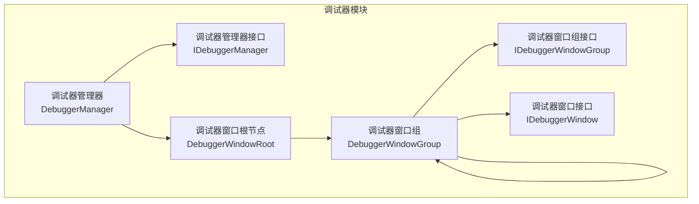

**图表来源**
- [IDebuggerManager.cs](file://GameFramework/Debugger/IDebuggerManager.cs#L12-L59)
- [DebuggerManager.cs](file://GameFramework/Debugger/DebuggerManager.cs#L12-L141)
- [IDebuggerWindowGroup.cs](file://GameFramework/Debugger/IDebuggerWindowGroup.cs#L12-L57)
- [IDebuggerWindow.cs](file://GameFramework/Debugger/IDebuggerWindow.cs#L12-L46)

**本节来源**
- [IDebuggerManager.cs](file://GameFramework/Debugger/IDebuggerManager.cs#L12-L59)
- [DebuggerManager.cs](file://GameFramework/Debugger/DebuggerManager.cs#L12-L141)

## 核心接口设计

### IDebuggerManager 接口

`IDebuggerManager` 接口定义了调试器管理器的核心功能，是调试器模块的入口点。

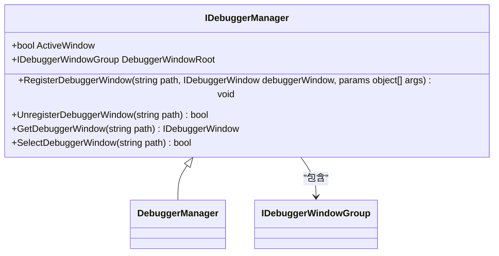

**接口成员说明**：
- `ActiveWindow`: 获取或设置调试器窗口是否激活
- `DebuggerWindowRoot`: 获取调试器窗口根节点
- `RegisterDebuggerWindow`: 注册调试器窗口
- `UnregisterDebuggerWindow`: 解除注册调试器窗口
- `GetDebuggerWindow`: 获取调试器窗口
- `SelectDebuggerWindow`: 选中调试器窗口

**图表来源**
- [IDebuggerManager.cs](file://GameFramework/Debugger/IDebuggerManager.cs#L12-L59)

**本节来源**
- [IDebuggerManager.cs](file://GameFramework/Debugger/IDebuggerManager.cs#L12-L59)

### IDebuggerWindow 接口

`IDebuggerWindow` 接口定义了所有调试窗口的基本行为和生命周期管理。

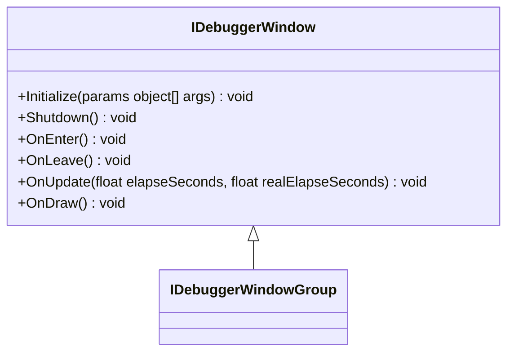

**接口成员说明**：
- `Initialize`: 初始化调试器窗口
- `Shutdown`: 关闭调试器窗口
- `OnEnter`: 进入调试器窗口
- `OnLeave`: 离开调试器窗口
- `OnUpdate`: 调试器窗口轮询
- `OnDraw`: 调试器窗口绘制

**图表来源**
- [IDebuggerWindow.cs](file://GameFramework/Debugger/IDebuggerWindow.cs#L12-L46)

**本节来源**
- [IDebuggerWindow.cs](file://GameFramework/Debugger/IDebuggerWindow.cs#L12-L46)

### IDebuggerWindowGroup 接口

`IDebuggerWindowGroup` 接口继承自 `IDebuggerWindow`，定义了调试器窗口组的管理功能。

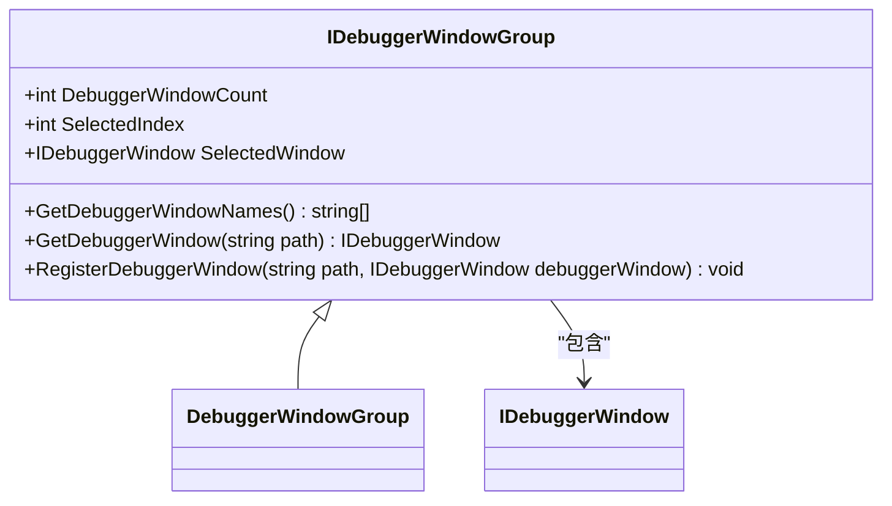

**接口成员说明**：
- `DebuggerWindowCount`: 获取调试器窗口数量
- `SelectedIndex`: 获取或设置当前选中的调试器窗口索引
- `SelectedWindow`: 获取当前选中的调试器窗口
- `GetDebuggerWindowNames`: 获取调试组的调试器窗口名称集合
- `GetDebuggerWindow`: 获取调试器窗口
- `RegisterDebuggerWindow`: 注册调试器窗口

**图表来源**
- [IDebuggerWindowGroup.cs](file://GameFramework/Debugger/IDebuggerWindowGroup.cs#L12-L57)

**本节来源**
- [IDebuggerWindowGroup.cs](file://GameFramework/Debugger/IDebuggerWindowGroup.cs#L12-L57)

## 调试窗口的创建与管理

调试窗口的创建和管理是调试器模块的核心功能之一。通过 `IDebuggerManager` 接口提供的方法，可以实现调试窗口的动态注册、获取和管理。

### 调试窗口注册流程

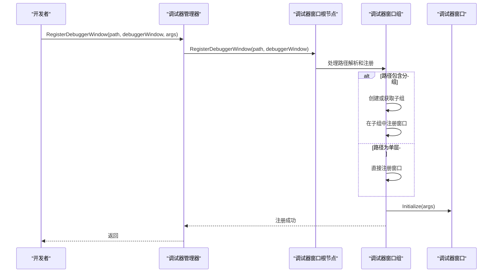

**图表来源**
- [DebuggerManager.cs](file://GameFramework/Debugger/DebuggerManager.cs#L88-L118)
- [DebuggerManager.DebuggerWindowGroup.cs](file://GameFramework/Debugger/DebuggerManager.DebuggerWindowGroup.cs#L198-L243)

**本节来源**
- [DebuggerManager.cs](file://GameFramework/Debugger/DebuggerManager.cs#L88-L118)
- [DebuggerManager.DebuggerWindowGroup.cs](file://GameFramework/Debugger/DebuggerManager.DebuggerWindowGroup.cs#L198-L243)

### 调试窗口生命周期管理

调试窗口的生命周期由以下方法管理：

1. **初始化**：通过 `Initialize` 方法进行初始化，接收可变参数作为初始化参数
2. **激活**：通过 `OnEnter` 方法进入调试器窗口
3. **更新**：通过 `OnUpdate` 方法进行轮询更新，接收逻辑流逝时间和真实流逝时间
4. **绘制**：通过 `OnDraw` 方法进行界面绘制
5. **离开**：通过 `OnLeave` 方法离开调试器窗口
6. **关闭**：通过 `Shutdown` 方法关闭并清理资源

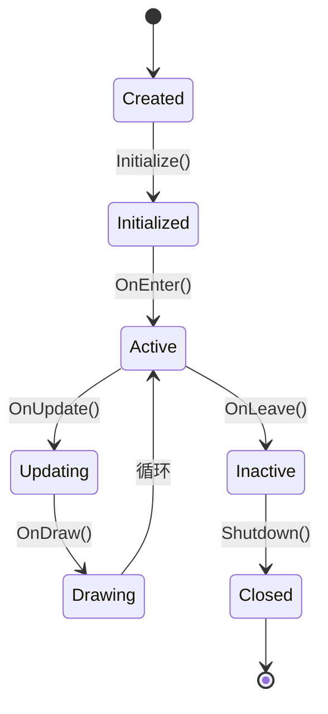

**图表来源**
- [IDebuggerWindow.cs](file://GameFramework/Debugger/IDebuggerWindow.cs#L12-L46)
- [DebuggerManager.DebuggerWindowGroup.cs](file://GameFramework/Debugger/DebuggerManager.DebuggerWindowGroup.cs#L89-L133)

**本节来源**
- [IDebuggerWindow.cs](file://GameFramework/Debugger/IDebuggerWindow.cs#L12-L46)
- [DebuggerManager.DebuggerWindowGroup.cs](file://GameFramework/Debugger/DebuggerManager.DebuggerWindowGroup.cs#L89-L133)

## 调试窗口分组显示

调试器模块支持通过路径系统实现调试窗口的分组显示，允许创建层级化的调试界面结构。

### 分组显示机制

调试窗口的分组通过路径字符串实现，路径使用斜杠 `/` 分隔，形成树状结构。例如：
- `System/Performance` 表示在 System 组下的 Performance 窗口
- `Network/Status` 表示在 Network 组下的 Status 窗口
- `Memory` 表示根节点下的 Memory 窗口

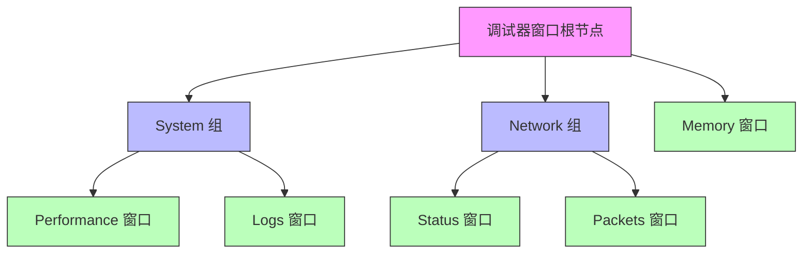

**图表来源**
- [DebuggerManager.DebuggerWindowGroup.cs](file://GameFramework/Debugger/DebuggerManager.DebuggerWindowGroup.cs#L135-L170)
- [DebuggerManager.DebuggerWindowGroup.cs](file://GameFramework/Debugger/DebuggerManager.DebuggerWindowGroup.cs#L241-L273)

**本节来源**
- [DebuggerManager.DebuggerWindowGroup.cs](file://GameFramework/Debugger/DebuggerManager.DebuggerWindowGroup.cs#L135-L170)
- [DebuggerManager.DebuggerWindowGroup.cs](file://GameFramework/Debugger/DebuggerManager.DebuggerWindowGroup.cs#L241-L273)

### 分组操作流程

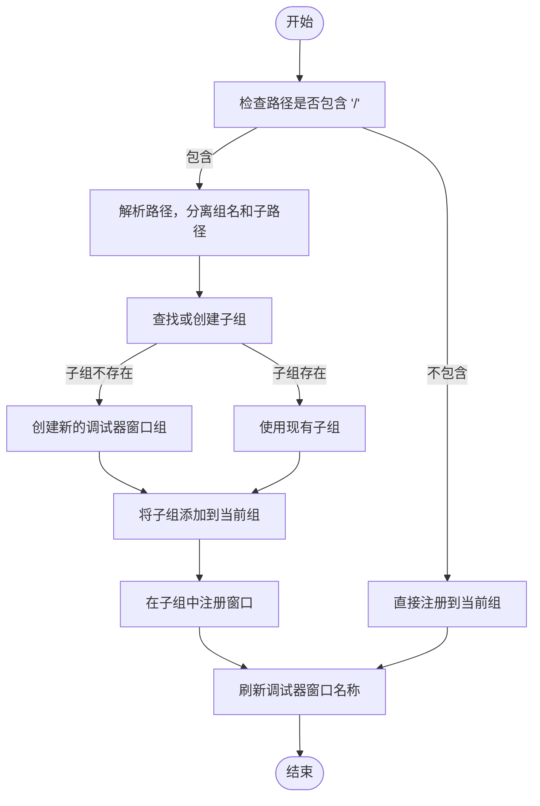

**图表来源**
- [DebuggerManager.DebuggerWindowGroup.cs](file://GameFramework/Debugger/DebuggerManager.DebuggerWindowGroup.cs#L221-L243)
- [DebuggerManager.DebuggerWindowGroup.cs](file://GameFramework/Debugger/DebuggerManager.DebuggerWindowGroup.cs#L275-L306)

**本节来源**
- [DebuggerManager.DebuggerWindowGroup.cs](file://GameFramework/Debugger/DebuggerManager.DebuggerWindowGroup.cs#L221-L243)
- [DebuggerManager.DebuggerWindowGroup.cs](file://GameFramework/Debugger/DebuggerManager.DebuggerWindowGroup.cs#L275-L306)

## 运行时信息查看

调试器模块提供了在运行时查看各种系统信息的能力，包括日志、性能指标和内存状态等。

### 信息查看架构

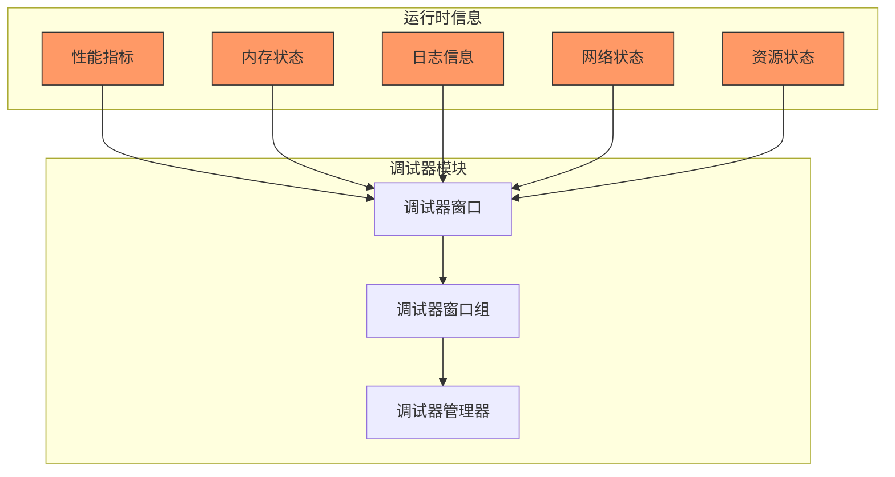

**图表来源**
- [DebuggerManager.cs](file://GameFramework/Debugger/DebuggerManager.cs#L38-L86)
- [IDebuggerWindow.cs](file://GameFramework/Debugger/IDebuggerWindow.cs#L12-L46)

**本节来源**
- [DebuggerManager.cs](file://GameFramework/Debugger/DebuggerManager.cs#L38-L86)
- [IDebuggerWindow.cs](file://GameFramework/Debugger/IDebuggerWindow.cs#L12-L46)

### 信息更新流程

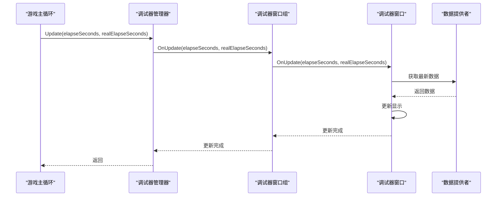

**图表来源**
- [DebuggerManager.cs](file://GameFramework/Debugger/DebuggerManager.cs#L38-L86)
- [DebuggerManager.DebuggerWindowGroup.cs](file://GameFramework/Debugger/DebuggerManager.DebuggerWindowGroup.cs#L89-L133)

**本节来源**
- [DebuggerManager.cs](file://GameFramework/Debugger/DebuggerManager.cs#L38-L86)
- [DebuggerManager.DebuggerWindowGroup.cs](file://GameFramework/Debugger/DebuggerManager.DebuggerWindowGroup.cs#L89-L133)

## 自定义调试面板扩展

调试器模块支持通过实现 `IDebuggerWindow` 接口来创建自定义调试面板，为开发者提供灵活的扩展能力。

### 扩展实现流程

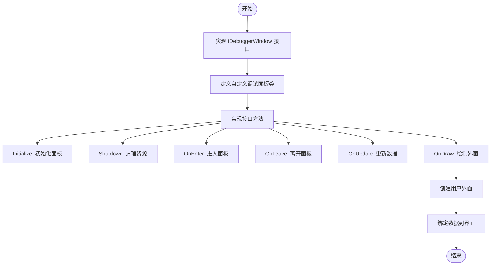

**图表来源**
- [IDebuggerWindow.cs](file://GameFramework/Debugger/IDebuggerWindow.cs#L12-L46)
- [DebuggerManager.cs](file://GameFramework/Debugger/DebuggerManager.cs#L88-L118)

**本节来源**
- [IDebuggerWindow.cs](file://GameFramework/Debugger/IDebuggerWindow.cs#L12-L46)
- [DebuggerManager.cs](file://GameFramework/Debugger/DebuggerManager.cs#L88-L118)

### 扩展注册示例

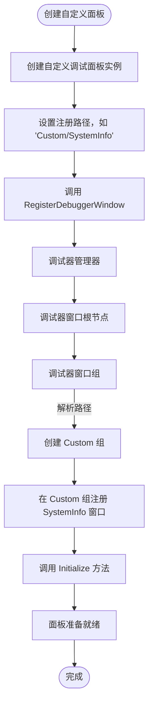

**图表来源**
- [DebuggerManager.cs](file://GameFramework/Debugger/DebuggerManager.cs#L88-L118)
- [DebuggerManager.DebuggerWindowGroup.cs](file://GameFramework/Debugger/DebuggerManager.DebuggerWindowGroup.cs#L221-L243)

**本节来源**
- [DebuggerManager.cs](file://GameFramework/Debugger/DebuggerManager.cs#L88-L118)
- [DebuggerManager.DebuggerWindowGroup.cs](file://GameFramework/Debugger/DebuggerManager.DebuggerWindowGroup.cs#L221-L243)

## 集成自定义调试工具

调试器模块提供了集成自定义调试工具的完整解决方案，允许开发者将各种调试工具集成到统一的调试界面中。

### 工具集成架构

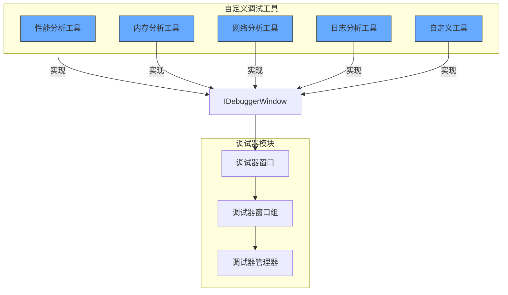

**图表来源**
- [IDebuggerWindow.cs](file://GameFramework/Debugger/IDebuggerWindow.cs#L12-L46)
- [IDebuggerWindowGroup.cs](file://GameFramework/Debugger/IDebuggerWindowGroup.cs#L12-L57)

**本节来源**
- [IDebuggerWindow.cs](file://GameFramework/Debugger/IDebuggerWindow.cs#L12-L46)
- [IDebuggerWindowGroup.cs](file://GameFramework/Debugger/IDebuggerWindowGroup.cs#L12-L57)

### 集成流程

```mermaid
sequenceDiagram
    participant Developer as "开发者"
    participant CustomTool as "自定义调试工具"
    participant DebuggerManager as "调试器管理器"
    
    Developer->>CustomTool: 实现 IDebuggerWindow 接口
    CustomTool->>CustomTool: 实现所有必需方法
    Developer->>DebuggerManager: 获取 IDebuggerManager 实例
    DebuggerManager-->>Developer: 返回实例
    Developer->>DebuggerManager: 调用 RegisterDebuggerWindow
    DebuggerManager->>DebuggerManager: 验证参数
    DebuggerManager->>DebuggerWindowRoot: 调用 RegisterDebuggerWindow
    DebuggerWindowRoot->>