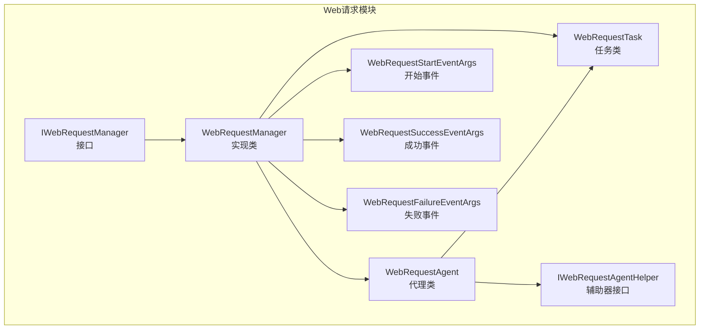
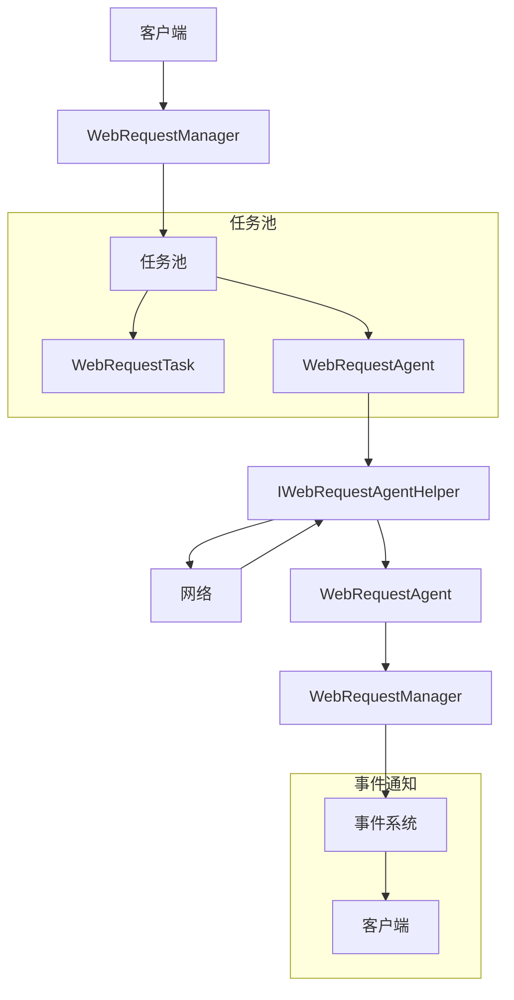
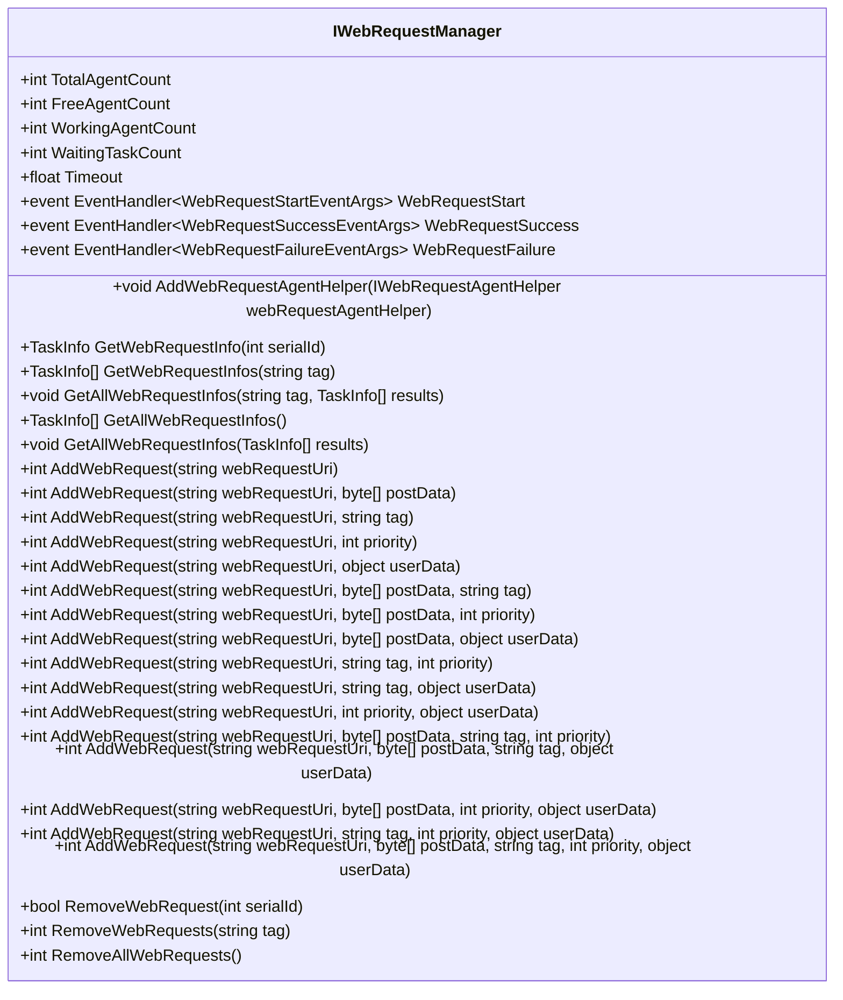
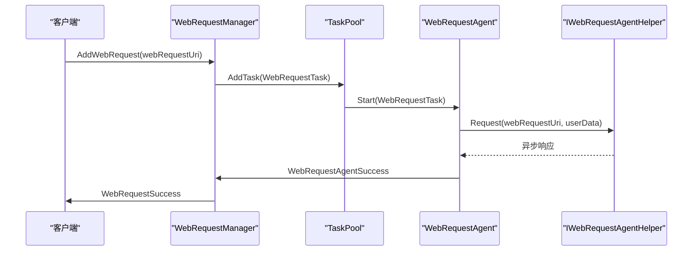
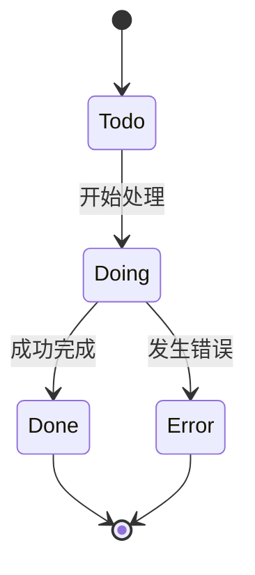
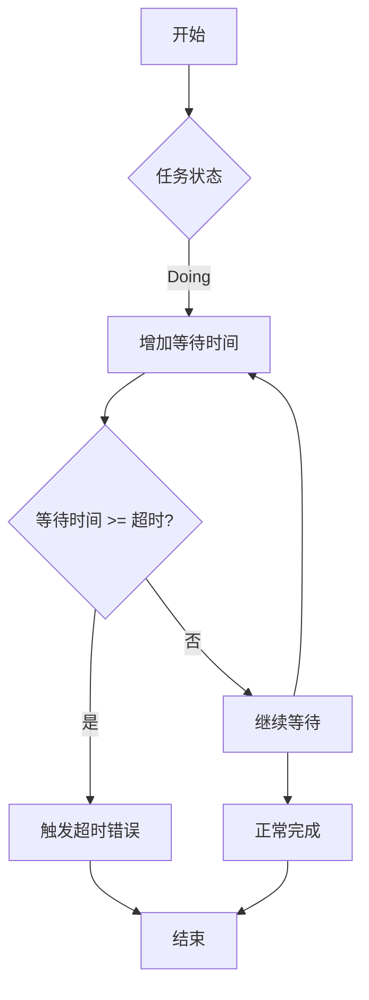
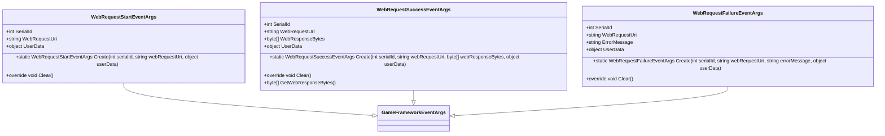
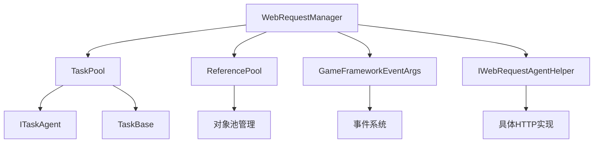

# Web请求

<cite>
**本文档引用的文件**
- [IWebRequestManager.cs](file://GameFramework/WebRequest/IWebRequestManager.cs)
- [WebRequestManager.cs](file://GameFramework/WebRequest/WebRequestManager.cs)
- [WebRequestManager.WebRequestAgent.cs](file://GameFramework/WebRequest/WebRequestManager.WebRequestAgent.cs)
- [WebRequestManager.WebRequestTask.cs](file://GameFramework/WebRequest/WebRequestManager.WebRequestTask.cs)
- [WebRequestStartEventArgs.cs](file://GameFramework/WebRequest/WebRequestStartEventArgs.cs)
- [IWebRequestAgentHelper.cs](file://GameFramework/WebRequest/IWebRequestAgentHelper.cs)
- [Constant.cs](file://GameFramework/WebRequest/Constant.cs)
- [TaskPool.cs](file://GameFramework/Base/TaskPool/TaskPool.cs)
</cite>

## 目录
1. [简介](#简介)
2. [项目结构](#项目结构)
3. [核心组件](#核心组件)
4. [架构概述](#架构概述)
5. [详细组件分析](#详细组件分析)
6. [依赖分析](#依赖分析)
7. [性能考虑](#性能考虑)
8. [故障排除指南](#故障排除指南)
9. [结论](#结论)

## 简介
本文档系统化地记录了Web请求功能，重点解析了IWebRequestManager接口和WebRequestManager类实现的HTTP通信机制。详细说明了WebRequestTask任务的创建、调度和执行流程，包括请求超时、重试策略和并发控制。结合WebRequestStartEventArgs等事件类，描述了请求过程中的状态通知机制。深入阐述了WebRequestAgent代理的工作原理，包括连接池管理、请求头设置和响应解析。提供了GET/POST请求、文件上传下载和自定义请求头的代码示例，并讨论了如何通过IWebRequestAgentHelper扩展自定义网络行为。

## 项目结构
Web请求功能位于GameFramework/WebRequest目录下，是GameFramework框架的一部分。该模块通过任务池机制管理HTTP请求，实现了高效的并发控制和资源管理。核心组件包括IWebRequestManager接口、WebRequestManager实现类、WebRequestAgent代理类和WebRequestTask任务类，配合事件系统实现完整的请求生命周期管理。

**图示来源**
- [IWebRequestManager.cs](file://GameFramework/WebRequest/IWebRequestManager.cs)
- [WebRequestManager.cs](file://GameFramework/WebRequest/WebRequestManager.cs)
- [WebRequestManager.WebRequestAgent.cs](file://GameFramework/WebRequest/WebRequestManager.WebRequestAgent.cs)
- [WebRequestManager.WebRequestTask.cs](file://GameFramework/WebRequest/WebRequestManager.WebRequestTask.cs)
- [IWebRequestAgentHelper.cs](file://GameFramework/WebRequest/IWebRequestAgentHelper.cs)

**本节来源**
- [IWebRequestManager.cs](file://GameFramework/WebRequest/IWebRequestManager.cs)
- [WebRequestManager.cs](file://GameFramework/WebRequest/WebRequestManager.cs)

## 核心组件
Web请求系统的核心组件包括IWebRequestManager接口、WebRequestManager实现类、WebRequestAgent代理类和WebRequestTask任务类。这些组件协同工作，实现了完整的HTTP请求管理功能。IWebRequestManager定义了Web请求管理器的公共接口，WebRequestManager提供了具体实现，WebRequestAgent负责实际的请求执行，而WebRequestTask则封装了请求的具体信息和状态。

**本节来源**
- [IWebRequestManager.cs](file://GameFramework/WebRequest/IWebRequestManager.cs)
- [WebRequestManager.cs](file://GameFramework/WebRequest/WebRequestManager.cs)
- [WebRequestManager.WebRequestAgent.cs](file://GameFramework/WebRequest/WebRequestManager.WebRequestAgent.cs)
- [WebRequestManager.WebRequestTask.cs](file://GameFramework/WebRequest/WebRequestManager.WebRequestTask.cs)

## 架构概述
Web请求系统采用任务池架构模式，将HTTP请求抽象为任务进行管理。WebRequestManager作为核心管理器，维护着一个任务池，负责任务的调度和代理的分配。当添加新的Web请求时，系统创建WebRequestTask实例并加入等待队列。可用的WebRequestAgent从队列中获取任务并执行HTTP请求。整个系统通过事件机制通知请求的开始、成功和失败状态，实现了松耦合的设计。

**图示来源**
- [WebRequestManager.cs](file://GameFramework/WebRequest/WebRequestManager.cs)
- [WebRequestManager.WebRequestAgent.cs](file://GameFramework/WebRequest/WebRequestManager.WebRequestAgent.cs)
- [WebRequestManager.WebRequestTask.cs](file://GameFramework/WebRequest/WebRequestManager.WebRequestTask.cs)

## 详细组件分析
Web请求系统的各个组件紧密协作，实现了高效、可靠的HTTP通信功能。每个组件都有明确的职责和接口，通过清晰的调用关系完成整个请求流程。

### IWebRequestManager接口分析
IWebRequestManager接口定义了Web请求管理器的公共契约，提供了对请求状态的监控和管理功能。接口包含获取代理数量、任务数量、超时设置等属性，以及添加请求、移除请求、获取任务信息等方法。通过事件机制，外部系统可以订阅请求的开始、成功和失败事件，实现异步通知。

**图示来源**
- [IWebRequestManager.cs](file://GameFramework/WebRequest/IWebRequestManager.cs)

**本节来源**
- [IWebRequestManager.cs](file://GameFramework/WebRequest/IWebRequestManager.cs)

### WebRequestManager实现分析
WebRequestManager类实现了IWebRequestManager接口，是Web请求功能的核心。它内部维护一个TaskPool<WebRequestTask>实例，用于管理所有Web请求任务。管理器提供了丰富的AddWebRequest重载方法，支持不同参数组合的请求添加。通过事件委托机制，管理器将代理层的事件转换为高层事件，实现了关注点分离。

**图示来源**
- [WebRequestManager.cs](file://GameFramework/WebRequest/WebRequestManager.cs)
- [WebRequestManager.WebRequestAgent.cs](file://GameFramework/WebRequest/WebRequestManager.WebRequestAgent.cs)

**本节来源**
- [WebRequestManager.cs](file://GameFramework/WebRequest/WebRequestManager.cs)

### WebRequestTask任务分析
WebRequestTask类继承自TaskBase，代表一个具体的Web请求任务。任务包含请求地址、POST数据、超时时间等属性，并通过状态机管理任务的生命周期。任务的创建通过静态Create方法完成，利用对象池优化内存分配。任务状态包括Todo（待处理）、Doing（处理中）、Done（完成）和Error（错误）四种。

**图示来源**
- [WebRequestManager.WebRequestTask.cs](file://GameFramework/WebRequest/WebRequestManager.WebRequestTask.cs)
- [WebRequestManager.WebRequestTaskStatus.cs](file://GameFramework/WebRequest/WebRequestManager.WebRequestTaskStatus.cs)

**本节来源**
- [WebRequestManager.WebRequestTask.cs](file://GameFramework/WebRequest/WebRequestManager.WebRequestTask.cs)

### WebRequestAgent代理分析
WebRequestAgent类实现了ITaskAgent<WebRequestTask>接口，负责实际执行Web请求。代理持有IWebRequestAgentHelper引用，通过辅助器发送HTTP请求。代理实现了Update方法，用于检测请求超时。当请求超时时，代理会触发错误事件。代理还负责管理请求的生命周期，包括初始化、更新和关闭。

**图示来源**
- [WebRequestManager.WebRequestAgent.cs](file://GameFramework/WebRequest/WebRequestManager.WebRequestAgent.cs)

**本节来源**
- [WebRequestManager.WebRequestAgent.cs](file://GameFramework/WebRequest/WebRequestManager.WebRequestAgent.cs)

### 事件系统分析
Web请求系统通过事件机制实现异步通知。WebRequestStartEventArgs、WebRequestSuccessEventArgs和WebRequestFailureEventArgs三个事件类分别表示请求开始、成功和失败。这些事件类继承自GameFrameworkEventArgs，利用对象池优化性能。事件通过事件委托在代理层和管理器层之间传递，最终通知到客户端。

**图示来源**
- [WebRequestStartEventArgs.cs](file://GameFramework/WebRequest/WebRequestStartEventArgs.cs)
- [WebRequestSuccessEventArgs.cs](file://GameFramework/WebRequest/WebRequestSuccessEventArgs.cs)
- [WebRequestFailureEventArgs.cs](file://GameFramework/WebRequest/WebRequestFailureEventArgs.cs)

**本节来源**
- [WebRequestStartEventArgs.cs](file://GameFramework/WebRequest/WebRequestStartEventArgs.cs)
- [WebRequestSuccessEventArgs.cs](file://GameFramework/WebRequest/WebRequestSuccessEventArgs.cs)
- [WebRequestFailureEventArgs.cs](file://GameFramework/WebRequest/WebRequestFailureEventArgs.cs)

## 依赖分析
Web请求系统依赖于框架的多个核心模块，形成了紧密的集成。系统通过TaskPool实现任务调度，利用ReferencePool实现对象池化，通过GameFrameworkEventArgs实现事件系统。IWebRequestAgentHelper接口作为抽象层，允许系统与不同的HTTP实现集成。

**图示来源**
- [WebRequestManager.cs](file://GameFramework/WebRequest/WebRequestManager.cs)
- [TaskPool.cs](file://GameFramework/Base/TaskPool/TaskPool.cs)
- [IWebRequestAgentHelper.cs](file://GameFramework/WebRequest/IWebRequestAgentHelper.cs)

**本节来源**
- [WebRequestManager.cs](file://GameFramework/WebRequest/WebRequestManager.cs)
- [TaskPool.cs](file://GameFramework/Base/TaskPool/TaskPool.cs)
- [IWebRequestAgentHelper.cs](file://GameFramework/WebRequest/IWebRequestAgentHelper.cs)

## 性能考虑
Web请求系统在设计时充分考虑了性能因素。通过对象池技术减少GC压力，使用任务池实现高效的并发控制，避免了线程创建的开销。请求超时检测在Update方法中进行，避免了定时器的使用。系统支持请求优先级，确保关键请求能够优先处理。

## 故障排除指南
当Web请求出现问题时，可以通过以下步骤进行排查：首先检查WebRequestFailure事件的ErrorMessage属性，了解具体的错误信息。其次检查网络连接是否正常，请求地址是否正确。如果出现超时，可以适当增加Timeout属性的值。对于频繁的请求失败，建议检查IWebRequestAgentHelper的具体实现。

**本节来源**
- [WebRequestManager.cs](file://GameFramework/WebRequest/WebRequestManager.cs)
- [WebRequestManager.WebRequestAgent.cs](file://GameFramework/WebRequest/WebRequestManager.WebRequestAgent.cs)
- [WebRequestFailureEventArgs.cs](file://GameFramework/WebRequest/WebRequestFailureEventArgs.cs)

## 结论
Web请求系统通过清晰的分层架构和模块化设计，提供了一套完整、高效的HTTP通信解决方案。系统具有良好的扩展性，通过IWebRequestAgentHelper接口可以轻松集成不同的HTTP库。事件驱动的设计使得系统能够很好地适应异步编程模型。对象池和任务池的使用确保了系统的高性能和低内存占用。