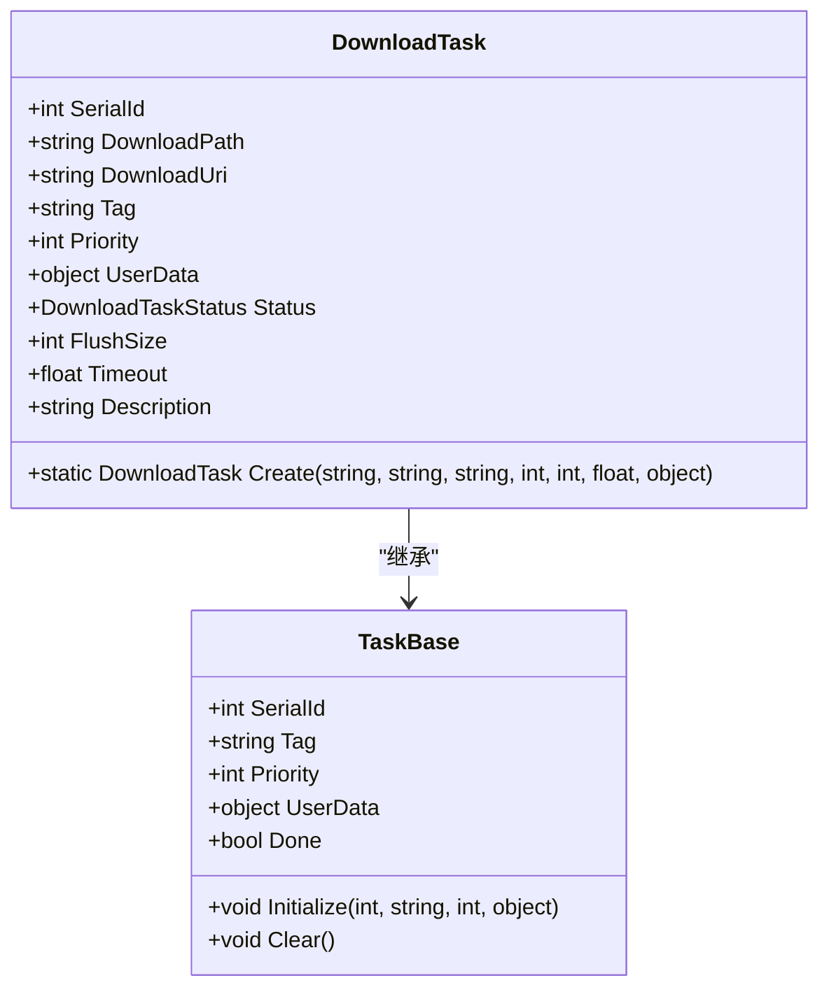
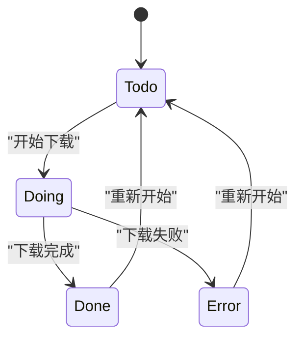
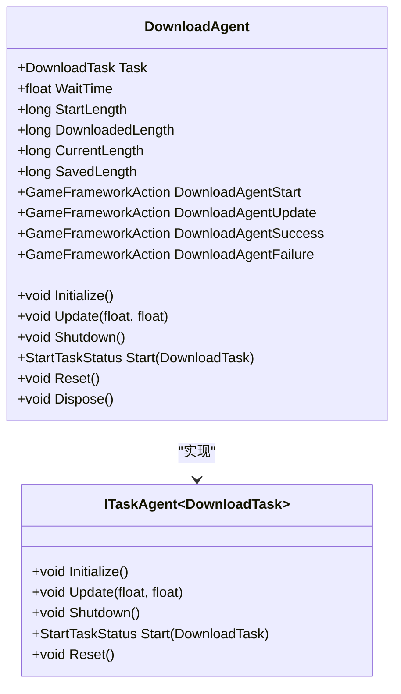
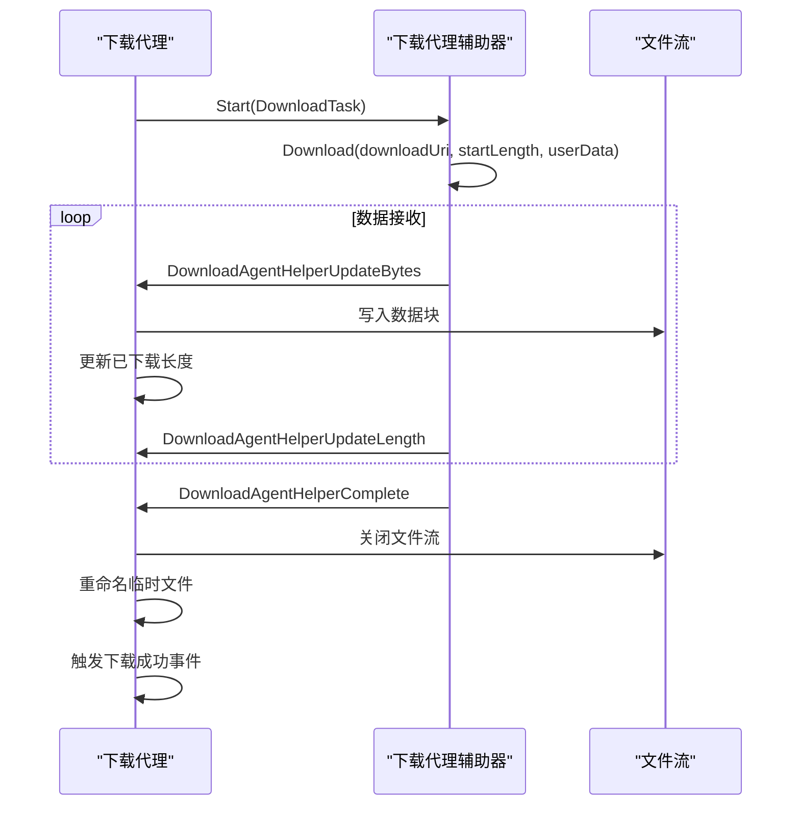
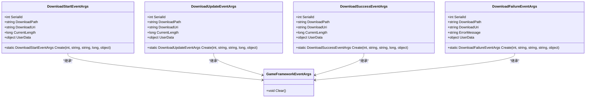
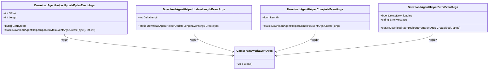
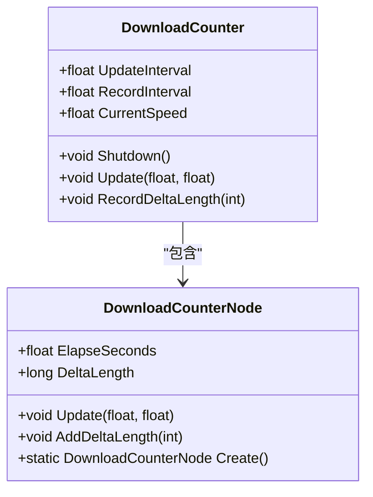
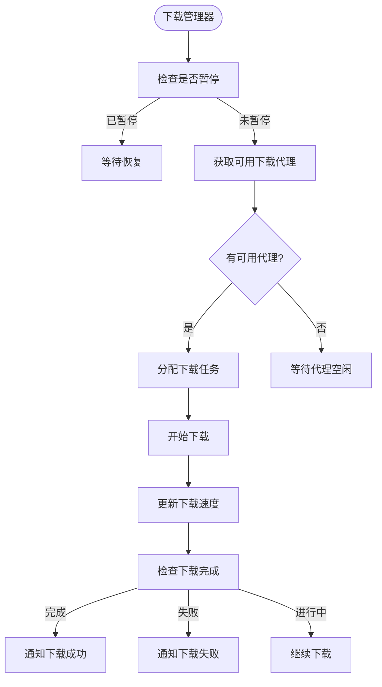
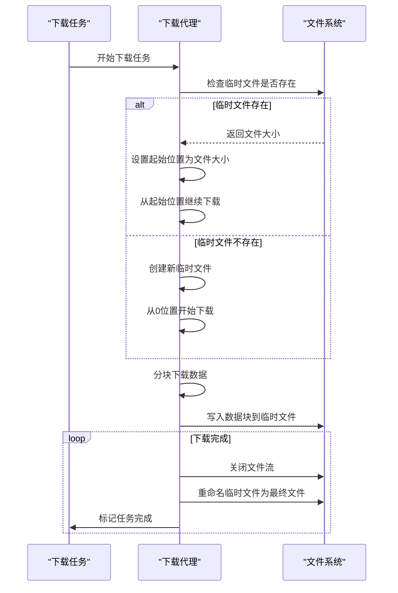
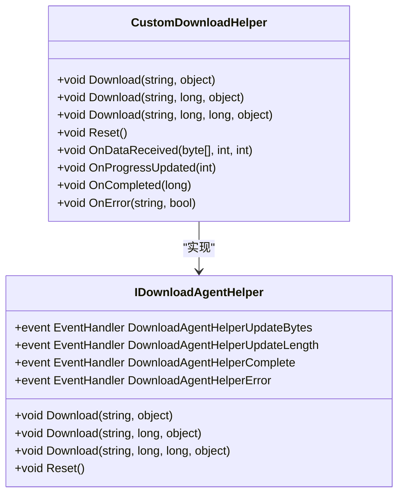

# 下载系统

<cite>
**本文档引用的文件**
- [IDownloadManager.cs](file://GameFramework/Download/IDownloadManager.cs)
- [DownloadManager.cs](file://GameFramework/Download/DownloadManager.cs)
- [DownloadManager.DownloadTask.cs](file://GameFramework/Download/DownloadManager.DownloadTask.cs)
- [DownloadManager.DownloadAgent.cs](file://GameFramework/Download/DownloadManager.DownloadAgent.cs)
- [DownloadStartEventArgs.cs](file://GameFramework/Download/DownloadStartEventArgs.cs)
- [DownloadUpdateEventArgs.cs](file://GameFramework/Download/DownloadUpdateEventArgs.cs)
- [DownloadSuccessEventArgs.cs](file://GameFramework/Download/DownloadSuccessEventArgs.cs)
- [DownloadFailureEventArgs.cs](file://GameFramework/Download/DownloadFailureEventArgs.cs)
- [IDownloadAgentHelper.cs](file://GameFramework/Download/IDownloadAgentHelper.cs)
- [DownloadAgentHelperUpdateBytesEventArgs.cs](file://GameFramework/Download/DownloadAgentHelperUpdateBytesEventArgs.cs)
- [DownloadAgentHelperUpdateLengthEventArgs.cs](file://GameFramework/Download/DownloadAgentHelperUpdateLengthEventArgs.cs)
- [DownloadAgentHelperCompleteEventArgs.cs](file://GameFramework/Download/DownloadAgentHelperCompleteEventArgs.cs)
- [DownloadAgentHelperErrorEventArgs.cs](file://GameFramework/Download/DownloadAgentHelperErrorEventArgs.cs)
- [Constant.cs](file://GameFramework/Download/Constant.cs)
- [DownloadManager.DownloadCounter.cs](file://GameFramework/Download/DownloadManager.DownloadCounter.cs)
</cite>

## 目录
1. [简介](#简介)
2. [核心组件](#核心组件)
3. [下载任务管理](#下载任务管理)
4. [下载代理机制](#下载代理机制)
5. [事件通知系统](#事件通知系统)
6. [带宽与并发控制](#带宽与并发控制)
7. [断点续传与多线程下载](#断点续传与多线程下载)
8. [自定义下载行为扩展](#自定义下载行为扩展)

## 简介
下载系统是GameFramework中的核心模块之一，负责管理所有文件下载任务。该系统通过IDownloadManager接口和DownloadManager类实现，提供了完整的下载任务创建、调度、执行和监控功能。系统支持下载优先级设置、并发控制、带宽管理和断点续传等高级特性，确保下载过程的稳定性和效率。

## 核心组件

下载系统由多个核心组件构成，包括IDownloadManager接口、DownloadManager实现类、DownloadTask下载任务、DownloadAgent下载代理以及各种事件类。这些组件协同工作，形成了一个完整的下载管理体系。

**本节引用的文件**
- [IDownloadManager.cs](file://GameFramework/Download/IDownloadManager.cs#L15-L238)
- [DownloadManager.cs](file://GameFramework/Download/DownloadManager.cs#L31-L41)
- [DownloadManager.DownloadTask.cs](file://GameFramework/Download/DownloadManager.DownloadTask.cs#L14-L140)

## 下载任务管理

### 下载任务创建与调度
下载任务通过DownloadTask类表示，每个任务包含下载路径、下载地址、优先级、标签等属性。任务创建时会分配唯一的序列编号，并根据优先级进行调度。

**图表来源**
- [DownloadManager.DownloadTask.cs](file://GameFramework/Download/DownloadManager.DownloadTask.cs#L14-L140)

### 下载任务状态管理
下载任务具有四种状态：Todo（准备下载）、Doing（下载中）、Done（下载完成）和Error（下载错误）。状态转换由下载代理在执行过程中进行管理。

**图表来源**
- [DownloadManager.DownloadTaskStatus.cs](file://GameFramework/Download/DownloadManager.DownloadTaskStatus.cs#L12-L38)

**本节引用的文件**
- [DownloadManager.DownloadTask.cs](file://GameFramework/Download/DownloadManager.DownloadTask.cs#L14-L140)
- [DownloadManager.DownloadTaskStatus.cs](file://GameFramework/Download/DownloadManager.DownloadTaskStatus.cs#L12-L38)

## 下载代理机制

### 下载代理工作原理
下载代理（DownloadAgent）是实际执行下载任务的组件，每个代理对应一个下载任务。代理通过IDownloadAgentHelper接口与具体的下载实现进行交互，管理文件流、缓冲区刷新和错误处理。

**图表来源**
- [DownloadManager.DownloadAgent.cs](file://GameFramework/Download/DownloadManager.DownloadAgent.cs#L12-L373)

### 连接管理与数据传输
下载代理通过IDownloadAgentHelper接口管理网络连接，支持从指定位置开始下载，实现断点续传功能。数据分块传输通过事件机制通知代理，确保数据完整性和效率。

**图表来源**
- [DownloadManager.DownloadAgent.cs](file://GameFramework/Download/DownloadManager.DownloadAgent.cs#L12-L373)
- [IDownloadAgentHelper.cs](file://GameFramework/Download/IDownloadAgentHelper.cs#L14-L64)

**本节引用的文件**
- [DownloadManager.DownloadAgent.cs](file://GameFramework/Download/DownloadManager.DownloadAgent.cs#L12-L373)
- [IDownloadAgentHelper.cs](file://GameFramework/Download/IDownloadAgentHelper.cs#L14-L64)

## 事件通知系统

### 下载状态事件
系统通过事件机制通知下载过程中的各种状态变化，包括下载开始、更新、成功和失败。这些事件允许上层应用实时监控下载进度并做出相应处理。

**图表来源**
- [DownloadStartEventArgs.cs](file://GameFramework/Download/DownloadStartEventArgs.cs#L12-L102)
- [DownloadUpdateEventArgs.cs](file://GameFramework/Download/DownloadUpdateEventArgs.cs#L12-L102)
- [DownloadSuccessEventArgs.cs](file://GameFramework/Download/DownloadSuccessEventArgs.cs#L12-L102)
- [DownloadFailureEventArgs.cs](file://GameFramework/Download/DownloadFailureEventArgs.cs#L12-L102)

### 代理辅助器事件
下载代理辅助器通过一系列事件通知下载代理数据传输的进度和状态，包括数据流更新、数据大小更新、完成和错误事件。

**图表来源**
- [DownloadAgentHelperUpdateBytesEventArgs.cs](file://GameFramework/Download/DownloadAgentHelperUpdateBytesEventArgs.cs#L12-L92)
- [DownloadAgentHelperUpdateLengthEventArgs.cs](file://GameFramework/Download/DownloadAgentHelperUpdateLengthEventArgs.cs#L12-L55)
- [DownloadAgentHelperCompleteEventArgs.cs](file://GameFramework/Download/DownloadAgentHelperCompleteEventArgs.cs#L12-L55)
- [DownloadAgentHelperErrorEventArgs.cs](file://GameFramework/Download/DownloadAgentHelperErrorEventArgs.cs#L12-L63)

**本节引用的文件**
- [DownloadStartEventArgs.cs](file://GameFramework/Download/DownloadStartEventArgs.cs#L12-L102)
- [DownloadUpdateEventArgs.cs](file://GameFramework/Download/DownloadUpdateEventArgs.cs#L12-L102)
- [DownloadSuccessEventArgs.cs](file://GameFramework/Download/DownloadSuccessEventArgs.cs#L12-L102)
- [DownloadFailureEventArgs.cs](file://GameFramework/Download/DownloadFailureEventArgs.cs#L12-L102)
- [DownloadAgentHelperUpdateBytesEventArgs.cs](file://GameFramework/Download/DownloadAgentHelperUpdateBytesEventArgs.cs#L12-L92)
- [DownloadAgentHelperUpdateLengthEventArgs.cs](file://GameFramework/Download/DownloadAgentHelperUpdateLengthEventArgs.cs#L12-L55)
- [DownloadAgentHelperCompleteEventArgs.cs](file://GameFramework/Download/DownloadAgentHelperCompleteEventArgs.cs#L12-L55)
- [DownloadAgentHelperErrorEventArgs.cs](file://GameFramework/Download/DownloadAgentHelperErrorEventArgs.cs#L12-L63)

## 带宽与并发控制

### 下载速度计算
系统通过DownloadCounter类统计下载速度，使用滑动时间窗口算法计算当前下载速度。该算法记录指定时间间隔内的数据增量，提供平滑的下载速度显示。

**图表来源**
- [DownloadManager.DownloadCounter.cs](file://GameFramework/Download/DownloadManager.DownloadCounter.cs#L12-L170)

### 并发下载管理
下载管理器通过任务池（TaskPool）管理并发下载，支持配置下载代理数量，实现并发控制。系统根据代理数量和任务优先级自动调度下载任务。

**图表来源**
- [DownloadManager.cs](file://GameFramework/Download/DownloadManager.cs#L31-L41)
- [DownloadManager.DownloadAgent.cs](file://GameFramework/Download/DownloadManager.DownloadAgent.cs#L12-L373)

**本节引用的文件**
- [DownloadManager.DownloadCounter.cs](file://GameFramework/Download/DownloadManager.DownloadCounter.cs#L12-L170)
- [DownloadManager.cs](file://GameFramework/Download/DownloadManager.cs#L31-L41)

## 断点续传与多线程下载

### 断点续传实现
系统通过在临时文件中保存下载进度实现断点续传功能。当下载中断后，系统会检查临时文件的大小，并从该位置继续下载，避免重复下载已获取的数据。

**图表来源**
- [DownloadManager.DownloadAgent.cs](file://GameFramework/Download/DownloadManager.DownloadAgent.cs#L12-L373)

### 多线程下载策略
虽然当前实现主要基于单线程下载代理，但系统架构支持通过创建多个下载代理实现多线程下载。每个代理独立工作，通过任务池进行统一管理。

**本节引用的文件**
- [DownloadManager.DownloadAgent.cs](file://GameFramework/Download/DownloadManager.DownloadAgent.cs#L12-L373)

## 自定义下载行为扩展

### 下载代理辅助器接口
通过IDownloadAgentHelper接口，开发者可以实现自定义的下载行为，如使用不同的网络库、添加认证机制或实现特殊的错误恢复策略。

**图表来源**
- [IDownloadAgentHelper.cs](file://GameFramework/Download/IDownloadAgentHelper.cs#L14-L64)

### 扩展示例
开发者可以通过实现IDownloadAgentHelper接口来扩展下载功能，例如添加HTTP认证、使用CDN加速或实现智能重试机制。

**本节引用的文件**
- [IDownloadAgentHelper.cs](file://GameFramework/Download/IDownloadAgentHelper.cs#L14-L64)