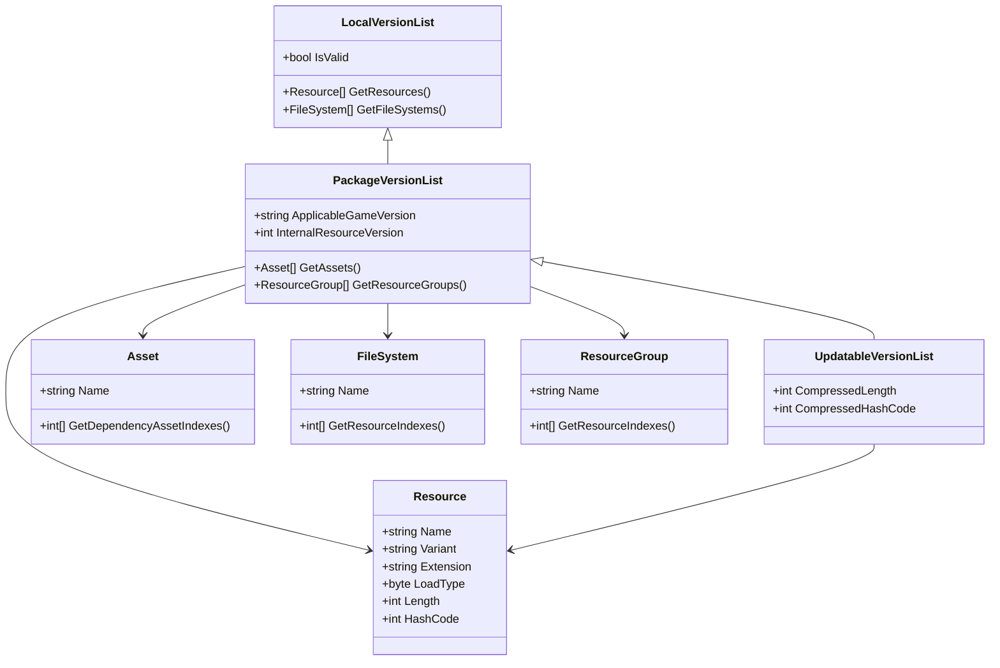
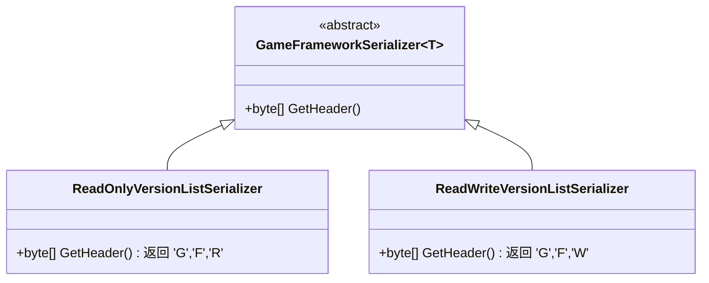
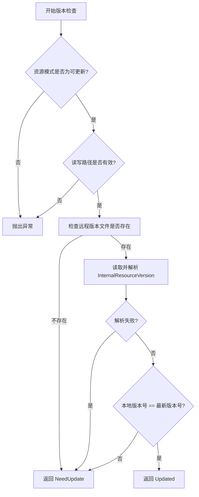
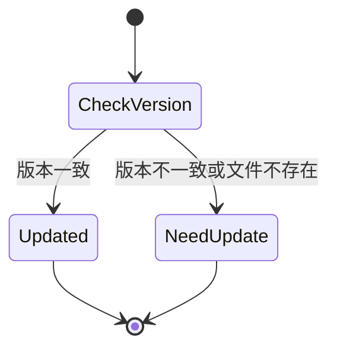

# 版本控制

<cite>
**本文档中引用的文件**  
- [LocalVersionList.cs](file://GameFramework/Resource/LocalVersionList.cs)
- [PackageVersionList.cs](file://GameFramework/Resource/PackageVersionList.cs)
- [UpdatableVersionList.cs](file://GameFramework/Resource/UpdatableVersionList.cs)
- [ReadOnlyVersionListSerializer.cs](file://GameFramework/Resource/ReadOnlyVersionListSerializer.cs)
- [ReadWriteVersionListSerializer.cs](file://GameFramework/Resource/ReadWriteVersionListSerializer.cs)
- [CheckVersionListResult.cs](file://GameFramework/Resource/CheckVersionListResult.cs)
- [ResourceManager.VersionListProcessor.cs](file://GameFramework/Resource/ResourceManager.VersionListProcessor.cs)
- [ResourceManager.cs](file://GameFramework/Resource/ResourceManager.cs)
</cite>

## 目录
1. [简介](#简介)
2. [版本列表数据结构与作用域](#版本列表数据结构与作用域)
3. [版本序列化器实现机制](#版本序列化器实现机制)
4. [版本比对算法原理](#版本比对算法原理)
5. [版本检查结果处理逻辑](#版本检查结果处理逻辑)
6. [版本控制配置示例](#版本控制配置示例)
7. [结论](#结论)

## 简介
本系统文档详细阐述了资源版本控制机制的核心组件，包括本地、单机模式和可更新模式下的版本列表数据结构，版本信息的序列化与反序列化机制，以及版本比对和更新策略。系统通过哈希值校验、文件大小验证和内部版本号比对，确保资源一致性与完整性，支持多版本共存与降级处理，适用于复杂的游戏资源管理场景。

## 版本列表数据结构与作用域

### LocalVersionList（本地版本列表）
`LocalVersionList` 用于描述存储在本地只读区或读写区的资源版本信息，包含资源集合和文件系统集合。其核心结构由 `Resource` 和 `FileSystem` 组成：

- **Resource**：描述单个资源的元数据，包括名称、变体、扩展名、加载方式、长度、哈希值。
- **FileSystem**：表示一个文件系统，包含名称及其所包含的资源索引数组。

该结构适用于本地资源的快速加载与验证，不包含依赖关系或资源组信息。

**Section sources**
- [LocalVersionList.cs](file://GameFramework/Resource/LocalVersionList.cs#L11-L76)
- [LocalVersionList.Resource.cs](file://GameFramework/Resource/LocalVersionList.Resource.cs#L11-L118)
- [LocalVersionList.FileSystem.cs](file://GameFramework/Resource/LocalVersionList.FileSystem.cs#L11-L60)

### PackageVersionList（单机模式版本列表）
`PackageVersionList` 用于单机模式下的资源管理，包含完整的资源依赖与分组信息。其结构扩展了 `LocalVersionList`，增加了：

- **Asset**：表示可被加载的资源单元，包含名称及其依赖资源的索引数组。
- **Resource**：在基础信息上增加了 `m_AssetIndexes`，表示该资源包含哪些 Asset。
- **ResourceGroup**：资源组，包含名称及其所包含的资源索引数组。

该结构支持资源依赖解析和按组加载，适用于打包发布场景。

**Section sources**
- [PackageVersionList.cs](file://GameFramework/Resource/PackageVersionList.cs#L11-L150)
- [PackageVersionList.Asset.cs](file://GameFramework/Resource/PackageVersionList.Asset.cs#L11-L60)
- [PackageVersionList.Resource.cs](file://GameFramework/Resource/PackageVersionList.Resource.cs#L11-L132)
- [PackageVersionList.FileSystem.cs](file://GameFramework/Resource/PackageVersionList.FileSystem.cs#L11-L60)
- [PackageVersionList.ResourceGroup.cs](file://GameFramework/Resource/PackageVersionList.ResourceGroup.cs#L11-L60)

### UpdatableVersionList（可更新版本列表）
`UpdatableVersionList` 专为可更新模式设计，结构与 `PackageVersionList` 基本一致，但 `Resource` 结构额外包含压缩信息：

- **CompressedLength**：资源压缩后的长度。
- **CompressedHashCode**：资源压缩后的哈希值。

这使得系统能够在更新时校验压缩包的完整性，适用于热更新和增量更新场景。

**Section sources**
- [UpdatableVersionList.cs](file://GameFramework/Resource/UpdatableVersionList.cs#L11-L150)
- [UpdatableVersionList.Asset.cs](file://GameFramework/Resource/UpdatableVersionList.Asset.cs#L11-L60)
- [UpdatableVersionList.Resource.cs](file://GameFramework/Resource/UpdatableVersionList.Resource.cs#L11-L160)
- [UpdatableVersionList.FileSystem.cs](file://GameFramework/Resource/UpdatableVersionList.FileSystem.cs#L11-L60)
- [UpdatableVersionList.ResourceGroup.cs](file://GameFramework/Resource/UpdatableVersionList.ResourceGroup.cs#L11-L60)



**Diagram sources**
- [LocalVersionList.cs](file://GameFramework/Resource/LocalVersionList.cs#L11-L76)
- [PackageVersionList.cs](file://GameFramework/Resource/PackageVersionList.cs#L11-L150)
- [UpdatableVersionList.cs](file://GameFramework/Resource/UpdatableVersionList.cs#L11-L150)

## 版本序列化器实现机制

### ReadOnlyVersionListSerializer（只读版本列表序列化器）
该序列化器继承自 `GameFrameworkSerializer<LocalVersionList>`，用于序列化和反序列化存储在本地只读区的版本列表。其头部标识为 `GFR`（GameFramework Read-Only），确保文件格式的正确性。

**Section sources**
- [ReadOnlyVersionListSerializer.cs](file://GameFramework/Resource/ReadOnlyVersionListSerializer.cs#L1-L33)
- [ResourceManager.cs](file://GameFramework/Resource/ResourceManager.cs#L212-L218)
- [IResourceManager.cs](file://GameFramework/Resource/IResourceManager.cs#L71-L74)

### ReadWriteVersionListSerializer（读写版本列表序列化器）
该序列化器同样继承自 `GameFrameworkSerializer<LocalVersionList>`，用于处理本地读写区的版本列表。其头部标识为 `GFW`（GameFramework Write），与只读区区分开来，防止误读。

**Section sources**
- [ReadWriteVersionListSerializer.cs](file://GameFramework/Resource/ReadWriteVersionListSerializer.cs#L1-L33)
- [ResourceManager.cs](file://GameFramework/Resource/ResourceManager.cs#L223-L229)
- [IResourceManager.cs](file://GameFramework/Resource/IResourceManager.cs#L79-L82)



**Diagram sources**
- [ReadOnlyVersionListSerializer.cs](file://GameFramework/Resource/ReadOnlyVersionListSerializer.cs#L1-L33)
- [ReadWriteVersionListSerializer.cs](file://GameFramework/Resource/ReadWriteVersionListSerializer.cs#L1-L33)

## 版本比对算法原理

版本比对算法通过以下步骤判断是否需要更新：

1. **检查资源模式**：仅在 `Updatable` 或 `UpdatableWhilePlaying` 模式下允许版本检查。
2. **验证读写路径**：确保本地读写路径有效。
3. **读取远程版本文件**：尝试从读写路径加载 `RemoteVersionList` 文件。
4. **解析内部版本号**：使用 `UpdatableVersionListSerializer` 从文件中提取 `InternalResourceVersion`。
5. **版本号比对**：将本地版本号与传入的最新版本号进行比较，若不一致则标记为需要更新。

该算法通过文件存在性、版本号一致性双重校验，确保更新判断的准确性。

**Section sources**
- [ResourceManager.VersionListProcessor.cs](file://GameFramework/Resource/ResourceManager.VersionListProcessor.cs#L80-L125)
- [ResourceManager.cs](file://GameFramework/Resource/ResourceManager.cs#L1119-L1137)
- [IResourceManager.cs](file://GameFramework/Resource/IResourceManager.cs#L438)



**Diagram sources**
- [ResourceManager.VersionListProcessor.cs](file://GameFramework/Resource/ResourceManager.VersionListProcessor.cs#L80-L125)

## 版本检查结果处理逻辑

### CheckVersionListResult 枚举
该枚举定义了版本检查的两种结果：

- **Updated**：当前版本已是最新的，无需更新。
- **NeedUpdate**：当前版本过时，需要进行资源更新。

此结果由 `ResourceManager.CheckVersionList` 方法返回，供上层逻辑（如更新流程控制器）决策是否启动资源更新流程。

**Section sources**
- [CheckVersionListResult.cs](file://GameFramework/Resource/CheckVersionListResult.cs#L1-L25)
- [ResourceManager.cs](file://GameFramework/Resource/ResourceManager.cs#L1119-L1137)



**Diagram sources**
- [CheckVersionListResult.cs](file://GameFramework/Resource/CheckVersionListResult.cs#L1-L25)

## 版本控制配置示例

### 定义资源版本策略
```csharp
// 设置资源模式为可更新
resourceManager.SetResourceMode(ResourceMode.Updatable);

// 初始化资源系统
resourceManager.InitResources();
```

### 管理多版本共存
系统通过 `LocalVersionList` 和 `UpdatableVersionList` 分别管理本地和远程版本信息，支持：
- 本地缓存资源与远程资源并存
- 按需加载不同版本的资源
- 资源组隔离，避免版本冲突

### 处理版本降级
当服务器版本回退时，系统通过比对 `InternalResourceVersion` 自动识别降级需求，并触发资源重新下载与替换，确保客户端与服务器版本一致。

**Section sources**
- [ResourceManager.cs](file://GameFramework/Resource/ResourceManager.cs#L1119-L1137)
- [UpdatableVersionList.cs](file://GameFramework/Resource/UpdatableVersionList.cs#L11-L150)

## 结论
本资源版本控制系统通过清晰的版本列表结构、高效的序列化机制和可靠的比对算法，实现了对本地与远程资源的精确管理。系统支持热更新、增量更新和版本降级等多种场景，具备高稳定性与扩展性，为游戏资源的动态更新提供了坚实基础。