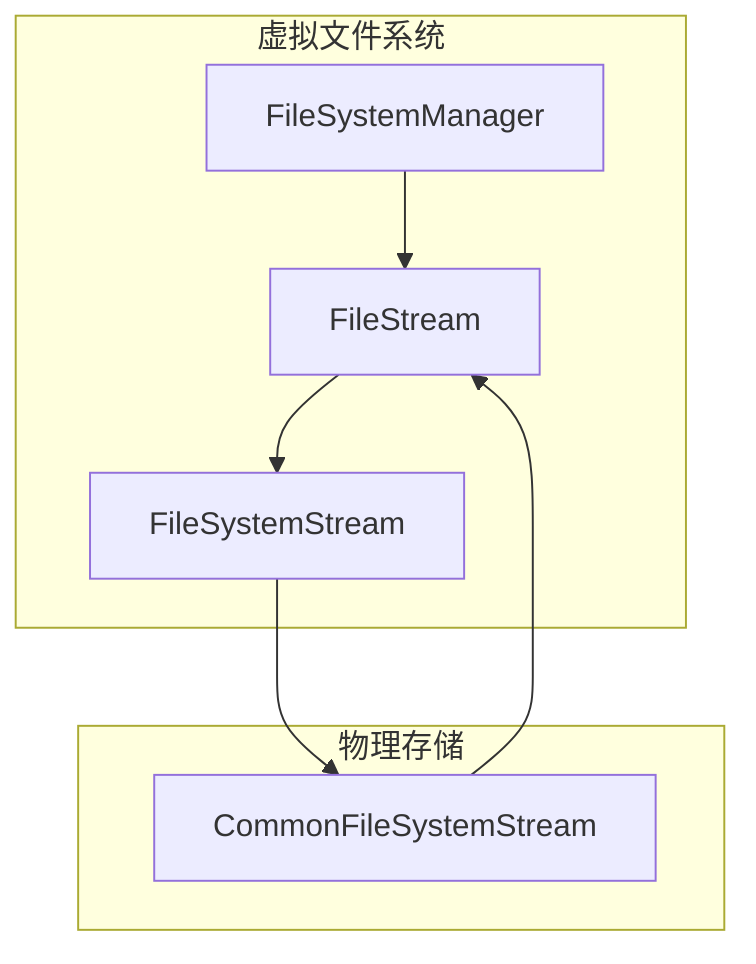
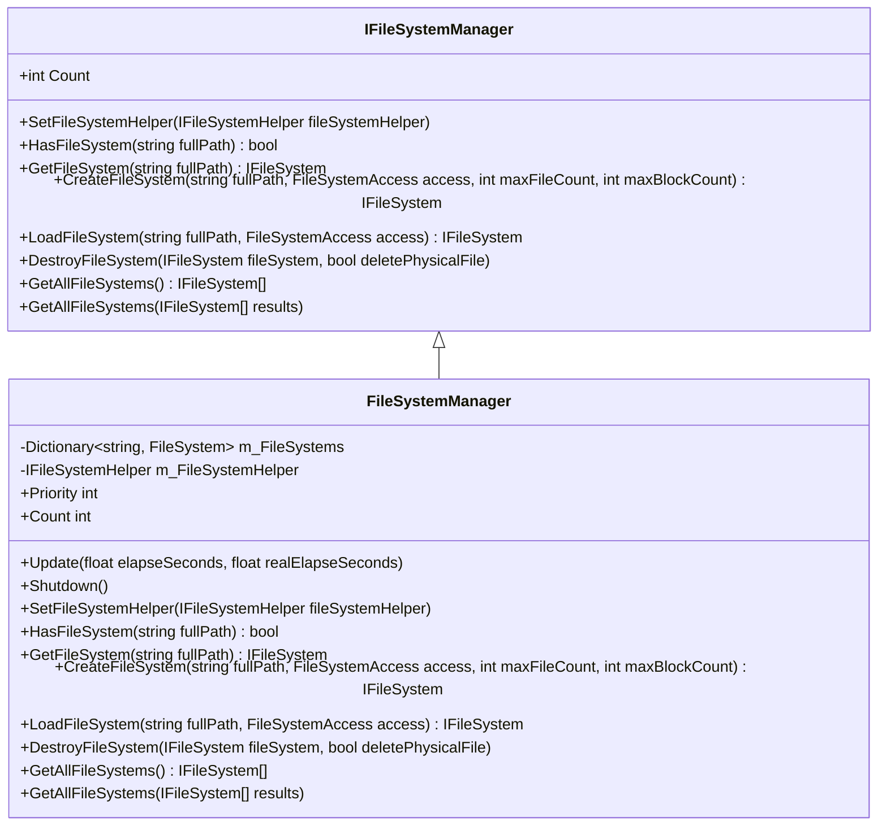
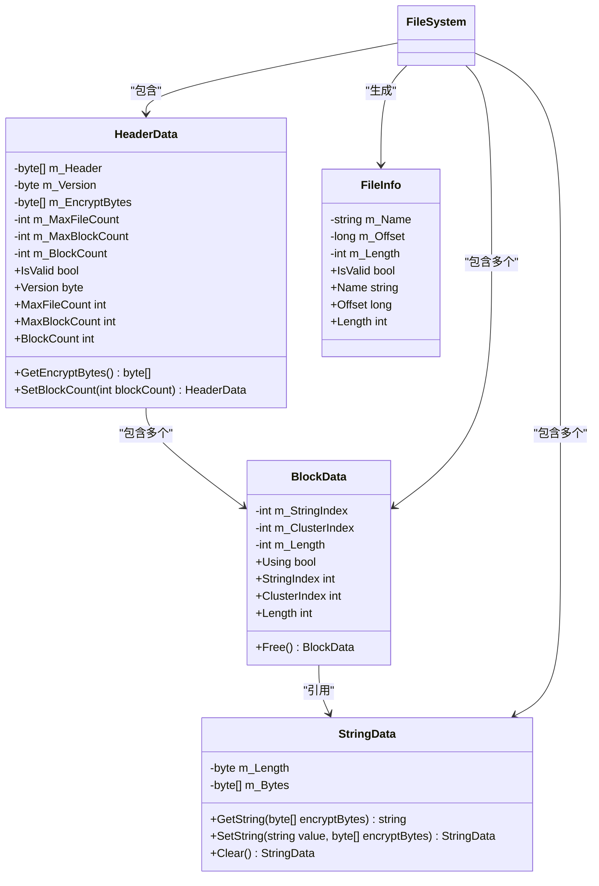
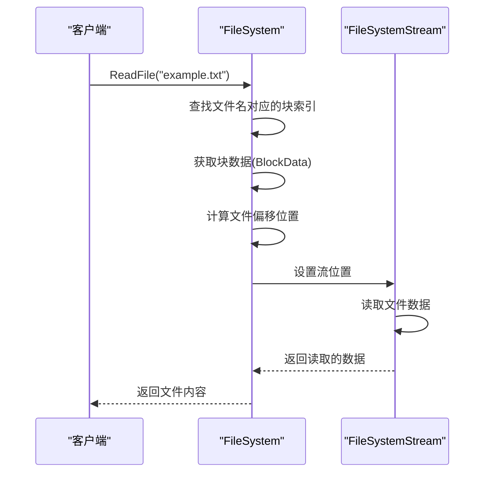
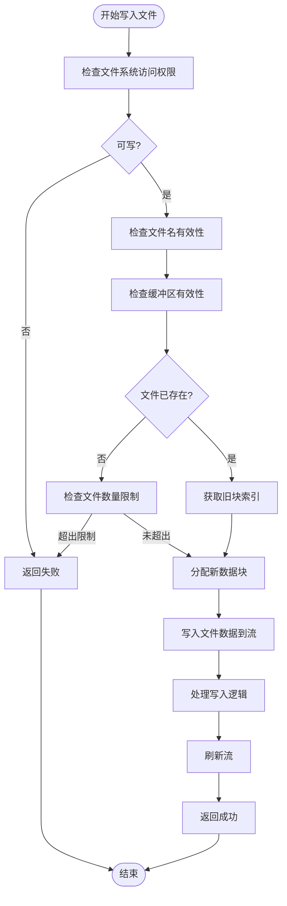
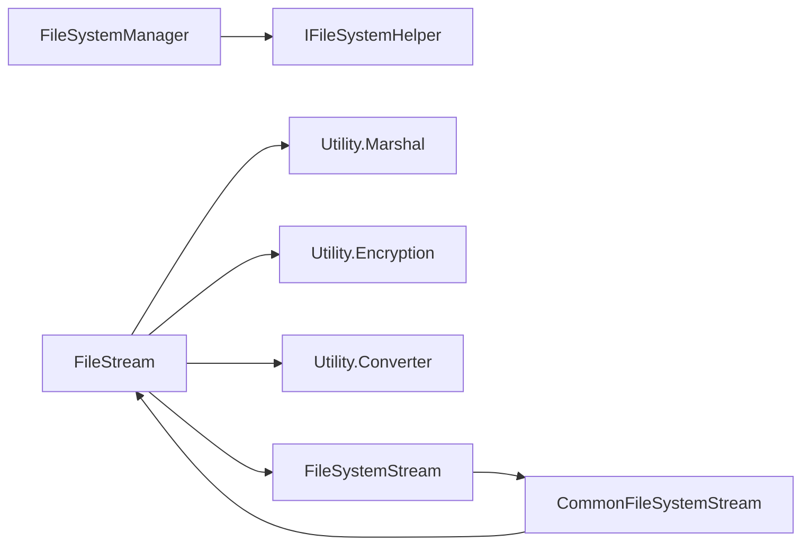

# 虚拟文件系统

<cite>
**Referenced Files in This Document**  
- [IFileSystemManager.cs](file://GameFramework/FileSystem/IFileSystemManager.cs)
- [FileSystemManager.cs](file://GameFramework/FileSystem/FileSystemManager.cs)
- [IFileSystem.cs](file://GameFramework/FileSystem/IFileSystem.cs)
- [FileSystem.cs](file://GameFramework/FileSystem/FileSystem.cs)
- [FileSystem.HeaderData.cs](file://GameFramework/FileSystem/FileSystem.HeaderData.cs)
- [FileSystem.BlockData.cs](file://GameFramework/FileSystem/FileSystem.BlockData.cs)
- [FileSystem.StringData.cs](file://GameFramework/FileSystem/FileSystem.StringData.cs)
- [FileInfo.cs](file://GameFramework/FileSystem/FileInfo.cs)
- [FileSystemStream.cs](file://GameFramework/FileSystem/FileSystemStream.cs)
- [CommonFileSystemStream.cs](file://GameFramework/FileSystem/CommonFileSystemStream.cs)
</cite>

## 目录
1. [简介](#简介)
2. [核心组件](#核心组件)
3. [架构概述](#架构概述)
4. [详细组件分析](#详细组件分析)
5. [依赖分析](#依赖分析)
6. [性能考虑](#性能考虑)
7. [故障排除指南](#故障排除指南)
8. [结论](#结论)

## 简介
虚拟文件系统模块为游戏框架提供了一套完整的虚拟化文件管理解决方案。该系统通过封装物理存储，为应用程序提供统一的文件访问接口，支持资源加密、资源打包和跨平台文件访问等关键功能。本文档深入解析了`IFileSystemManager`和`FileSystemManager`类如何管理多个虚拟文件系统实例，以及`IFileSystem`接口定义的文件读写操作在`FileSystem`类中的具体实现机制。

## 核心组件
虚拟文件系统的核心由文件系统管理器、文件系统实例、文件流和数据结构四大部分组成。`IFileSystemManager`接口定义了对多个虚拟文件系统的统一管理能力，包括创建、加载、销毁和查询等操作。`FileSystemManager`作为其实现类，使用字典结构维护所有活动的文件系统实例。`IFileSystem`接口则定义了单个虚拟文件系统的文件操作契约，而`FileSystem`类实现了这些操作的具体逻辑，包括文件头解析、数据块管理和字符串数据存储等底层机制。

**Section sources**
- [IFileSystemManager.cs](file://GameFramework/FileSystem/IFileSystemManager.cs#L14-L80)
- [FileSystemManager.cs](file://GameFramework/FileSystem/FileSystemManager.cs#L16-L281)
- [IFileSystem.cs](file://GameFramework/FileSystem/IFileSystem.cs#L15-L275)
- [FileSystem.cs](file://GameFramework/FileSystem/FileSystem.cs#L18-L1381)

## 架构概述
虚拟文件系统采用分层架构设计，将物理存储与逻辑文件系统分离。在物理层，`FileSystemStream`抽象类定义了文件流的基本操作，`CommonFileSystemStream`提供了基于`FileStream`的具体实现。在逻辑层，`FileSystem`类通过文件头、块数据和字符串数据三个核心结构管理文件系统元数据和内容。`FileSystemManager`作为管理者，协调多个`FileSystem`实例的生命周期。

**Diagram sources**
- [FileSystemManager.cs](file://GameFramework/FileSystem/FileSystemManager.cs#L16-L281)
- [FileSystem.cs](file://GameFramework/FileSystem/FileSystem.cs#L18-L1381)
- [FileSystemStream.cs](file://GameFramework/FileSystem/FileSystemStream.cs#L1-L135)
- [CommonFileSystemStream.cs](file://GameFramework/FileSystem/CommonFileSystemStream.cs#L1-L162)

## 详细组件分析

### 文件系统管理器分析
`FileSystemManager`类实现了`IFileSystemManager`接口，负责管理多个虚拟文件系统实例的生命周期。它使用`Dictionary<string, FileSystem>`结构以文件系统完整路径为键存储所有活动实例，确保每个路径对应唯一的文件系统实例。管理器提供了创建、加载、获取和销毁文件系统的完整功能集。

#### 文件系统管理器类图

**Diagram sources**
- [IFileSystemManager.cs](file://GameFramework/FileSystem/IFileSystemManager.cs#L14-L80)
- [FileSystemManager.cs](file://GameFramework/FileSystem/FileSystemManager.cs#L16-L281)

**Section sources**
- [IFileSystemManager.cs](file://GameFramework/FileSystem/IFileSystemManager.cs#L14-L80)
- [FileSystemManager.cs](file://GameFramework/FileSystem/FileSystemManager.cs#L16-L281)

### 文件系统实现分析
`FileSystem`类实现了`IFileSystem`接口，提供了完整的文件操作功能。它通过三个核心数据结构管理文件系统：`HeaderData`存储文件系统元数据，`BlockData`管理数据块分配，`StringData`存储文件名等字符串信息。文件系统采用簇（Cluster）为基本存储单位，每个簇大小为4KB。

#### 文件系统核心数据结构

**Diagram sources**
- [FileSystem.HeaderData.cs](file://GameFramework/FileSystem/FileSystem.HeaderData.cs#L1-L105)
- [FileSystem.BlockData.cs](file://GameFramework/FileSystem/FileSystem.BlockData.cs#L1-L76)
- [FileSystem.StringData.cs](file://GameFramework/FileSystem/FileSystem.StringData.cs#L1-L70)
- [FileInfo.cs](file://GameFramework/FileSystem/FileInfo.cs#L1-L94)

**Section sources**
- [FileSystem.HeaderData.cs](file://GameFramework/FileSystem/FileSystem.HeaderData.cs#L1-L105)
- [FileSystem.BlockData.cs](file://GameFramework/FileSystem/FileSystem.BlockData.cs#L1-L76)
- [FileSystem.StringData.cs](file://GameFramework/FileSystem/FileSystem.StringData.cs#L1-L70)
- [FileInfo.cs](file://GameFramework/FileSystem/FileInfo.cs#L1-L94)

### 文件操作流程分析
虚拟文件系统的文件操作遵循特定的流程。读取文件时，系统首先通过文件名在`m_FileDatas`字典中查找对应的块索引，然后从`m_BlockDatas`获取块数据，计算文件在物理流中的偏移位置，最后从流中读取指定长度的数据。写入文件时，系统需要分配新的数据块，更新块数据和字符串数据，并维护空闲块索引。

#### 文件读取序列图

**Diagram sources**
- [FileSystem.cs](file://GameFramework/FileSystem/FileSystem.cs#L258-L273)
- [FileSystemStream.cs](file://GameFramework/FileSystem/FileSystemStream.cs#L1-L135)

#### 文件写入流程图

**Diagram sources**
- [FileSystem.cs](file://GameFramework/FileSystem/FileSystem.cs#L800-L1381)

## 依赖分析
虚拟文件系统模块依赖于框架的其他核心组件。`FileSystemManager`依赖`IFileSystemHelper`接口来创建文件系统流，这体现了依赖倒置原则。`FileSystem`类依赖`Utility.Marshal`进行结构体与字节数组的转换，依赖`Utility.Encryption`进行字符串加密，依赖`Utility.Converter`进行字符串与字节数组的转换。这些依赖关系通过静态方法调用实现，降低了耦合度。

**Diagram sources**
- [FileSystemManager.cs](file://GameFramework/FileSystem/FileSystemManager.cs#L16-L281)
- [FileSystem.cs](file://GameFramework/FileSystem/FileSystem.cs#L18-L1381)
- [CommonFileSystemStream.cs](file://GameFramework/FileSystem/CommonFileSystemStream.cs#L1-L162)

**Section sources**
- [FileSystemManager.cs](file://GameFramework/FileSystem/FileSystemManager.cs#L16-L281)
- [FileSystem.cs](file://GameFramework/FileSystem/FileSystem.cs#L18-L1381)
- [CommonFileSystemStream.cs](file://GameFramework/FileSystem/CommonFileSystemStream.cs#L1-L162)

## 性能考虑
虚拟文件系统在设计时充分考虑了性能因素。通过预分配缓存字节数组`s_CachedBytes`避免频繁的内存分配。使用`SortedDictionary<int, StringData>`存储字符串数据，确保字符串索引的有序性，便于空闲索引的管理。采用簇对齐的存储策略，提高磁盘I/O效率。文件名存储采用加密的XOR操作，既保证了安全性又保持了较低的计算开销。

## 故障排除指南
在使用虚拟文件系统时，可能遇到以下常见问题：文件系统创建失败通常是由于访问权限设置为只读或路径已存在；文件读取失败可能是由于文件不存在或流读取异常；文件写入失败可能是因为文件系统空间不足或访问权限不足。建议在操作前检查文件系统状态和访问权限，并妥善处理异常情况。

**Section sources**
- [FileSystemManager.cs](file://GameFramework/FileSystem/FileSystemManager.cs#L136-L178)
- [FileSystem.cs](file://GameFramework/FileSystem/FileSystem.cs#L800-L1381)

## 结论
虚拟文件系统模块通过精心设计的分层架构和高效的数据结构，为游戏开发提供了强大的文件管理能力。它不仅实现了基本的文件读写功能，还通过加密、打包等特性增强了资源的安全性和管理效率。该系统的设计体现了高内聚、低耦合的原则，各组件职责明确，便于维护和扩展。在