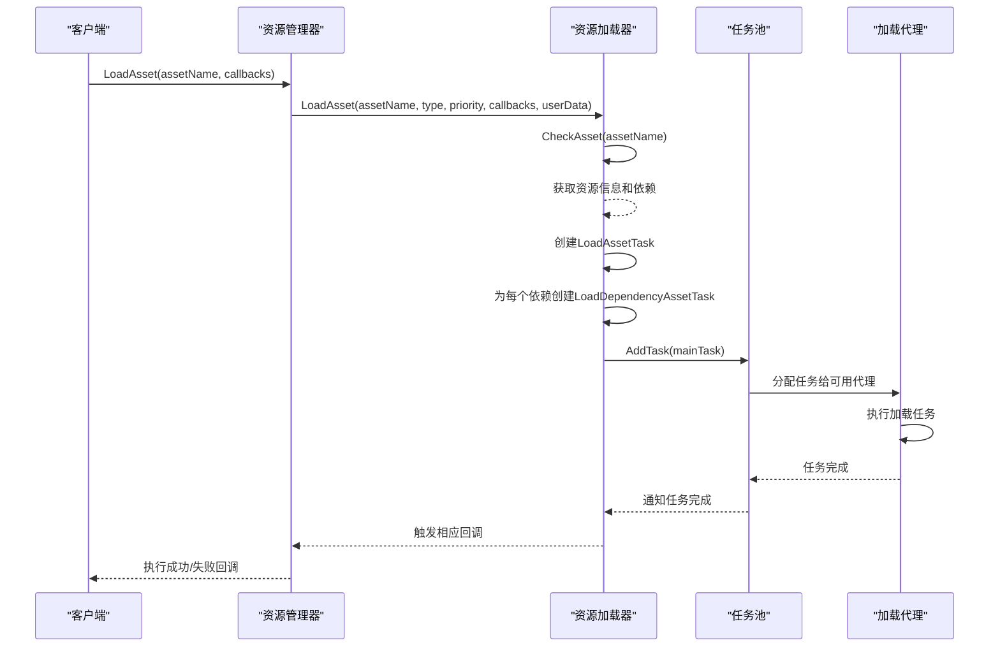
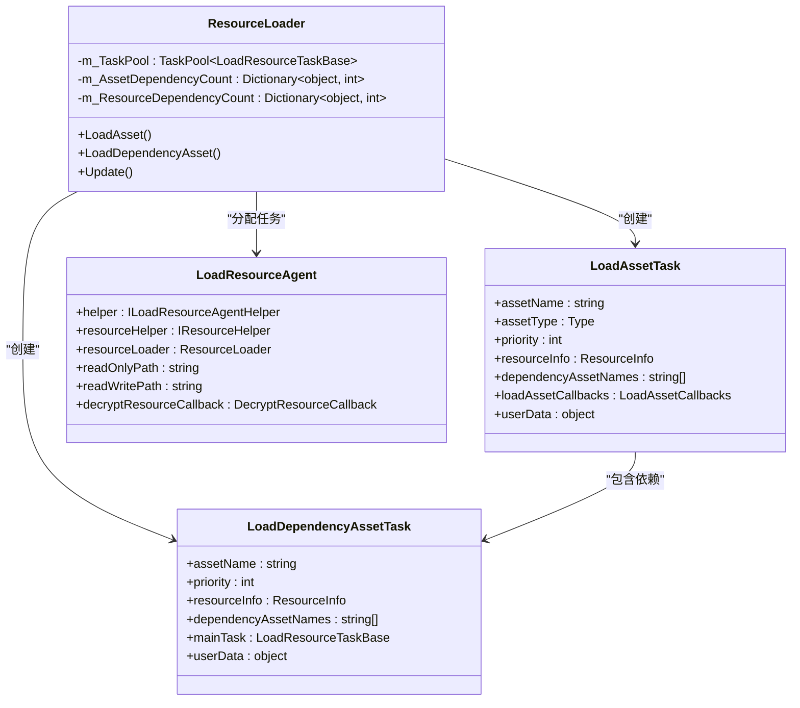
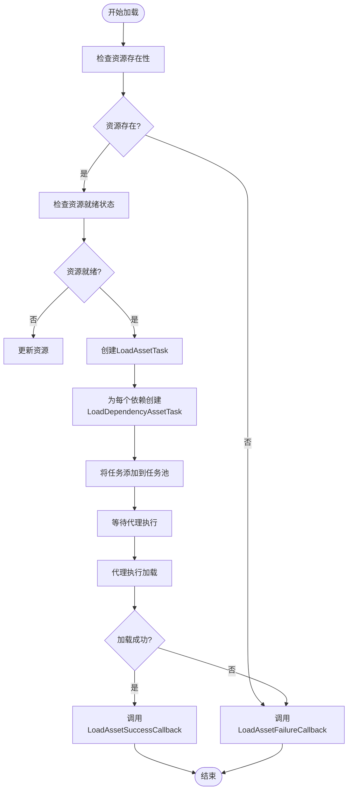

# 资源加载

<cite>
**Referenced Files in This Document**   
- [IResourceManager.cs](file://GameFramework/Resource/IResourceManager.cs)
- [LoadAssetCallbacks.cs](file://GameFramework/Resource/LoadAssetCallbacks.cs)
- [ResourceManager.ResourceLoader.cs](file://GameFramework/Resource/ResourceManager.ResourceLoader.cs)
- [LoadAssetSuccessCallback.cs](file://GameFramework/Resource/LoadAssetSuccessCallback.cs)
- [LoadAssetFailureCallback.cs](file://GameFramework/Resource/LoadAssetFailureCallback.cs)
- [LoadAssetUpdateCallback.cs](file://GameFramework/Resource/LoadAssetUpdateCallback.cs)
- [LoadAssetDependencyAssetCallback.cs](file://GameFramework/Resource/LoadAssetDependencyAssetCallback.cs)
</cite>

## 目录
1. [简介](#简介)
2. [核心组件](#核心组件)
3. [资源加载流程](#资源加载流程)
4. [依赖解析与调度](#依赖解析与调度)
5. [回调机制](#回调机制)
6. [典型使用示例](#典型使用示例)
7. [性能优化策略](#性能优化策略)
8. [错误恢复机制](#错误恢复机制)

## 简介

资源加载子系统是游戏框架中的核心模块，负责管理游戏运行时所需的各种资源（如预制体、纹理、音频等）的加载、卸载和内存管理。该系统通过 `IResourceManager` 接口提供统一的资源管理功能，支持异步加载、依赖解析、优先级调度和回调通知等高级特性。本文档将深入分析资源加载的实现机制，重点阐述 `IResourceManager` 接口中 `LoadAsset` 系列异步加载方法的工作流程。

## 核心组件

资源加载子系统由多个核心组件构成，主要包括 `IResourceManager` 接口、`LoadAssetCallbacks` 回调集合类和 `ResourceManager.ResourceLoader` 加载器类。

`IResourceManager` 接口定义了资源管理器的核心功能，包括资源路径管理、资源模式设置、资源加载与卸载、资源组管理等。该接口提供了丰富的属性和方法，允许开发者灵活配置和控制资源加载行为。

`LoadAssetCallbacks` 类封装了资源加载过程中的各种回调函数，包括成功、失败、更新和依赖资源加载等回调。通过该类，开发者可以精确地监控资源加载的各个阶段，并做出相应的处理。

`ResourceManager.ResourceLoader` 是资源加载的核心实现类，负责管理加载任务、调度加载代理、处理资源依赖和执行回调通知。该类内部维护了一个任务池（`TaskPool<LoadResourceTaskBase>`），用于管理所有待处理的加载任务。

**Section sources**
- [IResourceManager.cs](file://GameFramework/Resource/IResourceManager.cs#L18-L830)
- [LoadAssetCallbacks.cs](file://GameFramework/Resource/LoadAssetCallbacks.cs#L12-L143)
- [ResourceManager.ResourceLoader.cs](file://GameFramework/Resource/ResourceManager.ResourceLoader.cs#L0-L799)

## 资源加载流程

资源加载流程始于调用 `IResourceManager.LoadAsset` 方法，该方法接受资源名称、类型、优先级和回调集合等参数。加载器首先检查目标资源是否存在并已准备好，然后创建一个 `LoadAssetTask` 实例并将其添加到任务池中。



**Diagram sources**
- [IResourceManager.cs](file://GameFramework/Resource/IResourceManager.cs#L550-L642)
- [ResourceManager.ResourceLoader.cs](file://GameFramework/Resource/ResourceManager.ResourceLoader.cs#L300-L390)

## 依赖解析与调度

资源加载器在加载主资源之前，会先解析其所有依赖资源。这一过程通过递归调用 `LoadDependencyAsset` 方法实现，确保所有依赖资源都被正确加载。依赖解析的结果存储在 `m_AssetDependencyCount` 和 `m_ResourceDependencyCount` 字典中，用于跟踪每个资源的依赖数量。

加载优先级由 `priority` 参数控制，任务池会根据优先级对任务进行排序，确保高优先级任务能够优先执行。资源加载器还支持批量加载和预加载策略，可以通过 `LoadWaitingCount` 和 `UpdateCandidateCount` 属性监控等待加载的资源数量。



**Diagram sources**
- [ResourceManager.ResourceLoader.cs](file://GameFramework/Resource/ResourceManager.ResourceLoader.cs#L80-L300)
- [ResourceManager.ResourceLoader.cs](file://GameFramework/Resource/ResourceManager.ResourceLoader.cs#L800-L943)

## 回调机制

资源加载的回调机制通过 `LoadAssetCallbacks` 类实现。该类封装了四个关键的回调函数：`LoadAssetSuccessCallback`、`LoadAssetFailureCallback`、`LoadAssetUpdateCallback` 和 `LoadAssetDependencyAssetCallback`。开发者可以通过构造函数选择性地提供这些回调函数。

当资源加载成功时，系统会调用 `LoadAssetSuccessCallback`，并将加载的资源对象、加载耗时和用户数据传递给回调函数。如果加载失败，则调用 `LoadAssetFailureCallback`，并提供错误状态和错误信息。在加载过程中，系统会定期调用 `LoadAssetUpdateCallback` 报告加载进度。当加载依赖资源时，会触发 `LoadAssetDependencyAssetCallback`。



**Diagram sources**
- [LoadAssetCallbacks.cs](file://GameFramework/Resource/LoadAssetCallbacks.cs#L12-L143)
- [ResourceManager.ResourceLoader.cs](file://GameFramework/Resource/ResourceManager.ResourceLoader.cs#L300-L390)

## 典型使用示例

以下是一些典型的资源加载使用示例：

### 预制体加载
```csharp
// 异步加载预制体
string prefabName = "Assets/Prefabs/Player.prefab";
LoadAssetCallbacks callbacks = new LoadAssetCallbacks(
    (assetName, asset, duration, userData) =>
    {
        // 成功回调：实例化预制体
        GameObject player = GameObject.Instantiate((GameObject)asset);
        Debug.Log($"成功加载玩家预制体，耗时：{duration}秒");
    },
    (assetName, status, errorMessage, userData) =>
    {
        // 失败回调
        Debug.LogError($"加载玩家预制体失败：{errorMessage}");
    },
    (assetName, progress, userData) =>
    {
        // 更新回调：显示加载进度
        Debug.Log($"加载进度：{progress:P}");
    }
);
resourceManager.LoadAsset(prefabName, typeof(GameObject), 100, callbacks, null);
```

### 纹理加载
```csharp
// 同步加载纹理（通过高优先级实现）
string textureName = "Assets/Textures/Background.png";
LoadAssetCallbacks syncCallbacks = new LoadAssetCallbacks(
    (assetName, asset, duration, userData) =>
    {
        Texture2D texture = (Texture2D)asset;
        // 使用纹理
        GetComponent<Renderer>().material.mainTexture = texture;
    }
);
// 使用高优先级确保快速加载
resourceManager.LoadAsset(textureName, typeof(Texture2D), 1000, syncCallbacks, null);
```

### 音频加载
```csharp
// 带依赖的音频加载
string audioName = "Assets/Audio/BGM.mp3";
LoadAssetCallbacks audioCallbacks = new LoadAssetCallbacks(
    (assetName, asset, duration, userData) =>
    {
        AudioClip clip = (AudioClip)asset;
        AudioSource source = GetComponent<AudioSource>();
        source.clip = clip;
        source.Play();
    },
    null,
    null,
    (assetName, dependencyAssetName, loadedCount, totalCount, userData) =>
    {
        // 依赖加载回调
        Debug.Log($"正在加载音频依赖资源：{dependencyAssetName} ({loadedCount}/{totalCount})");
    }
);
resourceManager.LoadAsset(audioName, typeof(AudioClip), 50, audioCallbacks, null);
```

**Section sources**
- [IResourceManager.cs](file://GameFramework/Resource/IResourceManager.cs#L550-L642)
- [LoadAssetCallbacks.cs](file://GameFramework/Resource/LoadAssetCallbacks.cs#L12-L143)

## 性能优化策略

资源加载子系统提供了多种性能优化策略：

### 批量加载
通过监控 `LoadWaitingTaskCount` 属性，可以了解当前等待加载的任务数量。建议将多个小资源合并为大资源包进行批量加载，减少I/O操作次数。

### 预加载策略
利用 `CheckResources`