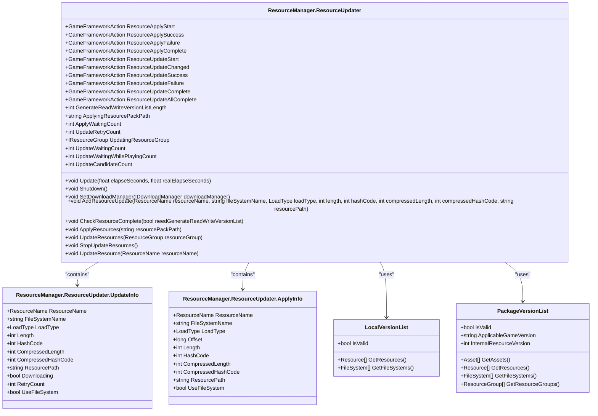
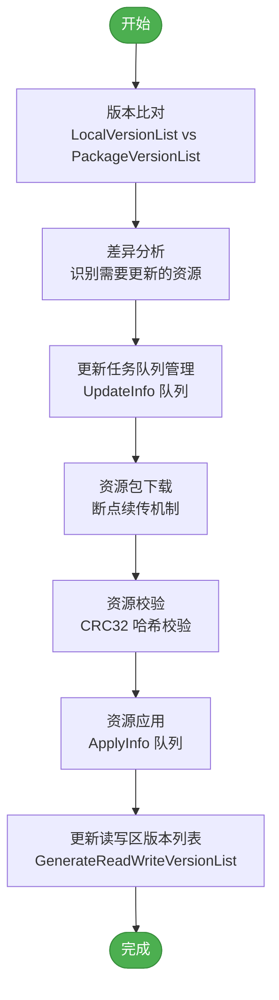
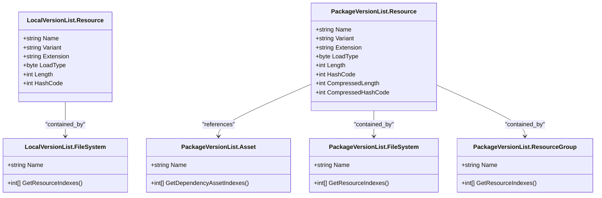
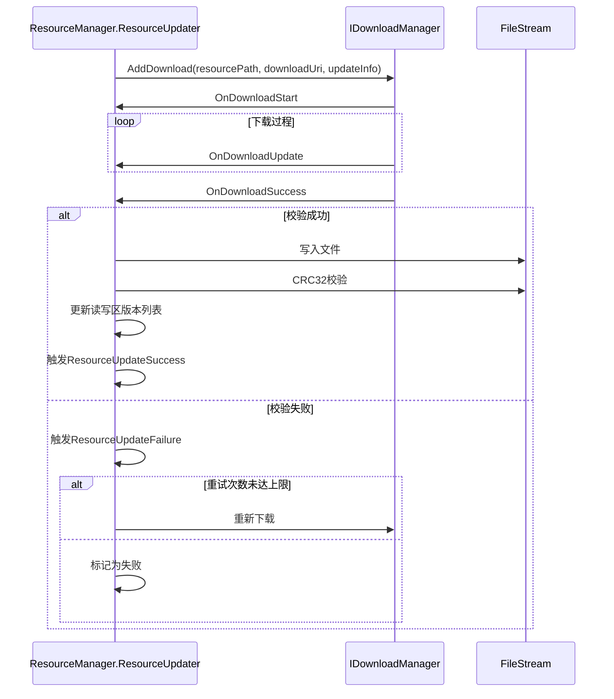

# 资源更新

<cite>
**Referenced Files in This Document**  
- [ResourceManager.ResourceUpdater.cs](file://GameFramework/Resource/ResourceManager.ResourceUpdater.cs)
- [ResourceUpdateStartEventArgs.cs](file://GameFramework/Resource/ResourceUpdateStartEventArgs.cs)
- [ResourceUpdateSuccessEventArgs.cs](file://GameFramework/Resource/ResourceUpdateSuccessEventArgs.cs)
- [ResourceUpdateFailureEventArgs.cs](file://GameFramework/Resource/ResourceUpdateFailureEventArgs.cs)
- [ResourceUpdateChangedEventArgs.cs](file://GameFramework/Resource/ResourceUpdateChangedEventArgs.cs)
- [ResourceUpdateAllCompleteEventArgs.cs](file://GameFramework/Resource/ResourceUpdateAllCompleteEventArgs.cs)
- [LocalVersionList.cs](file://GameFramework/Resource/LocalVersionList.cs)
- [PackageVersionList.cs](file://GameFramework/Resource/PackageVersionList.cs)
- [ResourceManager.ResourceChecker.cs](file://GameFramework/Resource/ResourceManager.ResourceChecker.cs)
</cite>

## 目录
1. [引言](#引言)
2. [核心组件](#核心组件)
3. [热更新流程](#热更新流程)
4. [版本比对与差异分析](#版本比对与差异分析)
5. [更新任务管理](#更新任务管理)
6. [资源下载与校验](#资源下载与校验)
7. [状态通知机制](#状态通知机制)
8. [代码示例](#代码示例)
9. [最佳实践](#最佳实践)
10. [结论](#结论)

## 引言

资源更新模块是游戏框架中实现热更新功能的核心组件，它允许游戏在不重新安装的情况下动态更新资源。本文档深入分析了`ResourceManager.ResourceUpdater`类的实现机制，详细描述了从版本比对、增量更新到资源应用的完整流程。通过本地版本列表(`LocalVersionList`)与远程版本列表(`PackageVersionList`)的差异分析，系统能够精确识别需要更新的资源，并通过高效的下载与校验机制确保资源的完整性。本文档还探讨了更新过程中的状态通知机制，提供了完整的热更新代码示例，并讨论了断点续传、错误重试和用户交互设计的最佳实践。

## 核心组件

资源更新模块由多个核心组件构成，它们协同工作以实现完整的热更新功能。`ResourceManager.ResourceUpdater`类是热更新机制的核心，负责管理整个更新流程。该类通过`LocalVersionList`和`PackageVersionList`进行版本比对，利用`UpdateInfo`和`ApplyInfo`结构体管理更新和应用任务，并通过一系列事件类通知更新状态。



**Diagram sources**
- [ResourceManager.ResourceUpdater.cs](file://GameFramework/Resource/ResourceManager.ResourceUpdater.cs#L1-L1017)
- [LocalVersionList.cs](file://GameFramework/Resource/LocalVersionList.cs#L1-L77)
- [PackageVersionList.cs](file://GameFramework/Resource/PackageVersionList.cs#L1-L151)

**Section sources**
- [ResourceManager.ResourceUpdater.cs](file://GameFramework/Resource/ResourceManager.ResourceUpdater.cs#L1-L1017)
- [LocalVersionList.cs](file://GameFramework/Resource/LocalVersionList.cs#L1-L77)
- [PackageVersionList.cs](file://GameFramework/Resource/PackageVersionList.cs#L1-L151)

## 热更新流程

资源更新模块的热更新流程是一个精心设计的多阶段过程，确保了资源更新的高效性和可靠性。整个流程从版本比对开始，通过差异分析确定需要更新的资源，然后进入下载和应用阶段。`ResourceManager.ResourceUpdater`类作为流程的控制器，协调各个组件的工作。



**Diagram sources**
- [ResourceManager.ResourceUpdater.cs](file://GameFramework/Resource/ResourceManager.ResourceUpdater.cs#L1-L1017)
- [LocalVersionList.cs](file://GameFramework/Resource/LocalVersionList.cs#L1-L77)
- [PackageVersionList.cs](file://GameFramework/Resource/PackageVersionList.cs#L1-L151)

**Section sources**
- [ResourceManager.ResourceUpdater.cs](file://GameFramework/Resource/ResourceManager.ResourceUpdater.cs#L1-L1017)
- [LocalVersionList.cs](file://GameFramework/Resource/LocalVersionList.cs#L1-L77)
- [PackageVersionList.cs](file://GameFramework/Resource/PackageVersionList.cs#L1-L151)

## 版本比对与差异分析

版本比对与差异分析是热更新流程的起点，决定了哪些资源需要更新。`LocalVersionList`表示本地已有的资源版本，而`PackageVersionList`表示远程服务器上的最新资源版本。通过比较这两个版本列表，系统能够精确识别出需要更新、新增或删除的资源。



**Diagram sources**
- [LocalVersionList.cs](file://GameFramework/Resource/LocalVersionList.cs#L1-L77)
- [PackageVersionList.cs](file://GameFramework/Resource/PackageVersionList.cs#L1-L151)

**Section sources**
- [LocalVersionList.cs](file://GameFramework/Resource/LocalVersionList.cs#L1-L77)
- [PackageVersionList.cs](file://GameFramework/Resource/PackageVersionList.cs#L1-L151)

## 更新任务管理

更新任务管理是资源更新模块的核心功能之一，它通过`UpdateInfo`和`ApplyInfo`结构体来管理更新和应用任务。`UpdateInfo`包含了资源更新所需的所有信息，如资源名称、文件系统名称、加载方式、大小、哈希值等。`ApplyInfo`则用于管理资源包的应用过程。

```mermaid
classDiagram
class ResourceManager.ResourceUpdater {
+Queue<ApplyInfo> m_ApplyWaitingInfo
+List<UpdateInfo> m_UpdateWaitingInfo
+HashSet<UpdateInfo> m_UpdateWaitingInfoWhilePlaying
+Dictionary<ResourceName, UpdateInfo> m_UpdateCandidateInfo
}
class ResourceManager.ResourceUpdater.UpdateInfo {
+ResourceName ResourceName
+string FileSystemName
+LoadType LoadType
+int Length
+int HashCode
+int CompressedLength
+int CompressedHashCode
+string ResourcePath
+bool Downloading
+int RetryCount
+bool UseFileSystem
}
class ResourceManager.ResourceUpdater.ApplyInfo {
+ResourceName ResourceName
+string FileSystemName
+LoadType LoadType
+long Offset
+int Length
+int HashCode
+int CompressedLength
+int CompressedHashCode
+string ResourcePath
+bool UseFileSystem
}
ResourceManager.ResourceUpdater --> UpdateInfo : "manages"
ResourceManager.ResourceUpdater --> ApplyInfo : "manages"
ResourceManager.ResourceUpdater --> Queue<ApplyInfo> : "contains"
ResourceManager.ResourceUpdater --> List<UpdateInfo> : "contains"
ResourceManager.ResourceUpdater --> HashSet<UpdateInfo> : "contains"
ResourceManager.ResourceUpdater --> Dictionary<ResourceName, UpdateInfo> : "contains"
```

**Diagram sources**
- [ResourceManager.ResourceUpdater.cs](file://GameFramework/Resource/ResourceManager.ResourceUpdater.cs#L1-L1017)

**Section sources**
- [ResourceManager.ResourceUpdater.cs](file://GameFramework/Resource/ResourceManager.ResourceUpdater.cs#L1-L1017)

## 资源下载与校验

资源下载与校验是确保资源完整性和安全性的关键步骤。`ResourceManager.ResourceUpdater`类通过`IDownloadManager`接口与下载管理器交互，实现资源的下载。下载完成后，系统会对资源进行校验，确保其完整性和正确性。



**Diagram sources**
- [ResourceManager.ResourceUpdater.cs](file://GameFramework/Resource/ResourceManager.ResourceUpdater.cs#L1-L1017)

**Section sources**
- [ResourceManager.ResourceUpdater.cs](file://GameFramework/Resource/ResourceManager.ResourceUpdater.cs#L1-L1017)

## 状态通知机制

状态通知机制是资源更新模块与上层应用交互的桥梁，它通过一系列事件类向应用层报告更新过程中的各种状态。这些事件类继承自`GameFrameworkEventArgs`，通过事件委托的方式进行通知。

```mermaid
classDiagram
class GameFrameworkEventArgs {
+void Clear()
}
class ResourceUpdateStartEventArgs {
+string Name
+string DownloadPath
+string DownloadUri
+int CurrentLength
+int CompressedLength
+int RetryCount
+static ResourceUpdateStartEventArgs Create(string name, string downloadPath, string downloadUri, int currentLength, int compressedLength, int retryCount)
}
class ResourceUpdateChangedEventArgs {
+string Name
+string DownloadPath
+string DownloadUri
+int CurrentLength
+int CompressedLength
+static ResourceUpdateChangedEventArgs Create(string name, string downloadPath, string downloadUri, int currentLength, int compressedLength)
}
class ResourceUpdateSuccessEventArgs {
+string Name
+string DownloadPath
+string DownloadUri
+int Length
+int CompressedLength
+static ResourceUpdateSuccessEventArgs Create(string name, string downloadPath, string downloadUri, int length, int compressedLength)
}
class ResourceUpdateFailureEventArgs {
+string Name
+string DownloadUri
+int RetryCount
+int TotalRetryCount
+string ErrorMessage
+static ResourceUpdateFailureEventArgs Create(string name, string downloadUri, int retryCount, int totalRetryCount, string errorMessage)
}
class ResourceUpdateAllCompleteEventArgs {
+static ResourceUpdateAllCompleteEventArgs Create()
}
GameFrameworkEventArgs <|-- ResourceUpdateStartEventArgs
GameFrameworkEventArgs <|-- ResourceUpdateChangedEventArgs
GameFrameworkEventArgs <|-- ResourceUpdateSuccessEventArgs
GameFrameworkEventArgs <|-- ResourceUpdateFailureEventArgs
GameFrameworkEventArgs <|-- ResourceUpdateAllCompleteEventArgs
ResourceManager.ResourceUpdater --> ResourceUpdateStartEventArgs : "triggers"
ResourceManager.ResourceUpdater --> ResourceUpdateChangedEventArgs : "triggers"
ResourceManager.ResourceUpdater --> ResourceUpdateSuccessEventArgs : "triggers"
ResourceManager.ResourceUpdater --> ResourceUpdateFailureEventArgs : "triggers"
ResourceManager.ResourceUpdater --> ResourceUpdateAllCompleteEventArgs : "triggers"
```



**Diagram sources**
- [ResourceUpdateStartEventArgs.cs](file://GameFramework/Resource/ResourceUpdateStartEventArgs.cs#L1-L118)
- [ResourceUpdateChangedEventArgs.cs](file://GameFramework/Resource/ResourceUpdateChangedEventArgs.cs#L1-L105)
- [ResourceUpdateSuccessEventArgs.cs](file://GameFramework/Resource/ResourceUpdateSuccessEventArgs.cs#L1-L105)
- [ResourceUpdateFailureEventArgs.cs](file://GameFramework/Resource/ResourceUpdateFailureEventArgs.cs#L1-L106)
- [ResourceUpdateAllCompleteEventArgs.cs](file://GameFramework/Resource/ResourceUpdateAllCompleteEventArgs.cs#L1-L39)

**Section sources**
- [ResourceUpdateStartEventArgs.cs](file://GameFramework/Resource/ResourceUpdateStartEventArgs.cs#L1-L118)
- [ResourceUpdateChangedEventArgs.cs](file://GameFramework/Resource/ResourceUpdateChangedEventArgs.cs#L1-L105)
- [ResourceUpdateSuccessEventArgs.cs](file://GameFramework/Resource/ResourceUpdateSuccessEventArgs.cs#L1-L105)
- [ResourceUpdateFailureEventArgs.cs](file://GameFramework/Resource/ResourceUpdateFailureEventArgs.cs#L1-L106)
- [ResourceUpdateAllCompleteEventArgs.cs](file://GameFramework/Resource/ResourceUpdateAllCompleteEventArgs.cs#L1-L39)

## 代码示例

以下是一个完整的热更新代码示例，涵盖了版本检查、更新准备、下载执行和资源应用等阶段。

```csharp
// 设置下载管理器
resourceManager.ResourceUpdater.SetDownloadManager(downloadManager);

// 开始版本检查
resourceChecker.CheckResources(currentVariant, ignoreOtherVariant);

// 处理资源需要更新的事件
resourceManager.ResourceUpdater.ResourceNeedUpdate += (resourceName, fileSystemName, loadType, length, hashCode, compressedLength, compressedHashCode) =>
{
    // 将需要更新的资源添加到更新队列
    resourceManager.ResourceUpdater.AddResourceUpdate(resourceName, fileSystemName, loadType, length, hashCode, compressedLength, compressedHashCode, GetResourcePath(resourceName));
};

// 处理版本检查完成事件
resourceChecker.ResourceCheckComplete += (movedCount, removedCount, updateCount, updateTotalLength, updateTotalCompressedLength) =>
{
    if (updateCount > 0)
    {
        // 开始更新资源
        resourceManager.ResourceUpdater.UpdateResources(resourceGroup);
    }
};

// 处理更新开始事件
resourceManager.ResourceUpdater.ResourceUpdateStart += (resourceName, downloadPath, downloadUri, currentLength, compressedLength, retryCount) =>
{
    // 更新UI，显示下载进度
    UpdateDownloadProgress(resourceName, currentLength, compressedLength);
};

// 处理更新改变事件
resourceManager.ResourceUpdater.ResourceUpdateChanged += (resourceName, downloadPath, downloadUri, currentLength, compressedLength) =>
{
    // 更新UI，显示下载进度
    UpdateDownloadProgress(resourceName, currentLength, compressedLength);
};

// 处理更新成功事件
resourceManager.ResourceUpdater.ResourceUpdateSuccess += (resourceName, downloadPath, downloadUri, length, compressedLength) =>
{
    // 更新UI，显示下载完成
    ShowDownloadComplete(resourceName);
};

// 处理更新失败事件
resourceManager.ResourceUpdater.ResourceUpdateFailure += (resourceName, downloadUri, retryCount, totalRetryCount, errorMessage) =>
{
    // 显示错误信息
    ShowErrorMessage(resourceName, errorMessage);
    
    if (retryCount >= totalRetryCount)
    {
        // 达到最大重试次数，停止更新
        resourceManager.ResourceUpdater.StopUpdateResources();
    }
};

// 处理所有更新完成事件
resourceManager.ResourceUpdater.ResourceUpdateAllComplete += () =>
{
    // 所有资源更新完成，可以开始游戏
    StartGame();
};
```

**Section sources**
- [ResourceManager.ResourceUpdater.cs](file://GameFramework/Resource/ResourceManager.ResourceUpdater.cs#L1-L1017)
- [ResourceManager.ResourceChecker.cs](file://GameFramework/Resource/ResourceManager.ResourceChecker.cs#L1-L506)

## 最佳实践

在实现资源更新功能时，应遵循以下最佳实践：

1. **断点续传**：在下载过程中，应支持断点续传功能，避免网络中断后重新下载整个文件。
2. **错误重试**：对于网络错误等临时性问题，应实现自动重试机制，提高更新成功率。
3. **用户交互**：提供清晰的用户界面，显示下载进度、剩余时间等信息，提升用户体验。
4. **资源校验**：下载完成后，必须对资源进行完整性校验，确保资源的正确性。
5. **版本管理**：合理管理本地和远程版本列表，确保版本比对的准确性。
6. **内存管理**：在处理大量资源时，应注意内存使用，避免内存溢出。
7. **异常处理**：完善异常处理机制，确保在各种异常情况下系统能够稳定运行。

**Section sources**
- [ResourceManager.ResourceUpdater.cs](file://GameFramework/Resource/ResourceManager.ResourceUpdater.cs#L1-L1017)

## 结论

`ResourceManager.ResourceUpdater`类实现了一个高效、可靠的热更新机制，通过版本比对、差异分析、任务管理、下载校验和状态通知等环节，确保了资源更新的完整性和安全性。该机制不仅支持批量更新，还支持单个资源的按需更新，满足了不同场景下的需求。通过合理的事件通知机制，上层应用可以实时了解更新状态，提供良好的用户体验。遵循最佳实践，可以进一步提升热更新的稳定性和效率。