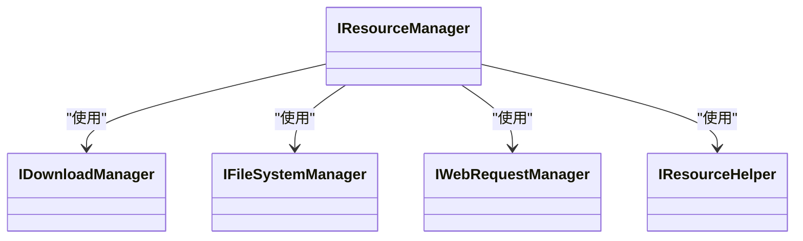

# 资源管理

<cite>
**本文档引用的文件 **  
- [IResourceManager.cs](file://GameFramework/Resource/IResourceManager.cs)
- [ResourceManager.cs](file://GameFramework/Resource/ResourceManager.cs)
- [IDownloadManager.cs](file://GameFramework/Download/IDownloadManager.cs)
- [IFileSystemManager.cs](file://GameFramework/FileSystem/IFileSystemManager.cs)
- [IWebRequestManager.cs](file://GameFramework/WebRequest/IWebRequestManager.cs)
- [IResourceHelper.cs](file://GameFramework/Resource/IResourceHelper.cs)
</cite>

## 目录
1. [引言](#引言)
2. [核心接口设计](#核心接口设计)
3. [资源加载生命周期](#资源加载生命周期)
4. [资源热更新流程](#资源热更新流程)
5. [资源组管理](#资源组管理)
6. [底层支持机制](#底层支持机制)
7. [典型使用模式](#典型使用模式)
8. [性能优化技巧](#性能优化技巧)

## 引言
资源管理系统是游戏框架的核心组件，负责管理游戏运行时所需的所有资源。该系统提供了一套完整的解决方案，涵盖资源加载、异步处理、版本控制、热更新、资源组管理以及底层支持机制。通过精心设计的接口和模块化架构，系统实现了高效、可靠的资源管理，支持多种资源模式和复杂的资源依赖关系。

**Section sources**
- [IResourceManager.cs](file://GameFramework/Resource/IResourceManager.cs#L18-L830)

## 核心接口设计

### IResourceManager接口设计理念
`IResourceManager`接口是资源管理系统的核心，定义了资源管理的所有功能。该接口采用面向对象的设计原则，将资源管理的各个功能模块化，提供了清晰的职责划分。接口设计遵循单一职责原则，每个方法只负责一个特定的功能，如资源加载、版本检查、资源更新等。

接口通过事件机制实现了松耦合，允许外部系统订阅资源管理的各种事件，如资源加载成功、资源更新失败等。这种设计使得资源管理系统可以独立运行，同时又能与外部系统进行有效的通信。

**Diagram sources **
- [IResourceManager.cs](file://GameFramework/Resource/IResourceManager.cs#L18-L830)

### 与底层管理器的协作关系
`IResourceManager`接口通过依赖注入的方式与`IDownloadManager`、`IFileSystemManager`、`IWebRequestManager`等底层管理器协作。这种设计实现了高度的模块化和可扩展性，使得资源管理系统可以灵活地适应不同的运行环境和需求。

**Diagram sources **
- [IResourceManager.cs](file://GameFramework/Resource/IResourceManager.cs#L18-L830)
- [IDownloadManager.cs](file://GameFramework/Download/IDownloadManager.cs#L15-L238)
- [IFileSystemManager.cs](file://GameFramework/FileSystem/IFileSystemManager.cs#L14-L80)
- [IWebRequestManager.cs](file://GameFramework/WebRequest/IWebRequestManager.cs#L15-L275)
- [IResourceHelper.cs](file://GameFramework/Resource/IResourceHelper.cs#L12-L35)

**Section sources**
- [IResourceManager.cs](file://GameFramework/Resource/IResourceManager.cs#L18-L830)
- [IDownloadManager.cs](file://GameFramework/Download/IDownloadManager.cs#L15-L238)
- [IFileSystemManager.cs](file://GameFramework/FileSystem/IFileSystemManager.cs#L14-L80)
- [IWebRequestManager.cs](file://GameFramework/WebRequest/IWebRequestManager.cs#L15-L275)
- [IResourceHelper.cs](file://GameFramework/Resource/IResourceHelper.cs#L1