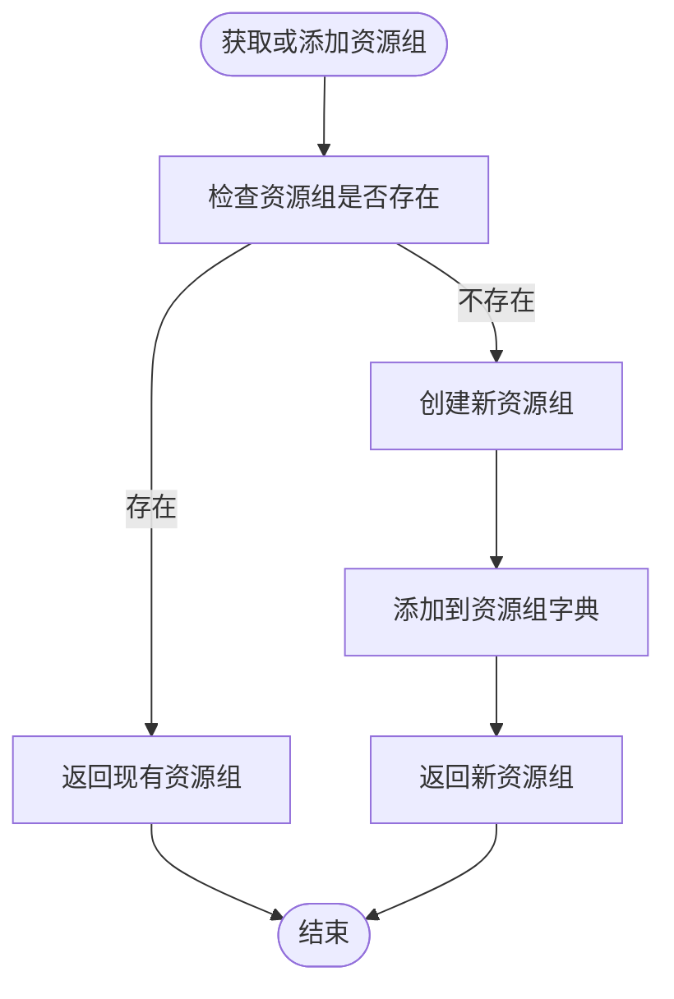
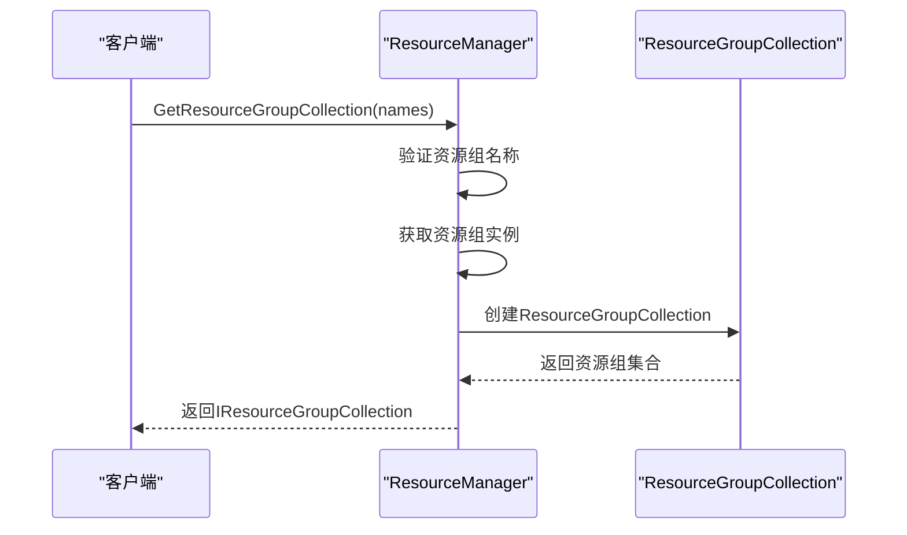

# 资源组管理

<cite>
**本文档中引用的文件**  
- [IResourceGroup.cs](file://GameFramework/Resource/IResourceGroup.cs)
- [IResourceGroupCollection.cs](file://GameFramework/Resource/IResourceGroupCollection.cs)
- [ResourceManager.cs](file://GameFramework/Resource/ResourceManager.cs)
- [ResourceManager.ResourceGroup.cs](file://GameFramework/Resource/ResourceManager.ResourceGroup.cs)
- [ResourceManager.ResourceGroupCollection.cs](file://GameFramework/Resource/ResourceManager.ResourceGroupCollection.cs)
- [IResourceManager.cs](file://GameFramework/Resource/IResourceManager.cs)
</cite>

## 目录
1. [引言](#引言)
2. [资源组设计与接口](#资源组设计与接口)
3. [资源组集合设计与接口](#资源组集合设计与接口)
4. [资源组管理实现](#资源组管理实现)
5. [资源组API使用示例](#资源组api使用示例)
6. [资源组在大型项目中的应用](#资源组在大型项目中的应用)
7. [总结](#总结)

## 引言
资源组管理是游戏框架中实现高效资源组织、加载和内存控制的核心机制。通过将资源逻辑分组，开发者可以按需加载、卸载和更新资源，从而优化内存使用和加载性能。本文档详细阐述了`IResourceGroup`和`IResourceGroupCollection`接口的设计理念与使用场景，说明如何通过资源组对资源进行逻辑分组，并结合`ResourceManager`的资源组API展示具体使用方法。

## 资源组设计与接口
`IResourceGroup`接口定义了资源组的核心功能，提供了对资源组状态、大小和进度的查询能力。资源组作为资源的逻辑容器，允许开发者按场景、功能模块或更新单元组织资源。

### 接口设计
`IResourceGroup`接口提供了以下关键属性和方法：

- **Name**: 获取资源组名称。
- **Ready**: 获取资源组是否准备完毕。
- **TotalCount**: 获取资源组包含资源数量。
- **ReadyCount**: 获取资源组中已准备完成资源数量。
- **TotalLength**: 获取资源组包含资源的总大小。
- **TotalCompressedLength**: 获取资源组包含资源压缩后的总大小。
- **ReadyLength**: 获取资源组中已准备完成资源的总大小。
- **ReadyCompressedLength**: 获取资源组中已准备完成资源压缩后的总大小。
- **Progress**: 获取资源组的完成进度。
- **GetResourceNames()**: 获取资源组包含的资源名称列表。

### 使用场景
资源组适用于以下场景：
- 按场景组织资源，实现场景切换时的资源加载和卸载。
- 按功能模块组织资源，实现模块化加载。
- 按更新单元组织资源，支持热更新。

**Section sources**
- [IResourceGroup.cs](file://GameFramework/Resource/IResourceGroup.cs#L14-L99)
- [ResourceManager.ResourceGroup.cs](file://GameFramework/Resource/ResourceManager.ResourceGroup.cs#L25-L267)

## 资源组集合设计与接口
`IResourceGroupCollection`接口定义了资源组集合的功能，允许将多个资源组合并为一个逻辑单元进行管理。资源组集合继承了资源组的统计和进度查询能力，同时提供了对包含资源组的访问。

### 接口设计
`IResourceGroupCollection`接口提供了以下关键属性和方法：

- **Ready**: 获取资源组集合是否准备完毕。
- **TotalCount**: 获取资源组集合包含资源数量。
- **ReadyCount**: 获取资源组集合中已准备完成资源数量。
- **TotalLength**: 获取资源组集合包含资源的总大小。
- **TotalCompressedLength**: 获取资源组集合包含资源压缩后的总大小。
- **ReadyLength**: 获取资源组集合中已准备完成资源的总大小。
- **ReadyCompressedLength**: 获取资源组集合中已准备完成资源压缩后的总大小。
- **Progress**: 获取资源组集合的完成进度。
- **GetResourceGroups()**: 获取资源组集合包含的资源组列表。
- **GetResourceNames()**: 获取资源组集合包含的资源名称列表。

### 使用场景
资源组集合适用于以下场景：
- 同时管理多个相关资源组，如主场景和其依赖的公共资源组。
- 实现复杂的资源加载策略，如分阶段加载多个模块的资源。
- 统一监控多个资源组的加载进度。

**Section sources**
- [IResourceGroupCollection.cs](file://GameFramework/Resource/IResourceGroupCollection.cs#L14-L97)
- [ResourceManager.ResourceGroupCollection.cs](file://GameFramework/Resource/ResourceManager.ResourceGroupCollection.cs#L23-L252)

## 资源组管理实现
资源组管理由`ResourceManager`类实现，通过内部的`ResourceGroup`和`ResourceGroupCollection`类提供具体功能。`ResourceManager`维护了一个资源组字典，用于存储和管理所有资源组。

### 资源组创建
资源组通过`GetOrAddResourceGroup`方法创建或获取。当请求一个不存在的资源组时，会自动创建新的资源组实例。

**Diagram sources**
- [ResourceManager.cs](file://GameFramework/Resource/ResourceManager.cs#L2237-L2252)

### 资源组集合创建
资源组集合通过`GetResourceGroupCollection`方法创建。该方法接收一个资源组名称数组，验证其有效性后创建`ResourceGroupCollection`实例。

**Diagram sources**
- [ResourceManager.cs](file://GameFramework/Resource/ResourceManager.cs#L2177-L2