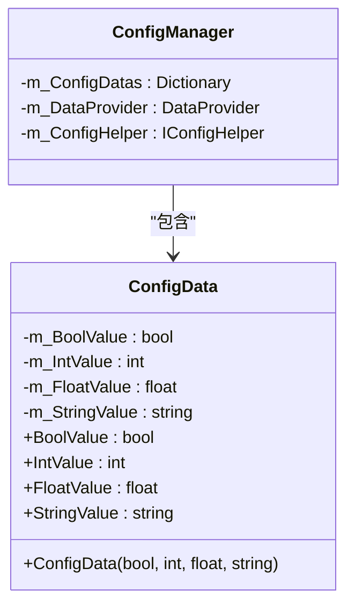
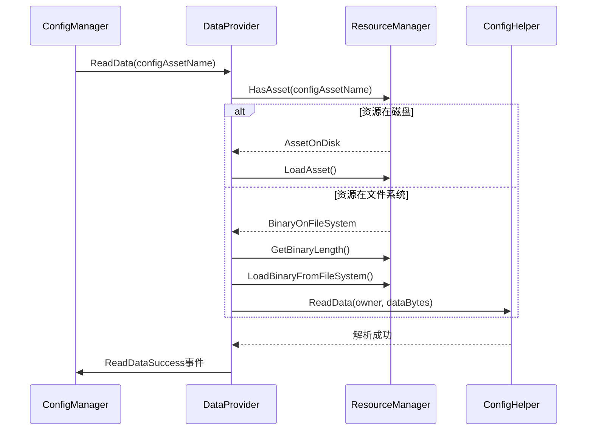
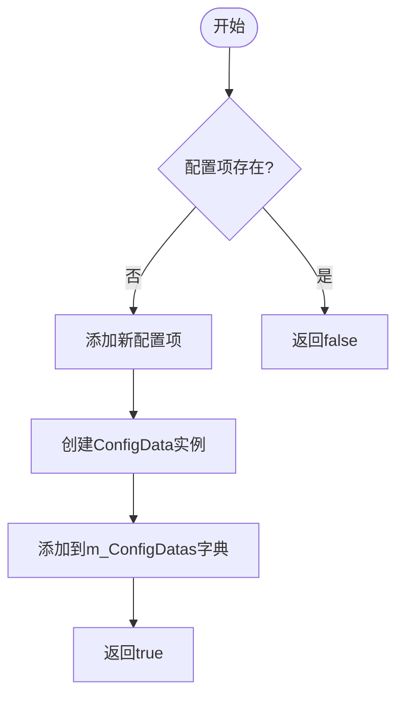

# 配置管理

<cite>
**本文档引用的文件**  
- [IConfigManager.cs](file://GameFramework/Config/IConfigManager.cs)
- [ConfigManager.cs](file://GameFramework/Config/ConfigManager.cs)
- [ConfigManager.ConfigData.cs](file://GameFramework/Config/ConfigManager.ConfigData.cs)
- [DataProvider.cs](file://GameFramework/Base/DataProvider/DataProvider.cs)
- [IResourceManager.cs](file://GameFramework/Resource/IResourceManager.cs)
</cite>

## 目录
1. [引言](#引言)
2. [核心组件](#核心组件)
3. [配置数据结构](#配置数据结构)
4. [持久化与加载机制](#持久化与加载机制)
5. [内存缓存与线程安全](#内存缓存与线程安全)
6. [配置项操作API](#配置项操作api)
7. [动态更新实践](#动态更新实践)
8. [扩展点与辅助器](#扩展点与辅助器)
9. [总结](#总结)

## 引言

配置管理模块是游戏框架中负责全局配置项存储、读取、序列化、缓存及动态更新的核心组件。该模块通过`IConfigManager`接口定义了统一的配置管理契约，由`ConfigManager`类实现具体功能。配置数据支持从资源系统加载或直接解析字符串/二进制流，并在内存中以线程安全的方式进行缓存和访问。本文档将深入解析该模块的架构设计、核心功能及使用方法。

## 核心组件

配置管理模块主要由`IConfigManager`接口和`ConfigManager`实现类构成。`IConfigManager`定义了配置项的增删改查、读取、解析等核心操作契约，而`ConfigManager`则通过组合`DataProvider<IConfigManager>`来实现资源加载与数据解析的分离。该设计遵循单一职责原则，使得配置管理器专注于配置数据的内存管理，而将底层资源加载委托给通用的数据提供者。

**Section sources**
- [IConfigManager.cs](file://GameFramework/Config/IConfigManager.cs#L14-L158)
- [ConfigManager.cs](file://GameFramework/Config/ConfigManager.cs#L25-L30)

## 配置数据结构

配置项在内存中以`ConfigData`结构体形式存储，包含布尔值、整数值、浮点数值和字符串值四种基本类型。该结构体被设计为不可变的值类型，确保了数据的一致性和线程安全性。所有配置项通过字典`m_ConfigDatas`以配置名称为键进行索引，实现了O(1)时间复杂度的快速查找。

**Diagram sources**
- [ConfigManager.ConfigData.cs](file://GameFramework/Config/ConfigManager.ConfigData.cs#L11-L61)
- [ConfigManager.cs](file://GameFramework/Config/ConfigManager.cs#L25-L30)

## 持久化与加载机制

配置数据的持久化通过`DataProvider<IConfigManager>`实现，该组件负责从资源系统加载配置资源。加载过程首先通过`IResourceManager.HasAsset`检查资源位置，然后根据资源类型（磁盘、文件系统等）选择相应的加载策略。对于存储在文件系统中的二进制资源，会先通过`LoadBinaryFromFileSystem`加载到共享缓存字节数组中，再由`IConfigHelper`进行解析。

**Diagram sources**
- [DataProvider.cs](file://GameFramework/Base/DataProvider/DataProvider.cs#L181-L245)
- [IResourceManager.cs](file://GameFramework/Resource/IResourceManager.cs#L420-L425)

## 内存缓存与线程安全

配置管理器采用静态字节数组`s_CachedBytes`作为共享缓存，通过`EnsureCachedBytesSize`方法确保缓存大小足够容纳待加载的配置数据。该缓存由`DataProvider`类统一管理，避免了频繁的内存分配与垃圾回收。配置数据的读取通过`GetConfigData`方法实现，该方法首先验证配置名称的有效性，然后通过字典的`TryGetValue`操作安全地获取配置数据，确保了线程安全的读取操作。

**Section sources**
- [DataProvider.cs](file://GameFramework/Base/DataProvider/DataProvider.cs#L15-L20)
- [ConfigManager.cs](file://GameFramework/Config/ConfigManager.cs#L470-L484)

## 配置项操作API

配置管理器提供了丰富的API用于配置项的增删改查操作。读取操作支持指定默认值的重载方法，当配置项不存在时返回默认值而非抛出异常。增加配置项时，`AddConfig`方法会先检查配置名称是否已存在，避免重复添加。移除操作通过`RemoveConfig`方法实现，该方法在移除前会检查配置项的存在性。

**Diagram sources**
- [ConfigManager.cs](file://GameFramework/Config/ConfigManager.cs#L414-L460)

## 动态更新实践

在游戏运行时，可以通过`ParseData`系列方法动态更新配置。这些方法支持从字符串、字节数组等多种格式解析配置数据，并触发相应的成功或失败事件。开发者可以在事件回调中处理配置更新后的逻辑，如刷新UI、调整游戏参数等。对于需要立即生效的配置变更，建议在解析成功后主动通知相关模块进行更新。

**Section sources**
- [ConfigManager.cs](file://GameFramework/Config/ConfigManager.cs#L224-L284)

## 扩展点与辅助器

`IConfigHelper`接口作为配置管理的扩展点，允许开发者自定义配置数据的解析逻辑。通过`SetConfigHelper`方法设置自定义的辅助器，可以支持不同的配置格式（如JSON、XML等）。`DataProvider`的`SetDataProviderHelper`方法则允许替换数据提供者的辅助器，从而改变资源加载和解析的底层行为。这种设计提供了高度的灵活性和可扩展性。

**Section sources**
- [IConfigHelper.cs](file://GameFramework/Config/IConfigHelper.cs#L12-L14)
- [ConfigManager.cs](file://GameFramework/Config/ConfigManager.cs#L105-L115)

## 总结

配置管理模块通过清晰的接口定义、合理的职责分离和高效的内存管理，为游戏开发提供了稳定可靠的配置管理解决方案。其支持多种加载方式、提供丰富的操作API，并通过事件机制实现动态更新，能够满足大多数游戏项目的配置管理需求。通过扩展`IConfigHelper`接口，还可以轻松支持自定义的配置格式和解析逻辑。