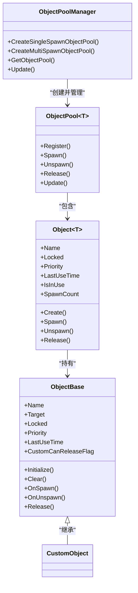
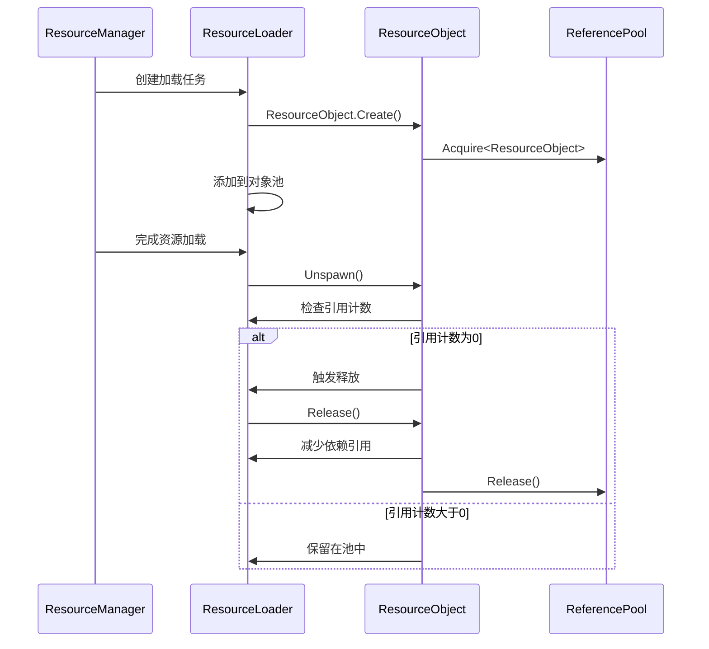
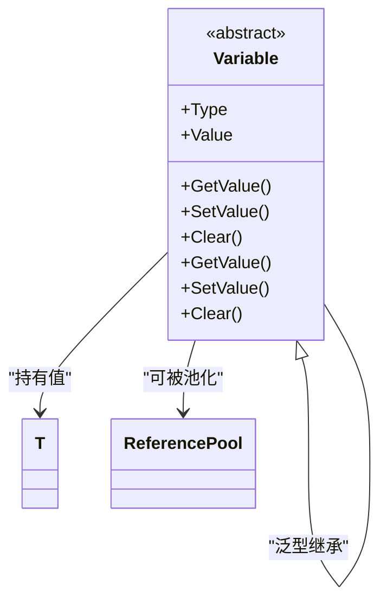

# 内存管理

<cite>
**本文档中引用的文件**  
- [ReferencePool.cs](file://GameFramework/Base/ReferencePool/ReferencePool.cs)
- [ReferencePool.ReferenceCollection.cs](file://GameFramework/Base/ReferencePool/ReferencePool.ReferenceCollection.cs)
- [ObjectPoolManager.cs](file://GameFramework/ObjectPool/ObjectPoolManager.cs)
- [ObjectPoolManager.ObjectPool.cs](file://GameFramework/ObjectPool/ObjectPoolManager.ObjectPool.cs)
- [ObjectPoolManager.Object.cs](file://GameFramework/ObjectPool/ObjectPoolManager.Object.cs)
- [ObjectBase.cs](file://GameFramework/ObjectPool/ObjectBase.cs)
- [ResourceManager.ResourceLoader.ResourceObject.cs](file://GameFramework/Resource/ResourceManager.ResourceLoader.ResourceObject.cs)
- [GenericVariable.cs](file://GameFramework/Base/Variable/GenericVariable.cs)
- [Variable.cs](file://GameFramework/Base/Variable/Variable.cs)
</cite>

## 目录
1. [引言](#引言)
2. [引用池(ReferencePool)机制](#引用池referencepool-机制)
3. [对象池(ObjectPool)架构与生命周期管理](#对象池objectpool-架构与生命周期管理)
4. [资源对象(ResourceObject)回收机制](#资源对象resourceobject-回收机制)
5. [基于Variable的泛型统一管理](#基于variable的泛型统一管理)
6. [内存泄漏检测与监控策略](#内存泄漏检测与监控策略)
7. [对象池自动释放策略配置](#对象池自动释放策略配置)
8. [典型内存问题排查与优化建议](#典型内存问题排查与优化建议)
9. [总结](#总结)

## 引言
本框架通过引用池、对象池和资源对象的协同管理机制，构建了一套高效的内存管理体系。该体系旨在降低垃圾回收(GC)压力、避免内存碎片化，并通过池化技术实现对象的高效复用。核心组件包括引用池(ReferencePool)用于轻量级引用对象的复用，对象池(ObjectPool)管理复杂对象的生命周期，以及资源对象(ResourceObject)实现资源依赖的自动回收。结合Variable泛型设计，实现了值类型与引用类型的统一管理，为开发者提供了完整的内存泄漏检测、引用计数监控和自动释放策略配置能力。

## 引用池(ReferencePool)机制

引用池通过`ReferencePool`静态类实现，采用类型索引的字典结构管理不同类型的引用对象集合。每个引用类型对应一个`ReferenceCollection`实例，内部使用队列(`Queue<IReference>`)存储未使用的引用对象，实现O(1)时间复杂度的获取与归还操作。

引用池的核心优势在于避免频繁的内存分配与回收。当调用`Acquire<T>()`时，系统优先从队列中取出空闲对象，若队列为空则创建新实例；调用`Release()`时，对象被清空后重新入队。这种机制显著减少了GC压力，特别适用于频繁创建和销毁的轻量级对象（如事件参数、临时数据结构）。

引用池支持运行时统计与调试，通过`GetAllReferencePoolInfos()`可获取所有引用池的详细信息，包括未使用/正在使用引用数量、获取/归还次数等，为内存使用分析提供数据支持。

**Section sources**
- [ReferencePool.cs](file://GameFramework/Base/ReferencePool/ReferencePool.cs#L98-L102)
- [ReferencePool.ReferenceCollection.cs](file://GameFramework/Base/ReferencePool/ReferencePool.ReferenceCollection.cs#L112-L126)

## 对象池(ObjectPool)架构与生命周期管理

对象池系统由`ObjectPoolManager`统一管理，采用`ObjectPool<T>`泛型类实现具体池实例，其中`T`必须继承自`ObjectBase`。对象池通过`m_ObjectMap`字典建立对象实例与内部包装对象`Object<T>`的映射关系，实现高效的对象查找与状态管理。

**Diagram sources**
- [ObjectPoolManager.cs](file://GameFramework/ObjectPool/ObjectPoolManager.cs#L28-L33)
- [ObjectPoolManager.ObjectPool.cs](file://GameFramework/ObjectPool/ObjectPoolManager.ObjectPool.cs#L41-L55)
- [ObjectBase.cs](file://GameFramework/ObjectPool/ObjectBase.cs#L25-L32)
- [ObjectPoolManager.Object.cs](file://GameFramework/ObjectPool/ObjectPoolManager.Object.cs#L11-L194)

对象生命周期通过`Spawn()`和`Unspawn()`方法控制。`Spawn()`增加获取计数并更新最后使用时间，`Unspawn()`减少计数。对象池支持两种模式：单次获取（`AllowMultiSpawn=false`）确保对象不被重复获取，多次获取（`AllowMultiSpawn=true`）允许多个引用共享同一对象。对象的释放由`Release()`方法触发，结合`CustomCanReleaseFlag`和引用计数判断是否可释放。

## 资源对象(ResourceObject)回收机制

资源对象`ResourceObject`继承自`ObjectBase`，专门用于管理资源加载过程中的对象生命周期。其核心特性在于通过引用计数实现依赖资源的自动回收。

**Diagram sources**
- [ResourceManager.ResourceLoader.ResourceObject.cs](file://GameFramework/Resource/ResourceManager.ResourceLoader.ResourceObject.cs#L42-L59)
- [ResourceManager.ResourceLoader.ResourceObject.cs](file://GameFramework/Resource/ResourceManager.ResourceLoader.ResourceObject.cs#L25-L30)

`ResourceObject`通过`AddDependencyResource()`方法记录其依赖的其他资源，并在`m_ResourceLoader`中维护这些依赖的引用计数。`CustomCanReleaseFlag`属性重写为检查自身及所有依赖资源的引用计数是否为零。`Release()`方法在非关闭状态下会验证引用计数，防止被引用的资源被提前释放，确保资源管理的安全性。

## 基于Variable的泛型统一管理

框架通过`Variable<T>`泛型类实现值类型与引用类型的统一管理。`Variable<T>`继承自抽象基类`Variable`，后者实现了`IReference`接口，使其能够被引用池管理。

**Diagram sources**
- [GenericVariable.cs](file://GameFramework/Base/Variable/GenericVariable.cs#L15-L87)
- [Variable.cs](file://GameFramework/Base/Variable/Variable.cs#L0-L49)

这种设计允许将任意类型的值（包括值类型和引用类型）封装为`Variable`对象，从而可以统一使用引用池进行管理。例如，`Fsm`（有限状态机）和`DataNode`（数据节点）等系统通过`GetData()`方法获取`Variable`对象，实现了数据的动态存储与高效复用，避免了装箱/拆箱操作带来的性能损耗。

## 内存泄漏检测与监控策略

框架提供了多层次的内存泄漏检测与监控机制。首先，通过`ReferencePool.EnableStrictCheck`可开启严格检查模式，在归还已释放的引用时抛出异常，帮助定位重复释放问题。

其次，对象池提供了详细的运行时信息。通过`GetAllObjectInfos()`可获取池中所有对象的状态，包括名称、锁定状态、优先级、最后使用时间等。结合`CanReleaseCount`属性，可监控可释放对象的数量，判断是否存在对象未被正确回收。

对于资源对象，其`Release()`方法在非关闭状态下会进行严格的引用计数检查，若发现目标资源或其依赖资源的引用计数大于零，则抛出异常，有效防止因引用未释放导致的内存泄漏。

**Section sources**
- [ReferencePool.cs](file://GameFramework/Base/ReferencePool/ReferencePool.cs#L46-L81)
- [ObjectPoolManager.ObjectPool.cs](file://GameFramework/ObjectPool/ObjectPoolManager.ObjectPool.cs#L18-L634)
- [ResourceManager.ResourceLoader.ResourceObject.cs](file://GameFramework/Resource/ResourceManager.ResourceLoader.ResourceObject.cs#L19-L121)

## 对象池自动释放策略配置

对象池支持灵活的自动释放策略配置，通过以下参数控制：

- **容量(Capacity)**：池中对象的最大数量，超过此数量时会触发释放。
- **过期时间(ExpireTime)**：对象在未被使用的情况下保持存活的最长时间。
- **自动释放间隔(AutoReleaseInterval)**：检查并释放可释放对象的时间间隔。
- **优先级(Priority)**：在释放多个候选对象时，优先级低的对象优先被释放。

释放策略由`DefaultReleaseObjectFilterCallback`实现，其逻辑为：首先释放已过期的对象，然后根据优先级和最后使用时间对剩余候选对象排序，优先释放优先级低且最近未使用的对象。开发者可通过自定义`ReleaseObjectFilterCallback`实现更复杂的释放逻辑。

**Section sources**
- [ObjectPoolManager.ObjectPool.cs](file://GameFramework/ObjectPool/ObjectPoolManager.ObjectPool.cs#L18-L634)

## 典型内存问题排查与优化建议

### 排查步骤
1. **检查引用池状态**：调用`ReferencePool.GetAllReferencePoolInfos()`，观察特定类型引用的`UsingReferenceCount`是否持续增长，判断是否存在未归还的引用。
2. **分析对象池信息**：获取目标对象池的`ObjectInfo`数组，检查`SpawnCount`是否为零，`LastUseTime`是否异常陈旧，判断对象是否被正确回收。
3. **验证资源引用计数**：在资源释放异常时，检查`m_ResourceDependencyCount`字典中相关资源的引用计数，定位未释放的引用来源。
4. **启用严格检查**：在开发阶段开启`ReferencePool.EnableStrictCheck`，捕获重复释放或非法操作。

### 优化建议
- **合理配置池容量**：根据对象使用频率和内存占用，设置合适的`Capacity`，避免内存浪费或频繁创建。
- **设置合理的过期时间**：对于临时性对象，设置较短的`ExpireTime`，及时释放内存。
- **正确使用锁定机制**：对需要长期持有的对象使用`SetLocked(true)`，防止被意外释放。
- **及时释放资源**：确保所有获取的资源在使用完毕后调用`Unspawn()`或`Release()`。
- **监控关键指标**：定期检查`AcquireReferenceCount`与`ReleaseReferenceCount`的差值，确保引用平衡。

**Section sources**
- [ReferencePool.cs](file://GameFramework/Base/ReferencePool/ReferencePool.cs#L98-L102)
- [ObjectPoolManager.ObjectPool.cs](file://GameFramework/ObjectPool/ObjectPoolManager.ObjectPool.cs#L18-L634)
- [ResourceManager.ResourceLoader.ResourceObject.cs](file://GameFramework/Resource/ResourceManager.ResourceLoader.ResourceObject.cs#L19-L121)

## 总结
本框架的内存管理机制通过引用池、对象池和资源对象的深度整合，构建了一个高效、安全、可监控的内存管理体系。引用池解决了轻量级对象的GC问题，对象池实现了复杂对象的生命周期管理，资源对象通过引用计数确保了资源依赖的正确回收。结合Variable泛型设计，实现了数据的统一管理。完善的监控与检测机制为开发者提供了强大的调试能力，而灵活的自动释放策略则保证了内存使用的高效性。遵循本文档的指导原则，可有效避免内存泄漏，优化应用性能。