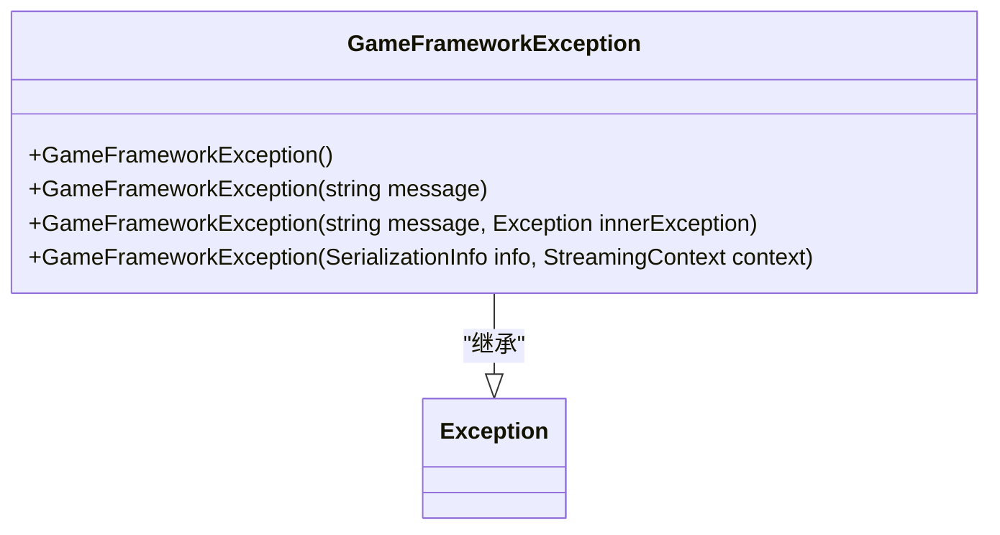
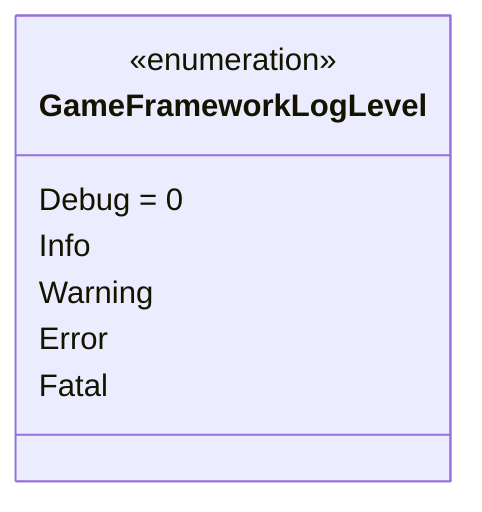
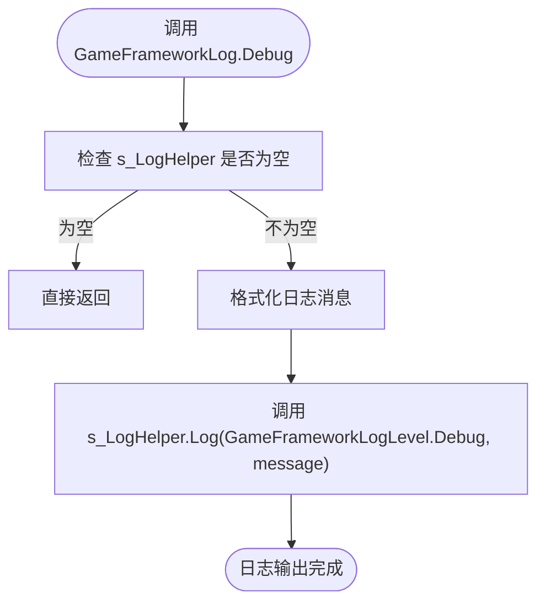
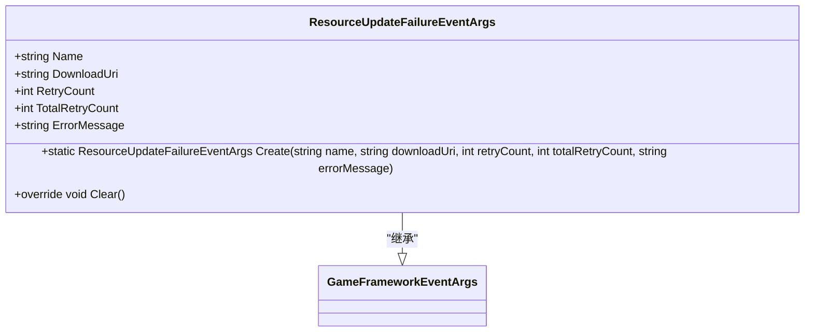
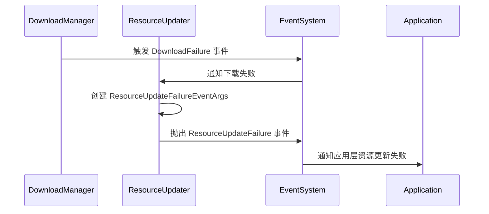
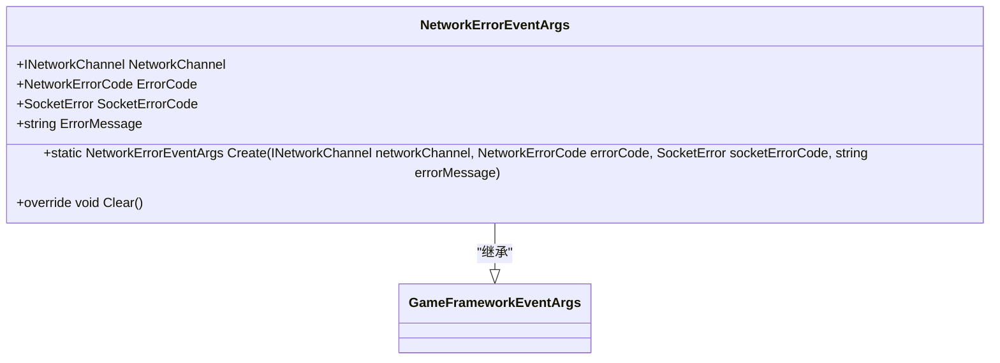

# 异常处理机制

<cite>
**Referenced Files in This Document**   
- [GameFrameworkException.cs](file://GameFramework/Base/GameFrameworkException.cs)
- [GameFrameworkLog.cs](file://GameFramework/Base/Log/GameFrameworkLog.cs)
- [GameFrameworkLogLevel.cs](file://GameFramework/Base/Log/GameFrameworkLogLevel.cs)
- [ResourceUpdateFailureEventArgs.cs](file://GameFramework/Resource/ResourceUpdateFailureEventArgs.cs)
- [ResourceManager.ResourceUpdater.cs](file://GameFramework/Resource/ResourceManager.ResourceUpdater.cs)
- [ResourceManager.ResourceLoader.cs](file://GameFramework/Resource/ResourceManager.ResourceLoader.cs)
- [DownloadManager.cs](file://GameFramework/Download/DownloadManager.cs)
- [NetworkErrorEventArgs.cs](file://GameFramework/Network/NetworkErrorEventArgs.cs)
</cite>

## 目录
1. [引言](#引言)
2. [核心异常类型设计](#核心异常类型设计)
3. [日志记录系统](#日志记录系统)
4. [资源加载错误处理](#资源加载错误处理)
5. [网络通信错误处理](#网络通信错误处理)
6. [事件驱动的错误通知](#事件驱动的错误通知)
7. [最佳实践与扩展](#最佳实践与扩展)
8. [总结](#总结)

## 引言

GameFramework框架提供了一套完整的异常处理体系，旨在帮助开发者构建健壮、可维护的应用程序。该体系以`GameFrameworkException`为核心，结合`GameFrameworkLog`日志系统和事件驱动的错误通知机制，实现了从异常捕获、日志记录到错误恢复的全流程管理。本文档将系统性地介绍框架的异常处理机制，重点阐述自定义异常的设计原则、标准化的日志输出流程，以及如何通过事件系统进行错误通知与恢复。

## 核心异常类型设计

### GameFrameworkException 类设计

框架定义了`GameFrameworkException`作为所有自定义异常的基础类，继承自.NET的`Exception`类。该设计遵循了异常处理的最佳实践，提供了多种构造函数以满足不同的使用场景。



**Diagram sources**  
- [GameFrameworkException.cs](file://GameFramework/Base/GameFrameworkException.cs#L15-L54)

**Section sources**  
- [GameFrameworkException.cs](file://GameFramework/Base/GameFrameworkException.cs#L15-L54)

#### 设计原则与实现

`GameFrameworkException`类的设计体现了以下几个关键原则：

1.  **基础构造函数**：无参构造函数`GameFrameworkException()`用于创建一个具有默认消息的异常实例。
2.  **消息构造函数**：`GameFrameworkException(string message)`允许开发者传入自定义的错误描述，这对于提供清晰的错误信息至关重要。
3.  **内部异常包装**：`GameFrameworkException(string message, Exception innerException)`构造函数支持将底层异常包装起来，形成异常链。这使得开发者可以在不丢失原始错误信息的情况下，添加更高层次的上下文信息。
4.  **序列化支持**：`GameFrameworkException(SerializationInfo info, StreamingContext context)`构造函数确保异常可以在分布式或持久化场景中被正确序列化和反序列化。

这种设计模式使得`GameFrameworkException`既灵活又强大，能够适应各种复杂的错误场景。

## 日志记录系统

### GameFrameworkLog 日志等级

框架提供了`GameFrameworkLog`类来统一管理日志输出。日志等级定义在`GameFrameworkLogLevel`枚举中，从低到高分别为`Debug`、`Info`、`Warning`、`Error`和`Fatal`。



**Diagram sources**  
- [GameFrameworkLogLevel.cs](file://GameFramework/Base/Log/GameFrameworkLogLevel.cs#L9-L40)

**Section sources**  
- [GameFrameworkLogLevel.cs](file://GameFramework/Base/Log/GameFrameworkLogLevel.cs#L9-L40)

### 日志输出流程

`GameFrameworkLog`是一个静态类，提供了`Debug`、`Info`、`Warning`、`Error`等静态方法，用于输出不同级别的日志。其核心工作流程如下：

1.  **日志辅助器设置**：通过`SetLogHelper(ILogHelper logHelper)`方法，开发者可以注入自定义的日志实现，从而将日志输出到控制台、文件或远程服务器。
2.  **日志级别过滤**：当调用`GameFrameworkLog.Debug(message)`等方法时，系统会首先检查`ILogHelper`是否已设置。如果未设置，则直接返回，不进行任何操作。
3.  **格式化与输出**：对于带格式的重载方法（如`Debug<T>(string format, T arg)`），框架会使用`Utility.Text.Format`方法将参数格式化为最终的字符串，然后通过`ILogHelper.Log`方法将日志消息和等级传递给底层的日志辅助器。



**Diagram sources**  
- [GameFrameworkLog.cs](file://GameFramework/Base/Log/GameFrameworkLog.cs#L20-L23)
- [GameFrameworkLog.cs](file://GameFramework/Base/Log/GameFrameworkLog.cs#L43-L51)

**Section sources**  
- [GameFrameworkLog.cs](file://GameFramework/Base/Log/GameFrameworkLog.cs#L20-L1807)

## 资源加载错误处理

### 资源更新失败事件

在资源管理模块中，当资源更新失败时，框架会通过事件系统抛出`ResourceUpdateFailureEventArgs`事件。该事件封装了失败的详细信息，为上层应用提供了恢复和重试的机会。



**Diagram sources**  
- [ResourceUpdateFailureEventArgs.cs](file://GameFramework/Resource/ResourceUpdateFailureEventArgs.cs#L12-L103)

**Section sources**  
- [ResourceUpdateFailureEventArgs.cs](file://GameFramework/Resource/ResourceUpdateFailureEventArgs.cs#L12-L103)

#### 错误传播与恢复机制

`ResourceUpdateFailureEventArgs`的创建和传播是资源更新流程中的关键环节。当`DownloadManager`在下载资源时遇到网络错误或文件损坏，它会触发`DownloadFailure`事件。`ResourceManager.ResourceUpdater`作为事件的监听者，会捕获该事件，并创建一个`ResourceUpdateFailureEventArgs`实例。



**Diagram sources**  
- [ResourceManager.ResourceUpdater.cs](file://GameFramework/Resource/ResourceManager.ResourceUpdater.cs#L500-L550)
- [DownloadManager.cs](file://GameFramework/Download/DownloadManager.cs#L400-L450)

**Section sources**  
- [ResourceManager.ResourceUpdater.cs](file://GameFramework/Resource/ResourceManager.ResourceUpdater.cs#L1-L1017)
- [DownloadManager.cs](file://GameFramework/Download/DownloadManager.cs#L1-L487)

`ResourceUpdater`类中的`OnDownloadFailure`方法是这一流程的核心。它接收来自下载代理的失败通知，提取错误信息，并通过`ResourceUpdateFailure`事件回调将`ResourceUpdateFailureEventArgs`传递给应用层。应用层可以据此决定是重试下载、降级处理还是向用户显示错误提示。

## 网络通信错误处理

### 网络错误事件

与资源模块类似，网络通信模块也采用了事件驱动的错误处理机制。`NetworkErrorEventArgs`类用于封装网络连接、数据传输过程中发生的各种错误。



**Diagram sources**  
- [NetworkErrorEventArgs.cs](file://GameFramework/Network/NetworkErrorEventArgs.cs#L12-L93)

**Section sources**  
- [NetworkErrorEventArgs.cs](file://GameFramework/Network/NetworkErrorEventArgs.cs#L12-L93)

#### 错误码与错误信息

`NetworkErrorEventArgs`包含了丰富的错误信息：
-   `NetworkChannel`：发生错误的网络频道，用于定位问题。
-   `ErrorCode`：框架定义的网络错误码（如`Unknown`、`SocketError`等），便于程序化处理。
-   `SocketErrorCode`：底层Socket的错误码，提供更详细的诊断信息。
-   `ErrorMessage`：可读的错误描述，可用于直接展示给用户。

这种分层的错误信息设计，使得开发者既能进行精确的错误分类和处理，又能提供友好的用户反馈。

## 事件驱动的错误通知

### 统一的事件处理模式

框架的异常处理体系高度依赖于事件系统（`EventPool`）。无论是资源更新失败还是网络通信错误，都通过发布特定的`EventArgs`来通知上层应用。这种模式具有以下优势：

1.  **解耦**：错误的产生者（如`DownloadManager`）和处理者（如UI系统）完全解耦。错误产生者只需发布事件，无需关心谁来处理。
2.  **灵活性**：多个监听者可以同时订阅同一个事件，实现多点响应。例如，一个错误可以同时触发日志记录、UI提示和自动重试。
3.  **可扩展性**：添加新的错误处理逻辑只需注册新的事件监听器，而无需修改核心代码。

### 事件的创建与回收

为了优化性能，框架使用了对象池（`ReferencePool`）来管理事件对象的生命周期。`ResourceUpdateFailureEventArgs`和`NetworkErrorEventArgs`都实现了`Clear()`方法，并通过`Create`静态方法从对象池中获取实例。

```csharp
// 伪代码示例：事件的创建与回收
public static ResourceUpdateFailureEventArgs Create(string name, string errorMessage) {
    // 从对象池获取实例，避免频繁的GC
    ResourceUpdateFailureEventArgs e = ReferencePool.Acquire<ResourceUpdateFailureEventArgs>();
    e.Name = name;
    e.ErrorMessage = errorMessage;
    return e;
}

public override void Clear() {
    // 重置所有字段，为下一次复用做准备
    Name = null;
    ErrorMessage = null;
    // ... 其他字段
}
```

这种设计显著减少了内存分配和垃圾回收的压力，特别适合在游戏等高性能场景中使用。

## 最佳实践与扩展

### 异常分类与错误码

建议开发者在使用`GameFrameworkException`时，遵循以下最佳实践：
-   **明确分类**：根据业务逻辑定义不同类型的异常，例如`ResourceLoadException`、`NetworkTimeoutException`等，继承自`GameFrameworkException`。
-   **使用错误码**：在`ErrorMessage`中包含结构化的错误码，便于程序化处理和国际化。例如：`"ERR_RESOURCE_NOT_FOUND: The resource 'xxx' could not be found."`。

### 用户友好提示

直接向用户展示技术性错误信息是不友好的。推荐的做法是：
1.  在事件监听器中捕获`ResourceUpdateFailureEventArgs`。
2.  根据`ErrorCode`或`ErrorMessage`中的错误码，查找预定义的、用户可理解的提示语。
3.  通过UI系统向用户显示友好的错误提示。

### 扩展框架能力

开发者可以通过以下方式扩展框架的异常处理能力：
-   **自定义日志辅助器**：实现`GameFrameworkLog.ILogHelper`接口，将日志输出到自定义的目标（如云端日志服务）。
-   **全局异常处理器**：在应用入口处设置全局异常捕获，将未处理的异常也通过`GameFrameworkLog.Error`记录下来，防止程序崩溃。
-   **集成监控系统**：在`ILogHelper`的实现中，将`Error`和`Fatal`级别的日志发送到监控告警系统。

## 总结

GameFramework的异常处理机制是一个设计精良、层次分明的系统。它以`GameFrameworkException`为核心，通过`GameFrameworkLog`提供标准化的日志输出，并利用事件系统（如`ResourceUpdateFailureEventArgs`）实现错误的解耦通知。这种架构不仅保证了代码的健壮性和可维护性，还为开发者提供了极大的灵活性和扩展性。通过遵循本文档介绍的最佳实践，开发者可以构建出能够优雅处理各种错误场景的高质量应用程序。