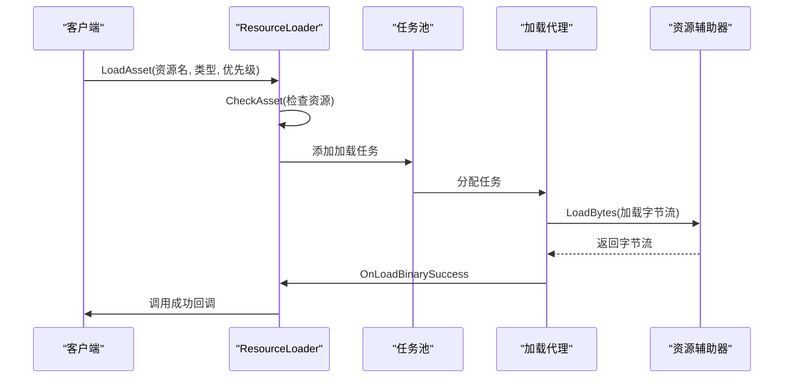
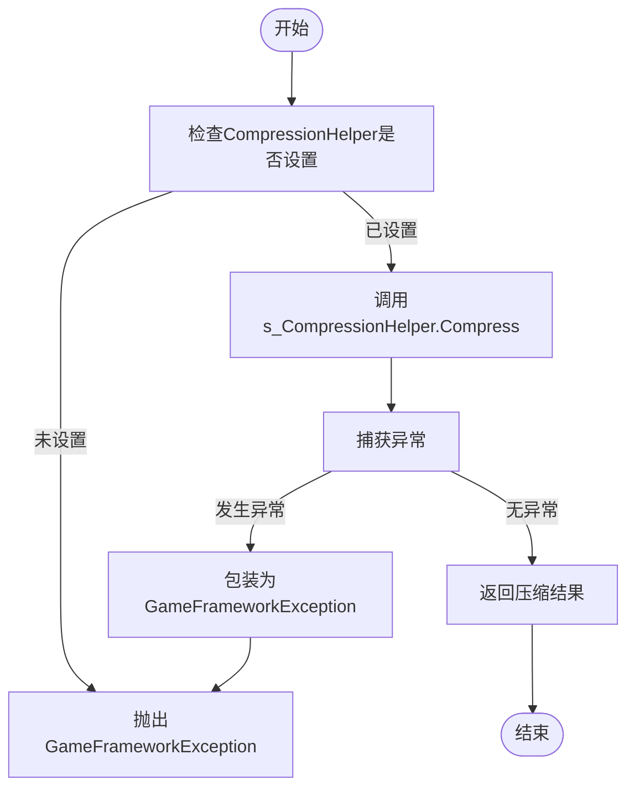
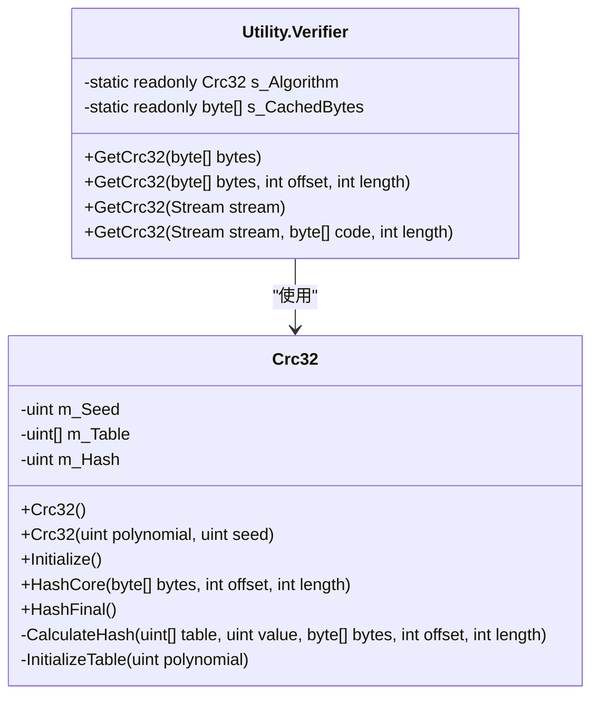
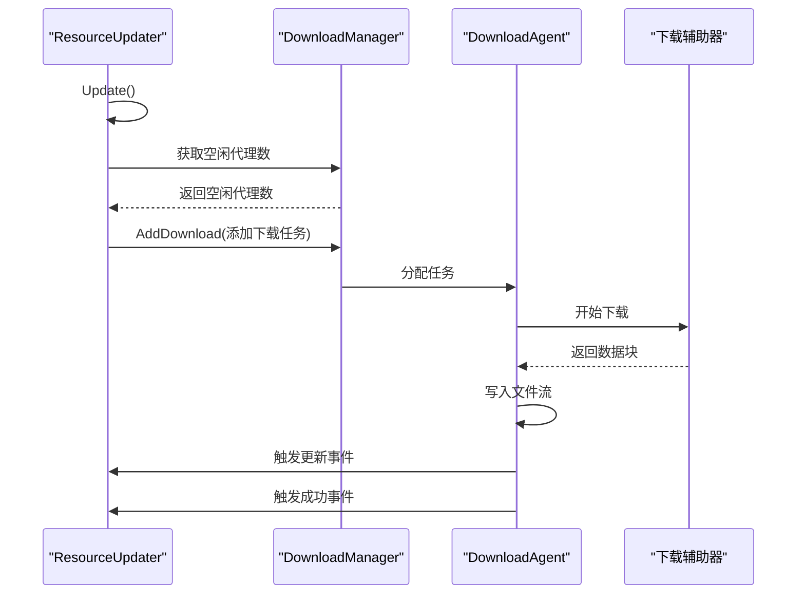
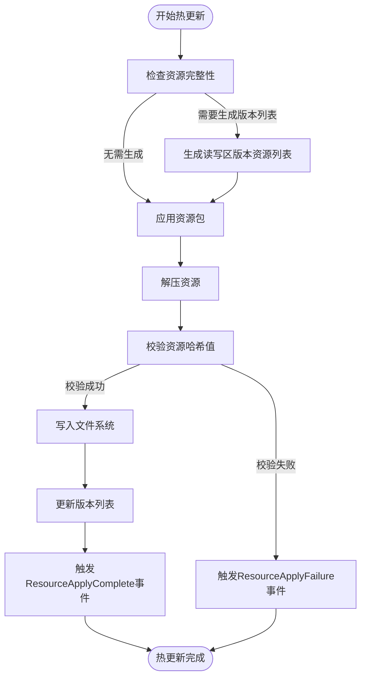
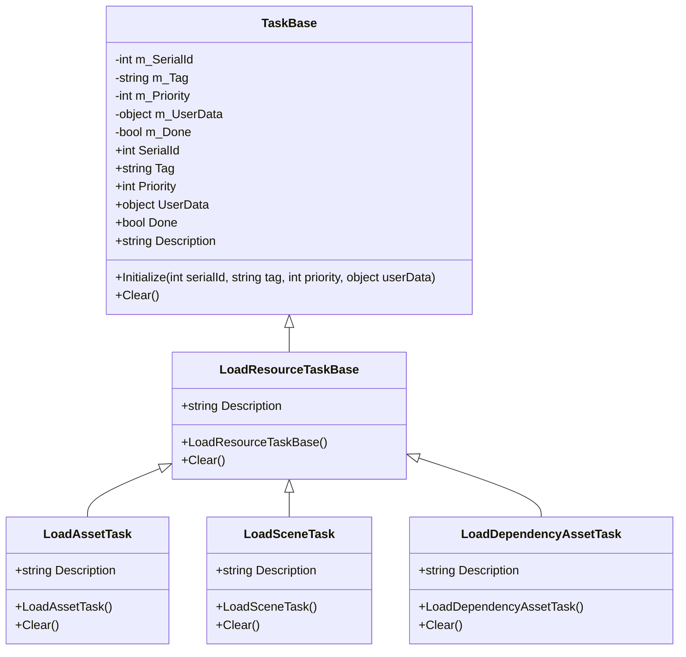

# 性能优化

<cite>
**本文档中引用的文件**  
- [ResourceManager.ResourceLoader.cs](file://GameFramework/Resource/ResourceManager.ResourceLoader.cs)
- [ResourceManager.ResourceUpdater.cs](file://GameFramework/Resource/ResourceManager.ResourceUpdater.cs)
- [Utility.Verifier.Crc32.cs](file://GameFramework/Utility/Utility.Verifier.Crc32.cs)
- [Utility.Verifier.cs](file://GameFramework/Utility/Utility.Verifier.cs)
- [Utility.Compression.cs](file://GameFramework/Utility/Utility.Compression.cs)
- [TaskBase.cs](file://GameFramework/Base/TaskPool/TaskBase.cs)
- [IResourceHelper.cs](file://GameFramework/Resource/IResourceHelper.cs)
- [ILoadResourceAgentHelper.cs](file://GameFramework/Resource/ILoadResourceAgentHelper.cs)
- [DownloadManager.DownloadAgent.cs](file://GameFramework/Download/DownloadManager.DownloadAgent.cs)
- [Constant.cs](file://GameFramework/Resource/Constant.cs)
</cite>

## 目录
1. [引言](#引言)
2. [资源加载性能优化](#资源加载性能优化)
3. [数据压缩与解压优化](#数据压缩与解压优化)
4. [CRC32校验性能优化](#crc32校验性能优化)
5. [异步任务调度与批量处理](#异步任务调度与批量处理)
6. [缓存机制设计](#缓存机制设计)
7. [热更新流程优化](#热更新流程优化)
8. [性能剖析与监控](#性能剖析与监控)
9. [常见性能问题诊断与解决方案](#常见性能问题诊断与解决方案)
10. [结论](#结论)

## 引言
本文档深入探讨了GameFramework框架在性能优化方面的最佳实践，重点分析了资源加载、数据压缩、CRC32校验等关键路径的性能瓶颈与优化策略。通过分析ResourceManager.ResourceLoader和ResourceUpdater的实现，详细说明了异步任务调度、批量处理、缓存机制的设计原理。同时，提供了性能剖析方法，指导开发者使用内置工具监控资源加载效率、内存分配频率和GC触发情况。通过实际代码示例展示如何优化热更新流程、减少主线程阻塞、提升版本校验速度，并给出常见性能问题的诊断与解决方案。

## 资源加载性能优化
资源加载是游戏启动和运行过程中的关键环节，直接影响用户体验。ResourceManager.ResourceLoader通过异步任务调度和对象池技术实现了高效的资源加载。



**图示来源**
- [ResourceManager.ResourceLoader.cs](file://GameFramework/Resource/ResourceManager.ResourceLoader.cs#L250-L300)
- [IResourceHelper.cs](file://GameFramework/Resource/IResourceHelper.cs#L12-L35)

ResourceLoader使用TaskPool管理加载任务，实现了任务的优先级调度和并发控制。通过SetObjectPoolManager方法设置对象池，利用对象池技术避免频繁的内存分配和GC，提高资源加载效率。

**节来源**
- [ResourceManager.ResourceLoader.cs](file://GameFramework/Resource/ResourceManager.ResourceLoader.cs#L100-L150)

## 数据压缩与解压优化
数据压缩是减少资源包大小、加快下载速度的重要手段。框架通过Utility.Compression类提供了高效的压缩解压功能。



**图示来源**
- [Utility.Compression.cs](file://GameFramework/Utility/Utility.Compression.cs#L100-L200)

压缩解压操作通过SetCompressionHelper方法注入具体的压缩算法实现，支持灵活替换。框架采用流式处理方式，避免一次性加载整个文件到内存，有效控制内存使用。

**节来源**
- [Utility.Compression.cs](file://GameFramework/Utility/Utility.Compression.cs#L50-L100)

## CRC32校验性能优化
CRC32校验用于确保资源完整性和一致性，是资源更新过程中的重要环节。框架通过优化的CRC32算法实现了高效的校验功能。



**图示来源**
- [Utility.Verifier.Crc32.cs](file://GameFramework/Utility/Utility.Verifier.Crc32.cs#L10-L90)
- [Utility.Verifier.cs](file://GameFramework/Utility/Utility.Verifier.cs#L50-L100)

CRC32算法采用查表法优化，预先计算256个字节的哈希值表，将复杂的位运算转换为简单的查表操作，大幅提升计算效率。同时使用静态实例和缓存字节数组，避免重复创建对象。

**节来源**
- [Utility.Verifier.Crc32.cs](file://GameFramework/Utility/Utility.Verifier.Crc32.cs#L1-L100)
- [Utility.Verifier.cs](file://GameFramework/Utility/Utility.Verifier.cs#L1-L200)

## 异步任务调度与批量处理
异步任务调度是避免主线程阻塞、提高程序响应性的关键。框架通过TaskPool和DownloadManager实现了高效的异步任务管理。



**图示来源**
- [ResourceManager.ResourceUpdater.cs](file://GameFramework/Resource/ResourceManager.ResourceUpdater.cs#L500-L600)
- [DownloadManager.DownloadAgent.cs](file://GameFramework/Download/DownloadManager.DownloadAgent.cs#L100-L200)

ResourceUpdater在Update方法中检查空闲下载代理数量，批量添加下载任务，实现并发下载。通过事件回调机制通知下载进度和结果，避免轮询造成的性能浪费。

**节来源**
- [ResourceManager.ResourceUpdater.cs](file://GameFramework/Resource/ResourceManager.ResourceUpdater.cs#L400-L600)

## 缓存机制设计
缓存机制是提高性能的重要手段，框架在多个层面实现了缓存优化。

```mermaid
classDiagram
class ResourceLoader {
-byte[] m_CachedHashBytes
-byte[] m_CachedBytes
-Dictionary<object, int> m_AssetDependencyCount
-Dictionary<object, int> m_ResourceDependencyCount
-Dictionary<object, object> m_AssetToResourceMap
-Dictionary<string, object> m_SceneToAssetMap
}
class ResourceUpdater {
-byte[] m_CachedHashBytes
-byte[] m_CachedBytes
-Queue<ApplyInfo> m_ApplyWaitingInfo
-List<UpdateInfo> m_UpdateWaitingInfo
-HashSet<UpdateInfo> m_UpdateWaitingInfoWhilePlaying
-Dictionary<ResourceName, UpdateInfo> m_UpdateCandidateInfo
-SortedDictionary<string, List<int>> m_CachedFileSystemsForGenerateReadWriteVersionList
-List<ResourceName> m_CachedResourceNames
}
ResourceLoader --> "缓存字节数组" : "使用"
ResourceUpdater --> "缓存字节数组" : "使用"
ResourceLoader --> "缓存字典" : "使用"
ResourceUpdater --> "缓存集合" : "使用"
```

**图示来源**
- [ResourceManager.ResourceLoader.cs](file://GameFramework/Resource/ResourceManager.ResourceLoader.cs#L50-L100)
- [ResourceManager.ResourceUpdater.cs](file://GameFramework/Resource/ResourceManager.ResourceUpdater.cs#L50-L100)

框架使用预分配的缓存字节数组（如m_CachedHashBytes、m_CachedBytes）避免频繁的内存分配。同时使用各种集合类型缓存中间结果，减少重复计算和查找操作。

**节来源**
- [ResourceManager.ResourceLoader.cs](file://GameFramework/Resource/ResourceManager.ResourceLoader.cs#L1-L200)
- [ResourceManager.ResourceUpdater.cs](file://GameFramework/Resource/ResourceManager.ResourceUpdater.cs#L1-L200)

## 热更新流程优化
热更新是游戏运营中的重要功能，框架通过优化的流程设计确保更新过程的高效和稳定。



**图示来源**
- [ResourceManager.ResourceUpdater.cs](file://GameFramework/Resource/ResourceManager.ResourceUpdater.cs#L800-L900)

热更新流程采用分步处理方式，将资源应用、解压、校验、写入等操作分离，便于错误处理和进度跟踪。通过GenerateReadWriteVersionListLength配置项控制版本列表生成频率，平衡性能和可靠性。

**节来源**
- [ResourceManager.ResourceUpdater.cs](file://GameFramework/Resource/ResourceManager.ResourceUpdater.cs#L300-L1000)

## 性能剖析与监控
框架提供了丰富的性能监控接口，帮助开发者分析和优化性能。



**图示来源**
- [TaskBase.cs](file://GameFramework/Base/TaskPool/TaskBase.cs#L1-L100)
- [ResourceManager.ResourceLoader.cs](file://GameFramework/Resource/ResourceManager.ResourceLoader.cs#L500-L600)

通过继承TaskBase基类，各种加载任务都具有统一的标识、优先级、用户数据等属性，便于统计和分析。开发者可以通过GetAllLoadAssetInfos方法获取所有加载任务的信息，监控加载进度和性能。

**节来源**
- [TaskBase.cs](file://GameFramework/Base/TaskPool/TaskBase.cs#L1-L150)
- [ResourceManager.ResourceLoader.cs](file://GameFramework/Resource/ResourceManager.ResourceLoader.cs#L900-L950)

## 常见性能问题诊断与解决方案
### 资源加载缓慢
**问题原因**：大量小文件导致频繁的IO操作
**解决方案**：使用文件系统（FileSystem）将多个小文件打包，减少IO次数

### 内存占用过高
**问题原因**：频繁的内存分配和GC
**解决方案**：合理配置对象池参数，重用对象，避免临时对象创建

### CRC32校验耗时过长
**问题原因**：大文件的CRC32计算耗时
**解决方案**：优化CRC32算法，使用查表法，预分配缓存

### 下载速度慢
**问题原因**：并发下载数不足
**解决方案**：增加下载代理数量，提高并发度

### 主线程卡顿
**问题原因**：大量资源加载任务阻塞主线程
**解决方案**：使用异步加载，合理设置任务优先级，分批加载

**节来源**
- [ResourceManager.ResourceLoader.cs](file://GameFramework/Resource/ResourceManager.ResourceLoader.cs)
- [ResourceManager.ResourceUpdater.cs](file://GameFramework/Resource/ResourceManager.ResourceUpdater.cs)
- [Utility.Verifier.cs](file://GameFramework/Utility/Utility.Verifier.cs)

## 结论
GameFramework框架通过异步任务调度、对象池、缓存机制、批量处理等多种技术手段，实现了高效的资源管理和性能优化。开发者应深入理解框架的设计原理，合理配置各项参数，充分利用提供的监控工具，持续优化游戏性能。在实际开发中，建议重点关注资源加载、数据压缩、CRC32校验等关键路径的性能表现，通过性能剖析找出瓶颈，采取针对性的优化措施，为玩家提供流畅的游戏体验。